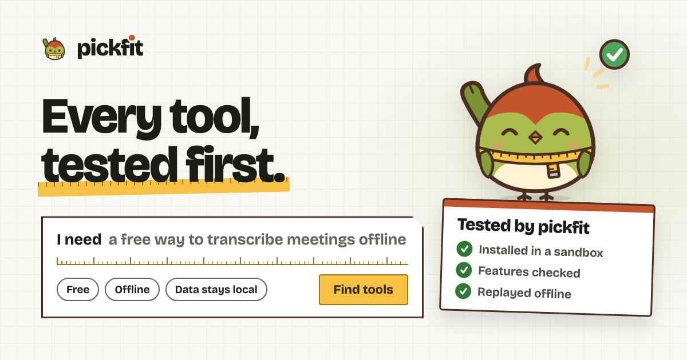
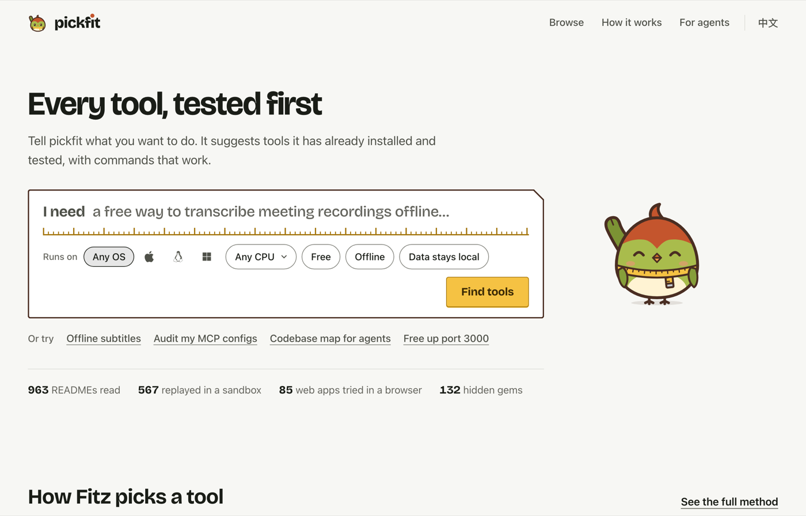
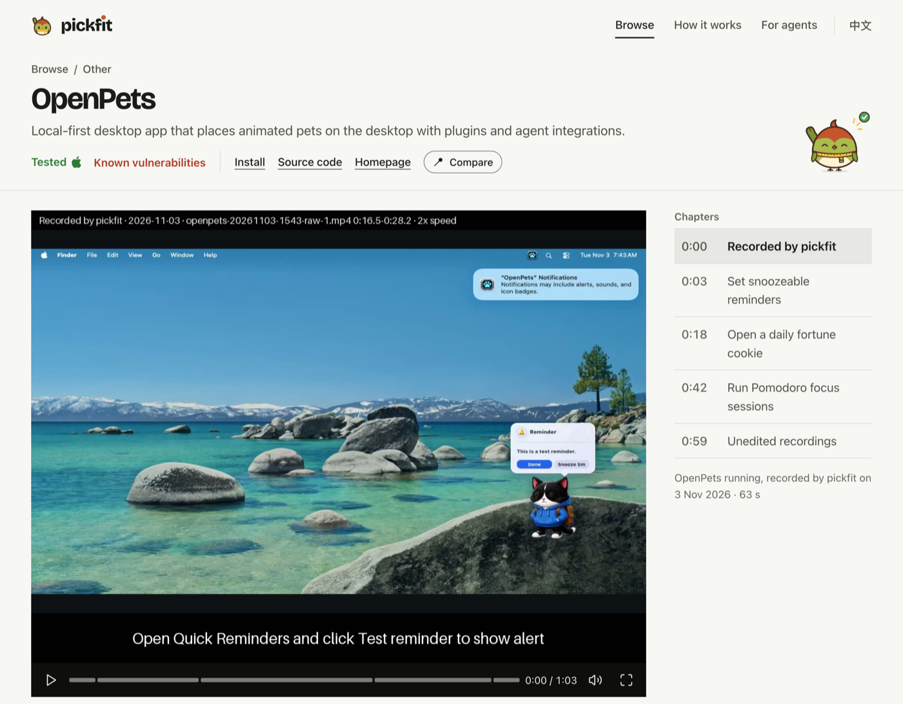
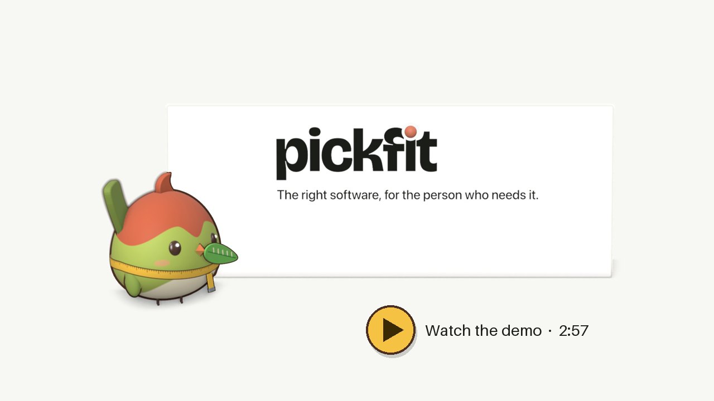
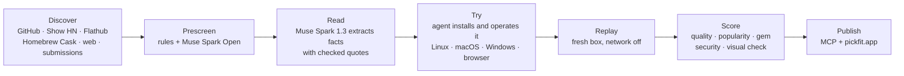

<p align="center">
  <a href="https://pickfit.app"></a>
</p>

<h1 align="center">pickfit</h1>

<p align="center"><b>Every tool, tested first.</b><br>
A software advisor for people and their AI agents. pickfit installs and tests software in a sandbox before it recommends it, then hands you the steps that actually worked.</p>

<p align="center">
  <a href="https://pickfit.app"><b>pickfit.app</b></a> ·
  <a href="https://www.youtube.com/watch?v=AkYyI8kSsiQ"><b>Demo video (2:57)</b></a> ·
  <a href="https://pickfit.app/agents">Connect your agent (MCP)</a> ·
  <a href="https://ncchen99.github.io/pickfit/"><b>Full report</b></a> ·
  <a href="docs/REPORT.md">Report (Markdown)</a>
</p>

<p align="center">
  
  
  
  
</p>

---

## Why

AI agents made building software cheap, so new tools appear every day on GitHub, Show HN, Flathub and the web. Finding the right one got harder. Search and directories reward popularity, models don't know what shipped after their training cutoff, and small projects often have install steps that don't work. So people and agents rebuild what already exists, and pay for it later in maintenance and tokens.

pickfit belongs to no vendor and runs no ads or referral links. It reads each project, **installs it in a fresh sandbox, checks that the features work, replays the steps offline**, and only then lets it be recommended. Results are ranked by fit, not stars, and lesser-known tools that do the job well get surfaced as *hidden gems*.

Fitz, the mascot, is a tailorbird. Real tailorbirds pick leaves and stitch them into a nest that fits exactly. Fitz never recommends what it hasn't tried.

## See it

| Ask in one sentence | Every claim comes from a run |
|---|---|
|  |  |

As of 3 Nov 2026: **963** projects read, **652** verified at least through install, **567** replayed in a fresh sandbox, **85** web apps tried in a browser, **132** hidden gems. CLI tools, local AI tools, MCP servers, desktop apps (Linux and macOS) and web apps.

<p align="center"><a href="https://www.youtube.com/watch?v=AkYyI8kSsiQ"></a><br><sub>Watch the 3-minute demo: Claude Code finds and installs MangoDisk through pickfit, then the app's first use.</sub></p>

## Try it

**On the web:** open [pickfit.app](https://pickfit.app) and describe what you need. The site is in English and Traditional Chinese.

**In your agent:** pickfit is a stateless MCP server at `https://pickfit.app/mcp`. No account needed.

```bash
claude mcp add --transport http pickfit https://pickfit.app/mcp
```

```json
{ "mcpServers": { "pickfit": { "type": "http", "url": "https://pickfit.app/mcp" } } }
```

Then ask in plain words: *"Find me a free tool that works offline on my Mac to turn meeting recordings into subtitles, and install it."*

| Tool | What it does |
|---|---|
| `find_software` | Two or three verified tools for a need and conditions (OS, CPU, free, offline), with reasons, tradeoffs and the best free option |
| `find_alternatives` | Replacements for a tool you use now, given what you dislike and what you must keep |
| `get_install_guide` | Only the steps that worked in pickfit's run, for your OS, plus how to check the install |
| `report_outcome` | Did it install, did it work, are you still using it; real failures queue a fresh run |
| `submit_software` | Send a GitHub project or a web app; it goes through the same read, install and replay |

Every answer carries `how_we_know` and an `evidence_url`, so your agent can tell you where each claim came from.

## How it works



Meta's models do every product decision: **Muse Spark 1.3** reads READMEs, judges what passed and matches requests live; **Muse Spark Open** (open weights, on Baseten and Modal) does the first cut and operates desktop apps from screenshots; **Muse Wonder** checks screenshots for visual defects. Since 3 Nov the same Meta models are reached through OpenRouter, pinned to Meta as the only provider with data collection denied. Claude was the development tool and the agent under test in the evaluation; it also wrote the tool pages' how-to text for records that existed on 2 Nov, and each such record names the model that wrote it. The [full report](https://ncchen99.github.io/pickfit/) covers the hypotheses, every experiment (including the ones that failed), the iterations, and the designs that keep the catalogue honest.

## Repository

| Path | What |
|---|---|
| [`pickfit/`](pickfit/) | Python pipeline: discovery, prescreen, extraction, sandbox verification, scoring, security, publish |
| [`worker/`](worker/) | Cloudflare Worker: MCP server and the website |
| [`data/software/`](data/software/) | The catalogue, one JSON record per tool, each with its evidence |
| [`eval/`](eval/) | Frozen evaluation questions, runner and results |
| [`brand/`](brand/) | Fitz the mascot, share cards, screenshots |
| [`video/`](video/) | The 3-minute demo video: script, scenes, build scripts |
| [`docs/`](docs/) | The report and the working documents ([index](docs/README.md)) |

Run the pipeline with `uv run pickfit --help`; run the Worker with `cd worker && npm ci && npm test`. Details in [`worker/README.md`](worker/README.md).

## The hackathon

Built for the [Meta Global AI Developer Hackathon](https://cerebralvalley.ai/e/meta-ai-developer-hackathon) (27 Oct – 4 Nov 2026 ET). The idea and planning notes predate the event and are **not** in this repository; all code, data, the website, the mascot and the video were made during the hackathon. Rules and how we followed them: [`docs/hackathon-rules.md`](docs/hackathon-rules.md). Experiments that were tried and not merged are kept as git tags (`git tag -l 'archive/*' -n3`).

## License

MIT, see [LICENSE](LICENSE). Third-party code, fonts and data are listed in [NOTICE](NOTICE). Each tool in the catalogue keeps its own license.
