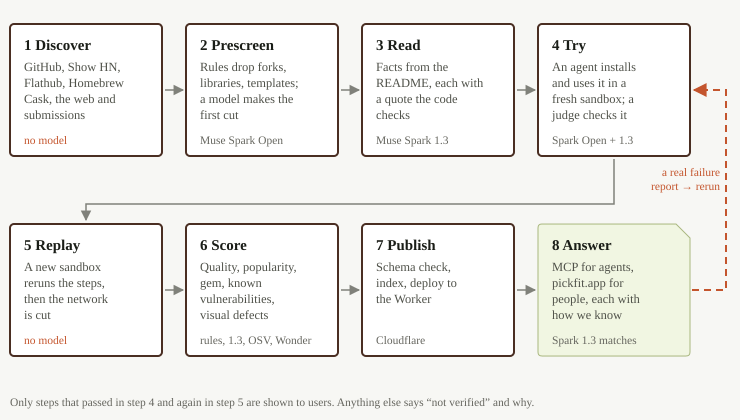
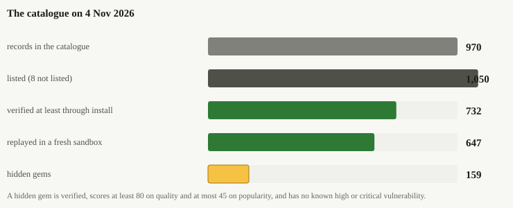
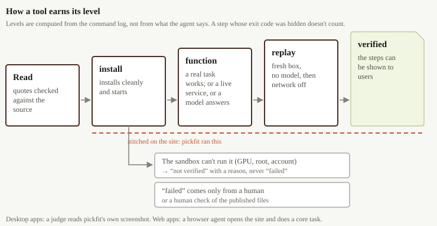
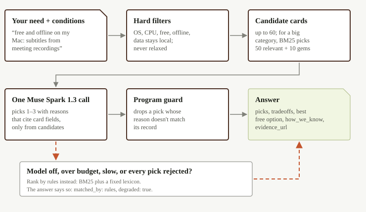
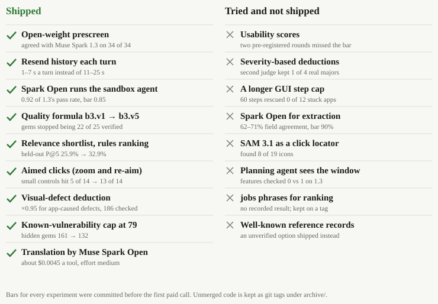
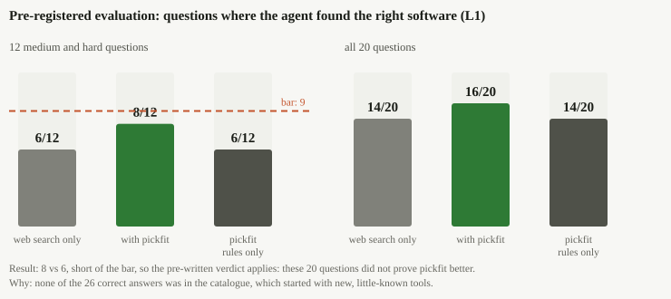
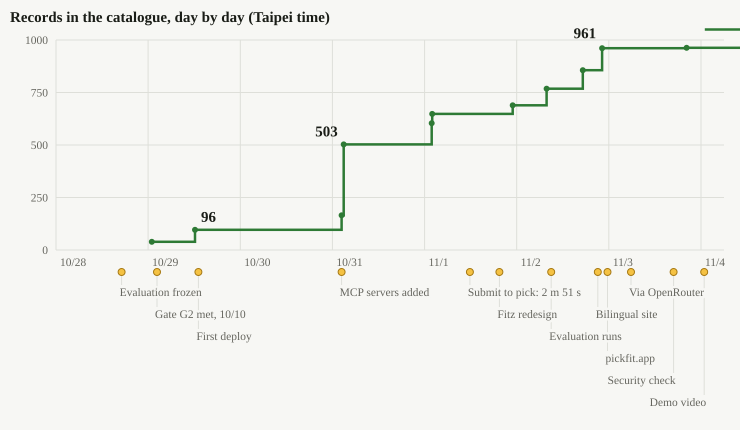
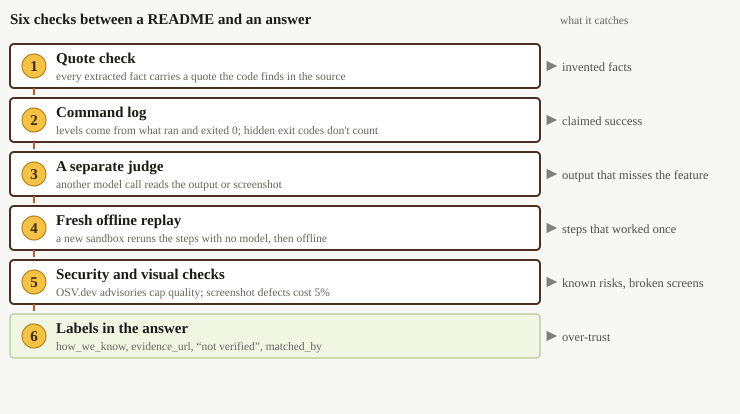

# pickfit: project report

**Meta Global AI Developer Hackathon, 27 Oct – 4 Nov 2026 (ET). Indie Developer track. Solo project by 念誠 (GitHub `ncchen99`).**

This report covers pickfit from its origin to the end of the hackathon. It explains why it was built, the bets it rested on, how the system works and how it uses Meta's models. It also covers every experiment we ran, including the ones that failed, how the system changed day by day, and what is still unknown. Every number comes from the repository's own records (`docs/plan.md`, `eval/`, `data/software/`, the working documents under `docs/`) or from a read-only count made for this report. Where sources disagree, the report gives the latest value with its date. All times are Taipei time (UTC+8) unless marked ET.

Claude Code was the development tool. Meta's models run the product.

---

## The story in one page

**The problem.** AI coding agents made software cheap to build, so new tools appear every day. Finding the one that fits has become harder. Good small projects get no promotion, agents' training data predates them, and their install docs are often incomplete. So people keep rebuilding what already exists.

**The bet.** A recommendation is worth giving only if someone has tried the software first. pickfit therefore installs and tests every tool in a sandbox before the tool can be recommended. It also labels plainly anything it has not verified.

**How it works.** pickfit collects candidates from GitHub, Show HN, Flathub, Homebrew Cask, the web and direct submissions. Rules and an open-weight Meta model screen out libraries, forks and other non-tools. Muse Spark 1.3 extracts facts, and the program checks every supporting quote against the source. A model-driven agent then installs and tests each tool in a sandbox on Linux, macOS or Windows, or in a browser. Next comes a *replay*: a brand-new sandbox re-runs the recorded steps with no model and the network cut. Finally, quality, popularity and security are scored separately. The results go to a website and to an MCP server that agents can query.

**What the week produced.** By 5 Nov the catalog held 1,058 records, 1,050 of them listed. 732 listed records were verified at least through install, and 647 had a passing run replayed in a fresh sandbox. 159 are hidden gems, called "treasures": verified, quality ≥ 80, popularity ≤ 45. All Meta-model spend from 28 Oct to 5 Nov came to $380.59, about $0.52 per verified tool. One third-party repo went from submission to first recommendation in 2 min 51 s.

**What changed the design.**

- The open-weight Muse Spark Open passed sandbox runs at 0.92 of Muse Spark 1.3's rate, so it took over much of the sandbox agent and the GUI operator. It failed the extraction bar, so 1.3 kept extraction (6.3).
- The first scoring formula marked 22 of 25 verified tools as treasures. Scores had to be rebuilt around how deeply each tool was verified (6.6).
- Zooming in and re-aiming small clicks raised hits from 5 of 14 to 13 of 14 (6.9).

**What failed.**

- A model could not judge ease of use. Two pre-registered rounds failed, and a third model failed a new bar (6.11).
- Raising the GUI step cap from 28 to 60 rescued 0 of 12 stuck apps (6.7).
- Severity-based visual deductions missed their bar (6.13). A planning-agent fix helped more operations pass but did not reliably check more features, and was not merged (6.14).

**What is still unproven.** The evaluation was *pre-registered*: its questions and pass bars were committed before any data or results existed. On the 12 medium and hard questions, the agent with pickfit passed 8 and the web-search-only agent passed 6. The required lead was 3. The losses came from catalog coverage: none of the 26 correct answers were in the catalog. The usage-outcome loop is built, but no tool has enough external reports for outcomes to count.

**Where to start reading.** Section 1 has the numbers and Section 4 explains how the system works. Section 6.1 covers the evaluation and Section 6 every experiment. Section 8 covers the designs that keep the catalog honest, and Section 11 covers the limits. The 2:57 demo video is at <https://www.youtube.com/watch?v=AkYyI8kSsiQ>.

---

## 1. Summary

pickfit tests software before it recommends it, and Meta's models make every product decision. This section gives the short description, the headline numbers and the links.

pickfit is a software advisor for people and their AI agents. It covers developer CLIs, local AI tools, MCP (Model Context Protocol) servers, desktop apps on Linux and macOS, and web apps. For each project it finds, it reads the project and **installs and tests it in a sandbox**. Then it **replays the steps in a fresh offline sandbox** and scores quality separately from popularity. Only after that can the tool be recommended.

People ask in one sentence on the web at <https://pickfit.app>. Agents ask over a stateless MCP server at `https://pickfit.app/mcp`, which is also served at `https://pickfit-mcp.ncchen99.workers.dev/mcp`. Each answer carries the steps that actually worked and the source of each claim. Anything pickfit did not verify gets a plain label. pickfit belongs to no vendor, shows no ads and carries no referral links. It ranks results by fit, not by stars.

Meta's models make every product decision:

- **Muse Spark 1.3** extracts facts with checked quotes, judges what passed, grades install docs and matches requests live.
- **Muse Spark Open** (open weights, served on Baseten and on a Modal shared endpoint) does the first-cut prescreen and runs much of the sandbox agent. It also operates desktop apps from screenshots and drives a browser for web apps.
- **Muse Wonder** checks screenshots for measurable visual defects.

**Headline numbers** (count of `data/software/*.json` at commit `4cf9a747`, 4 Nov 00:55):

| | Count |
|---|---|
| Records in the catalog | 1,058 (1,050 listed, 8 not listed) |
| Listed records verified at least through `install` | 732 (381 `function`, 160 `service`, 173 `install`, 18 `inference`) |
| Listed records with a passing run replayed in a fresh sandbox | 647 |
| Web apps tried in a sandboxed browser | 85 |
| Listed records `unverified` (each with a reason code) / `failed` (human-confirmed) | 317 / 1 |
| Hidden gems ("treasures": verified, quality ≥ 80, popularity ≤ 45) | 159 |
| Security check: clean / known high-or-critical vulnerability / unchecked | 464 / 294 / 292 |
| Model spend on Meta models, 28 Oct – 5 Nov (shared ledger) | $380.59, about **$0.52 per verified tool** |
| Python tests / Worker tests, 5 Nov | 1,648 / 292 |

The verification levels are defined in Section 13.2. In brief:

- `install`: a clean install and a basic launch.
- `function`: a real task from the README ran and gave the expected output.
- `service`: a server answered a live local request.
- `inference`: a local AI tool loaded a real model and returned a completion.

Well-known tools get the same tests. Early on, credits were kept for lesser-known tools and the 87 well-known projects added on 4 Nov stopped at `install`; on 4–5 Nov the developer had them run again with Muse Spark 1.3 as the agent. 51 reached `function`, 4 `service` and 1 `inference`, 24 stayed at `install` and 7 are `unverified`, and 40 have at least one feature checked. Desktop apps operated from screenshots remain the hardest case, menu-bar utilities above all (Section 6.6).

The pre-registered evaluation did **not** prove pickfit better. On the 12 medium and hard questions, the agent with pickfit passed 8 and the web-search-only agent passed 6. That falls short of the pre-set lead of 3 (Section 6.1).

**Links.**

- Site: <https://pickfit.app>
- MCP: `https://pickfit.app/mcp`
- Code: <https://github.com/ncchen99/pickfit> (per `video/YOUTUBE.md`; public at submission)
- Demo video (2:57): <https://www.youtube.com/watch?v=AkYyI8kSsiQ>. The render is at `video/out/pickfit-demo.mp4` (not in git), and the YouTube text is in `video/YOUTUBE.md`.

---

## 2. Origin and the problem

There are more tools than ever, but the good small ones are hard to find, unknown to agents and often hard to install. This section explains that problem, why existing platforms don't solve it, and the principles pickfit took from it.

### 2.1 What we saw

AI coding agents made software cheap to build. Independent developers, students and small teams publish new tools every day on GitHub, Show HN, Flathub and the web. The number of tools exploded, but finding the one that fits got harder (`docs/brief.md` §1):

- **It cannot be found.** Search and ad rankings reflect who markets best, not who fits you. Good projects sit on GitHub with casual names and no promotion.
- **Agents don't know it either.** A model's training data has a cutoff, so this year's projects are mostly absent. When an agent searches the web, it finds the same heavily marketed tools.
- **It won't install.** Small projects often have incomplete docs. Only the author knows the install steps that work.

So everyone keeps reinventing the wheel. Building your own is not free: after the first version comes maintenance, and now an AI token bill as well. People spend the same effort again and again on problems that already have good, maintained answers.

### 2.2 The desire, not only the problem

The brief states the project from both sides on purpose. The problem explains why it is urgent. The desire explains why someone would use it and keep using it. In the brief's words, the developer wanted an AI that helps *find the right software that already exists, instead of building everything myself*.

The story notes (`docs/submission/story.md` §2) list the concrete pains:

- comparing tools across many tabs
- watching a video to see one button
- finding that the ideal tool is Windows-only
- installing three or four tools to keep one
- reading subjective reviews
- agents that stitch answers together from scattered pages of uneven quality

The brief gives a real example. A team member spent half a month comparing dictation tools, then came across a friend's app in a GitHub feed. It fit perfectly, yet a direct search almost never surfaced it.

### 2.3 Why existing platforms don't cover this

Well-known software is already well organized. Review sites (G2, Capterra), tool directories with MCP servers (Toolradar) and vendors' own plugin directories mostly list commercial SaaS and earn their money from vendors. **No one systematically collects high-quality, little-known long-tail software** (`brief.md` §1). Large vendors can recommend software too, but they have a conflict of interest. Their agents rarely recommend a rival, a free local tool, or "you don't need anything new."

### 2.4 Positioning

Four principles have held since the start (`brief.md` §2):

- **We are the knowledge, not the hands.** The agent runs commands; pickfit tells it what to use and how. ("We don't build the navigation app; we build the map data.")
- **Recommendation is matching, not ranking.** There is no best software, only the best fit for an OS, budget, privacy need, language and workflow.
- **Neutral.** pickfit is not owned by any vendor or agent ecosystem, so it can say "the built-in one is enough." It stays neutral only by keeping the rules: no ads, no paid placement, no building the software it recommends.
- **Outcomes over reviews.** The most credible signals are "did it install, is it still used, what replaced it."

Two revisions during the week sharpened this.

- **11/1.** The developer restated pickfit as *a person's software advisor, delivered through the person's agent*. GUI apps came into scope. Source integration (Flathub, Homebrew Cask, Show HN, GitHub, submissions) became a core value.
- **11/3.** The developer corrected the positioning again (`story.md` §1): **pickfit collects any software**. Collecting lesser-known software first was a choice of *validation order*, not the product's definition. It tested the hardest case: that such software can be found, tested and trusted, and that hidden gems exist. The MCP server description and the site were changed to match, and `submit_software` dropped its star cap.

The pre-hackathon idea was narrower: a Traditional Chinese desktop dictation tool for Taiwanese developers, with hand-written records and 10–20 users. For this hackathon the brief widened it to global users, any category, and agent-driven discovery and verification (`brief.md` §2). Only the idea and planning notes predate the event, and none of that material is in the repository (Section 13.6).

### 2.5 Brand: Fitz the tailorbird

Fitz is a tailorbird, original artwork made during the hackathon (`brand/mascot/`). Real tailorbirds pick leaves and stitch them into a nest that fits. pickfit takes your measurements (OS, CPU, budget, offline), tries each tool on, and hands you only what fits.

The site is designed as a tailor's fitting room (`DESIGN.md`). A stitch marks a record pickfit ran, and a missing stitch labels anything it has not verified. Fitz is happy only next to something that passed a test. An unverified option gets no Fitz at all.

---

## 3. Hypotheses

Most of the original bets held. Two were refuted (the threaded agent loop and model-judged usability), and two remain untested or unshown (the evaluation lead and outcome-based ranking).

The architecture research (`docs/research/architecture.md`) was written on 28 Oct by several agents directed by the developer, before any API key existed. It recorded a design and the bets it rested on, plus a list of things it could not confirm. The table states each bet as written there or in the brief, and what the week showed.

| # | Bet | What we learned | Status |
|---|---|---|---|
| H1 | Meta's API works from a Taiwan account and supports strict JSON schema, tool calling and images (the "G0" gate, the plan's first go/no-go check) | Key valid on 10/28; 9 models listed (no embedding model); json_schema, tools and image all passed on 10/28 | Confirmed |
| H2 | Sandbox verification is both the core selling point and the biggest risk: READMEs are often wrong, and an agent can fix them | On 10/28 the agent fixed `evnx` after its README failed. Of 650 passing non-web runs in today's catalog, 148 needed at least one fix tagged `readme_wrong` (184 such fixes in total; this report's count) | Confirmed |
| H3 | Rule-based quality saturates (small tools and `bat` both score 80–100), so quality must come from sandbox depth and a model rubric | The first formula, `b3.v1`, marked 22 of 25 verified tools as treasures. Separating them took verification depth, install difficulty and a pool-relative popularity reference (`b3.v3`–`b3.v5`) | Confirmed |
| H4 | An open-weight model is good enough for a cheap first-cut prescreen | Muse Spark Open agreed with `muse-spark-1.3` on a fixed 5% sample: 34/34 (10/29) and 100/100 (expanded batch, 10/31) | Confirmed |
| H5 | Open weights are not cheaper, so use them only for prescreen | After a 20-repo comparison (0.92 pass ratio), Muse Spark Open also ran most sandbox agents and the GUI operator. It did **not** pass the extraction bar (62–71% field agreement vs 90%) | Partly refuted: wider role than planned, but not extraction |
| H6 | A threaded Responses loop (`previous_response_id`) is the right agent loop | Threaded turns took 11–25 s and once returned 400 "response not found"; resending the full history took 1–7 s per turn | Refuted; resend became the default |
| H7 | No vector search: hard filters plus one model call over ≤ 60 candidate cards is enough | Held for small categories. Once a category passed 60 cards, the 60 sent were the highest treasure scores, not the most relevant. A model keyword step plus a BM25 shortlist (BM25 is a standard keyword-relevance formula) was added on 10/31 | Confirmed with an amendment |
| H8 | A tool can go from submission to recommendable in about 10 minutes | `matchify` was submitted at 11:40:14 on 11/1 and recommended first by `find_software` at about 11:43:05: about 2 min 51 s | Confirmed (one case) |
| H9 | The same agent recommends tools that fit hard conditions more often with pickfit than with web search alone | Pre-registered evaluation: 8 vs 6 on 12 questions, below the bar of +3. The main losses were catalog coverage, not matching | Not shown |
| H10 | High-quality, low-popularity software (treasures) exists in quantity | 159 listed treasures after the security cap: CLI tools (64), MCP servers (41), web apps (34), daemons (7), TUIs (6), desktop apps (6) and a self-hosted web app (1) | Confirmed |
| H11 | Real usage outcomes (installed, still used, replaced) will improve ranking over time | The loop is built (report → re-verify → diff, plus a consented check-in), but no tool has reached the 3 external reports needed to count | Untested |
| H12 | Desktop GUI apps can reach `function` with a Meta model operating from screenshots | Yes, but rarely: 16 desktop apps at `function` today. Most unchecked features were never attempted or hit environment limits; the step cap was not the bottleneck | Partly confirmed |
| H13 | A model can judge how easy an app is to use | Two pre-registered rounds failed; a third model (Muse Wonder) failed a new bar; only measurable visual defects were shipped | Refuted for now |
| H14 | Videos and the web show the brand, which agents hide | Built: the website became mandatory on 10/29 and was redesigned twice; pickfit-recorded videos are on 10 records | Built, not measured |

The research also listed unconfirmed items (D.4). All were settled during the week:

- Is a screenshot in a tool output visible to the model? Yes.
- Can `text.format` and tools share a request? Yes.
- What is the real reasoning-token use? Measured and logged.
- Does Baseten's `muse-spark-open-1026` exist? Yes, approved 10/29.
- Can Modal credits pay for a shared endpoint? Yes, confirmed 11/1.

---

## 4. System overview

pickfit is a pipeline that turns a repository or website into a verified catalog record. A Cloudflare Worker then serves those records to people and agents. This section walks through each stage in order.

### 4.1 The pipeline

```mermaid
flowchart LR
  A[Discover<br>GitHub search · Show HN<br>Flathub · Homebrew Cask<br>web apps · submit_software] --> B[Rule prescreen<br>fork, archived, template,<br>library signals]
  B --> C[Open-weight prescreen<br>Muse Spark Open<br>+ 1.3 audit]
  C --> D[Extraction<br>muse-spark-1.3<br>quotes checked vs source]
  D --> E[Sandbox agent<br>Linux gVisor / VM · macOS tart<br>Windows VirtualBox · browser]
  E --> F[Judges<br>screen, output, feature]
  F --> G[Replay<br>fresh box, no model,<br>network off]
  G --> H[Score<br>quality · popularity · treasure<br>security · visual]
  H --> I[Publish<br>index → Cloudflare Worker<br>D1 events · R2 videos]
  I --> J[MCP tools + pickfit.app]
  J -->|report_outcome failures| E
```

The pipeline is a Python package (`pickfit/`, CLI `uv run pickfit`) that runs from the developer's machine. Sandboxes run on Modal, in local tart VMs and in a VirtualBox VM. The product runs on a Cloudflare Worker (`worker/`). The canonical data is one JSON file per tool in git (`data/software/<slug>.json`). The schema is `software.v1`, generated from pydantic into `schema/software.v1.json`.

### 4.2 Discovery (`pickfit/discover/`)

Discovery pulls candidates from five kinds of sources. Each source has a fixed, written rule, so the pipeline never hand-picks tools.

- **GitHub search** (`github.py`). The search runs per-category queries (dev CLI, local AI, MCP server topics; 36 topic queries by 11/2). It requires `created:` this year, `pushed:` within 14 days and 5–300 stars, and it sends queries at least 2.1 s apart. Each query and its time is stored in `runs/pipeline.db`. The queries were written by sessions that never read `eval/` (Section 8.9). A second rule, `github-well-known.v1` (11/2), took repos with 301–5000 stars under the same date conditions.
- **Show HN** (`showhn.py`, 11/1). This source reads the last 60 days of Show HN posts through the Algolia HN Search API and the official HN API. It keeps only posts that link a GitHub repo, use category words and have ≤ 300 stars. The post only says where to look; every field comes from the repo. Funnel: 7,893 posts → 598 repos (511 new) → 45 extracted → 44 records → 32 verified.
- **Flathub and Homebrew Cask** (`flathub.py`, `cask.py`, `listings.py`, 11/1). pickfit reads only the AppStream catalog that flatpak clients download and the `formulae.brew.sh` cask definitions. It never uses the Flathub website, API or install statistics. Sampling follows a neutral rule (`docs/source-terms.md`): software, open source, maintained within 365 days, no account mentioned, popularity in the source's middle half, and fixed-seed hash sampling. 92 listed records cite Flathub and 33 cite Homebrew Cask.
- **Web apps** (`webapps.py`, 11/1–11/2). This source takes Show HN posts and GitHub repos that have a live homepage, after checking each site's robots.txt and terms. From 15,516 posts and 9,593 repos, 100 sites were selected (55 and 45). 95 became `web_app` records. The developer hid 7 for possible infringement, medical content or other unsuitability.
- **Submissions.** `submit_software` queues a GitHub repo in D1 (and, from 11/2, a web app URL). `pickfit watch` polls every 60 seconds and runs the same single-record pipeline. On 11/3 submissions were opened to any kind the catalog lists, including desktop and web apps. Libraries are still rejected.

### 4.3 Prescreen

The prescreen removes candidates that are clearly not end-user tools before any expensive step runs. It has two layers.

1. **Rules** (`rules.py`). These reject forks, archived repos, templates, repos with no README, library signals, README-only phishing-style repos, and binary-only repos without a license. Rule v2 passed 452 of 496 (91.1%) on 10/29.
2. **Open-weight prescreen** (`prescreen.py`). Muse Spark Open on Baseten classifies each candidate with `reasoning_effort: low` and a forced tool call. It sees no star counts, to avoid popularity bias. Low-confidence answers, contradictions, kind `other` and failures go to `muse-spark-1.3`, which overrides them. A fixed 5% sample is always re-checked to measure agreement. Each candidate costs about $0.004 and takes 1–2 s.

### 4.4 Extraction (`extract.py`)

Extraction turns a project's documents into structured fields, and the program refuses any quote it cannot find in the source.

`muse-spark-1.3` reads the README, manifests and release notes. They are wrapped in `<source>` tags, which mark them as data, not instructions. The model fills a strict JSON schema; on 10/28 the Meta API accepted an 11.7K-character schema. Every field carries a verbatim quote, and **the program checks that each quote really appears in the source**. Quotes that don't are dropped. License, releases and stars come from APIs, never from the model. Unknown values are `null`. Average cost was about $0.014 per repo (10/29).

### 4.5 Sandbox verification (`pickfit/verify/`)

A model-driven agent installs each tool in an isolated box and tests it. pickfit, not the agent, decides from the record of what actually ran whether the test passed.

The verification agent (`agent.py`) is a tool-calling loop at reasoning effort `medium`. Its tools are `list_dir`, `read_file`, `run_command`, `run_background`, `launch_gui`, `operate_gui` and `finish`. A run stops at 25 turns, 15 commands, 20 minutes or $0.50 per tool (later raised per task), or after the same error three times. The agent picks an install method: package manager first, then a release binary, then source. It reads errors, repairs steps, and runs smoke tests and feature checks.

Every box (`box.py` and siblings) starts fresh with **no API keys inside**, and cloud metadata and private address ranges are blocked. On Linux the main box uses gVisor, a user-space kernel that stands between a container and the host. tart runs macOS virtual machines on Apple silicon.

| Box | Use | Notes |
|---|---|---|
| `DockerBox` | Local development | Non-root, cap-drop ALL, CPU/memory/disk/pids/time limits |
| `ModalBox` gVisor | Linux CLI, local AI, MCP servers | 3–4 s start; network open for install, then cut; limits test 12/12 at first, 22/22 after the DNS fix |
| `ModalBox` VM + Xvfb | Linux desktop apps | Separate-uid evidence capture, nonce, seccomp blocking `AF_VSOCK` and `io_uring`, no user namespaces |
| GPU boxes | Tools that need CUDA | T4/L4 on Modal |
| `tart_box.py` | macOS arm64 (macOS 26) | Host-side softnet blocks host and multicast when online, all traffic when offline; 27/27 limits checks after 4 adversarial review rounds |
| `vbox_box.py` | Windows 11 x86_64 | Evaluation VM behind an Alpine router VM, standard user, PowerShell 7 |
| `web_box.py` | Web apps | browser-use (MIT) in a Modal microVM behind a mitmproxy network guard |

**GUI apps** (`gui.py`, `gui_operate.py`, `gui_mac.py`). The app launches on a virtual display. A separate screen judge reads pickfit's own screenshot crop and classifies it as `main_ui`, `first_run`, `sign_in_wall` or `crash_or_error`. The operator model then proposes clicks, typing, keys and scrolls, and pickfit executes them (`xdotool` on Linux, VNC on macOS). Each run puts a fresh random nonce into goals and inputs. **pickfit, not the app, checks the result.** It looks at the clipboard, a file the app wrote, or text the screen judge reads back. From 11/3 it can also check that a file is gone. On macOS, Vision OCR adds numbered text marks so the operator can click by number.

**Web apps** (`web_verify.py`). Opening the site counts as `install`. Completing a core task with a checkable result counts as `function`. Offline reload is tested only for PWAs. The run records account walls, ads, trackers and whether input left the browser. It never submits forms with side effects, never registers and runs each site once.

**Simulated microphone** (`audio.py`). A virtual audio device plays speech containing a fresh random word. The check passes only if that word appears in the app's output.

**Videos** (`video.py`, `web_video.py`). GUI and web runs can be recorded. Muse Spark Open selects segments and writes captions, and the clips are chaptered by feature and served from R2. 10 listed records carry a video today.

### 4.6 Judges, verdict and replay

After the agent finishes, independent checks decide what the run proved. A replay then confirms that the recorded steps work without the model.

- **Screen judge** (`judge.py`). `muse-spark-1.3` reads the redrawn terminal screenshot (drawn with Pillow) or the GUI crop. It returns a verdict with evidence boxes in 0–1000 coordinates.
- **Feature judge** (`feature_judge.py`). A second model call confirms that a passing smoke test's output shows the advertised feature. If that call fails, no feature counts.
- **Verdict** (`verdict.py`). The level comes only from the recorded command log. Steps whose exit code was masked (`|| true`, `; echo`, trailing `| head`/`| tail`) do not count. From 11/1, `run_command` strips those suffixes before running.
- **Replay** (`replay.py`). A brand-new box re-runs the recorded install with **no model**. It then cuts the network, including DNS, and re-runs the smoke tests. If an offline check fails, the network is restored and the test retried, so `works_offline` is recorded honestly. Only replayed steps are written back. Web app runs are not replayed this way; a "second visit" added on 11/2 replays recorded actions only to make videos.

### 4.7 Scoring, security and visual check

Each record gets separate scores for quality and popularity, and a treasure flag. A security check and a visual check then adjust quality.

- `score.py` scores quality, popularity and treasure separately (formulas in Section 13.3). The install-docs rubric is one `muse-spark-1.3` call per record: 8 items, each scored 0/1/2, and each non-zero item needs a checked quote. The result is reused when the README is unchanged.
- `security.py` (`sec.v1`, 11/3) resolves what a fresh install would pull in, using `npm --package-lock-only --ignore-scripts`, `uv pip compile --no-build` or the repo's lockfile. It queries OSV.dev, caps quality at 79 for any high or critical advisory, and hides records with malicious packages. It uses no model and costs $0.
- The visual check (`comfort.v1` / `visual.v1`, 11/3) has Muse Wonder list measurable visual defects on pickfit's own screenshots. Any defect the app caused multiplies quality by 0.95.

### 4.8 Publish, Worker and MCP tools

Publishing validates the data and deploys it. The Worker then answers through five MCP tools, and only one of them calls a model.

`pickfit publish` validates every record against `software.v1`, builds the index, translates missing zh-TW sentences and deploys the Worker with `wrangler`. Bad data blocks the deploy. D1 holds `events`, `submissions`, `reverify_queue` and `meta_budget` (migrations 0001–0005). The R2 bucket `pickfit-videos` serves clips with Range support, and only for files a record lists. The status log records 47 distinct Worker version IDs between 10/29 and 11/3.

| Tool | Model? | What it does |
|---|---|---|
| `find_software` | `muse-spark-1.3` once (plus a small keyword call when > 60 cards) | Hard filters → candidate cards → one strict-schema call (slug enum = the candidates) → program guard → 1–3 picks with reasons citing card fields, tradeoffs, best free option, "built-in is enough," `well_known_option`, at most one question |
| `find_alternatives` | Same path | Takes `current_software`, `pain_points`, `must_keep`; may answer `keep_current` |
| `get_install_guide` | None | Only replayed or human-verified steps for the user's OS and arch, MCP client config, the consented `check_in` |
| `report_outcome` | None | Stages `installed` … `abandoned`; counted only with a valid `rec_id`; real failures queue a fresh run |
| `submit_software` | None | Queues a repo or web URL for `pickfit watch`; resubmitting reads status |

Matching details (`worker/README.md`): hard conditions never relax. In some cases the answer falls back to a rules ranking: the model is off, over budget or times out, it fails twice on retryable errors, or the guard rejects all its picks. The rules ranking uses BM25 with a static 258-word Chinese–English lexicon and handles negation. Such answers are labeled `matched_by: rules` and `degraded: true`, with a `degraded_reason`. Results are never cached on the MCP path.

### 4.9 Website

The website runs the same matching as the MCP server, inside the same Worker.

Natural-language search (`POST /search`) runs the MCP's own `findSoftware` and `installGuide`. The other pages are `/browse`, `/compare`, `/tool/<slug>`, `/how` and `/agents`. The site is server-rendered, works without JavaScript, uses a per-response nonce CSP and escapes every value. Since 11/2 it has been bilingual (English and Traditional Chinese). Since 11/2 23:39 it has been served at `pickfit.app`. HTML requests to workers.dev redirect there with a 301, while `/mcp` keeps working on both hosts.

---

## 5. How Meta models are used

Muse Spark 1.3 handles the steps that need strict accuracy, and Muse Spark Open handles high-volume work. Muse Wonder checks for visual defects. All calls go through one metered wrapper. This section lists each role, the spend, the forced switch to OpenRouter on 11/3, and the places a non-Meta model was used.

### 5.1 Which model does what

| Step | Model | Why this model | Record |
|---|---|---|---|
| Prescreen | Muse Spark Open (`meta-models/muse-spark-open-1026`, Baseten); audit by `muse-spark-1.3` | High volume, cheap per call, open weights; 1.3 audits low-confidence and contradictory answers plus a fixed 5% sample | 957 candidates on 10/29 for $3.80 |
| Extraction with checked quotes | `muse-spark-1.3`; `-contributor` only in development on public data | Strict schema adherence; Spark Open's field agreement was only 62–71% | ~$0.014/repo |
| Sandbox verification agent | `muse-spark-1.3` and Muse Spark Open (Baseten and Modal) | 1.3 first; Spark Open after the 20-repo comparison (0.92 pass ratio) for MCP expansion, feature coverage and the 301–5000 batch; GUI install agent moved back to 1.3 on 11/1 | Actor model across listed runs: 1.3 425, Spark Open Baseten 280, Spark Open Modal 98, contributor 3 |
| Screen, output and feature judges | `muse-spark-1.3` (vision + strict schema) | Kept on 1.3 even when the agent is Spark Open (`judge_model_for`) | 733 listed runs judged by 1.3 |
| Install-docs rubric | `muse-spark-1.3` | Quote-checked 8-item rubric | Reused when README unchanged |
| GUI operator | Muse Spark Open (Baseten, then the Modal shared endpoint `Muse-Spark-Open-816B-A42B`) | Reads screenshots and chooses actions; on 11/3, Modal steps took 1.4–5 s where Baseten took 100–300 s | — |
| Aimed clicks (re-aim on a 4× crop) | Muse Spark Open (Modal) | Same model points again at the zoomed target | ~$0.004 per aim |
| Web app operator | Muse Spark Open via browser-use | OpenAI-compatible model in an MIT browser agent | ~$0.04 per site for recording |
| Video segment selection and captions | Muse Spark Open (Modal) | — | — |
| Live matching and keyword expansion | `muse-spark-1.3` in the Worker (`store: false`, effort `low`; keyword call effort `minimal`, ≤ 5 s) | User needs are private, so never the contributor model | $0.029–0.038 per match (10/31) |
| zh-TW translation (from 11/2 22:10) | Muse Spark Open (Modal, effort medium) | Chosen after a blind comparison (Section 6.17) | ~$0.0045 per tool |
| Visual defects (`comfort.v1`, shipped) | Muse Wonder 1.0 | Better at listing visual defects than the usability judges | ~$0.03 per app |
| GUI rescue comparison, usability rerun | Muse Wonder 1.0 | Experiments only | Section 6 |
| GUI click-locator probe | SAM 3.1 | Experiment, not adopted | $0.078 |
| Evaluation third grader (descriptive) | Muse Spark Open (Baseten) | Pre-registered; never overrides | $1.17 |
| Test-set writing and labels for ranking experiments | Muse Spark Open (Baseten) | Written without seeing tool data | — |

Muse Image, Muse Voice Transcribe and Muse Glimmer are not used in the product, because no partner serves them per token (`architecture.md` D.2).

### 5.2 Spend

From 28 Oct to 3 Nov, all Meta-model calls, including experiments and failed runs, cost $290.60, about $0.45 per verified tool.

Every call goes through one wrapper: `call_meta` in `pickfit/meta.py` and `callMeta` in `worker/src/meta.ts`. The wrapper prices `usage`, writes a trace, caches identical requests in development and retries transient errors. It also enforces hard caps from a **single shared ledger** (`~/.pickfit/ledger.sqlite`, with locked writes) that every worktree uses. The Worker keeps its own budget in D1.

The ledger snapshot in `docs/submission/README.draft.md` (3 Nov 04:12) covers every Meta-model call from 28 Oct to 3 Nov, including experiments and runs that did not pass. The total is **$290.60**:

- `muse-spark-1.3`: $146.79 on the Meta Model API
- `muse-wonder-1.0`: $16.82 on the Meta Model API
- Muse Spark Open: $97.39 on Baseten and $29.52 on Modal
- SAM 3.1: $0.08

The sandbox verification agent was the largest stage ($143.28). Over 650 verified records, that is about **$0.45 of model spend per verified tool**, not counting sandbox compute. The status log adds that the total was "about $320" by 3 Nov 15:20, including later OpenRouter and Modal calls. The repository records no later ledger total.

Earlier reference points:

- On 10/29 there were 1,429 requests across sessions, with an 80% development-cache hit rate. There were also 79 sandbox verifications, of which 63 passed and were replayed (median 73 s, $0.048 each).
- On 10/31 the median Meta cost per verified tool in the large expansion was $0.107.

The developer set the caps and raised them by explicit decision several times as the scope grew. The pipeline total went from $100 on 10/28 to $225 on 11/2. A Windows host kept its own ledger, capped at $5. The Worker was capped at $3/day and $15 for the judging period.

### 5.3 The switch to OpenRouter (11/3)

When Meta's API stopped accepting the team's key, pickfit moved to the same Meta models through OpenRouter, with Meta pinned as the only provider.

From 3 Nov 04:21, Meta's API returned 402 `billing_not_configured` for the team's key, and live search fell back to rules ranking. From 05:47, the same models (`meta/muse-spark-1.3`, `meta/muse-wonder`) were called through OpenRouter. Every request pins Meta as the only provider and denies data collection (`provider: {order: ["meta"], allow_fallbacks: false, data_collection: "deny"}`).

Some limits apply:

- OpenRouter's Meta endpoint offers no zero-retention option, so pickfit does not claim zero retention.
- Records still name the Meta model id; the ledger notes the provider.
- The contributor model is not on OpenRouter. SAM 3.1, Muse Image and Muse Voice Transcribe do not go through it.

A side effect was found later. OpenRouter lists no cached-input price, so pickfit priced cached input at full price. As a result, 1.3 verification agents reached the per-tool cap after about 17 turns (`docs/plan.md`, 11/3 19:34).

### 5.4 Where non-Meta models were used

Non-Meta models wrote some page text, did the first translation pass, and served as the agent and grader in the evaluation. None of them makes a product decision. The details come from the detailed README (`docs/README.zh-TW.md`) and the status log.

- **Tool-page how-to text** (`usage_guide`). On 2 Nov, with the developer's agreement, Anthropic's `claude-opus-5-5` filled this text for the records that existed then. It rewrote only what the record and its runs already held, and wrote steps only for features a run verified. Each record names its model, and the generator defaults to Meta models for new records. Counts differ by source: 667 in the README, 669 in the status log. This report counts 666 records by `claude-opus-5-5` and 5 by `muse-spark-1.3`.
- **Website translation.** The first zh-TW pass (11/2 21:07, 10,333 sentences for 859 tools) used Claude, and Claude Opus 5.5 converted the interface strings. From 11/2 22:10, translation moved to Muse Spark Open. 1,307 sentences were retranslated with it, and `pickfit publish` now uses it to fill missing sentences. The detailed README still says translation uses Claude; the status log is the later source.
- **Evaluation.** The agent under test was Claude Opus 5.5 in Claude Code headless, with Claude Haiku 5.5 for a small-model arm. Claude also served as the L1 grader. L1 is the evaluation's first level: did the agent name the right software, meeting every hard condition. None of this is part of the product flow.
- **Development.** Claude Code and its subagents wrote the code and ran reviews. Review subagents never called paid APIs in loops.

---

## 6. Experiments

This section records every experiment with its question, its setup, its result and the decision it led to. It also says whether the pass bar was committed before the first paid call. Several experiments changed the design. Others failed, and their code was kept, unmerged, on tags.

Branches that were not merged are preserved as git tags under `archive/*` (`git tag -l 'archive/*' -n3`): `baseten-404-fallback`, `mac-operator-element`, `mangodisk-round7`, `planning-goals-checks`, `severity-deductions`, `tool-jobs`, `usage-steps-layout`, `well-known-pilot`.

### 6.1 The frozen 20-question evaluation

pickfit helped on some questions but did not reach the lead set in advance. The losses traced to tools missing from the catalog, not to bad matching.

**Question.** Given pickfit's MCP, does the same agent more often recommend software that fits the user's hard conditions and that installs and runs? And does it say "built-in is enough" when it should?

**Setup.** 20 questions were frozen on 10/28 at 17:06 (`5ac62ca`), **before any data was written**. AI agents drafted 42 candidates from three angles, which were cut to 20 and reviewed for fairness, measurability and realism. The developer then reviewed them one by one and froze them. The questions state needs and checkable conditions, never expected answers. Ten are about dev CLIs and ten about local AI; 5 are in Traditional Chinese; difficulty groups were fixed in advance.

There were three arms:

- **control**: Claude Code headless with WebSearch and WebFetch
- **pickfit**: the same, plus the MCP
- **rules-only**: pickfit with model matching off

Each run used an empty temporary HOME and working directory with `--strict-mcp-config`, so the developer's own MCP servers could not leak in. Two frozen read-only deployments served the runs (`pickfit-eval`, `pickfit-eval-rules`), and main was frozen for code and data during the whole run.

More was pre-registered before the first run:

- 9.1 (10/29 00:25): thresholds, supplementary reruns, blind grading and loss tags
- 9.2 (10/31): budget, a third grader, the Haiku arm and the B set
- 9.3: L2 environments with pinned images, network blocking and test models

The three levels:

- **L1**: right software that meets every hard condition
- **L2**: installs and runs in a clean environment
- **L3**: honesty on built-in questions

**Result.** On the medium and hard questions, pickfit passed L1 on 8 and the control on 6, with one run per question per arm. That missed the required lead of 3. Per the pre-written wording, *these 20 questions did not prove pickfit better* (`eval/results/final/report.md`, 11/2). The five thresholds:

- D1, a lead of at least 3: not met (8 vs 6).
- D2, no regression on easy questions: met (8 vs 8).
- D3, L2: met (2 vs 2).
- D4, built-in honesty: met (2 vs 2).
- D5, no overclaiming: not met. There was **1 violation in 518 checkable claims**: a check command split across setup lines in `jevalt`'s record.

Rules-only passed 6 of 12. Across all 20 questions at L1, the control passed 14, pickfit 16 and rules-only 14.

**Descriptive results.** These were registered as descriptive only:

- Supplementary reruns: 6 vs 6 and 7 vs 7.
- Haiku as the agent: pickfit 5, control 7 on the 12.
- B set (12 public questions sampled from 3,834 posts by committed queries and seed): 3 vs 3.
- The developer's blind preference: 7–7 with 6 ties. The caveat is that phrasing left in the de-identified answers let the developer recognize the pickfit arm in many cases.

**Deviations** (recorded in `eval/README.md` 9.4). The developer decided not to fill in the L1 sheet by hand. Instead, the already-run Claude grader (`claude-opus-5-5`, blind, no web access) became the primary L1 judge. This grader is the same model as the agent under test. `unknown` verdicts count as fails. If every `unknown` counted as a pass instead, the 12-question result would be 12, 11, 11, so **the conclusion is sensitive to that choice**. Mac L2 moved from human runs to fresh tart VMs, and L2 stopped on 11/2 at 22:15.

**Why pickfit lost.** The catalog lacked the right tools:

- Of 17 tagged questions, 10 were `tool_error`: pickfit returned nothing.
- Across 82 pickfit responses, 51 were empty. **All 51 were correct for pickfit's own data**: no tool that passed L1 was in the catalog, and none was missed.
- A post-hoc coverage check, made after seeing the results and with no model calls, found **0 of the 26 correct answers in the catalog**. The discovery rules themselves had excluded all of them: 23 were created before 2026 and 15 had over 5,000 stars. Examples include Bruno, Docling, SOPS, DuckDB, Ollama and whisper.cpp.
- The 301–5000-star batch kept the 2026 and 14-day conditions, so it added none of them.

**Decision.** The result is reported as is; no count, bar or question was changed. Covering well-known tools means widening the creation-year and star rules, and any re-test after that would be exploratory.

**Known-item test** (exploratory, registered 11/2 17:05). This test checked whether pickfit finds a specific tool when asked for it. The questions came only from the upstream READMEs of 15 catalog tools. On the live service, hit@1 was 11/15 and hit@3 was 13/15 (Anthropic $1.81, Meta $0.66). The catalog had only 856 records at the time, so these numbers are optimistic.

### 6.2 Prescreen agreement: Muse Spark Open vs `muse-spark-1.3`

The cheap open-weight model agreed with the stronger model on every audited sample, so it now screens every source.

**Question.** Can Muse Spark Open do the first-cut screen as well as `muse-spark-1.3`?

**Setup.** The run covered all 957 rule-passing candidates (10/29), scaled up in steps of 1 → 5 → 30 → all. 1.3 re-checked a fixed 5% sample.

**Result.** **The 5% sample agreed 34/34**, and the 10/31 expansion agreed 100/100. Other details:

- Muse Spark Open kept 907 and rejected 50: 29 libraries, 10 research or benchmark repos, 3 demos, 3 frameworks and others.
- 83 were audited and 18 overturned, all among flagged cases.
- Confidence was almost always ≥ 0.9, so the low-confidence trigger fired only once.
- Cost: Baseten $3.80, Meta audits $0.66.

**Decision.** The open-weight prescreen was kept for every source. A later review (11/3) found that forced tool calling on Baseten produced no reasoning at all in prescreen. This was noted, not fixed.

### 6.3 Muse Spark Open vs `muse-spark-1.3` for extraction and verification

Muse Spark Open was good enough to run the sandbox agent but not to extract facts, so the work was split between the two models.

**Question.** The developer's rule on 10/31 was "If the interface is compatible, use Muse Spark Open." Can it take over extraction and the sandbox agent?

**Setup.** Both models ran on 20 MCP-server repos. The bars were set before the runs: a verification pass ratio of at least 0.85 of 1.3's, and extraction field agreement of at least 90%. A compatibility probe ran first. Strict json_schema, strict function tools, multi-turn reasoning resend and `prompt_cache_key` worked on Baseten `/v1/responses`; `previous_response_id` did not.

**Result.** As the agent, Spark Open passed 11/20 against 1.3's 12/20, a ratio of 0.92, above the 0.85 bar. It failed the extraction bar: its main fields agreed with 1.3 only 62–71% of the time. Other details:

- The two Spark Open passes that 1.3 lacked (`ken`, `vibes-plug`) were confirmed by hand.
- The command-log guards caught every false claim.
- In the first extraction round, 11 of 20 violated enums, because Baseten does not enforce json_schema.
- Cost: Baseten $2.27, Meta $0.075.

**Decision.** The work was split. Spark Open runs the sandbox agent and, later, the GUI operator; 1.3 extracts, judges and scores.

### 6.4 Threaded vs resend-history agent loop

Resending the full conversation each turn was faster and more reliable than server-side threading.

**Question.** Should the agent loop keep state on the server (`previous_response_id`) or resend the history every turn?

**Setup.** Test P0.3 timed threaded turns at 15–18 s. Test P3.3 compared 3–5 turns of threading against resending the full history with `store: false`.

**Result.** Resend took 1–7 s per turn. Threading took 11–25 s per turn and once returned 400 "response not found."

**Decision.** Resend plus `prompt_cache_key` became the default. It is also the only option on Baseten.

### 6.5 Verification batches and pass rates

The batches below show the catalog growing across platforms and kinds. A repeated finding was that masked exit codes hid real failures until pickfit stripped them.

| Date | Batch | Result |
|---|---|---|
| 10/29 00:58 | 10 test candidates on Modal | First round 7/10; after 3 fixes 10/10 passed and replayed; median 91 s, ~$0.08 each |
| 10/29 02:18 | 39 profiles | 11 could not run in a Linux sandbox (mostly GUI); 25 of the other 28 passed and replayed; **G2 gate met 10/10** (bar ≥ 5) two days early; 9 README or profile errors found |
| 10/29 12:12 | Local-AI branch | Verified local AI 4 → 28; `goinfer` and `xyntetik-runner` loaded a small model and ran inference in the sandbox |
| 10/30 23:12 | First macOS runs (tart) | 6 tools passed on real macOS arm64 |
| 10/31 02:24 | MCP servers | 520 discovered → 471 rules → 442 prescreen → 69 extracted → **49 verified** (38 `service`, 11 `function`), 46 also offline |
| 10/31 02:57 | Expansion | Verified 67 → 268 (dev CLI 181, local AI 87); 503 records with MCP; median Meta cost per verified tool $0.107 |
| 11/1 00:48–01:28 | Windows (VirtualBox) | 9 tools, 8 `function`, 1 `install` |
| 11/1 01:52 | MCP batch | +100 records, 58 verified |
| 11/1 01:59 | Show HN | 44 records, 32 verified, 16 treasures |
| 11/1 22:57 | Mac batch | 60 of 82 treasures passed on macOS |
| 11/2 17:14 | Web apps | 56 `function`, 27 `install`, 5 `unverified` |
| 11/2 17:14 | GPU and simulated microphone | 2 to `inference`, 6 to `function`, 3 to `install` |
| 11/2 22:15 | 301–5000 stars | 102 records; 62 run, 38 passed |

**Feature coverage** tracks which advertised features a run actually exercised, as confirmed by a feature judge. It took three rounds:

- **Round 1** (11/1 01:06) checked 232 of 882 features on 237 records. 28 tests failed, and sandbox limits explained 26 of them.
- **Round 2** (11/1 15:20, Spark Open agent) raised records with feature results from 237 to 305 and checked features from 232 to 303. But 82 of 165 runs were unverified. In 45 of them, the agent had piped quoted steps into `head`/`tail`, which masked their exit codes.
- **Round 3** (11/1 17:17) stripped those suffixes before running and rewrote 356 commands. It exposed 3 real failures that had been masked, cut unverified runs to 36 of 110, and raised checked features to 354.

Today, across listed records' passing runs, 499 features are checked, 37 failed their test and 1,630 are not checked (this report's count).

**Failure records** (10/29, after four adversarial review rounds). The pipeline never writes `failed` on its own. Sandbox errors become `unverified` with a concrete reason, or `suspected_tool_fault`. `failed` comes only from a human, or from a human check of a published artifact. The one case is `hillock`, whose PyPI wheel contained only dist-info.

### 6.6 Treasure-score calibration (`b3.v1` → `b3.v6`)

The first formula called almost everything a treasure. Five versions later, scores separate tools by how deeply pickfit verified them.

- **b3.v1** (10/29 12:07). All 39 records were scored, and the median quality of verified records was 85. **22 of 25 verified records were treasures**, so the formula did not separate them. Step-count tiers had no effect, and 4 of 7 popularity signals were empty.
- **b3.v3** (10/29 14:31). The developer chose option 1 and a treasure bar of 80. The sandbox score now reflects verification depth and install difficulty, and the README penalty applies only to real fixes. Popularity is measured against the category pool's 95th percentile, with downloads, registries and HN added. Result: 96 records, 67 verified, quality median 81.2, treasures 28 → 15. It was run by a session that had not read `eval/`.
- **b3.v4** (10/29 14:47). This version fixed 10 issues found by a review workflow. README-fix detection went from 21 to 15. Check commands no longer count as install steps, and unknown downloads are recorded as `null` instead of 0. Five recomputed qualities matched the reviewers' values.
- **b3.v5** (10/31 13:18). Only pitfalls tagged `readme_wrong` now count as README fixes. The old text rule had also counted 66 notes, 28 sandbox items and 1 tool-handled item. README fixes fell from 164 to 88 of 328 passing runs. 86 quality scores changed (median +6.0), and treasures went from 71 to 81. No model calls were made.
- **Later modifiers.** The visual `×0.95` took treasures from 162 to 161. The security cap at 79 took them from 161 to 134, then to 132 after pnpm support.
- **b3.v6** (11/5). The problem: a tool nobody had a chance to test beyond install lost points as if it had failed, so `ripgrep` scored 61 and could never reach 80. The 40 points for the sandbox split into installing (20) and feature results (20). Feature results are the share of features with a verdict that worked; only a failure the run puts on the tool counts against it, and a feature nobody could try drops out of the denominator, lowering `confidence` instead of the score. The site now shows that confidence beside quality, with what is missing in a tooltip. Result on 1,046 scored records: 275 up by 5 or more, 94 down by 1 or more, 11 down by 5 or more (`ai` −21.2 and `supercli` −11.5 have features that failed on the tool). Treasures went from 132 to 159: 29 gained, 8 of them at `install` level, and 2 lost. The known cost: a tool that only installed can now score high with low confidence (`opstrellis`, 97.4 at 60%), which is why the two numbers appear together.

### 6.7 GUI step cap, Muse Wonder and reasoning effort (the Linux GUI comparison)

More steps did not help stuck GUI runs. The main cause sat upstream, in the goals and checks the planning agent wrote.

**Question.** Is the 28-step operator cap the reason GUI checks fail?

**Setup** (11/3, measurement only, no write-back). The same 12 stuck Linux apps were rerun four ways:

- with 60 steps
- with Muse Wonder as the operator
- with Spark Open at medium effort
- with a desktop session bus and GTK portal

The comparison flags `PICKFIT_GUI_DESKTOP` and `PICKFIT_OPERATOR_EFFORT` default to off.

**Result.** **No.** Raising the cap to 60 steps rescued 0 of 12 apps. Operations that the operator finished and passed took ≤ 15 steps (median 8 on Linux, 11 on Mac). 38 of the 40 Linux runs that hit the cap were looping. The other arms:

- Muse Wonder rescued 2 of 12 at about 4× the cost per step (0 of 4 at 60 steps).
- Spark Open at medium effort rescued 1.
- The session bus and portal rescued 1 of 6 (a Flatpak file chooser).

pickfit's own stop records cover 117 GUI runs. 59 reached the cap (12 of them passed on the last step), and 44 ended with the operator saying it was done. The largest cause sat upstream, in the planning agent. Its goals and checks expected text the operator had typed itself, named shortcuts the app lacks, or needed outside services. Cost: Meta $8.02, Modal LLM $4.20, boxes about $0.77.

**Decision.** The cap stays at 28 and the flags stay off. Unchecked features now record pickfit's own stop reason: `operator_limit`, `check_not_met`, `app_error`, `needs_desktop` or `not_attempted`. Every run keeps the app's output in `app.log`, and 93 features with unclear causes were classified by hand.

**Earlier context** (11/1 23:45). The first Linux GUI batch had 15 apps and none at `function`:

- 9 needed multi-GB models, a GPU, a microphone or an account.
- 5 failed to install; Muse Spark Open, then the install agent, often truncated output.
- 1 was operated but missed the listed feature.
- Only `flint` looped in a dialog.

The response had three parts. pickfit picked apps whose features need none of those things, moved the GUI install agent to 1.3, and spent half a day trying the MIT-licensed `cua-driver`, which lists on-screen elements. `cua-driver` was not adopted. On Linux it had no documented element list or install path, and the failures were environment problems, not mis-clicks. On macOS it needs Accessibility and Screen Recording grants, which require disabling SIP or an admin password. macOS used host Vision OCR marks instead. Before the evaluation snapshot, Linux GUI then reached 5 apps at `function` (concessio, nip4, portfolio, qelectrotech, waywallen) and macOS reached 4 (neon-vision-editor, itsypad-macos, breaktimer-app, sigil).

**A related fix** (`archive/mac-operator-element`, cherry-picked). Under strict schema, the Mac operator filled `element` with 0 or −1 on coordinate clicks. pickfit refused those steps, wasting 62 steps across 10 operations. An element below 1 now means "none."

### 6.8 SAM 3.1 as a click locator

SAM 3.1 found too few of the right controls to help the operator click, so it was not added.

**Question.** Can SAM 3.1 locate the controls the operator needs to click?

**Setup** (11/3). The test used 29 existing verification screenshots from 17 apps, each with a valid operator click. The noun phrases were written before any call.

**Result.** SAM found 8 of 19 icons and returned no box for 9. It found 4 of 10 text targets. Repeated icons produced many boxes (8 boxes for a gear). Each call took about 1 s, and the probe cost $0.078.

**Decision.** Not added (`docs/research/notes/sam-3-1-gui-probe.md`).

### 6.9 Aimed clicks (zoom and re-aim)

Asking the model to point again on a zoomed crop fixed most of its misses on small controls.

**Question.** In MangoDisk, the operator missed small checkboxes by about 30 px. Is pickfit's coordinate mapping wrong?

**Setup.** The diagnosis came first, and the mapping was fine. The 1280×800 Mac screenshot is unscaled, and clicks on OCR marks land exactly. On a synthetic test image, the model's x error was ≤ 2 px, but its y drifted low by up to 37 px mid-screen. Padding the image to a square removed that drift on the synthetic image. On real screenshots, padding made things worse (5 vs 7 hits of 18), so it was rejected.

The change works like this. For an x/y click, pickfit crops 200×125 px around the point, enlarges it 4× and draws a crosshair. It then gives the crop to the same model, with the operator's new `target` description, and asks it to point again. If that fails, pickfit uses the original point. Both points are logged, and replay uses the aimed one.

**Result.** Offline, on 18 hand-labeled small controls from rounds 5–6, x/y clicks went from **5 of 14 to 13 of 14** hits, and two reruns agreed. The median distance from the control's center fell from 30.5 px to 4–6 px. Each aim costs about $0.004.

**Decision.** Merged (11/3 22:05).

### 6.10 MangoDisk rounds (the demo app)

MangoDisk went from submission to a macOS `function` result in under an hour. Later rounds that tried to confirm deletions in replay were not written back, under a rule set beforehand.

**Question.** Can a submitted desktop app be verified end to end, including its main features?

**Setup and first result.** The timeline:

- MangoDisk was submitted through `submit_software` on 11/3 at 18:04:23.
- By 18:07:18 rules, prescreen (2 s), extraction (13 s) and a Linux run (124 s) had been written. The `.deb` needs root, so the Linux result is `listed_unverified`.
- A macOS run (tart GUI VM, Homebrew cask, 18:30–18:48) reached `function` with offline replay and **4 of 4 listed features checked**. pickfit planted a 150 MB file, a duplicate pair and a fake Node project, and each page found them. The check is that the scan finds them, not that it deletes them.
- A new GUI check kind, `gone`, was added.
- Two manual fixes were recorded as sandbox pitfalls: Spotlight off in the VM, and `--appdir` and tap trust from pickfit's Mac rules.
- Security came back vulnerable (later counted as 9 advisories in 15 findings), so quality is capped at 79 and MangoDisk is not a treasure.

**Later rounds.**

- **Round 7** used aimed clicks and 40 steps. All three deletions passed with `gone`, in both the agent box and an offline fresh-VM replay. But the space-analysis feature judge found only file names, so the round was not better overall. Under the pre-set rule it **was not written back** (`archive/mangodisk-round7`).
- **Round 8**: duplicates ran out of steps in the location picker twice. The round was stopped early and not written back.

**Decision.** Across rounds 7 and 8, every deletion passed at least once. No single round passed all four features with deletions confirmed in replay, so the round-1 record stands.

### 6.11 Usability pilot: two rounds failed, not shipped

A model could not reliably judge how easy an app is to use, so usability never affects scores.

**Question.** An app that opens and operates is not necessarily easy to use. Can `muse-spark-1.3` score four dimensions from pickfit's screenshots and operation logs: ready on open, findable, responsive, and looks comfortable? Each judgment had to quote on-screen text that OCR or the DOM could find.

**Setup.** The sampling rule (a seeded hash), the 12 apps and four pass bars were committed **before any paid call and before the developer graded** (`docs/usability-pilot.md`):

- per-dimension agreement within one grade on at least 10 of 12 apps
- Spearman correlation with the developer's overall grade of at least 0.5
- two "pretty but hard" probe apps scored at most 50
- no verdict two levels away from the developer's

One revision was allowed.

**Result.** Both rounds failed. The figures, first round → second round:

- "Looks comfortable": 9/11 → 8/10
- Spearman: −0.40 → −0.73
- Probes: 87.5 and 91.7 → 87.5 and 95.8
- usdx was two verdict levels apart both times

The three mechanical dimensions agreed within one grade on every comparable app (12/12, 8/8, 9/9). The gap was in visual polish and overall impression. Cost: $0.83.

**Follow-ups.**

- **A 2×2 test**, registered before any paid call. Switching the judge to Claude Opus moved Spearman by +0.57. Removing the instruction "don't judge style" moved it by +0.01. All four cells failed.
- **A Muse Wonder rerun** under the developer's new bar, "never the opposite." The bar was committed at 02:39:56, before the first paid call at 02:40:01. 0 of 8 cells passed. usdx came out as the overall opposite under every judge, prompt and effort, and Wonder often omitted required quotes. Meta $8.51.

**Decision.** `EASE_SCORED` stays off, and usability never touches quality, ranking or treasure. The gap is in visual and experiential judgment, which multimodal models are still improving at. The pipeline is not tied to one model, so the same checklist and the 12 blind grades can calibrate a stronger model later.

### 6.12 Visual-defect deduction: shipped at 5%

Listing measurable defects worked well enough to ship as a small, deduction-only adjustment.

**Question.** Can Muse Wonder list measurable visual defects reliably enough to affect quality?

**Setup.** `comfort.v1` asks Muse Wonder to list only measurable defects, each with a reason and location, and no matters of taste. The defect types are truncated text, overlap, clipped controls, mid-word breaks, low contrast, tiny text, raw code shown, broken images, misalignment and crowding.

- **Pilot on the 12 apps.** Wonder found 9 defects, and OCR found every quote. Against the developer's grades: 5 the same, 4 one level off, 2 opposite.
- **Calibration before shipping.** Two independent Claude reviewers checked 14 apps, with controls drawn by a pre-committed rule. 18 of 24 listed defects were real, but only 4 of 12 "major" ones held up. Web pages had fewer defects per 100 lines of text than desktop apps; the grading was not stricter for desktop apps. An earlier bonus variant would have pushed down 71 apps that had no screenshots, so the design became deduction-only.

**Result.** Any app-caused defect now multiplies quality by 0.95. Of 186 apps checked, 69 were deducted, and no app moved more than 5 points. The formulas are `b3.v5+visual.v1` and `web.v1+visual.v1`; an app with no defect or no check is unchanged. The run cost about $6.4. The median change was 0, the mean −1.42, and treasures went from 162 to 161. Tool pages say "defects found −5%," "no defects found" or "not checked yet, so no deduction."

**Decision.** Shipped on 11/3 at 11:47. Today 188 records have a visual check, 70 of them with defects (this report's count).

### 6.13 Severity-based deductions: failed the pre-registered bar

A second judge could not tell real major defects from disputed ones, so deductions stay flat.

**Question.** Can major defects be deducted more (−10%) than minor ones (−5%) if a second judge must confirm "major"?

**Setup.** Major defects would cost −10% and minor ones −5%, and "major" required agreement from a second judge (`muse-spark-1.3` via OpenRouter). The bar, committed before the run: keep at least 3 of the 4 confirmed majors and demote at least 6 of the 8 disputed ones.

**Result.** The second judge kept only **1 of 4** confirmed majors (astrobservatories), so the bar was missed. It demoted 7 of the 8 disputed ones. Over the 40 majors, it answered major 10 times, minor 9 times and none 21 times. The developer reviewed the 12 judgments side by side and agreed with the Claude reviewers.

**Decision.** The deduction stays at a flat 5%. The code is in `archive/severity-deductions`; only the records were merged.

### 6.14 Planning agent: goals and checks before and after

Better-written goals helped more operations pass, but not more features. The fix was not merged.

**Question.** Section 6.7 found the main cause of failure upstream. Does fixing the planning agent's goals and checks rescue more GUI features than more steps or a bigger model?

**Setup.** The change had three parts:

- The planning agent sees the app's window before writing goals.
- Impossible checks are refused when the spec is written. These include expected text the operator could type or read off the goal, text already on the launch screen, and text expected inside compressed, PDF or media files.
- Every check names the effect it proves (`computed`, `converted_file`, `loaded`, `stored`).

The test covered 24 features on 10 apps without GPUs, with one run per arm per app, the same boxes and window, and write-back off. Pass 1 ran on Muse Spark Open (Modal) because Meta's API was returning 402. Pass 2 ran on `muse-spark-1.3` via OpenRouter, capped at $0.55 per run.

**Result.** Features checked barely moved: 1 vs 0 in pass 1 and 0 vs 1 in pass 2 (new agent first), so the feature-level result was not better.

- **Pass 1.** Operations passing pickfit's check went from 6 to 17.
- **Pass 2.** Operations passing went from 5 to 8, and check or goal failures from 5 to 2. But only 3 of 10 apps were recorded, against 7, because the extra turns pushed the new agent over the per-run cap.
- A spot check was inconclusive. OpenRouter cost $7.75.

**Decision.** Not merged: the work came after the freeze, and the feature-level result was not better. It is preserved in `archive/planning-goals-checks`, and the hypothesis stays open (Section 11).

### 6.15 Relevance ranking, fit labels and negation (10/31)

Four changes made matching more relevant and more honest about fit. Each was measured on test sets written without seeing tool data.

**Relevance-first cards.** When more than 60 cards pass the hard filters, the model used to see the 60 with the highest treasure scores, not the most relevant. Now a `muse-spark-1.3` keyword call (minimal effort, 5 s limit) produces English keywords. BM25 picks the 50 most relevant cards, plus 10 by treasure score. In a live check, the model matched all 5 needs (English and Chinese, 130–322 candidates) in 7.7–15.4 s, at $0.029–0.038 each.

**Rules ranking.** The fallback ranking got generic-word down-weighting, a coverage multiplier, negation handling, and a 258-word static Chinese→English lexicon committed before any test set existed. Muse Spark Open wrote the test set: 30 English and 20 Chinese needs, without seeing tool data, split by a fixed seed. On the held-out 25:

- Precision@5 rose from 25.9% to 32.9%.
- At least one relevant tool in the top 5 rose from 58.8% to 82.4%.
- MRR rose from 0.506 to 0.628.
- Recall@60 was unchanged at 97.3%.
- Chinese P@5 rose from 13.3% to 26.7%.

The model path gave byte-identical results on 1,268 replayed requests.

**Fit labels** (good / partial / weak). This took three rounds. The first two removed weak picks, and for 33% of needs that had a fitting tool, they reported that nothing fit. That failed the bar, so the developer chose labels only. A fresh 60-query held-out set was committed before any judgment. On it, "good" held 50% of the time (7/14), and "weak" picks were truly unfit 93% of the time.

**Negation.** "不需要 GPU" / "without GPU" no longer counts GPU as wanted. 42 of the 1,268 replayed requests got different cards. On 20 requests sent to the model twice, the model's own variance was about as large as the change: 5 of 20 differed between two identical runs.

### 6.16 The `jobs` phrases experiment (not merged)

The idea was to describe each tool in users' own words to improve the shortlist. The effect could not be confirmed from the repository.

**Question.** Do "jobs" phrases, short descriptions of what users would do with a tool, improve shortlist recall?

**Setup** (10/31–11/1). A new 60-query test set (36 English, 24 Chinese), labeled by Muse Spark Open, was committed **before any jobs existed**. Then Muse Spark Open wrote 3,477 jobs in users' words for 504 tools, each backed by a README or profile quote ($1.74). They were matched in BM25 and rules relevance at a weight of 0.5, fixed on the tuning sets.

**Result.** The tag holds the setup and the benches (`worker/bench/shortlist_recall.ts`), but no merged result table. This report could not confirm the measured effect.

**Decision.** Not merged; preserved in `archive/tool-jobs`.

### 6.17 Translation model comparison

Muse Spark Open translated slightly less accurately than Claude but well enough, so Chinese translation moved to the Meta model.

**Question.** Can Muse Spark Open replace Claude for zh-TW translation?

**Setup** (11/2). This was a blind comparison on 20 held-out tools and 246 sentences. Claude was the judge, which may favor its own output.

**Result.** The judge marked 5 of Muse Spark Open's sentences (Modal, effort medium) as meaning errors, against 2 of Claude's. Two of Spark Open's 5 were actually correct in pickfit's context (box → 沙盒). Preferences: Claude better 63, Spark Open better 27, tie 156. Spark Open costs about $0.0045 per tool. At effort low, its error rate was about 3%, so medium was chosen.

**Decision.** Translation moved to Muse Spark Open, integrated into `pickfit publish` with a $1 cap. If a sentence fails, that sentence falls back to English. A UI review aligned the glossary, and 1,307 sentences were retranslated.

### 6.18 Security relevance pilot and rescans

Most raw vulnerability hits were false positives. Even so, the developer chose a strict yes/no rule over AI judgment of exposure.

**Question.** How many treasures carry real high or critical advisories, and can a model judge whether a user is exposed?

**Setup and pilot** (11/3, read-only). Of 161 treasures, 119 could be scanned: 64 by resolving a fresh install and 55 from the repo's lockfile. None had malicious packages.

**Result.** Once false-positive sources were removed, only 15 treasures had fixable high or critical advisories:

- Reading a repo's lockfile directly gave 25 treasures with fixable high or critical advisories.
- Resolving Python projects at today's versions took Python hits from 139 to 0.
- Removing dev dependencies, peripheral files and DoS-only issues left 15.

The biggest source of false positives was stale lockfiles.

Then `muse-spark-1.3` judged exposure for 129 package–treasure pairs: 45 flagged by rules plus 84 controls. It matched a Claude-written reference on 38 and 39 of the 45 in two runs. It flagged 0 of the 84 controls and differed between runs on 1 pair, at $0.22 per run. Only 1 treasure looked exposed in normal use.

**Decision.** The developer chose not to use AI exposure judgment. In the developer's words, they "would rather lose a treasure than recommend something with a known vulnerability," and the model would face the same calibration problem as visual severity. `sec.v1` is a yes/no rule: any high or critical advisory in what a user installs caps quality at 79. A record is "clean" only when the dependency set was fully read; otherwise it is "unchecked," with a reason.

**Rescans.**

- First full rescan, 961 records: 248 vulnerable, 433 clean, 280 unchecked. Treasures went from 161 to 134.
- With pnpm-lock support: 259 / 440 / 263. Treasures went to 132.
- After a count fix that followed MangoDisk's manual review (dedup by package version, distinct advisory counts), 963 records: **436 clean, 264 vulnerable, 263 unchecked**. Four records turned vulnerable from a new calamine advisory unrelated to the fix.

### 6.19 Well-known tools: pilot vs `well_known_option`

Instead of adding unverified reference records for famous tools, pickfit lets the model name one, clearly labeled as unverified.

**Question.** How should pickfit handle a well-known tool that fits better than anything in the catalog?

**Setup.** The `archive/well-known-pilot` tag holds 4 reference records for well-known local AI tools (ollama, llama.cpp, whisper, whisper.cpp). A decision kept them off main. Instead, `well_known_option` shipped on 10/29. When a well-known free tool fits better than every pick, the model may name one. It is marked `verified: false`, and the program writes its `how_we_know`.

**Result.** On 8 self-written needs (not evaluation questions), 3 named a well-known option and 5 returned null. No tool was invented. One sentence claimed that Ollama "comes with models," which is wrong; that kind of error is exactly why the option is labeled unverified.

**Decision.** `well_known_option` stays the only path for well-known tools until discovery covers them.

### 6.20 Demo shortlist re-test

Choosing demo apps exposed a live schema bug. Once it was fixed, the picks were stable across repeated runs.

**Question.** Which tools does pickfit pick reliably enough to show in the demo?

**Setup.** On 11/2 a demo-selection session found a live bug. Any answer that contained a `function`-level GUI app failed output validation, because the `gui.tier` enum lacked `action_checked`. The evaluation snapshot had the same issue, so it was flagged for the evaluation session's `tool_error` check.

**Result.** After the hotfix, the same 4 needs × 3 runs put `breaktimer-app` at **rank 1 in all 6 of its runs**, always as the only pick. `neon-vision-editor` ranked 2, 2, — and —, —, —. On the earlier CLI-first shortlist, `mcp-audit`, `tcount`, `pando` and `shine` were each at rank 1 in 3 of 3 runs. A similar schema gap (`operations`) surfaced on 11/3 with OpenPets. It was fixed with a JSON Schema check against the live answer.

**Decision.** The final video used MangoDisk, patient-zero and gutenberg-mcp-server.

### 6.21 Smaller measurements

Three small checks are recorded for completeness:

- **Worker retry** (10/29). Meta sometimes returned 404 "model not found." The Worker now retries once within the timeout for 429, 5xx and that 404, and records it in `events`. A Baseten fallback was tried and then superseded by OpenRouter (`archive/baseten-404-fallback`).
- **gVisor DNS after the network cut** (11/1). Sandbox users could still resolve DNS while offline. Per-user network namespaces fixed it. Rerunning 305 + 234 gVisor records changed only one smoke test.
- **Submission round trip** (11/1). `matchify` took 2 min 51 s from submission to recommendation. `docvet` stayed unverified because the agent gave up before `git init`, which is an agent problem, not the tool's.

---

## 7. Iterations: day by day

The week moved from proving the APIs, to building the catalog, to widening platforms and sources, to evaluation and quality checks. The list gives each day's theme, the table gives its main changes, and smaller items follow the table. Times are when the row's commit landed in `docs/plan.md` (Taipei).

- **10/28**: prove the APIs work and freeze the evaluation.
- **10/29**: first verified tools, the first scoring formula and the first deploy.
- **10/30**: the evaluation runner and verification on real macOS.
- **10/31**: scale the catalog, add MCP servers, and make matching relevance-first.
- **11/1**: new platforms and sources (Windows, Show HN, Flathub, Cask, web apps) and a person-first scope.
- **11/2**: run the evaluation under a freeze, then merge, go bilingual and move to pickfit.app.
- **11/3**: quality checks (visual, security), the OpenRouter switch, a second redesign and MangoDisk.
- **11/4**: the demo video.

| Day | Main changes |
|---|---|
| **10/28** (10/27 ET) | Meta key valid, **G0 passed** (json_schema, tools, image); Modal gVisor ready in 16.4 s; **evaluation frozen 17:06** before any data; `software.v1` schema, `call_meta`, shared ledger, traces and cache (122 tests); three parallel sessions merged 23:24 |
| **10/29** | Pre-registration 9.1 (00:25); **G2 met 10/10 at 02:18** (gate was 10/31); Baseten key working 11:55; **first Worker deploy 13:06** (96 records); scoring `b3.v1` → `b3.v4`; **website made mandatory** |
| **10/30** | Evaluation runner committed (no question run yet); **macOS verifier** (tart, macOS 26) merged after 4 adversarial review rounds; 6 tools verified on real macOS arm64 |
| **10/31** | **MCP servers** as a third category (49 verified); **expansion: verified 67 → 268, 503 records**; relevance-first BM25 shortlist, fit labels, negation; **submission and re-verify loop** (`pickfit watch`, `pickfit reverify`); **product website live** on workers.dev |
| **11/1** | **Windows verifier** (VirtualBox); feature coverage rounds 1–3; **Show HN source**; **a third-party repo submitted and recommended in 2 min 51 s (11:48)**; scope revision 16:11; **site redesign with Fitz** (19:30); **web apps in scope** (23:19) |
| **11/2** | Pre-snapshot merge 07:48, **main frozen during the evaluation**; post-evaluation merge 17:14 (8 branches, 856 records); **videos on tool pages** via R2 (17:57); **bilingual site** (21:07); evaluation finalized (23:31); **pickfit.app** custom domain (23:39) |
| **11/3** | **Positioning corrected** (00:24); **04:21 Meta API returns 402; 05:47 switch to OpenRouter**; visual deduction shipped (11:47); **security check `sec.v1`** with the 79 cap (16:52); **MangoDisk** verified on macOS; **second site redesign** (21:40) |
| **11/4** | **Demo video merged** (00:50, 2:57); demo shortlist re-test merged (00:55); the video's fixes merged (11:56: flicker, a greyer room, Fitz's run with the tape) and the new cut public at <https://www.youtube.com/watch?v=AkYyI8kSsiQ> |

**Smaller items by day** (from the same status-log rows):

- **10/28.** Repo created 03:23. Architecture research written by agents before any key existed. 9 models listed; one 1.3 call cost ~$0.0002. A hello MCP on workers.dev was reached by Claude Code headless. The three-session merge brought 496 candidates, 466 past rules and 36 extractions. 1.3 repaired `evnx` after its README failed. The resend-history loop was chosen.
- **10/29.** Pre-registration 9.1 was reviewed by three independent reviewers before commit. 39 profiles; 10/10 test candidates passed on Modal. Run page and usage report. Open-weight prescreen over 957 candidates (34/34). Local AI branch: 96 profiles. `b3.v3` and `b3.v4`. The brief was updated with the cost of rebuilding, the user's desire and two intake paths. Worker retries. Output-schema conformance tests (126 live guides validated). The pipeline stopped writing `failed` on its own. `well_known_option` and arch-aware `verified_on_user_os`.
- **10/31.** Evaluation 9.2 pre-registration; B set frozen (3,834 posts → 12 questions). Linux GUI launch check (VM + Xvfb), merged after two isolation review rounds closed evidence-forgery paths. Rules ranking. `b3.v5`. Hybrid Spark Open / 1.3 model mix. Evaluation L2 fixtures and 9.3 pre-registration.
- **11/1.** 9 Windows records. MCP batch (+100). gVisor DNS fix (604 records, 387 verified). Show HN brought the catalog to 648 records. The scope revision made pickfit person-first, took GUI apps to `function` and added Flathub and Homebrew Cask as sources; the freeze for these moved to 11/3 12:00. **Modal shared endpoint** for Muse Spark Open. Usage check-in (`check_in`, `last_used`). Four branches merged (650 → 689 records): outcomes sync, new sources, Linux GUI operation, Mac batch. Web apps used browser-use (MIT). The GUI approach was adjusted, and GPU and simulated-microphone work started.
- **11/2.** Evaluation deployments created; snapshot moved to 09:00. The pre-snapshot merge reached 768 records, took Linux GUI `function` from 0 to 5 and brought macOS GUI `function` to 4. The post-evaluation merge brought web sources, web verification, Cask round 2, GPU/microphone, verification videos and answer-style rules. Hotfix for the GUI tier. The bilingual site covered 859 tools. Translation moved to Muse Spark Open (22:10). **Tool-page redesign** with video on top, feature ticks and the usage guide. The 301–5000-star batch brought the catalog to **961 records** (22:15). Usability pilot not shipped; post-hoc coverage check (23:59).
- **11/3.** UI polish (00:12–01:52): feature list, web app open card, canonical host redirect, share cards, favicon. SAM 3.1 probe. README section on environment limits; step-cap correction. Linux GUI comparison; causes of unchecked features recorded. Usability rerun with Muse Wonder; `comfort.v1`. Severity deductions not shipped (12:47). Submission story section 7 and the README draft rewritten. **OpenPets** added as a demo app; right-click and Mac scroll for the operator. pnpm support. User-facing `$HOME` paths instead of the sandbox's. Demo MCP and CLI re-verified on Mac (gutenberg-mcp-server). Submissions opened to desktop and web apps. The second redesign used one ground, color only in the conversation and no box-in-box. Security count fix and full rescan. Aimed clicks. MangoDisk rounds 7–8 not written back.
- **11/4.** The video uses three.js + GSAP scenes with a clay Fitz and real recordings of pickfit.app. It shows Claude Code installing MangoDisk after warning about known vulnerabilities, MangoDisk's first use, and the agent finding patient-zero and gutenberg-mcp-server. The narration is in the developer's voice via ElevenLabs.

**Gates and freezes.**

- G0 (10/28, Meta API usable) passed the same evening.
- G2 was the hard gate for the evening of 10/31: at least 5 of 10 demo candidates pass on Modal and replay. It was met on 10/29 with 10/10.
- The feature freeze was planned for the evening of 11/2. GUI operation checks and new sources were extended to 11/3 12:00. Web apps and GPU work were developed on branches and merged only after the evaluation snapshot.

**Catalog growth** (records): 39 (10/29 00:58) → 96 (10/29 12:12) → 165 (10/31 02:24) → 503 (10/31 02:57) → 604 (11/1 01:52) → 648 (11/1 01:59) → 689 (11/1 22:57) → 768 (11/2 07:48) → 856 (11/2 17:14) → 961 (11/2 22:15) → 963 listed (11/3 20:16; 970 files including 7 hidden). The repository has 1,525 commits up to `4cf9a747`, 212 of them merges. Commits per day peaked at 454 on 11/2.

---

## 8. Designs that keep quality and trust

Most of pickfit's design exists to stop it from claiming more than it measured. This section lists the mechanisms that enforce that, from how facts are extracted to how outcomes are counted.

### 8.1 Evidence-quoted extraction

The model must quote its source for every field, and the program checks the quote.

Every extracted field carries a verbatim quote, and the program checks that the quote appears in the source text. Quotes that don't match are dropped; 6 of 100 web extractions lost one quote each. API facts (license, release, stars) come from APIs. The install-docs rubric gives a non-zero item only with a checked quote. A known limit was written down on 10/29: a quote proves the sentence exists, not that it supports the value filled in.

### 8.2 Verification levels are earned from the command log

A level reflects only what actually ran and succeeded, never what the agent says happened.

Code computes the levels (`install`, `function`, `service`, `inference`) from what actually ran and exited 0, and the independent judge can cap them. Masked exit codes don't count. Depth depends on the category. `install` alone does not count as a pass for an MCP server. A desktop app at `install` means its own window rendered its main UI, not that its features work. Tools that need a key to start stay unverified, because pickfit never uses fake keys.

### 8.3 Replay in a fresh box before write-back

Install steps reach users only after a second, model-free run confirms them.

Install steps are written back only after a new box replays them with no model and then runs the checks with the network and DNS cut. `get_install_guide` serves only replayed or human-verified steps, verbatim. From 11/3, a rule-based user version (no model) replaces sandbox home paths with `$HOME`, and the verbatim command stays available under "Verified in pickfit." OpenPets' user command was tested in a VM whose home path contained a space.

### 8.4 Answers say how they know

Every answer carries its own provenance, so an agent or a person can see what backs each claim.

Responses carry:

- `how_we_know` and `evidence_url`
- `matched_by` (model or rules), and `degraded` with a reason
- the OS and arch actually verified, and `verified_on_user_os` with an arch match
- feature ticks, with reasons for unchecked features
- GUI evidence

An app sets its own window title, so pickfit deliberately leaves the title out of responses.

### 8.5 Well-known tools are never dressed up

A well-known tool that pickfit never tested is shown as exactly that.

`well_known_option` is marked `verified: false`. The program writes its `how_we_know`: who suggested it, that pickfit never installed it, that there is no install guide, and what was not checked. The name and the "why" pass strict filters. They may contain no URLs, commands or markdown, and they must say "free." They must not say "verified" or "tested," and the option must not be a catalog entry under another name. The site shows the option without stitch, badge, steps or link. Well-known tools never become treasures, because the treasure rule requires popularity ≤ 45 against the category pool.

### 8.6 Security per version, surfaced before install

Users hear about known vulnerabilities before they see the install steps.

Advisories are counted per package version, with a distinct advisory count. Vulnerable records get a red mark and a notice before the install steps, and the first warning from `get_install_guide` asks the agent to tell the user. The MCP server instructions say: if `vulnerable`, warn first; if `unchecked`, don't call it safe. A record is "clean" only when the dependency set was fully read.

### 8.7 Guarded write-back

New results can never silently weaken or corrupt an existing record.

- The pipeline never writes `failed`.
- A weaker pass never overwrites a stronger one. Among equal levels, the newer run wins. The developer chose this over picking runs by score, even though it cost four treasures on 11/1.
- Records were compared one by one before and after every merge, to confirm that no level dropped and no OS run was lost.
- Steps from re-verification are written back only if every package name and URL appears in the README, in pickfit's earlier steps or in the repo. Otherwise they are `held` for a human.
- `--reverify` cannot be combined with `--publish`.

### 8.8 Pre-registration

Pass bars were fixed before results could influence them, and missed bars were reported as missed.

Pre-registration means committing the test and its pass bar before seeing any result. For the evaluation, the thresholds, rerun budgets, grading procedure, loss tags and cut order were committed before the first run, and later changes were logged as deviations. Calibration criteria were committed before the first paid call or the first judgment for:

- usability
- `comfort.v1`
- severity deductions
- the B set
- the 301–5000 rule
- the known-item test
- the fit-label held-out set
- the jobs test set

### 8.9 Evaluation isolation

The sessions that built the catalog never saw the evaluation questions.

The data-building and matching sessions covered discovery, extraction, verification, scoring and Worker matching. None of them read `eval/`, and none was forked from a conversation that had. Discovery queries were written per category, not from questions. During the evaluation, main was frozen: no merges, no publish, no `pickfit watch`.

### 8.10 One ledger, hard caps

Spending limits are enforced in code, because provider spend limits only send email.

- A single locked ledger is shared by every worktree, with daily and total caps per provider enforced in code.
- The Worker checks the worst-case cost before every call and falls back to rules when over budget.
- The website stops calling Meta after $2 of the Worker's $3 daily cap, reserves two calls per search, and allows 6 searches per visitor per minute.
- Submissions are capped at 20 per hour.
- Claude Code subagents never call paid APIs in loops.

### 8.11 Prompt-injection and sandbox safety

Content from projects is treated as data, and sandboxes hold nothing worth stealing.

- READMEs, posts and tool output are wrapped in `<source>` and treated as data.
- Sandboxes contain no keys; model calls happen outside them.
- Cloud metadata and private address ranges are blocked.
- GUI evidence is captured by another uid, with absolute paths, into a 0700 directory, with a nonce passed on stdin. seccomp blocks `AF_VSOCK` and `io_uring`.
- MCP servers' tool descriptions never leave the sandbox. pickfit only checks them for instructions aimed at agents. 4 descriptions were flagged and read in full, and none asked the model to hide things from users.
- Report text and notes from `report_outcome` are never sent to a model and never appear in responses.

The Mac and Windows verifiers each went through multiple adversarial reviews. These covered root escalation through the admin desktop session, host reachability, multicast, and detecting VM failure from host state rather than guest text.

### 8.12 No fabricated outcomes

Only real outside reports count toward usage outcomes.

Only real failures may be used to demonstrate re-verification; there are no fake failure reports. pickfit's own tests, the evaluation and the demo send `X-Pickfit-Reporter` (`dev`, `eval`, `demo`), so they never count. Only `external` reports count, and only with a valid `rec_id`. A `rec_id` is valid for 7 days for install and first run, and for 120 days for still using, replaced or abandoned.

### 8.13 Privacy

pickfit stores as little about users as it can and still work.

- No IP addresses are stored.
- The raw request text is not stored, only the conditions the model parsed (and no keyword text).
- `last_used` accepts only four coarse values.
- The check-in runs only after the user agrees. Its commands are read-only and generated from recorded steps, not by a model. It never sends command output, exact times, paths or other software.
- `error_excerpt` and `note` are scrubbed of home user names, emails and tokens.
- Compare selections live in the visitor's browser, and no query string carries the need.

### 8.14 Honest wording

The words pickfit uses match what it measured.

Environment limits are written as "pickfit's test environment lacks X, so it wasn't tested," never as "the software doesn't work." Each claim is labeled as measured, a small-sample observation or a hypothesis (`story.md` §7). Numbers in the video use "about," and "verified" is phrased as "at least through install."

---

## 9. Usability and the product surface

The website and the MCP server share one matching engine. The website is built to show the software first and keep the verification details within reach. This section describes the pages, search, language support, design system and agent onboarding.

**Website pages** (`PRODUCT.md`):

- `/` makes the case and starts a search from the first viewport.
- `/search` shows the first pick as Fitz's answer, with all install steps and one Copy button. A line such as "On Linux instead? Use X" follows, then "Also fits."
- `/tool/<slug>` leads with pickfit's own video and its chapters, when there is one. Next comes "what it can do," with each feature ticked as tested, not tested or failed, with reasons in tooltips. Then "Use it" has OS tabs preselected to the visitor's system and three stages: install → check it works → start using.
- `/compare` sets facts side by side and marks rows that are the same for every tool.
- `/browse` explores by kind, OS and hidden gems.
- `/how` explains verification, matching and scoring. Score weights and thresholds appear only here.
- `/agents` shows MCP setup.

**Natural-language search** runs the same `findSoftware` and `installGuide` as the MCP. It has filters for OS, CPU, free, offline and "data stays local." Very broad Chinese queries with over 300 candidates can still take more than 25 s and fall back to rules.

**Bilingual EN / zh-TW.** Interface strings are written as `L('English', '中文')`. The language comes from `?lang=`, a cookie or `Accept-Language`. A tool sentence is shown in Chinese only if its English source is unchanged, so stale translations never appear. Commands, names and URLs are never translated. Matching and MCP answers stay in English. A UI review set Chinese-specific typography and Taiwanese product wording.

**Design system** (`DESIGN.md`). The site uses Bricolage Grotesque (OFL 1.1) and Lucide icons (ISC). After the 11/3 redesign:

- one ground color
- only two surfaces, your request and Fitz's answer, with the top-right corner cut like a tailor's label
- measuring-tape yellow for the one action per screen
- rufous stitching for verification
- facts written as a measurement sheet with dotted leaders
- a dressmaker's pin for Compare
- one Fitz per screen

The site works without JavaScript and meets WCAG AA contrast. It supports keyboard paths and respects `prefers-reduced-motion` and the color scheme. Four agents proposed directions for layout, color, identity and cognitive load. Two judges merged the proposals, and visual and code reviewers checked each round. The result was checked by rendering the Worker's HTML directly with fake model answers, at $0 model spend.

**Agent onboarding.** `/agents` and the README show `claude mcp add --transport http pickfit https://pickfit.app/mcp` and an `mcpServers` JSON snippet. The server instructions tell agents how to answer:

- Open with one pick for the likely setup.
- Say "free" when it is.
- Put "If your setup is X instead, use Y" before the steps.
- Tag well-known options "(not verified by pickfit)."
- Don't narrate the search.
- Warn first on known vulnerabilities.
- Run steps only with the user's consent.

For MCP servers, `get_install_guide` returns `claude mcp add` and `mcpServers` config.

---

## 10. Results in numbers

This section gives the full counts behind the headline numbers, broken down by kind, platform, reason, feature, score, security, source, tests and cost. All counts are this report's read-only count of `data/software/*.json` on 5 Nov unless marked.

**By kind (listed, 1,050)**

| Kind | Listed | `function` | `service` | `install` | `inference` | `unverified` | `failed` |
|---|---|---|---|---|---|---|---|
| CLI tool | 370 | 221 | 34 | 18 | 11 | 85 | 1 |
| Desktop app | 230 | 27 | 0 | 118 | 0 | 85 | 0 |
| MCP server or agent plugin | 198 | 28 | 105 | 0 | 0 | 65 | 0 |
| Web app | 90 | 58 | 0 | 27 | 0 | 5 | 0 |
| Server daemon | 84 | 11 | 10 | 2 | 7 | 54 | 0 |
| TUI | 41 | 32 | 1 | 6 | 0 | 2 | 0 |
| Self-hosted web app | 36 | 4 | 10 | 2 | 0 | 20 | 0 |
| Browser extension | 1 | 0 | 0 | 0 | 0 | 1 | 0 |
| **Total** | **1050** | **381** | **160** | **173** | **18** | **317** | **1** |

By category (all records): dev CLI 318, local AI 292, other 246, MCP server 202.

**Platforms.**

- Listed records with a passing run: Linux x86_64 674, macOS arm64 140, Windows x86_64 9. 87 records passed on two OSes and 2 on three.
- Runs by runner: Modal gVisor 643, tart 151, Modal VM with Chromium (web) 85, Modal VM (GUI) 12, VirtualBox 9.
- GUI tiers in listed runs: 122 `ui_rendered`, 27 `action_checked`.
- 646 of the 732 verified records have at least one smoke test that passed with the network off.

**Unverified reasons** (all unverified records): `not_run` 251, `needs_root` 17, `needs_toolchain` 15, `needs_account` 11, `suspected_tool_fault` 11, `needs_more_resources` 7, `needs_container` 4, `needs_gpu` 4, `gui_only` 3, `model_too_large` 1.

**Features** (union over passing runs). 592 checked, 53 failed their test and 1,812 not checked, on 664 records with feature results. The detailed README's 11/3 breakdown of unchecked features for 193 desktop apps (Linux / Mac):

- never attempted: 169 / 17
- environment: 63 / 21, of which truly missing hardware or GPU 18 / 3
- operator steps or looping, as noted by the agent: 13 / 2
- needs an account: 13 / 3
- other or unclear: 32 / 28

**Scores.**

- Treasures: 159 (CLI 64, MCP 41, web app 34, daemon 7, TUI 6, desktop app 6, self-hosted web app 1).
- Quality caps: `unverified` 317, `known_vulnerability` 191, `verification_failed` 1.
- Formula versions (listed): `b3.v6` 831, `b3.v6+visual.v1` 129, `web.v1+visual.v1` 85, `web.v1` 5.
- Visual checks: 214 (74 with defects).
- Usage guide: on 671 records.

**Security.** Clean 436, vulnerable 264, unchecked 263, and 0 malicious. The unchecked records break down as no lockfile 151, resolve failed 58, no source 46 and lockfile not supported 8.

**Sources cited** (listed records): GitHub API 917, README 917, release 800, package registry 125 (Flathub 92, Homebrew 33), Hacker News 92, website 90.

**Tests.** 1,640 Python tests collected (`pytest --collect-only`, this report); 282 Worker tests (status log, 11/3 21:57); 78 evaluation-runner tests (11/2).

**Cost.**

- Meta models: $290.60 to 3 Nov 04:12 (about $320 by the afternoon of 3 Nov, per the status log). That is about $0.45 of model spend per verified tool.
- Evaluation (Anthropic): runner $19.21, grading $5.54. Baseten third grader: $1.17.
- Other recorded Anthropic spend: usage guides $7.17, first translation pass about $10.24, translation blind comparison $1.89, usability 2×2 $4.47, known-item test $1.81.

---

## 11. Limitations and open questions

pickfit's biggest gaps are coverage of well-known tools, depth of GUI testing and the lack of real usage outcomes. The evaluation does not show that pickfit beats web search. This section separates measured limits, what the evaluation does and does not prove, small-sample observations and untested hypotheses.

### 11.1 Measured limits

- **Coverage.** Discovery deliberately started with the hardest case: new software nobody knows yet. That meant repos created in 2026, pushed within 14 days, with ≤ 300 stars (later ≤ 5,000). As a result, most well-known tools are missing. When one fits better, `find_software` names it as `well_known_option`, unverified and with no install guide.
- **Verification environment.** Each platform's sandbox lacks something:
  - Linux runs in Modal gVisor: no root, no kernel modules, no Docker. The display is 1280×800 with no window manager, file dialogs, URL handlers or Wayland. GPUs are available only in gVisor, not in microVMs.
  - macOS runs in tart: virtual GPU, no camera, sound off.
  - Windows runs in VirtualBox: no real GPU, and 3D, sound and USB are off for isolation.

  Environment limits cost coverage. They are recorded as `unverified` with reasons and never blamed on the software.
- **GUI depth.** Only 16 desktop apps reached `function`. Most unchecked features were never attempted, because the run stopped at install. On Mac, Muse Spark Open's coordinate clicks landed tens of pixels off until aimed clicks were added.
- **Usage outcomes.** No tool has 3 external `report_outcome` reports, so the usage component of the score is not active anywhere.
- **Query edges.** Broad Chinese queries with over 300 candidates can time out and fall back to rules. Rules relevance misses Chinese words outside its lexicon and some negation patterns ("GPU 不需要," "without Docker and Kubernetes").
- **Security.** 263 records are unchecked, mostly for lack of a lockfile; yarn and bun are not supported. Platform-specific dependencies (Windows-only crates) are not yet separated. Until the count fix, MangoDisk's page and its install guide showed different numbers (15 findings vs 9 advisories). The video avoids stating either.
- **Visual check.** Defect descriptions are model-written English and also appear on Chinese pages. Severity is not used, because only a third of "major" defects held up. 104 apps have no visual check.
- **Re-verification** runs only in Linux sandboxes, even for reports from macOS or Windows.

### 11.2 What the evaluation does and does not prove

On these 20 questions, the evaluation shows four things:

- pickfit did not regress on easy questions.
- It matched the control on L2 and on built-in honesty.
- It made 1 overclaim in 518 checkable claims.

It does **not** show that pickfit beats web search. The lead was 2, not 3, with one run per question per arm. Several caveats apply:

- AI drafted the questions, and pickfit's own developer froze them.
- The L1 grader was the same model as the agent under test.
- `unknown` counted as a fail, and the conclusion flips under the other reading.
- The blind preference may have been partly unblinded.

The losses trace to catalog coverage. The coverage check was made after seeing the results, so any improvement measured on these questions after widening discovery would be exploratory. The supplementary reruns, the rules-only arm, the Haiku arm, the B set and the preferences are descriptive only.

### 11.3 Observations (small samples)

These are worth noting but too small to rely on:

- Muse Wonder rescued 2 of 12 stuck GUI runs where more steps rescued none, at about 4× the cost per step.
- Muse Spark Open made more translation meaning errors than Claude on 246 sentences (5 vs 2), and 2 of its 5 were arguably correct.
- Muse Spark Open as a GUI install agent often truncated command output.
- The developer's view that "1.3 does much better than Spark Open" at testing features and operating GUIs has no side-by-side measurement on the same task. It is recorded as an observation (`story.md` §6.2).

### 11.4 Hypotheses still untested

| Hypothesis | How to test it |
|---|---|
| Widening the discovery rules (repos created before 2026, more than 5,000 stars) would remove most evaluation losses | A fresh question set written after the change, reported as exploratory |
| Fixing the planning agent's goals and checks would rescue more GUI features than more steps or a bigger operator | Rerun the same 24 features with the per-run cap raised so the new agent can finish (pass 2 was cut short by the cap) |
| GUI and feature checks get deeper as models improve, without changing the pipeline | Rerun the same apps and the same 12 blind grades with the next operator model |
| Usage outcomes make ranking better over time | Needs real external reports above the threshold |
| `jobs` phrases improve shortlist recall | Merge the bench results from `archive/tool-jobs` and run on a fresh set |

---

## 12. What's next

**Submission paths still to connect.** The website form (`/submit`, 11/5) and `submit_software` take any repository or web app and a repository runs end to end by itself: `charmbracelet/glow`, sent through the live form, was listed 12 minutes later, with its vulnerability check; a submitted desktop app also gets its visual check. Two parts are next. A website link waits in the queue for the batch web pipeline, which is started by hand, and the status page says so. The automatic run is Linux only, so an app that needs macOS is listed unverified until it gets a run on the Mac, as MangoDisk did.

The next steps follow from the limits: wider coverage, fuller test environments, deeper agentic checks, and real outcomes in the score. These come from the brief, the story notes and the README. They are post-hackathon plans, not work done during the event.

- **Coverage.** Widen discovery beyond 2026-created repos with ≤ 5,000 stars, so that well-known tools are verified too. In the long term, much of the supply would come from developer submissions through the same agentic review, with concrete failure reasons sent back to authors.
- **Verification environments.**
  - Linux and Windows: full cloud GPU VMs with a real desktop (window manager, file dialogs, PipeWire), behind Amazon DCV virtual displays at 1920×1080, restored from snapshots for each check.
  - Mac: mostly tart, with AWS EC2 Mac for apps that need a full GPU or a real display.
  - A small set of physical machines with PiKVM V4, used only to re-check apps that went unverified purely because of the environment.
- **Agentic depth.** Ship the planning-agent fix after a fair rerun. Keep calibrating usability and visual severity against human grades with stronger models. Support yarn and bun lockfiles and platform-specific dependencies in the security check.
- **Outcomes.** Accumulate external reports so that retention and replacement rates enter the score. A consented local inventory tool and a "demand map" of needs nobody serves are longer-term ideas in the brief (§3.2). Neither is built.
- **Submission.** Repo public, Indie Developer track, X post (`docs/hackathon-rules.md` §11). The video is uploaded with a link anyone can open: <https://www.youtube.com/watch?v=AkYyI8kSsiQ>.

---

## 13. Appendix

This appendix is reference material: where things live, what the levels and scores mean, the archived experiments, licenses, compliance and a glossary.

### 13.1 Repository map

| Path | What |
|---|---|
| `pickfit/` | Python pipeline: `meta.py` (`call_meta`), `ledger.py`, `schema.py`, `discover/` (github, showhn, flathub, cask, listings, webapps, rules, shortlist), `prescreen.py`, `extract.py`, `verify/` (agent, box, modal_box, tart_box, vbox_box, web_box, gui, gui_operate, gui_mac, judge, feature_judge, verdict, replay, audio, video, mcp_probe, web_guard, …), `score.py`, `security.py`, `usability.py`, `usage_guide.py`, `translate.py`, `userpaths.py`, `watch.py`, `reverify.py`, `outcomes.py`, `publish.py`, `cli.py` |
| `worker/` | Cloudflare Worker: MCP server (`server.ts`, `find.ts`, `filter.ts`, `relevance.ts`, `expand.ts`, `fit.ts`, `guard.ts`, `install.ts`, `checkin.ts`, `outcome.ts`, `submit.ts`, `budget.ts`, `meta.ts`), website (`page.ts`, `pages/`, `ui/`, `i18n.ts`), `migrations/` (D1), `public/` (Fitz, fonts) |
| `data/software/` | Catalog, one JSON per tool; `data/i18n/zh-TW/` translations; `data/calibration/` human grades and pilot answers |
| `schema/` | `software.v1.json`, `extraction.v1.json` generated from pydantic |
| `eval/` | Frozen questions (`questions.yaml`, `questions-b.yaml`), rules (`README.md`), runner, fixtures, results |
| `scripts/` | Index build, run page, usage report, translation, probes, check-in |
| `spikes/` | Research spikes from 10/28 (not product code) |
| `brand/` | Fitz mascot, share cards, screenshots |
| `video/` | Demo script, three.js scene kit, cut list, mix and assembly |
| `docs/` | `brief.md`, `plan.md` (status log), `research/`, `submission/`, pilots and proposals, `README.zh-TW.md` (detailed Chinese README) |

### 13.2 Verification levels

| Level | Meaning |
|---|---|
| `inference` | A local AI tool loaded a real small weight file in the sandbox and returned a completion |
| `service` | A daemon or server started and answered a live local request; for MCP servers, handshake plus a real account-free `tools/call` without `isError` |
| `function` | A real task from the README ran on sample inputs with exit 0 and the expected output; MCP: `initialize` + `tools/list`; GUI: an operation checked by pickfit; web: a core task with a checkable result |
| `install` | Clean install and a basic launch or `--version`; GUI: its own window rendered the main UI or first-run screen; web: the page opened to its main UI (does not count for MCP servers) |
| `unverified` | Not verified, with a reason code (`not_run`, `needs_gpu`, `needs_root`, `needs_account`, `suspected_tool_fault`, …) |
| `failed` | Confirmed broken by a human or a human check of the published artifact only |

`works_offline` is recorded from the offline replay. PWAs are recorded separately as `verified` / `not_offline` / `not_tested`. GUI tiers are `window`, `ui_rendered` and `action_checked`.

### 13.3 Score formulas

These come from `pickfit/score.py` (formula `b3.v6`).

**Quality (0–100)** is a weighted mean of components. A missing component drops out of the denominator and lowers `confidence`. The components:

- **Installing, 20%.** The best passed run's install-step tier (1.0 / 0.85 / 0.7 for ≤ 3 / 4–6 / > 6 actions), × 0.85 per genuine `readme_wrong` fix.
- **Feature results, 20%.** Of the features the passed runs reached a verdict on, the share that worked. Only a failure the run puts on the tool counts against it; no verdict means the part drops out.
- **Install-docs rubric, 25%.** 8 items × 0/1/2, with checked quotes.
- **Maintenance, 10%.**
- **Responsiveness, 10%.** Based on external issues; at least 2 are needed.
- **Engineering hygiene, 5%.**
- **Usage outcomes, 10% and up,** only after ≥ 3 external reports.

`confidence` is the share of the nominal weight that had data, and the site shows it beside quality. Caps: archived 30, human-confirmed failed 40, not an end-user kind 50, unverified 69, known high/critical vulnerability 79 (`sec.v1`). Visual: × 0.95 if an app-caused defect was found (`+visual.v1`). Web apps use `web.v1`.

**Popularity (0–100)** uses log-normalized stars, forks, release downloads, monthly package downloads, registry count and top HN score. Each is relative to the 95th percentile of the category pool. Star velocity is added for repos at least 3 months old.

**Treasure** means verified, quality ≥ 80 and popularity ≤ 45. Treasures are ordered by `T = quality × (1 − popularity/100)`. The research draft used quality ≥ 70 and different weights; the bar was raised to 80 on 10/29.

### 13.4 Archived experiment tags

| Tag | What it holds |
|---|---|
| `archive/baseten-404-fallback` | Worker falling back once to Muse Spark Open on Baseten after a Meta 404 (11/1); superseded by OpenRouter |
| `archive/mac-operator-element` | Mac operator element < 1 fix; cherry-picked into main with OpenPets |
| `archive/mangodisk-round7` | MangoDisk round 7 (11/3); not written back under the pre-set rule |
| `archive/planning-goals-checks` | Planning agent sees the window before writing goals (11/3); before/after measured; not merged after the freeze |
| `archive/severity-deductions` | `visual.v2` severity deductions with a second judge; missed the pre-registered bar; only records merged (`7bde0bcc`) |
| `archive/tool-jobs` | Per-tool `jobs` phrases for shortlist BM25 and rules relevance (10/31–11/1); not merged |
| `archive/usage-steps-layout` | Usage-steps layout iteration (11/3); superseded by the tool-page redesign |
| `archive/well-known-pilot` | 4 well-known reference records (10/29); kept off main; `well_known_option` shipped instead |

### 13.5 Licenses and third parties

pickfit's code is MIT (`LICENSE`). Third parties are listed in `NOTICE`:

- Python dependencies: httpx, openai, pydantic, Pillow, modal.
- The sandbox image: Python, Node.js, uv, pipx, slirp4netns, the simulated-microphone packages such as flite and PulseAudio, and VirtualGL.
- The web verifier image: browser-use 0.13.14 (MIT, telemetry off), mitmproxy, Chromium, Noto fonts, nftables.
- Bricolage Grotesque (OFL 1.1) and Lucide icons (ISC).

Data sources and their terms are in `docs/source-terms.md`:

- GitHub REST API (short quotes ≤ 300 characters; the rest stays under upstream licenses).
- Show HN via the Algolia and official HN APIs (no post text or comments copied).
- Flathub's AppStream catalog only.
- Homebrew cask definitions (install counts used only as transient sampling signals, never stored).
- npm, PyPI and crates.io download counts, and OSV.dev.

Deliberately not used:

- Product Hunt, AlternativeTo and the Reddit API, because of their terms.
- Flathub's website, API and statistics.
- The GitLab.com and Codeberg APIs.
- ecosyste.ms, whose terms forbid scripted access without written consent. It appears only in pre-product research spikes, which carry a warning.

The narration, music and effects in the video are ElevenLabs output, and the 3D scenes use three.js and GSAP.

### 13.6 Hackathon compliance

- The repository was created on 2026-10-28 at 03:23 Taipei (27 Oct ET), inside the development period, and contains only in-period work. Pre-hackathon material dates from 2026-10-05: the idea, user and market research, decision notes, draft data fields, draft evaluation questions and a placeholder icon. It is kept outside the repository and is not presented as hackathon work (`docs/hackathon-rules.md` §8). The evaluation questions were written fresh on 10/28 without the pre-event drafts.
- No commit times or history were rewritten. Commits were small and frequent (1,525 to `4cf9a747`).
- Meta's models are the working core of the product (Section 5); non-Meta model use is listed in 5.4.
- The repository holds no API keys and no credit or billing details. Credentials live in `.env`, which is git-ignored.
- Every session worked in its own worktree and branch. Only the coordinating session merged to main and wrote the status log.
- The video's first sentence discloses what existed before the event ("idea and planning notes"). The video is public at <https://www.youtube.com/watch?v=AkYyI8kSsiQ>.

### 13.7 Glossary

- **Treasure / hidden gem**: verified, high quality, low popularity (13.3).
- **Replay**: re-running recorded steps in a fresh box with no model, then offline.
- **Degraded**: an answer ranked by rules because the model was off, failed or over budget.
- **`rec_id`**: an id pickfit issues with a recommendation or install guide; outcomes count only with a valid one.
- **G0 / G2**: the plan's two gates (Meta API usable on 10/28; ≥ 5 of 10 demo candidates verified and replayed on Modal by 10/31).
- **L1 / L2 / L3**: evaluation levels (right software; installs and runs; built-in honesty).
- **D1–D6**: the evaluation's pre-registered thresholds.
- **gVisor**: a user-space kernel that isolates a container from the host; pickfit's main Linux sandbox.
- **BM25**: a standard keyword-relevance ranking formula, used for the shortlist and the rules fallback.
- **Pre-registration**: committing a test's setup and pass bar before running it or seeing any result.
