# pickfit: project report

**Meta Global AI Developer Hackathon, 27 Oct – 4 Nov 2026 (ET). Indie Developer track. Solo project by 念誠 (GitHub `ncchen99`).**

This report covers pickfit from its origin to the end of the hackathon: why it was built, the bets it rested on, how the system works, how Meta's models are used, every experiment we ran (including the ones that failed), how the system changed day by day, and what is still unknown. Every number comes from the repository's own records (`docs/plan.md`, `eval/`, `data/software/`, the working documents under `docs/`) or from a read-only count made for this report; where sources disagree, the latest value is given with its date. All times are Taipei time (UTC+8) unless marked ET.

Claude Code was the development tool. Meta's models run the product.

---

## 1. Summary

pickfit is a software advisor for people and their AI agents. It discovers software (developer CLIs, local AI tools, MCP servers, desktop apps on Linux and macOS, and web apps), reads each project, **installs and tests it in a sandbox, replays the steps in a fresh offline sandbox**, scores quality separately from popularity, and only then lets it be recommended. People ask in one sentence on the web at <https://pickfit.app>; agents ask over a stateless MCP server at `https://pickfit.app/mcp` (also served at `https://pickfit-mcp.ncchen99.workers.dev/mcp`). The answer carries the steps that actually worked, where each claim came from, and plain labels for anything pickfit did not verify. pickfit belongs to no vendor, shows no ads and carries no referral links; results are ranked by fit, not stars.

Meta's models make every product decision: **Muse Spark 1.3** extracts facts with checked quotes, judges what passed, grades install docs and matches requests live; **Muse Spark Open** (open weights, served on Baseten and on a Modal shared endpoint) does the first-cut prescreen, runs much of the sandbox agent, operates desktop apps from screenshots and drives a browser for web apps; **Muse Wonder** checks screenshots for measurable visual defects.

**Headline numbers** (count of `data/software/*.json` at commit `4cf9a747`, 4 Nov 00:55):

| | Count |
|---|---|
| Records in the catalogue | 970 (963 listed, 7 hidden by the developer's decision) |
| Listed records verified at least through `install` | 652 (330 `function`, 156 `service`, 149 `install`, 17 `inference`) |
| Listed records with a passing run replayed in a fresh sandbox | 567 |
| Web apps tried in a sandboxed browser | 85 |
| Listed records `unverified` (each with a reason code) / `failed` (human-confirmed) | 310 / 1 |
| Hidden gems ("treasures": verified, quality ≥ 80, popularity ≤ 45) | 132 |
| Security check: clean / known high-or-critical vulnerability / unchecked | 436 / 264 / 263 |
| Model spend on Meta models, 28 Oct – 3 Nov (shared ledger, as of 3 Nov 04:12) | $290.60, about **$0.45 per verified tool** |
| Python tests collected (this report's run) / Worker tests (status log, 3 Nov) | 1,640 / 282 |

The pre-registered evaluation did **not** prove pickfit better: on the 12 medium and hard questions, the agent with pickfit passed 8 and the web-search-only agent 6, short of the pre-set lead of 3 (Section 6.1).

**Links.** Site: <https://pickfit.app>. MCP: `https://pickfit.app/mcp`. Code: <https://github.com/ncchen99/pickfit> (per `video/YOUTUBE.md`; public at submission). Demo video: 2:57, rendered at `video/out/pickfit-demo.mp4` (not in git); the YouTube text is in `video/YOUTUBE.md`, but no public video URL is recorded in the repository yet.

---

## 2. Origin and the problem

### 2.1 What we saw

AI coding agents made software cheap to build. Independent developers, students and small teams publish new tools every day on GitHub, Show HN, Flathub and the web. The number of tools exploded, but finding the one that fits got harder (`docs/brief.md` §1):

- **It cannot be found.** Search and ad rankings reflect who markets best, not who fits you. Good projects sit on GitHub with casual names and no promotion.
- **Agents don't know it either.** A model's training data has a cutoff, so this year's projects are mostly absent; when an agent searches the web, it finds the same heavily marketed tools.
- **It won't install.** Small projects often have incomplete docs; the working install steps are known only to the author.

The result is that everyone keeps reinventing the wheel. Building your own is not free: after the first version comes maintenance, and now an AI token bill as well. The same effort is spent again and again on problems that already have good, maintained answers.

### 2.2 The desire, not only the problem

The brief deliberately states the project from both sides. The problem explains why it is urgent; the desire explains why someone would use it and stay. The developer's own wish, in the brief's words: an AI that helps *find the right software that already exists, instead of building everything myself*. The story notes (`docs/submission/story.md` §2) list the concrete pains: comparing across many tabs, watching a video to see one button, finding that the ideal tool is Windows-only, installing three or four to keep one, reading subjective reviews, and agents that stitch answers from scattered pages of uneven quality. A real example in the brief: a team member spent half a month comparing dictation tools before stumbling on a friend's app in a GitHub feed; it fit perfectly, and a direct search almost never surfaced it.

### 2.3 Why existing platforms don't cover this

Well-known software is already well organised: review sites (G2, Capterra), tool directories with MCP servers (Toolradar), and vendors' own plugin directories mostly list commercial SaaS and earn from vendors. **High-quality, little-known long-tail software is not collected systematically by anyone** (`brief.md` §1). Large vendors can recommend software too, but they have a conflict of interest: their agents rarely recommend a rival, a free local tool, or "you don't need anything new."

### 2.4 Positioning

Principles kept from the start (`brief.md` §2):

- **We are the knowledge, not the hands.** The agent runs commands; pickfit tells it what to use and how. ("We don't build the navigation app; we build the map data.")
- **Recommendation is matching, not ranking.** There is no best software, only the best fit for an OS, budget, privacy need, language and workflow.
- **Neutral.** Not owned by any vendor or agent ecosystem, so it can say "the built-in one is enough." Neutrality is kept only by keeping the rules: no ads, no paid placement, no building the software it recommends.
- **Outcomes over reviews.** The most credible signals are "did it install, is it still used, what replaced it."

Two revisions during the week sharpened this. On 11/1 the developer restated pickfit as *a person's software advisor, delivered through the person's agent*: GUI apps came into scope, and source integration (Flathub, Homebrew Cask, Show HN, GitHub, submissions) became a core value. On 11/3 the developer corrected the positioning again (`story.md` §1): **pickfit collects any software**; collecting lesser-known, not-yet-famous software first was a choice of *validation order*, to prove the hardest case (that such software can be found, tested and trusted, and that hidden gems exist), not the product's definition. The MCP server description and the site were changed to match, and `submit_software` dropped its star cap.

The pre-hackathon idea was narrower: a Traditional Chinese desktop dictation tool for Taiwanese developers, hand-written records, 10–20 users. For this hackathon the brief widened it to global users, any category, and agent-driven discovery and verification (`brief.md` §2). Only the idea and planning notes predate the event; none of that material is in the repository (Section 13.6).

### 2.5 Brand: Fitz the tailorbird

Fitz is a tailorbird, original artwork made during the hackathon (`brand/mascot/`). Real tailorbirds pick leaves and stitch them into a nest that fits; pickfit takes your measurements (OS, CPU, budget, offline), tries each tool on, and hands you only what fits. The site is designed as a tailor's fitting room (`DESIGN.md`): a stitch marks a record pickfit ran, and a missing stitch is the label for anything it has not verified. Fitz is happy only next to something that passed a test; an unverified option gets no Fitz at all.

---

## 3. Hypotheses

The architecture research (`docs/research/architecture.md`, written 28 Oct by several agents directed by the developer, before any API key existed) recorded a design and the bets it rested on, plus a list of things it could not confirm. The table states each bet as written there or in the brief, and what the week showed.

| # | Bet | What we learned | Status |
|---|---|---|---|
| H1 | Meta's API is usable from a Taiwan account and supports strict JSON schema, tool calling and images (the "G0" gate) | Key valid on 10/28; 9 models listed (no embedding model); json_schema, tools and image all passed on 10/28 | Confirmed |
| H2 | Sandbox verification is both the core selling point and the biggest risk: READMEs are often wrong, and an agent can fix them | On 10/28 the agent fixed `evnx` after the README failed. Of 650 passing non-web runs in today's catalogue, 148 needed at least one fix tagged `readme_wrong` (184 such fixes in total; this report's count) | Confirmed |
| H3 | Rule-based quality saturates (small tools and `bat` both score 80–100), so quality must come from sandbox depth and a model rubric | The first formula `b3.v1` marked 22 of 25 verified tools as treasures; separating them needed verification depth, install difficulty and a pool-relative popularity reference (`b3.v3`–`b3.v5`) | Confirmed |
| H4 | An open-weight model is good enough for a cheap first-cut prescreen | Muse Spark Open agreed with `muse-spark-1.3` on a fixed 5% sample: 34/34 (10/29) and 100/100 (expanded batch, 10/31) | Confirmed |
| H5 | Open weights are not cheaper, so use them only for prescreen | Muse Spark Open later also ran most sandbox agents and the GUI operator after a 20-repo comparison (0.92 pass ratio); it did **not** pass the extraction bar (62–71% field agreement vs 90%) | Partly refuted: wider role than planned, but not for extraction |
| H6 | A threaded Responses loop (`previous_response_id`) is the right agent loop | Threaded turns took 11–25 s and once returned 400 "response not found"; resending the full history took 1–7 s per turn | Refuted; resend became the default |
| H7 | No vector search: hard filters plus one model call over ≤ 60 candidate cards is enough | Held for small categories. Once a category passed 60 cards, the 60 sent were the highest treasure scores, not the most relevant; a model keyword step plus BM25 shortlist was added (10/31) | Confirmed with an amendment |
| H8 | A tool can go from submission to recommendable in about 10 minutes | `matchify` was submitted at 11:40:14 on 11/1 and recommended first by `find_software` at about 11:43:05: about 2 min 51 s | Confirmed (one case) |
| H9 | The same agent with pickfit recommends tools that fit hard conditions more often than with web search alone | Pre-registered evaluation: 8 vs 6 on 12 questions, below the bar of +3. The main losses were catalogue coverage, not matching | Not shown |
| H10 | High-quality, low-popularity software exists in quantity (treasures) | 132 listed treasures after the security cap; they span CLI tools (53), web apps (34), MCP servers (34), TUIs (6) and daemons (5) | Confirmed |
| H11 | Real usage outcomes (installed, still used, replaced) will make ranking better over time | The loop is built (report → re-verify → diff, consented check-in) but no tool has reached the 3 external reports needed to count | Untested |
| H12 | Desktop GUI apps can reach `function` with a Meta model operating from screenshots | Yes but rarely: 16 desktop apps at `function` today; most unchecked features were never attempted or hit environment limits; the step cap was not the bottleneck | Partly confirmed |
| H13 | A model can judge how easy an app is to use | Two pre-registered rounds failed; a third model (Muse Wonder) failed a new bar; only measurable visual defects were shipped | Refuted for now |
| H14 | Videos and the web show the brand, which agents hide | Built: the website became mandatory on 10/29 and was redesigned twice; pickfit-recorded videos are on 10 records | Built, not measured |

The research also listed unconfirmed items (D.4): whether a screenshot in a tool output is visible to the model (yes), whether `text.format` and tools can share a request (yes), real reasoning-token use (measured and logged), whether Baseten's `muse-spark-open-1026` existed (yes, approved 10/29), and whether Modal credits could pay a shared endpoint (yes, confirmed 11/1).

---

## 4. System overview

### 4.1 The pipeline

```mermaid
flowchart LR
  A[Discover<br>GitHub search · Show HN<br>Flathub · Homebrew Cask<br>web apps · submit_software] --> B[Rule prescreen<br>fork, archived, template,<br>library signals]
  B --> C[Open-weight prescreen<br>Muse Spark Open<br>+ 1.3 audit]
  C --> D[Extraction<br>muse-spark-1.3<br>quotes checked vs source]
  D --> E[Sandbox agent<br>Linux gVisor / VM · macOS tart<br>Windows VirtualBox · browser]
  E --> F[Judges<br>screen, output, feature]
  F --> G[Replay<br>fresh box, no model,<br>network off]
  G --> H[Score<br>quality · popularity · treasure<br>security · visual]
  H --> I[Publish<br>index → Cloudflare Worker<br>D1 events · R2 videos]
  I --> J[MCP tools + pickfit.app]
  J -->|report_outcome failures| E
```

The pipeline is a Python package (`pickfit/`, CLI `uv run pickfit`) run from the developer's machine; sandboxes run on Modal, in local tart VMs and in a VirtualBox VM; the product runs on a Cloudflare Worker (`worker/`). The canonical data is one JSON file per tool in git (`data/software/<slug>.json`, schema `software.v1`, generated from pydantic into `schema/software.v1.json`).

### 4.2 Discovery (`pickfit/discover/`)

- **GitHub search** (`github.py`): per-category queries (dev CLI, local AI, MCP server topics; 36 topic queries by 11/2), with `created:` this year, `pushed:` within 14 days, 5–300 stars, serialized at ≥ 2.1 s intervals. Each query and its time is stored in `runs/pipeline.db`. The queries were written by sessions that never read `eval/` (Section 8.9). A second rule, `github-well-known.v1` (11/2), took 301–5000 stars with the same date conditions.
- **Show HN** (`showhn.py`, 11/1): the last 60 days of Show HN posts via the Algolia HN Search API and the official HN API; only posts linking a GitHub repo with category words and ≤ 300 stars. The post only says where to look; every field comes from the repo. Funnel: 7,893 posts → 598 repos (511 new) → 45 extracted → 44 records → 32 verified.
- **Flathub and Homebrew Cask** (`flathub.py`, `cask.py`, `listings.py`, 11/1): only the AppStream catalogue that flatpak clients download, and `formulae.brew.sh` cask definitions; never the Flathub website, API or install statistics. A neutral sampling rule (`docs/source-terms.md`): software, open source, maintained within 365 days, no account mentioned, popularity in the source's middle half, fixed-seed hash sampling. 92 listed records cite Flathub and 33 cite Homebrew Cask.
- **Web apps** (`webapps.py`, 11/1–11/2): Show HN posts and GitHub repos with a live homepage; each site's robots.txt and terms were checked first. Of 15,516 posts and 9,593 repos, 100 sites were selected (55 and 45), 95 became `web_app` records; 7 were hidden by the developer (possible infringement, medical, or unsuitable).
- **Submissions**: `submit_software` queues a GitHub repo (and, from 11/2, a web app URL) in D1; `pickfit watch` polls every 60 seconds and runs the same single-record pipeline. On 11/3 it was opened to any kind the catalogue lists (desktop and web apps included), libraries still rejected.

### 4.3 Prescreen

1. **Rules** (`rules.py`): forks, archived repos, templates, no README, library signals, README-only phishing-style repos, binary-only repos without a licence. Rule v2 passed 452 of 496 (91.1%) on 10/29.
2. **Open-weight prescreen** (`prescreen.py`): Muse Spark Open on Baseten, `reasoning_effort: low`, forced tool call, no star counts given (to avoid popularity bias). Low confidence, contradictions, kind `other` or failures go to `muse-spark-1.3`, which overrides; a fixed 5% sample is always re-checked to measure agreement. About $0.004 and 1–2 s per candidate.

### 4.4 Extraction (`extract.py`)

`muse-spark-1.3` reads the README, manifests and release notes wrapped in `<source>` tags (data, not instructions) and fills a strict JSON schema (the Meta API accepted an 11.7K-character schema on 10/28). Every field carries a verbatim quote, and **the program checks that each quote really appears in the source**; quotes that don't are dropped. Licence, releases and stars come from APIs, never from the model. Unknowns are `null`. Average cost about $0.014 per repo (10/29).

### 4.5 Sandbox verification (`pickfit/verify/`)

The verification agent (`agent.py`) is a tool-calling loop with `list_dir`, `read_file`, `run_command`, `run_background`, `launch_gui`, `operate_gui` and `finish`, reasoning effort `medium`. Stop conditions: 25 turns, 15 commands, 20 minutes, $0.50 per tool (later raised per task), or the same error three times. It picks an install method (package manager, then release binary, then source), reads errors, repairs steps and runs smoke tests and feature checks.

Boxes (`box.py` and siblings), each started fresh with **no API keys inside** and cloud metadata and private address ranges blocked:

| Box | Use | Notes |
|---|---|---|
| `DockerBox` | Local development | Non-root, cap-drop ALL, CPU/memory/disk/pids/time limits |
| `ModalBox` gVisor | Linux CLI, local AI, MCP servers | 3–4 s start; network open for install, then cut; limits test 12/12 at first, 22/22 after the DNS fix |
| `ModalBox` VM + Xvfb | Linux desktop apps | Separate-uid evidence capture, nonce, seccomp blocking `AF_VSOCK` and `io_uring`, no user namespaces |
| GPU boxes | Tools that need CUDA | T4/L4 on Modal |
| `tart_box.py` | macOS arm64 (macOS 26) | Host-side softnet blocks host and multicast when online, all traffic when offline; 27/27 limits checks after 4 adversarial review rounds |
| `vbox_box.py` | Windows 11 x86_64 | Evaluation VM behind an Alpine router VM, standard user, PowerShell 7 |
| `web_box.py` | Web apps | browser-use (MIT) in a Modal microVM behind a mitmproxy network guard |

**GUI apps** (`gui.py`, `gui_operate.py`, `gui_mac.py`): the app launches on a virtual display; a separate screen judge reads pickfit's own screenshot crop (`main_ui`, `first_run`, `sign_in_wall`, `crash_or_error`); the operator model then proposes clicks, typing, keys and scrolls, which pickfit executes (`xdotool` on Linux, VNC on macOS). A run injects a fresh random nonce into goals and inputs, and **pickfit, not the app, checks the result**: the clipboard, a file written by the app, text the screen judge reads back, or (from 11/3) a file that should be gone. macOS adds Vision OCR text marks so the operator can click by number.

**Web apps** (`web_verify.py`): opens = `install`; a core task with a checkable result = `function`; offline reload only for PWAs. It records account walls, ads, trackers and whether input left the browser, never submits side-effect forms, never registers, and runs each site once.

**Simulated microphone** (`audio.py`): a virtual audio device plays speech with a fresh random word; the check passes only if that word appears in the app's output.

**Videos** (`video.py`, `web_video.py`): GUI and web runs can be recorded; Muse Spark Open selects segments and writes captions; clips are chaptered by feature and served from R2. 10 listed records carry a video today.

### 4.6 Judges, verdict and replay

- **Screen judge** (`judge.py`): `muse-spark-1.3` reads the redrawn terminal screenshot (Pillow) or the GUI crop and returns a verdict with evidence boxes in 0–1000 coordinates.
- **Feature judge** (`feature_judge.py`): a second model call confirms that a passing smoke test's output shows the advertised feature; if that call fails, no feature counts.
- **Verdict** (`verdict.py`): the level comes only from the recorded command log. Steps whose exit code was masked (`|| true`, `; echo`, trailing `| head`/`| tail`) do not count; from 11/1 `run_command` strips those suffixes before running.
- **Replay** (`replay.py`): a brand-new box re-runs the recorded install with **no model**, cuts the network (and DNS), and re-runs the smoke tests. If an offline check fails, the network is restored and the test retried, to record `works_offline` honestly. Only replayed steps are written back. (Web app runs are not replayed this way; a 11/2 "second visit" replays recorded actions only for videos.)

### 4.7 Scoring, security and visual check

- `score.py`: quality, popularity and treasure scored separately (Section 13.3 for formulas). The install-docs rubric is one `muse-spark-1.3` call per record (8 items, 0/1/2, each non-zero item with a checked quote), reused when the README is unchanged.
- `security.py` (`sec.v1`, 11/3): resolve what a fresh install would pull in (`npm --package-lock-only --ignore-scripts`, `uv pip compile --no-build`, or the repo's lockfile), query OSV.dev, cap quality at 79 for any high or critical advisory, hide records with malicious packages. No model, $0.
- Visual check (`comfort.v1` / `visual.v1`, 11/3): Muse Wonder lists measurable visual defects on pickfit's own screenshots; any app-caused defect multiplies quality by 0.95.

### 4.8 Publish, Worker and MCP tools

`pickfit publish` validates every record against `software.v1`, builds the index, translates missing zh-TW sentences, and deploys the Worker with `wrangler`; bad data blocks the deploy. D1 holds `events`, `submissions`, `reverify_queue` and `meta_budget` (migrations 0001–0005). R2 bucket `pickfit-videos` serves clips with Range support, only for files a record lists. The status log records 47 distinct Worker version IDs between 10/29 and 11/3.

| Tool | Model? | What it does |
|---|---|---|
| `find_software` | `muse-spark-1.3` once (plus a small keyword call when > 60 cards) | Hard filters → candidate cards → one strict-schema call (slug enum = the candidates) → program guard → 1–3 picks with reasons citing card fields, tradeoffs, best free option, "built-in is enough," `well_known_option`, at most one question |
| `find_alternatives` | Same path | Takes `current_software`, `pain_points`, `must_keep`; may answer `keep_current` |
| `get_install_guide` | None | Only replayed or human-verified steps for the user's OS and arch, MCP client config, the consented `check_in` |
| `report_outcome` | None | Stages `installed` … `abandoned`; counted only with a valid `rec_id`; real failures queue a fresh run |
| `submit_software` | None | Queues a repo or web URL for `pickfit watch`; resubmitting reads status |

Matching details (`worker/README.md`): hard conditions never relax; if the model is off, over budget, times out, fails twice on retryable errors, or all its picks are rejected by the guard, the answer falls back to a rules ranking (BM25 with a static 258-word Chinese–English lexicon and negation handling), labelled `matched_by: rules`, `degraded: true`, with `degraded_reason`. Results are never cached on the MCP path.

### 4.9 Website

The same Worker serves the website: natural-language search (`POST /search`, running the MCP's own `findSoftware` and `installGuide`), `/browse`, `/compare`, `/tool/<slug>`, `/how` and `/agents`. It is server-rendered, works without JavaScript, uses a per-response nonce CSP, and escapes every value. Since 11/2 it is bilingual (English and Traditional Chinese). Since 11/2 23:39 it is served at `pickfit.app`; workers.dev HTML requests redirect there with 301 while `/mcp` keeps working on both hosts.

---

## 5. How Meta models are used

### 5.1 Which model does what

| Step | Model | Why this model | Record |
|---|---|---|---|
| Prescreen | Muse Spark Open (`meta-models/muse-spark-open-1026`, Baseten); audit by `muse-spark-1.3` | High volume, cheap per call, open weights; 1.3 audits low-confidence, contradictory and a fixed 5% sample | 957 candidates on 10/29 for $3.80 |
| Extraction with checked quotes | `muse-spark-1.3`; `-contributor` only in development on public data | Strict schema adherence; Spark Open's field agreement was only 62–71% | ~$0.014/repo |
| Sandbox verification agent | `muse-spark-1.3` and Muse Spark Open (Baseten and Modal) | 1.3 first; Spark Open after the 20-repo comparison (0.92 pass ratio) for MCP expansion, feature coverage and the 301–5000 batch; GUI install agent moved back to 1.3 on 11/1 | Actor model across listed runs: 1.3 425, Spark Open Baseten 280, Spark Open Modal 98, contributor 3 |
| Screen, output and feature judges | `muse-spark-1.3` (vision + strict schema) | Kept on 1.3 even when the agent is Spark Open (`judge_model_for`) | 733 listed runs judged by 1.3 |
| Install-docs rubric | `muse-spark-1.3` | Quote-checked 8-item rubric | Reused when README unchanged |
| GUI operator | Muse Spark Open (Baseten, then the Modal shared endpoint `Muse-Spark-Open-816B-A42B`) | Screenshot reading and actions; Modal steps took 1.4–5 s where Baseten that day took 100–300 s (11/3) | — |
| Aimed clicks (re-aim on a 4× crop) | Muse Spark Open (Modal) | Same model points again at the zoomed target | ~$0.004 per aim |
| Web app operator | Muse Spark Open via browser-use | OpenAI-compatible model in an MIT browser agent | ~$0.04 per site for recording |
| Video segment selection and captions | Muse Spark Open (Modal) | — | — |
| Live matching and keyword expansion | `muse-spark-1.3` in the Worker (`store: false`, effort `low`; keyword call effort `minimal`, ≤ 5 s) | User needs are private, so never the contributor model | $0.029–0.038 per match (10/31) |
| zh-TW translation (from 11/2 22:10) | Muse Spark Open (Modal, effort medium) | After a blind comparison (Section 6.17) | ~$0.0045 per tool |
| Visual defects (`comfort.v1`, shipped) | Muse Wonder 1.0 | Better at listing visual defects than the usability judges | ~$0.03 per app |
| GUI rescue comparison, usability rerun | Muse Wonder 1.0 | Experiments only | Section 6 |
| GUI click-locator probe | SAM 3.1 | Experiment, not adopted | $0.078 |
| Evaluation third grader (descriptive) | Muse Spark Open (Baseten) | Pre-registered; never overrides | $1.17 |
| Test-set writing and labels for ranking experiments | Muse Spark Open (Baseten) | Written without seeing tool data | — |

Not used in the product: Muse Image, Muse Voice Transcribe and Muse Glimmer (no per-token serving from partners, per `architecture.md` D.2).

### 5.2 Spend

All calls go through one wrapper (`call_meta` in `pickfit/meta.py`; `callMeta` in `worker/src/meta.ts`) that prices `usage`, writes a trace, caches identical requests in development, retries transient errors, and enforces hard caps from a **single shared ledger** (`~/.pickfit/ledger.sqlite`, locked writes) used by every worktree. The Worker keeps its own budget in D1.

From the ledger, as written in `docs/submission/README.draft.md` (snapshot 3 Nov 04:12): every Meta-model call from 28 Oct to 3 Nov, including experiments and runs that did not pass, came to **$290.60**: `muse-spark-1.3` $146.79 and `muse-wonder-1.0` $16.82 on the Meta Model API, Muse Spark Open $97.39 on Baseten and $29.52 on Modal, SAM 3.1 $0.08. The sandbox verification agent was the largest stage ($143.28). Over 650 verified records that is about **$0.45 of model spend per verified tool**, not counting sandbox compute. The status log adds that by 3 Nov 15:20 the total was "about $320," including later OpenRouter and Modal calls; no later ledger total is recorded in the repository.

Earlier reference points: on 10/29, 1,429 requests across sessions with an 80% development-cache hit rate, and 79 sandbox verifications with 63 passing and replayed (median 73 s, $0.048 each). On 10/31 the median Meta cost per verified tool in the large expansion was $0.107.

The developer set the caps and raised them by explicit decision several times as the scope grew (pipeline total from $100 on 10/28 to $225 on 11/2); a Windows host kept its own ledger capped at $5, and the Worker was capped at $3/day and $15 for the judging period.

### 5.3 The switch to OpenRouter (11/3)

From 3 Nov 04:21, Meta's API returned 402 `billing_not_configured` for the team's key, and live search fell back to rules ranking. From 05:47 the same models (`meta/muse-spark-1.3`, `meta/muse-wonder`) were called through OpenRouter with every request pinned to Meta as the only provider and data collection denied (`provider: {order: ["meta"], allow_fallbacks: false, data_collection: "deny"}`). OpenRouter's Meta endpoint offers no zero-retention option, so pickfit does not claim zero retention. Records still name the Meta model id; the ledger notes the provider. The contributor model is not on OpenRouter; SAM 3.1, Muse Image and Muse Voice Transcribe do not go through it. A side effect found later: OpenRouter lists no cached-input price, so pickfit priced cached input at full price and 1.3 verification agents reached the per-tool cap after about 17 turns (`docs/plan.md`, 11/3 19:34).

### 5.4 Where non-Meta models were used

As stated in the detailed README (`docs/README.zh-TW.md`) and the status log:

- **Tool-page how-to text** (`usage_guide`): on 2 Nov, the records that existed then were filled by Anthropic's `claude-opus-5-5`, with the developer's agreement, rewriting only what the record and its runs already held and writing steps only for features a run verified. Each record names its model. The generator defaults to Meta models for new records. (Counts differ by source: 667 in the README, 669 in the status log; this report's count is 666 records by `claude-opus-5-5` and 5 by `muse-spark-1.3`.)
- **Website translation**: the first zh-TW pass (11/2 21:07, 10,333 sentences for 859 tools) used Claude, and the interface strings were converted by Claude Opus 5.5. From 11/2 22:10 translation moved to Muse Spark Open; 1,307 sentences were retranslated with it, and `pickfit publish` now fills missing sentences with it. The detailed README still says translation uses Claude; the status log is the later source.
- **Evaluation**: the agent under test (Claude Opus 5.5 in Claude Code headless; Claude Haiku 5.5 for a small-model arm) and the L1 grader. Not part of the product flow.
- **Development**: Claude Code and its subagents wrote the code and ran reviews; review subagents never called paid APIs in loops.

---

## 6. Experiments

Each experiment lists its question, setup (including whether criteria were committed before any paid call), result and decision. Branches that were not merged are preserved as git tags under `archive/*` (`git tag -l 'archive/*' -n3`): `baseten-404-fallback`, `mac-operator-element`, `mangodisk-round7`, `planning-goals-checks`, `severity-deductions`, `tool-jobs`, `usage-steps-layout`, `well-known-pilot`.

### 6.1 The frozen 20-question evaluation

- **Question.** Does the same agent, given pickfit's MCP, recommend software that fits the user's hard conditions, installs and runs, more often than with web search alone, and does it say "built-in is enough" when it should?
- **Setup.** 20 questions frozen on 10/28 17:06 (`5ac62ca`), **before any data was written**. Drafted by AI agents (42 drafts from three angles, cut to 20, reviewed for fairness, measurability and realism), then reviewed question by question and frozen by the developer; the questions state needs and checkable conditions, never expected answers. 10 dev-CLI and 10 local-AI questions; 5 in Traditional Chinese; difficulty groups fixed in advance. Arms: control (Claude Code headless with WebSearch and WebFetch), pickfit (same plus the MCP), rules-only (model matching off). Each run in an empty temporary HOME and working directory with `--strict-mcp-config`, so the developer's own MCP servers could not leak in. Further pre-registration before the first run: thresholds, supplementary reruns, blind grading, loss tags (9.1, 10/29 00:25); budget, third grader, Haiku arm, B set (9.2, 10/31); L2 environments with pinned images, network blocking, test models (9.3). Two frozen read-only deployments (`pickfit-eval`, `pickfit-eval-rules`), and a code-and-data freeze on main for the whole run. Levels: L1 right software meeting every hard condition; L2 install and run in a clean environment; L3 honesty on built-in questions.
- **Result** (`eval/results/final/report.md`, 11/2). **Medium + hard, L1: pickfit 8, control 6 (one run per question per arm).** D1 (lead ≥ 3): not met, so per the pre-written wording, *these 20 questions did not prove pickfit better*. D2 no regression on easy: 8 vs 8, met. D3 L2: 2 vs 2, met. D4 built-in honesty: 2 vs 2, met. D5 no overclaiming: **1 violation in 518 checkable claims** (a check command split across setup lines in `jevalt`'s record), not met. Rules-only passed 6 of 12. Over 20 questions L1: control 14, pickfit 16, rules-only 14.
- **Descriptive results.** Supplementary reruns: 6 vs 6 and 7 vs 7. Haiku as the agent: pickfit 5, control 7 on the 12. B set (12 public questions sampled by committed queries and seed from 3,834 posts): 3 vs 3. The developer's blind preference: 7–7 with 6 ties, with the caveat that phrasing left in the de-identified answers let them recognise the pickfit arm in many cases.
- **Deviations** (recorded in `eval/README.md` 9.4): the developer decided not to fill the L1 sheet and to use the already-run Claude grader (`claude-opus-5-5`, blind, no web access) as the primary L1 judge; this grader is the same model as the agent under test. `unknown` verdicts count as fails; if all `unknown`s were passes the 12-question result would be 12, 11, 11, so **the conclusion is sensitive to that choice**. Mac L2 moved from human runs to fresh tart VMs; L2 stopped on 11/2 22:15.
- **Why pickfit lost.** Of 17 tagged questions, 10 were `tool_error` (pickfit returned nothing). Across 82 pickfit responses, 51 were empty, and **all 51 were correct for pickfit's own data**: no tool that passed L1 was in the catalogue; none was missed. A post-hoc coverage check (no model calls, after seeing results) found **0 of the 26 correct answers in the catalogue**, all excluded by the discovery rules themselves (23 created before 2026, 15 over 5,000 stars; Bruno, Docling, SOPS, DuckDB, Ollama, whisper.cpp and so on). The 301–5000-star batch kept the 2026 and 14-day conditions, so it added none of them.
- **Decision.** Reported as is; no count, bar or question was changed. Covering well-known tools means widening the creation-year and star rules, and any re-test after that would be exploratory.

**Known-item test (exploratory, registered 11/2 17:05).** 15 catalogue tools, questions written only from upstream READMEs: hit@1 11/15, hit@3 13/15 on the live service (Anthropic $1.81, Meta $0.66). With only 856 records at the time, the numbers are optimistic.

### 6.2 Prescreen agreement: Muse Spark Open vs `muse-spark-1.3`

- **Setup.** All 957 rule-passing candidates (10/29), scaled 1 → 5 → 30 → all; fixed 5% sample re-checked by 1.3.
- **Result.** Kept 907, rejected 50 (29 libraries, 10 research or benchmarks, 3 demos, 3 frameworks, …). 83 audited, 18 overturned, all among flagged cases. **5% sample: 34/34 agreement**; in the 10/31 expansion 100/100. Confidence was almost always ≥ 0.9, so the low-confidence trigger fired once. Baseten $3.80, Meta audits $0.66.
- **Decision.** Open-weight prescreen kept for every source. A later review (11/3) found that forced tool calling on Baseten produced no reasoning at all in prescreen; noted, not fixed.

### 6.3 Muse Spark Open vs `muse-spark-1.3` for extraction and verification

- **Question.** "If the interface is compatible, use Muse Spark Open" (the developer, 10/31). Can it take over extraction and the sandbox agent?
- **Setup.** 20 MCP-server repos, both models; bars set before: verification pass ratio ≥ 0.85 of 1.3's; extraction field agreement ≥ 90%. Compatibility probe first: strict json_schema, strict function tools, multi-turn reasoning resend and `prompt_cache_key` worked on Baseten `/v1/responses`; `previous_response_id` did not.
- **Result.** Agent passes 11/20 vs 12/20 (ratio 0.92, above 0.85); the two extra Spark Open passes (`ken`, `vibes-plug`) were confirmed by hand, and every false claim was caught by the command-log guards. Extraction main fields agreed only 62–71%; in the first round 11 of 20 violated enums (Baseten does not enforce json_schema). Cost Baseten $2.27, Meta $0.075.
- **Decision.** Hybrid: Spark Open runs the sandbox agent and later the GUI operator; 1.3 extracts, judges and scores.

### 6.4 Threaded vs resend-history agent loop

- **Setup.** P0.3 measured threaded turns (`previous_response_id`) at 15–18 s; P3.3 compared 3–5 turns of threading against resending the full history (`store: false`).
- **Result.** Resend: 1–7 s per turn. Threaded: 11–25 s and one 400 "response not found."
- **Decision.** Resend plus `prompt_cache_key` is the default (also the only option on Baseten).

### 6.5 Verification batches and pass rates

| Date | Batch | Result |
|---|---|---|
| 10/29 00:58 | 10 test candidates on Modal | First round 7/10; after 3 fixes 10/10 passed and replayed; median 91 s, ~$0.08 each |
| 10/29 02:18 | 39 profiles | 11 could not run in a Linux sandbox (mostly GUI); 25 of the other 28 passed and replayed; **G2 gate met 10/10** (bar ≥ 5) two days early; 9 README or profile errors found |
| 10/29 12:12 | Local-AI branch | Verified local AI 4 → 28; `goinfer` and `xyntetik-runner` loaded a small model and ran inference in the sandbox |
| 10/30 23:12 | First macOS runs (tart) | 6 tools passed on real macOS arm64 |
| 10/31 02:24 | MCP servers | 520 discovered → 471 rules → 442 prescreen → 69 extracted → **49 verified** (38 `service`, 11 `function`), 46 also offline |
| 10/31 02:57 | Expansion | Verified 67 → 268 (dev CLI 181, local AI 87); 503 records with MCP; median Meta cost per verified tool $0.107 |
| 11/1 00:48–01:28 | Windows (VirtualBox) | 9 tools, 8 `function`, 1 `install` |
| 11/1 01:52 | MCP batch | +100 records, 58 verified |
| 11/1 01:59 | Show HN | 44 records, 32 verified, 16 treasures |
| 11/1 22:57 | Mac batch | 60 of 82 treasures passed on macOS |
| 11/2 17:14 | Web apps | 56 `function`, 27 `install`, 5 `unverified` |
| 11/2 17:14 | GPU and simulated microphone | 2 to `inference`, 6 to `function`, 3 to `install` |
| 11/2 22:15 | 301–5000 stars | 102 records; 62 run, 38 passed |

**Feature coverage** (which advertised features a run actually exercised, confirmed by a feature judge): round 1 (11/1 01:06) checked 232 of 882 features on 237 records, 28 tests failed (26 explained by sandbox limits); round 2 (11/1 15:20, Spark Open agent) raised records with feature results 237 → 305 and checked features 232 → 303, but 82 of 165 runs were unverified, 45 of them because the agent piped quoted steps into `head`/`tail`, masking exit codes; round 3 (11/1 17:17) stripped those suffixes before running, rewrote 356 commands, exposed 3 real failures that had been masked, cut unverified runs to 36 of 110, and raised checked features to 354. Today, across listed records' passing runs: 499 features checked, 37 test failed, 1,630 not checked (this report's count).

**Failure records** (10/29, four adversarial review rounds): the pipeline never writes `failed` on its own. Sandbox errors become `unverified` with a concrete reason or `suspected_tool_fault`; `failed` comes only from a human or a human check of a published artifact (`hillock`: its PyPI wheel contained only dist-info).

### 6.6 Treasure-score calibration (`b3.v1` → `b3.v5`)

- **b3.v1** (10/29 12:07): all 39 records scored; verified quality median 85; **22 of 25 verified were treasures** (no separation); step-count tiers had no effect; 4 of 7 popularity signals empty.
- **b3.v3** (10/29 14:31; the developer chose option 1 and a treasure bar of 80): sandbox score by verification depth and install difficulty, README penalty only for real fixes, popularity against the category pool's 95th percentile, downloads, registries and HN added. 96 records, 67 verified, quality median 81.2, treasures 28 → 15. Run by a session that had not read `eval/`.
- **b3.v4** (10/29 14:47): fixed 10 issues found by a review workflow: README-fix detection 21 → 15, check commands no longer counted as install steps, unknown downloads recorded as `null` instead of 0; 5 recomputed qualities matched the reviewers' values.
- **b3.v5** (10/31 13:18): only pitfalls tagged `readme_wrong` count as README fixes (the old text rule also counted 66 notes, 28 sandbox items and 1 tool-handled). README fixes 164 → 88 of 328 passing runs; 86 quality scores changed (median +6.0); treasures 71 → 81. No model calls.
- Later modifiers: visual `×0.95` (treasures 162 → 161), the security cap at 79 (161 → 134, then 132 after pnpm support).

### 6.7 GUI step cap, Muse Wonder and reasoning effort (the Linux GUI comparison)

- **Question.** Is the 28-step operator cap why GUI checks fail?
- **Setup** (11/3, measurement only, no write-back). The same 12 stuck Linux apps rerun with 60 steps, with Muse Wonder, with Spark Open at medium effort, and with a desktop session bus and GTK portal. Comparison flags `PICKFIT_GUI_DESKTOP` and `PICKFIT_OPERATOR_EFFORT` default off.
- **Result.** **No.** Operations the operator finished and passed took ≤ 15 steps (median 8 on Linux, 11 on Mac); 38 of 40 Linux runs that hit the cap were looping. 60 steps rescued 0 of 12. Muse Wonder rescued 2 of 12 at about 4× the cost per step (0 of 4 at 60 steps). Spark Open at medium effort rescued 1; the session bus and portal rescued 1 of 6 (a Flatpak file chooser). From pickfit's own stop records over 117 GUI runs, 59 reached the cap (12 passed on the last step) and 44 ended with the operator saying it was done. The largest cause sat upstream: the planning agent's goals and checks expected text the operator typed itself, named shortcuts the app lacks, or needed outside services. Cost Meta $8.02, Modal LLM $4.20, boxes about $0.77.
- **Decision.** Cap kept at 28; flags off. Unchecked features now record pickfit's own stop reason (`operator_limit`, `check_not_met`, `app_error`, `needs_desktop`, `not_attempted`), every run keeps the app's output in `app.log`, and 93 features with unclear causes were classified by hand.

Earlier context (11/1 23:45): the first Linux GUI batch had 15 apps and 0 at `function`. Of those, 9 needed multi-GB models, a GPU, a microphone or an account; 5 failed install (Muse Spark Open as install agent often truncated output); 1 operated but missed the listed feature; only `flint` looped in a dialog. The response was to pick apps whose features need none of those, move the GUI install agent to 1.3, and try MIT-licensed `cua-driver` element lists for half a day. `cua-driver` was not used: on Linux it had no documented element list and install path, and the failures were environment problems, not mis-clicks; on macOS it needs Accessibility and Screen Recording grants that require disabling SIP or an admin password. macOS used host Vision OCR marks instead. Linux GUI then reached 5 at `function` (concessio, nip4, portfolio, qelectrotech, waywallen) and macOS 4 (neon-vision-editor, itsypad-macos, breaktimer-app, sigil) before the evaluation snapshot.

A related fix (`archive/mac-operator-element`, cherry-picked): under strict schema the Mac operator filled `element` with 0 or −1 on coordinate clicks; 62 steps across 10 operations were refused and wasted. Elements below 1 now mean "none."

### 6.8 SAM 3.1 as a click locator

- **Setup** (11/3). 29 existing verification screenshots (17 apps), each a valid operator click; noun phrases written before any call.
- **Result.** Icons: 8 of 19 found, 9 returned no box. Text: 4 of 10. Many boxes for repeated icons (8 boxes for a gear). About 1 s per call; $0.078.
- **Decision.** Not added (`docs/research/notes/sam-3-1-gui-probe.md`).

### 6.9 Aimed clicks (zoom and re-aim)

- **Question.** The operator missed small checkboxes in MangoDisk by about 30 px. Is pickfit's coordinate mapping wrong?
- **Diagnosis.** No: the 1280×800 Mac screenshot is unscaled and OCR-mark clicks land exactly. On a synthetic test image the model's x error was ≤ 2 px and its y drifted low by up to 37 px mid-screen; padding to a square removed it there, but on real screenshots padding made things worse (5 vs 7 hits of 18), so it was rejected.
- **Change.** For an x/y click, pickfit crops 200×125 px around the point, enlarges it 4×, draws a crosshair and asks the same model, with the operator's new `target` description, to point again; failures fall back to the original point; both points are logged and replay uses the aimed one.
- **Result.** Offline on 18 hand-labelled small controls from rounds 5–6: x/y clicks went from **5 of 14 to 13 of 14** hits (two reruns agreed); median distance from the centre 30.5 px → 4–6 px. About $0.004 per aim.
- **Decision.** Merged (11/3 22:05).

### 6.10 MangoDisk rounds (the demo app)

MangoDisk was submitted through `submit_software` on 11/3 at 18:04:23; rules, prescreen (2 s), extraction (13 s) and a Linux run (124 s; the `.deb` needs root, so `listed_unverified`) were written at 18:07:18. A macOS run (tart GUI VM, Homebrew cask, 18:30–18:48) reached `function` with offline replay and **4 of 4 listed features checked**: pickfit planted a 150 MB file, a duplicate pair and a fake Node project, and each page found them (the check is that the scan finds them, not that it deletes). A new GUI check kind, `gone`, was added. Two manual fixes were recorded as sandbox pitfalls (Spotlight off in the VM; `--appdir` and tap trust from pickfit's Mac rules). Security: vulnerable (later counted as 9 advisories in 15 findings), so quality capped at 79, not a treasure. Round 7 (with aimed clicks, 40 steps): all three deletions passed with `gone` in both the agent box and an offline fresh-VM replay, but the space-analysis feature judge found only file names, so the round was not better overall and **was not written back** under the pre-set rule (`archive/mangodisk-round7`). Round 8: duplicates ran out of steps in the location picker twice; stopped early, not written back. Across rounds 7 and 8 every deletion passed at least once, but no single round passed all four with deletions confirmed in replay.

### 6.11 Usability pilot: two rounds failed, not shipped

- **Question.** "Opens and operates" does not mean easy to use. Can `muse-spark-1.3` score four dimensions (ready on open, findable, responsive, looks comfortable) from pickfit's screenshots and operation logs, with each judgement quoting on-screen text that OCR or the DOM must find?
- **Setup.** Sampling rule (seeded hash), 12 apps, and four pass bars committed **before any paid call and before the developer graded** (`docs/usability-pilot.md`): per-dimension agreement within one grade ≥ 10/12; Spearman with the developer's overall grade ≥ 0.5; two "pretty but hard" probes ≤ 50; no verdict two levels apart. One allowed revision.
- **Result.** Both rounds failed. "Looks comfortable" 9/11 → 8/10; Spearman −0.40 → −0.73; probes 87.5 and 91.7 → 87.5 and 95.8; usdx was two verdict levels apart both times. The three mechanical dimensions agreed within one grade on every comparable app (12/12, 8/8, 9/9); the gap was visual polish and overall impression. Cost $0.83.
- **Follow-ups.** A 2×2 (registered before paid calls): changing the judge to Claude Opus moved Spearman by +0.57, removing "don't judge style" by +0.01; all four cells failed. A Muse Wonder rerun under the developer's new bar "never the opposite," committed at 02:39:56 before the first paid call at 02:40:01: 0 of 8 cells passed; usdx came out as the overall opposite under every judge, prompt and effort; Wonder often omitted required quotes. Meta $8.51.
- **Decision.** `EASE_SCORED` stays off; usability never touches quality, ranking or treasure. What was learned: the gap is in visual and experiential judgement, which multimodal models are still improving at; the pipeline is not tied to a model, so the same checklist and 12 blind grades can calibrate a stronger model later.

### 6.12 Visual-defect deduction: shipped at 5%

- **Setup.** `comfort.v1`: Muse Wonder lists only measurable defects (truncated text, overlap, clipped controls, mid-word breaks, low contrast, tiny text, raw code shown, broken images, misalignment, crowding), each with reason and location; no taste. Pilot on the 12 apps: 9 defects, all quotes found by OCR; versus the developer 5 same, 4 one level off, 2 opposite. Calibration before shipping (two independent Claude reviewers, 14 apps, controls drawn by a pre-committed rule): 18 of 24 listed defects were real, and only 4 of 12 "major" ones held up; web pages had fewer defects per 100 lines of text than desktop apps, not stricter grading; an earlier bonus variant would have pushed 71 apps without screenshots down, so it became deduction-only.
- **Result.** Any app-caused defect multiplies quality by 0.95 (`b3.v5+visual.v1`, `web.v1+visual.v1`); no defect or no check changes nothing. 186 apps checked (~$6.4); 69 deducted; median change 0, mean −1.42; treasures 162 → 161; no app moved more than 5 points. Tool pages say "defects found −5%," "no defects found" or "not checked yet, so no deduction."
- **Decision.** Shipped 11/3 11:47. Today 188 records have a visual check, 70 with defects (this report's count).

### 6.13 Severity-based deductions: failed the pre-registered bar

- **Setup.** Major −10%, minor −5%, with "major" requiring a second judge (`muse-spark-1.3` via OpenRouter) to agree. Bar committed before: keep ≥ 3 of the 4 confirmed majors and demote ≥ 6 of the 8 disputed.
- **Result.** The second judge answered major 10, minor 9, none 21 for 40 majors; kept **1 of 4** confirmed (astrobservatories) and demoted 7 of 8 disputed. Bar missed. The developer reviewed the 12 judgements side by side and agreed with the Claude reviewers.
- **Decision.** Stay at a flat 5%. Code in `archive/severity-deductions`; only the records were merged.

### 6.14 Planning agent: goals and checks before and after

- **Question.** Following 6.7, does fixing the planning agent's goals and checks rescue more GUI features than more steps or a bigger model?
- **Change.** The planning agent sees the app's window before writing goals; impossible checks are refused at spec time (expected text the operator could type or read off the goal; text already on the launch screen; text expected in compressed, PDF or media files); every check names the effect it proves (`computed`, `converted_file`, `loaded`, `stored`).
- **Setup.** 24 features on 10 apps without GPUs, one run per arm per app, same boxes and window, write-back off. Pass 1 on Muse Spark Open (Modal) because Meta's API was returning 402; pass 2 on `muse-spark-1.3` via OpenRouter, capped at $0.55 per run.
- **Result.** Pass 1: operations passing pickfit's check 17 vs 6; features checked 1 vs 0. Pass 2: operations passing 8 vs 5, check or goal failures 2 vs 5, but only 3 of 10 apps recorded vs 7, because the extra turns pushed the new agent over the per-run cap; features checked 0 vs 1. A spot check was inconclusive. OpenRouter $7.75.
- **Decision.** Not merged: it came after the freeze and the feature-level result is not better. Preserved in `archive/planning-goals-checks`. The hypothesis stays open (Section 11).

### 6.15 Relevance ranking, fit labels and negation (10/31)

- **Relevance-first cards.** When more than 60 cards pass hard filters, a `muse-spark-1.3` keyword call (minimal effort, 5 s limit) produces English keywords; BM25 picks 50 relevant cards plus 10 by treasure score. Live check: 5 needs (English and Chinese, 130–322 candidates) all matched by the model in 7.7–15.4 s, $0.029–0.038 each.
- **Rules ranking.** Generic-word down-weighting, coverage multiplier, a 258-word static Chinese→English lexicon committed before any test set, and negation. Test set: Muse Spark Open wrote 30 English and 20 Chinese needs without seeing tool data, split by fixed seed. Held-out 25: Precision@5 25.9% → 32.9%, at least one relevant in top 5 58.8% → 82.4%, MRR 0.506 → 0.628, Recall@60 unchanged at 97.3%; Chinese P@5 13.3% → 26.7%. The model path was byte-identical on 1,268 replayed requests.
- **Fit labels** (good / partial / weak). Three rounds; the first two removed weak picks and told 33% of needs that had a fitting tool that nothing fit, which failed the bar, so the developer chose labels only. On a fresh 60-query held-out set committed before any judgement: "good" held 50% (7/14), "weak" was truly unfit 93%.
- **Negation.** "不需要 GPU" / "without GPU" no longer counts GPU as wanted. 42 of 1,268 replayed requests got different cards; on 20 sent to the model twice, the model's own variance (5/20 differing between two identical runs) was about as large as the change.

### 6.16 The `jobs` phrases experiment (not merged)

- **Setup** (10/31–11/1). A new 60-query test set (36 English, 24 Chinese) with Muse Spark Open labels was committed **before any jobs existed**. Then Muse Spark Open wrote 3,477 "jobs" in users' words for 504 tools, each backed by a README or profile quote ($1.74), matched in BM25 and rules relevance at weight 0.5 fixed on the tuning sets.
- **Result.** The repository records the setup and the benches (`worker/bench/shortlist_recall.ts`) on the tag, but no merged result table; this report could not confirm the measured effect.
- **Decision.** Not merged; preserved in `archive/tool-jobs`.

### 6.17 Translation model comparison

- **Setup** (11/2). Blind comparison, Claude as judge (which may favour its own output), 20 held-out tools, 246 sentences.
- **Result.** Muse Spark Open (Modal, effort medium) had 5 sentences marked as meaning errors, 2 of which (box → 沙盒) were actually correct in pickfit's context; Claude had 2. Preferences: Claude better 63, Spark Open 27, tie 156. About $0.0045 per tool. At effort low, Spark Open's error rate was about 3%, so medium was chosen.
- **Decision.** Translation moved to Muse Spark Open, integrated into `pickfit publish` with a $1 cap; failures fall back to English for that sentence. A UI review aligned the glossary, and 1,307 sentences were retranslated.

### 6.18 Security relevance pilot and rescans

- **Pilot** (11/3, read-only). Of 161 treasures, 119 could be scanned (64 by fresh-install resolution, 55 by repo lockfile); 0 malicious packages. Counting a repo's lockfile directly gave 25 treasures with fixable high/critical advisories; resolving Python projects at today's versions took Python hits from 139 to 0; removing dev dependencies, peripheral files and DoS-only issues left 15. Biggest false-positive source: stale lockfiles. Then `muse-spark-1.3` judged 129 package–treasure pairs for exposure (45 rule-flagged plus 84 controls): it matched a Claude-written reference on 38 and 39 of 45 in two runs, flagged 0 of 84 controls, and differed between runs on 1 pair; $0.22 per run. Only 1 treasure looked exposed in normal use.
- **Decision.** The developer chose not to use AI exposure judgement ("would rather lose a treasure than recommend something with a known vulnerability," and it would face the same calibration problem as visual severity). `sec.v1` is a yes/no rule: any high or critical advisory in what a user installs caps quality at 79; "clean" only when the dependency set was fully read; otherwise "unchecked" with a reason.
- **Rescans.** 961 records: 248 vulnerable, 433 clean, 280 unchecked; treasures 161 → 134. pnpm-lock support: 259 / 440 / 263; treasures → 132. A count fix after MangoDisk's manual review (dedup by package version, distinct advisory counts): 963 records, **436 clean, 264 vulnerable, 263 unchecked**; 4 records turned vulnerable from a new calamine advisory unrelated to the fix.

### 6.19 Well-known tools: pilot vs `well_known_option`

The `archive/well-known-pilot` tag holds 4 reference records for well-known local AI tools (ollama, llama.cpp, whisper, whisper.cpp), kept off main by decision. Instead `well_known_option` shipped (10/29): when a well-known free tool fits better than every pick, the model may name one, marked `verified: false`, with `how_we_know` written by the program. On 8 self-written needs (not evaluation questions), 3 named one, 5 returned null, and no tool was invented; the Ollama sentence claimed it "comes with models," which is wrong, which is exactly why it is labelled unverified.

### 6.20 Demo shortlist re-test

On 11/2 a demo-selection session found a live bug: any answer containing a `function`-level GUI app failed output validation (`gui.tier` enum lacked `action_checked`); the evaluation snapshot had the same issue and was flagged for the evaluation session's `tool_error` check. After the hotfix, the same 4 needs × 3 runs gave `breaktimer-app` **rank 1 in all 6 runs** as the only pick, while `neon-vision-editor` ranked 2, 2, — and —, —, —. The CLI-first shortlist earlier had `mcp-audit`, `tcount`, `pando` and `shine` at rank 1 in 3 of 3 runs each. A similar schema gap (`operations`) surfaced on 11/3 with OpenPets and was fixed with a JSON Schema check against the live answer. The final video used MangoDisk, patient-zero and gutenberg-mcp-server.

### 6.21 Smaller measurements

- **Worker retry** (10/29): Meta intermittently returned 404 "model not found"; one retry within the timeout for 429, 5xx and that 404, recorded in `events`. A Baseten fallback was tried and superseded by OpenRouter (`archive/baseten-404-fallback`).
- **gVisor DNS after network cut** (11/1): sandbox users could still resolve DNS offline; fixed with per-user network namespaces; rerunning 305 + 234 gVisor records changed only one smoke test.
- **Submission round trip** (11/1): 2 min 51 s for `matchify`; `docvet` stayed unverified because the agent gave up before `git init` (an agent problem, not the tool's).

---

## 7. Iterations: day by day

Times are when the row's commit landed in `docs/plan.md` (Taipei).

| Day | What changed and why |
|---|---|
| **10/28** (10/27 ET) | Repo created 03:23. Architecture research written by agents (no keys yet). P0 validation: Meta key valid, 9 models, one 1.3 call ~$0.0002; **G0 passed** (json_schema, tools, image); Modal gVisor 16.4 s to ready; hello MCP on workers.dev reached by Claude Code headless. **Evaluation frozen 17:06** before any data. Skeleton, `software.v1` schema, `call_meta` + shared ledger + traces + cache (122 tests). Three parallel sessions merged at 23:24: 496 candidates, 466 past rules, 36 extractions; `evnx` repaired by 1.3 after its README failed; resend-history loop chosen. |
| **10/29** | Evaluation pre-registration 9.1 (00:25), reviewed by three independent reviewers first. 39 profiles; 10/10 test candidates on Modal; **G2 met 10/10 at 02:18** (gate was 10/31). Baseten approved, key working 11:55. Scoring `b3.v1`, run page, usage report. Open-weight prescreen over 957 candidates (34/34). Local AI branch: 96 profiles. **First Worker deploy 13:06** (96 records). `b3.v3`, `b3.v4`. Brief updated: the cost of rebuilding, the user's desire, two intake paths, and the **website made mandatory**. Worker retries, output-schema conformance tests (126 live guides validated). Failure handling: the pipeline never writes `failed`. `well_known_option` and arch-aware `verified_on_user_os`. |
| **10/30** | Evaluation runner committed (no question run yet). **macOS verifier** (tart, macOS 26) merged after 4 adversarial review rounds; 6 tools verified on real macOS arm64. |
| **10/31** | Evaluation 9.2 pre-registration; B set frozen (3,834 posts → 12 questions). **MCP servers** as a third category (49 verified). **Expansion: verified 67 → 268, 503 records.** Linux GUI launch check (VM + Xvfb) after two isolation review rounds closed evidence-forgery paths. Relevance-first BM25 shortlist; rules ranking, fit labels, negation. `b3.v5`. **Submission and re-verify loop** (`pickfit watch`, `pickfit reverify`). **Product website live** on workers.dev. Hybrid Spark Open / 1.3 model mix. Evaluation L2 fixtures and 9.3 pre-registration. |
| **11/1** | **Windows verifier** (VirtualBox) and 9 Windows records. **Feature coverage** rounds 1–3. MCP batch (+100). gVisor DNS fix (604 records, 387 verified). **Show HN source** (648 records). **11/1 criterion met at 11:48: a third-party repo submitted and recommended in 2 min 51 s.** Developer's scope revision 16:11: person-first positioning, GUI apps to `function`, Flathub and Homebrew Cask as sources, freeze for these moved to 11/3 12:00. **Modal shared endpoint** for Muse Spark Open. Usage check-in (`check_in`, `last_used`). **Site redesign with Fitz** (19:30). Four branches merged (650 → 689 records): outcomes sync, new sources, Linux GUI operation, Mac batch. **Web apps brought into scope** 23:19 (browser-use, MIT). GUI approach adjusted; GPU and simulated microphone started. |
| **11/2** | Evaluation deployments created; snapshot moved to 09:00. Pre-snapshot merge 07:48 (768 records; Linux GUI `function` 0 → 5; macOS GUI `function` 4); **main frozen during the evaluation**. Post-evaluation merge 17:14: 8 branches, 856 records (web sources, web verification, Cask round 2, GPU/microphone, verification videos, answer-style rules). Hotfix for GUI tier; **videos on tool pages** via R2 (17:57). **Bilingual site** (21:07, 859). Translation moved to Muse Spark Open (22:10). **Tool-page redesign** with video on top, feature ticks and usage guide; 301–5000-star batch → **961 records** (22:15). Evaluation finalized (23:31). **pickfit.app** custom domain (23:39). Usability pilot not shipped; post-hoc coverage check (23:59). |
| **11/3** | UI polish (00:12–01:52): feature list, web app open card, canonical host redirect, share cards, favicon. **Positioning corrected** (00:24): pickfit collects any software. SAM 3.1 probe. README section on environment limits; step-cap correction. Linux GUI comparison; unchecked causes. Usability Muse Wonder rerun; `comfort.v1`. **04:21 Meta API returns 402; 05:47 switch to OpenRouter (Meta-only, no data collection).** Visual deduction shipped (11:47); severity deductions not shipped (12:47). Submission story section 7 and README draft rewrite. **OpenPets** added as a demo app; right-click and Mac scroll for the operator. **Security check `sec.v1`** with the 79 cap (16:52); pnpm support; user-facing `$HOME` paths instead of the sandbox's. Demo MCP and CLI re-verified on Mac (gutenberg-mcp-server). **MangoDisk** submitted and verified on macOS; submissions opened to desktop and web apps. **Second site redesign** (21:40): one ground, colour only in the conversation, no box-in-box. Security count fix and full rescan; aimed clicks; MangoDisk rounds 7–8 not written back. |
| **11/4** | **Demo video merged** (00:50): 2:57, three.js + GSAP scenes with a clay Fitz, real recordings of pickfit.app, Claude Code installing MangoDisk after warning about known vulnerabilities, MangoDisk's first use, and the agent finding patient-zero and gutenberg-mcp-server; narration in the developer's voice via ElevenLabs. Demo shortlist re-test merged (00:55). |

**Gates and freezes.** G0 (10/28, Meta API usable): passed the same evening. G2 (hard gate for 10/31 evening: ≥ 5 of 10 demo candidates pass on Modal and replay): met on 10/29 with 10/10. The feature freeze was planned for the evening of 11/2; GUI operation checks and new sources were extended to 11/3 12:00; web apps and GPU work were developed on branches and merged only after the evaluation snapshot.

**Catalogue growth** (records): 39 (10/29 00:58) → 96 (10/29 12:12) → 165 (10/31 02:24) → 503 (10/31 02:57) → 604 (11/1 01:52) → 648 (11/1 01:59) → 689 (11/1 22:57) → 768 (11/2 07:48) → 856 (11/2 17:14) → 961 (11/2 22:15) → 963 listed (11/3 20:16; 970 files including 7 hidden). The repository has 1,525 commits up to `4cf9a747`, 212 of them merges; commits per day peaked at 454 on 11/2.

---

## 8. Designs that keep quality and trust

### 8.1 Evidence-quoted extraction

Every extracted field carries a verbatim quote, and the program checks that the quote appears in the source text; mismatched quotes are dropped (6 of 100 web extractions lost one quote each). API facts (licence, release, stars) are filled from APIs. The install-docs rubric gives a non-zero item only with a checked quote. A known limit, written down on 10/29: a quote proves the sentence exists, not that it supports the value filled in.

### 8.2 Verification levels are earned from the command log

Levels (`install`, `function`, `service`, `inference`) are computed by code from what actually ran and exited 0, capped by the independent judge. Masked exit codes don't count. Category depth matters: `install` alone does not count as a pass for an MCP server; a desktop app at `install` means its own window rendered its main UI, not that its features work. Tools that need a key to start stay unverified; pickfit never uses fake keys.

### 8.3 Replay in a fresh box before write-back

Install steps are written back only after a new box replays them with no model, then runs the checks with the network and DNS cut. `get_install_guide` serves only replayed or human steps, verbatim. On 11/3 a rule-based (no model) user version replaces sandbox home paths with `$HOME`, while the verbatim command stays available under "Verified in pickfit"; OpenPets' user command was tested in a VM with a home path containing a space.

### 8.4 Answers say how they know

Responses carry `how_we_know`, `evidence_url`, `matched_by` (model or rules), `degraded` with a reason, the OS and arch actually verified (and `verified_on_user_os` matching arch), feature ticks with reasons for unchecked ones, and GUI evidence. A GUI app's window title is set by the app, so it is deliberately left out of responses.

### 8.5 Well-known tools are never dressed up

`well_known_option` is marked `verified: false`; its `how_we_know` is written by the program (who suggested it, that pickfit never installed it, that there is no install guide, what was not checked). The name and "why" pass strict filters: no URLs, commands or markdown, must say free, must not say verified or tested, must not be a catalogue entry under another name. The site shows it without stitch, badge, steps or link. Treasure is never given to well-known tools: the treasure rule requires popularity ≤ 45 against the category pool.

### 8.6 Security per version, surfaced before install

Advisories are counted per package version with a distinct advisory count; vulnerable records get a red mark and a notice before the install steps, and `get_install_guide`'s first warning asks the agent to tell the user. The MCP server instructions say: if `vulnerable`, warn first; if `unchecked`, don't call it safe. "Clean" is written only when the dependency set was fully read.

### 8.7 Guarded write-back

The pipeline never writes `failed`. A weaker pass never overwrites a stronger one; among equal levels the newer run wins (the developer chose this over picking runs by score, even when it cost four treasures on 11/1). Before and after every merge, records were compared one by one: no level drops, no lost OS runs. Steps from re-verification are written back only if every package name and URL appears in the README, pickfit's earlier steps or the repo; otherwise `held` for a human. `--reverify` cannot be combined with `--publish`.

### 8.8 Pre-registration

Evaluation thresholds, rerun budgets, grading procedure, loss tags and cut order were committed before the first run; deviations were logged afterwards as deviations. Calibration criteria for usability, `comfort.v1`, severity deductions, the B set, the 301–5000 rule, the known-item test, the fit-label held-out set and the jobs test set were committed before the first paid call or before any judgement. Bars missed were reported as missed.

### 8.9 Evaluation isolation

Data-building and matching sessions (discovery, extraction, verification, scoring, Worker matching) never read `eval/` and were never forked from a conversation that had. Discovery queries were written per category, not from questions. During the evaluation, main was frozen: no merges, no publish, no `pickfit watch`.

### 8.10 One ledger, hard caps

A single locked ledger shared by every worktree; daily and total caps per provider enforced in code (because spend-limit notices only email); the Worker checks the worst-case cost before every call and falls back to rules when over budget; the website stops calling Meta after $2 of the Worker's $3 daily cap, reserves two calls per search, and allows 6 searches per visitor per minute; submissions are capped at 20 per hour. Claude Code subagents never call paid APIs in loops.

### 8.11 Prompt-injection and sandbox safety

READMEs, posts and tool output are wrapped in `<source>` and treated as data. Sandboxes contain no keys; model calls happen outside. Cloud metadata and private ranges are blocked; GUI evidence is captured by another uid with absolute paths, into a 0700 directory, with a nonce passed on stdin; seccomp blocks `AF_VSOCK` and `io_uring`. MCP servers' tool descriptions never leave the sandbox; pickfit only checks them for instructions aimed at agents (4 flagged descriptions were read in full and none asked the model to hide things from users). Report text and notes from `report_outcome` are never sent to a model and never appear in responses. The Mac and Windows verifiers each went through multiple adversarial reviews (root escalation via the admin desktop session, host reachability, multicast, VM failure detection by host state rather than guest text).

### 8.12 No fabricated outcomes

Only real failures may be used to demonstrate re-verification; no fake failure reports. Our own tests, evaluation and the demo send `X-Pickfit-Reporter` (`dev`, `eval`, `demo`) so they never count; only `external` reports count, and only with a valid `rec_id` (7 days for install and first run, 120 days for still using / replaced / abandoned).

### 8.13 Privacy

No IP addresses are stored; the raw request text is not stored, only conditions the model parsed (and no keyword text). `last_used` accepts four coarse values only. The check-in runs only after the user agrees, with read-only commands generated from recorded steps (not by a model), and never sends command output, exact times, paths or other software. `error_excerpt` and `note` are scrubbed (home user names, emails, tokens). Compare selections live in the visitor's browser, and no query string carries the need.

### 8.14 Honest wording

Environment limits are written as "pickfit's test environment lacks X, so it wasn't tested," never "the software doesn't work." Each claim is labelled measured, small-sample observation or hypothesis (`story.md` §7). Numbers in the video use "about," and "verified" is phrased as "at least through install."

---

## 9. Usability and the product surface

**Website pages** (`PRODUCT.md`): `/` persuades and starts a search from the first viewport; `/search` shows the first pick as Fitz's answer with all install steps and one Copy button, a line like "On Linux instead? Use X," then "Also fits"; `/tool/<slug>` leads with pickfit's own video and its chapters when there is one, then "what it can do" with each feature ticked (tested / not tested / failed, reasons in tooltips), then "Use it" with OS tabs preselected to the visitor's system and the stages install → check it works → start using; `/compare` sets facts side by side and marks rows that are the same for every tool; `/browse` explores by kind, OS and hidden gems; `/how` explains verification, matching and scoring (score weights and thresholds live only here); `/agents` shows MCP setup.

**Natural-language search** runs the same `findSoftware` and `installGuide` as the MCP, with filters for OS, CPU, free, offline and "data stays local." Very broad Chinese queries with over 300 candidates can still exceed 25 s and fall back to rules.

**Bilingual EN / zh-TW.** Interface strings are written `L('English', '中文')`; the language comes from `?lang=`, a cookie, or `Accept-Language`. Tool sentences are shown in Chinese only when the English source sentence is unchanged, so stale translations never appear; commands, names and URLs are never translated. Matching and MCP answers stay in English. A UI review set Chinese-specific typography and Taiwanese product wording.

**Design system** (`DESIGN.md`). Bricolage Grotesque (OFL 1.1) and Lucide icons (ISC). After the 11/3 redesign: one ground colour; only two surfaces (your request and Fitz's answer, top-right corner cut like a tailor's label); measuring-tape yellow for the one action per screen; rufous stitching for verification; facts written as a measurement sheet with dotted leaders; a dressmaker's pin for Compare; one Fitz per screen. Works without JavaScript; WCAG AA contrast, keyboard paths, `prefers-reduced-motion` and colour-scheme respected. The redesign came from four agents proposing layout, colour, identity and cognitive-load directions, two judges merging them, and visual and code reviewers per round; it was checked by rendering the Worker's HTML directly with fake model answers ($0 model spend).

**Agent onboarding.** `/agents` and the README show `claude mcp add --transport http pickfit https://pickfit.app/mcp` and an `mcpServers` JSON snippet. The server instructions tell agents how to answer: open with one pick for the likely setup, say "free" when it is, put "If your setup is X instead, use Y" before the steps, tag well-known options "(not verified by pickfit)," don't narrate the search, warn first on known vulnerabilities, and run steps only with consent. `get_install_guide` returns `claude mcp add` and `mcpServers` config for MCP servers.

---

## 10. Results in numbers

All counts below are this report's read-only count of `data/software/*.json` at `4cf9a747` unless marked.

**By kind (listed, 963)**

| Kind | Listed | `function` | `service` | `install` | `inference` | `unverified` | `failed` |
|---|---|---|---|---|---|---|---|
| CLI tool | 335 | 191 | 34 | 14 | 11 | 84 | 1 |
| Desktop app | 195 | 16 | 0 | 99 | 0 | 80 | 0 |
| MCP server or agent plugin | 194 | 25 | 104 | 0 | 0 | 65 | 0 |
| Web app | 90 | 58 | 0 | 27 | 0 | 5 | 0 |
| Server daemon | 82 | 11 | 9 | 2 | 6 | 54 | 0 |
| TUI | 34 | 26 | 1 | 5 | 0 | 2 | 0 |
| Self-hosted web app | 32 | 3 | 8 | 2 | 0 | 19 | 0 |
| Browser extension | 1 | 0 | 0 | 0 | 0 | 1 | 0 |
| **Total** | **963** | **330** | **156** | **149** | **17** | **310** | **1** |

By category: local AI 287 (all records), dev CLI 276, other 209, MCP server 198.

**Platforms.** Listed records with a passing run on Linux x86_64: 620; macOS arm64: 106; Windows x86_64: 9. 79 records passed on two OSes, 2 on three. Runs by runner: Modal gVisor 586, tart 114, Modal VM with Chromium (web) 85, Modal VM (GUI) 12, VirtualBox 9. GUI tiers in listed runs: 98 `ui_rendered`, 16 `action_checked`. 566 of the 652 verified records have at least one smoke test that passed with the network off.

**Unverified reasons** (all 317 unverified records): `not_run` 249, `needs_toolchain` 15, `needs_root` 14, `needs_account` 11, `suspected_tool_fault` 11, `needs_more_resources` 6, `needs_container` 4, `needs_gpu` 4, `gui_only` 2, `model_too_large` 1.

**Features** (union over passing runs): 499 checked, 37 test failed, 1,630 not checked, on 585 records with feature results. The detailed README's 11/3 breakdown for 193 desktop apps' unchecked features: never attempted 169 (Linux) / 17 (Mac); environment 63 / 21 (of which truly missing hardware or GPU 18 / 3); operator steps or looping as noted by the agent 13 / 2; needs account 13 / 3; other or unclear 32 / 28.

**Scores.** Treasures 132 (CLI 53, web app 34, MCP 34, TUI 6, daemon 5). Quality caps: `unverified` 310, `known_vulnerability` 163, `verification_failed` 1. Formula versions: `b3.v5` 770, `b3.v5+visual.v1` 103, `web.v1+visual.v1` 85, `web.v1` 12. Visual checks 188 (70 with defects). Usage guide on 671 records.

**Security.** Clean 436, vulnerable 264, unchecked 263 (no lockfile 151, resolve failed 58, no source 46, lockfile not supported 8); 0 malicious.

**Sources cited** (listed records): GitHub API 917, README 917, release 800, package registry 125 (Flathub 92, Homebrew 33), Hacker News 92, website 90.

**Tests.** 1,640 Python tests collected (`pytest --collect-only`, this report); 282 Worker tests (status log, 11/3 21:57); 78 evaluation-runner tests (11/2).

**Cost.** Meta models $290.60 to 3 Nov 04:12 (about $320 by 3 Nov afternoon per the status log); about $0.45 of model spend per verified tool. Evaluation (Anthropic): runner $19.21, grading $5.54; Baseten third grader $1.17. Other Anthropic spend recorded: usage guides $7.17, first translation pass about $10.24, translation blind comparison $1.89, usability 2×2 $4.47, known-item test $1.81.

---

## 11. Limitations and open questions

### 11.1 Measured limits

- **Coverage.** Discovery deliberately started with the hardest case: new software nobody knows yet (created in 2026, pushed within 14 days, ≤ 300 stars, later ≤ 5,000). Most well-known tools are therefore missing. When one fits better, `find_software` names it as `well_known_option`, unverified, with no install guide.
- **Verification environment.** Linux runs in Modal gVisor (no root, no kernel modules, no Docker; 1280×800 display with no window manager, file dialogs, URL handlers or Wayland; GPU only in gVisor, not microVMs); macOS in tart (virtual GPU, no camera, sound off); Windows in VirtualBox (no real GPU; 3D, sound and USB off for isolation). Environment limits cost coverage, recorded as `unverified` with reasons; they never blame the software.
- **GUI depth.** Only 16 desktop apps reached `function`; most unchecked features were never attempted because the run stopped at install. On Mac, Muse Spark Open's coordinate clicks landed tens of pixels off until aimed clicks were added.
- **Usage outcomes.** No tool has 3 external `report_outcome` reports, so the usage component of the score is not active anywhere.
- **Query edges.** Broad Chinese queries with over 300 candidates can time out and fall back to rules; rules relevance misses Chinese words outside its lexicon and some negation patterns ("GPU 不需要," "without Docker and Kubernetes").
- **Security.** 263 records are unchecked (mostly no lockfile; yarn and bun not supported); platform-specific dependencies (Windows-only crates) are not yet separated; MangoDisk's page and its install guide showed different numbers (15 findings vs 9 advisories) until the count fix, and the video avoids stating either.
- **Visual check.** Defect descriptions are model-written English, also shown on Chinese pages; severity is not used because only a third of "major" defects held up; 104 apps have no visual check.
- **Re-verification** runs only in Linux sandboxes, even for macOS or Windows reports.

### 11.2 What the evaluation does and does not prove

It shows that on these 20 questions pickfit did not regress on easy questions, matched the control on L2 and built-in honesty, and made 1 overclaim in 518 checkable claims. It does **not** show that pickfit beats web search: the lead was 2, not 3, with one run per question per arm. The questions were drafted by AI and frozen by pickfit's own developer; the L1 grader was the same model as the agent under test; `unknown` counted as fail, and the conclusion flips under the other reading; the blind preference may be partly unblinded. The losses trace to catalogue coverage, and the coverage check was made after seeing results, so any improvement measured on these questions after widening discovery would be exploratory. Supplementary reruns, rules-only, Haiku, the B set and preferences are descriptive only.

### 11.3 Observations (small samples)

- Muse Wonder rescued 2 of 12 stuck GUI runs where more steps rescued none, at about 4× the cost per step.
- Muse Spark Open made more translation meaning errors than Claude on 246 sentences (5 vs 2, 2 of the 5 arguably correct).
- Muse Spark Open as a GUI install agent often truncated command output.
- The developer's view that "1.3 does much better than Spark Open" at testing features and operating GUIs has no side-by-side measurement on the same task; it is recorded as an observation (`story.md` §6.2).

### 11.4 Hypotheses still untested

| Hypothesis | How to test it |
|---|---|
| Widening the discovery rules (repos created before 2026, more than 5,000 stars) would remove most evaluation losses | A fresh question set written after the change, reported as exploratory |
| Fixing the planning agent's goals and checks would rescue more GUI features than more steps or a bigger operator | Rerun the same 24 features with the per-run cap raised so the new agent can finish (pass 2 was cut short by the cap) |
| GUI and feature checks get deeper as models improve, without changing the pipeline | Rerun the same apps and the same 12 blind grades with the next operator model |
| Usage outcomes make ranking better over time | Needs real external reports above the threshold |
| `jobs` phrases improve shortlist recall | Merge the bench results from `archive/tool-jobs` and run on a fresh set |

---

## 12. What's next

From the brief, story notes and README (post-hackathon; not done during the event):

- **Coverage.** Widen discovery beyond 2026-created and ≤ 5,000-star repos so well-known tools are verified too; long-term, much of the supply comes from developer submissions through the same agentic review, with concrete failure reasons sent back to authors.
- **Verification environments.** Linux and Windows on full cloud GPU VMs with a real desktop (window manager, file dialogs, PipeWire) behind Amazon DCV virtual displays at 1920×1080, restored from snapshots per check; Mac mostly on tart, with AWS EC2 Mac for apps that need a full GPU or real display; a small set of physical machines with PiKVM V4 only to re-check apps that went unverified purely because of the environment.
- **Agentic depth.** Ship the planning-agent fix after a fair rerun; keep calibrating usability and visual severity against human grades with stronger models; support yarn and bun lockfiles and platform-specific dependencies in the security check.
- **Outcomes.** Accumulate external reports so retention and replacement rates enter the score; a consented local inventory tool and a "demand map" of needs nobody serves are longer-term ideas in the brief (§3.2), not built.
- **Submission.** Repo public, video uploaded with a link anyone can open, Indie Developer track, X post (`docs/hackathon-rules.md` §11).

---

## 13. Appendix

### 13.1 Repository map

| Path | What |
|---|---|
| `pickfit/` | Python pipeline: `meta.py` (`call_meta`), `ledger.py`, `schema.py`, `discover/` (github, showhn, flathub, cask, listings, webapps, rules, shortlist), `prescreen.py`, `extract.py`, `verify/` (agent, box, modal_box, tart_box, vbox_box, web_box, gui, gui_operate, gui_mac, judge, feature_judge, verdict, replay, audio, video, mcp_probe, web_guard, …), `score.py`, `security.py`, `usability.py`, `usage_guide.py`, `translate.py`, `userpaths.py`, `watch.py`, `reverify.py`, `outcomes.py`, `publish.py`, `cli.py` |
| `worker/` | Cloudflare Worker: MCP server (`server.ts`, `find.ts`, `filter.ts`, `relevance.ts`, `expand.ts`, `fit.ts`, `guard.ts`, `install.ts`, `checkin.ts`, `outcome.ts`, `submit.ts`, `budget.ts`, `meta.ts`), website (`page.ts`, `pages/`, `ui/`, `i18n.ts`), `migrations/` (D1), `public/` (Fitz, fonts) |
| `data/software/` | Catalogue, one JSON per tool; `data/i18n/zh-TW/` translations; `data/calibration/` human grades and pilot answers |
| `schema/` | `software.v1.json`, `extraction.v1.json` generated from pydantic |
| `eval/` | Frozen questions (`questions.yaml`, `questions-b.yaml`), rules (`README.md`), runner, fixtures, results |
| `scripts/` | Index build, run page, usage report, translation, probes, check-in |
| `spikes/` | Research spikes from 10/28 (not product code) |
| `brand/` | Fitz mascot, share cards, screenshots |
| `video/` | Demo script, three.js scene kit, cut list, mix and assembly |
| `docs/` | `brief.md`, `plan.md` (status log), `research/`, `submission/`, pilots and proposals, `README.zh-TW.md` (detailed Chinese README) |

### 13.2 Verification levels

| Level | Meaning |
|---|---|
| `inference` | A local AI tool loaded a real small weight file in the sandbox and returned a completion |
| `service` | A daemon or server started and answered a live local request; for MCP servers, handshake plus a real account-free `tools/call` without `isError` |
| `function` | A real task from the README ran on sample inputs with exit 0 and the expected output; MCP: `initialize` + `tools/list`; GUI: an operation checked by pickfit; web: a core task with a checkable result |
| `install` | Clean install and a basic launch or `--version`; GUI: its own window rendered the main UI or first-run screen; web: the page opened to its main UI (does not count for MCP servers) |
| `unverified` | Not verified, with a reason code (`not_run`, `needs_gpu`, `needs_root`, `needs_account`, `suspected_tool_fault`, …) |
| `failed` | Confirmed broken by a human or a human check of the published artifact only |

`works_offline` is recorded from the offline replay; PWAs separately as `verified` / `not_offline` / `not_tested`. GUI tiers: `window`, `ui_rendered`, `action_checked`.

### 13.3 Score formulas

From `docs/submission/README.draft.md` (formula `b3.v5`, `pickfit/score.py`):

- **Quality (0–100)**: weighted mean of components; missing components leave the denominator and lower `confidence`. Sandbox verification 40% (best passed run's depth for its category × install-step tier 1.0 / 0.85 / 0.7 for ≤ 3 / 4–6 / > 6 actions × 0.85 per genuine `readme_wrong` fix); install-docs rubric 25% (8 items × 0/1/2 with checked quotes); maintenance 10%; responsiveness 10% (external issues, ≥ 2 needed); engineering hygiene 5%; usage outcomes 10% and up, only after ≥ 3 external reports. Caps: archived 30, human-confirmed failed 40, not an end-user kind 50, unverified 69, known high/critical vulnerability 79 (`sec.v1`). Visual: × 0.95 if an app-caused defect was found (`+visual.v1`). Web apps use `web.v1`.
- **Popularity (0–100)**: log-normalized stars, forks, release downloads, monthly package downloads, registry count and top HN score, relative to the 95th percentile of the category pool, plus star velocity for repos ≥ 3 months old.
- **Treasure**: verified, quality ≥ 80, popularity ≤ 45; ordered by `T = quality × (1 − popularity/100)`. (The research draft used quality ≥ 70 and different weights; the bar was raised to 80 on 10/29.)

### 13.4 Archived experiment tags

| Tag | What it holds |
|---|---|
| `archive/baseten-404-fallback` | Worker falling back once to Muse Spark Open on Baseten after a Meta 404 (11/1); superseded by OpenRouter |
| `archive/mac-operator-element` | Mac operator element < 1 fix; cherry-picked into main with OpenPets |
| `archive/mangodisk-round7` | MangoDisk round 7 (11/3); not written back under the pre-set rule |
| `archive/planning-goals-checks` | Planning agent sees the window before writing goals (11/3); before/after measured; not merged after the freeze |
| `archive/severity-deductions` | `visual.v2` severity deductions with a second judge; missed the pre-registered bar; only records merged (`7bde0bcc`) |
| `archive/tool-jobs` | Per-tool `jobs` phrases for shortlist BM25 and rules relevance (10/31–11/1); not merged |
| `archive/usage-steps-layout` | Usage-steps layout iteration (11/3); superseded by the tool-page redesign |
| `archive/well-known-pilot` | 4 well-known reference records (10/29); kept off main; `well_known_option` shipped instead |

### 13.5 Licences and third parties

pickfit's code is MIT (`LICENSE`); third parties are listed in `NOTICE`: Python dependencies (httpx, openai, pydantic, Pillow, modal), the sandbox image (Python, Node.js, uv, pipx, slirp4netns, the simulated-microphone packages such as flite and PulseAudio, VirtualGL), the web verifier image (browser-use 0.13.14 MIT with telemetry off, mitmproxy, Chromium, Noto fonts, nftables), Bricolage Grotesque (OFL 1.1) and Lucide icons (ISC). Data sources and their terms are in `docs/source-terms.md`: GitHub REST API (short quotes ≤ 300 characters, remaining under upstream licences), Show HN via the Algolia and official HN APIs (no post text or comments copied), Flathub's AppStream catalogue only, Homebrew cask definitions (install counts only as transient sampling signals, never stored), npm, PyPI and crates.io download counts, OSV.dev. Deliberately not used: Product Hunt, AlternativeTo and the Reddit API (terms), Flathub's website, API and statistics, GitLab.com and Codeberg APIs, and ecosyste.ms (its terms forbid scripted access without written consent; it appears only in pre-product research spikes, which carry a warning). Narration, music and effects in the video are ElevenLabs output; the 3D scenes use three.js and GSAP.

### 13.6 Hackathon compliance

- The repository was created on 2026-10-28 03:23 Taipei (27 Oct ET), inside the development period, and contains only in-period work. Pre-hackathon material (idea, user and market research, decision notes, draft data fields, draft evaluation questions, a placeholder icon, from 2026-10-05) is kept outside the repository and is not presented as hackathon work (`docs/hackathon-rules.md` §8). The evaluation questions were written fresh on 10/28 without the pre-event drafts.
- No commit times or history were rewritten; commits were small and frequent (1,525 to `4cf9a747`).
- Meta's models are the working core of the product (Section 5); non-Meta model use is listed in 5.4.
- No API keys or credit and billing details are in the repository; credentials live in `.env`, which is git-ignored.
- Every session worked in its own worktree and branch; only the coordinating session merged to main and wrote the status log.
- The video's first sentence discloses what existed before the event ("idea and planning notes").

### 13.7 Glossary

- **Treasure / hidden gem**: verified, high quality, low popularity (13.3).
- **Replay**: re-running recorded steps in a fresh box with no model, then offline.
- **Degraded**: an answer ranked by rules because the model was off, failed or over budget.
- **`rec_id`**: an id pickfit issues with a recommendation or install guide; outcomes count only with a valid one.
- **G0 / G2**: the plan's two gates (Meta API usable on 10/28; ≥ 5 of 10 demo candidates verified and replayed on Modal by 10/31).
- **L1 / L2 / L3**: evaluation levels (right software; installs and runs; built-in honesty).
- **D1–D6**: the evaluation's pre-registered thresholds.
