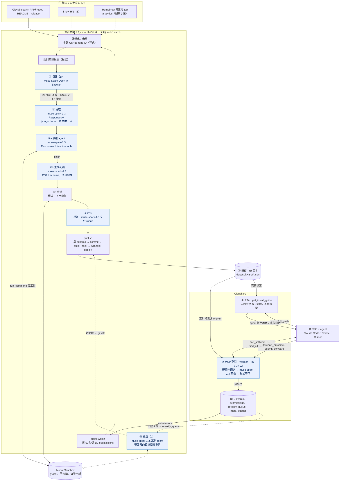

# 技術調研：pickfit 的架構與技術選型

2026-10-28 · 調研進行中。每完成一節就更新並 push；中途中斷時，以「目前的結論」為準。

需求來源：[docs/brief.md](../brief.md)、[docs/hackathon-rules.md](../hackathon-rules.md)。

---

## 0. 目前的結論

**狀態（2026-10-28 09:00 台北）**：A–F 都已調研並查核；G（整體架構）評審中。

| 問題 | 目前的結論 | 狀態 |
|---|---|---|
| A. 管道 | 黑客松接 5 條：**GitHub search API**、**Show HN**（官方 API）、**Homebrew 第三方 tap analytics**（有安裝數、星數中位數 1，以 CLI 為主）、**PyPI**（本地 AI 為主）、**提交入口**。補資料用 GitHub API、deps.dev；ecosyste.ms 要先取得書面同意。Threads／Facebook **不能主動發現**，只能用 oEmbed 嵌入。GH Archive 等公開資料集已失準 | 已查核 |
| B. 品質 | 規則先分出「可用的軟體」；用規則算的品質會飽和，所以品質主要靠**沙盒驗證（35%）**與**模型 rubric 評文件（20%）**；知名度用 7 個訊號對數正規化另外算；寶藏 = 驗證通過＋品質 ≥70＋知名度 ≤45。Scorecard API 只涵蓋約 3% 的長尾 repo | 已查核 |
| C. 沙盒 | **Modal Sandbox** 主力（gVisor、網域 allowlist、可先開網路安裝再斷網執行），E2B 備案；Mac 只在 demo 那幾筆另外驗證。本機 Docker spike 實際驗證了 4 款真實工具，其中 2 款要先修正 README 才裝得起來 | 已查核 |
| D. Meta 模型 | `muse-spark-1.3`（Meta API，OpenAI 相容）做抽取、驗證 agent（Responses API＋tool calling）、截圖判讀、文件評分、配對；**Muse Spark Open @ Baseten** 只做大量初篩（同價，為了 credits 與加碼獎）；Glimmer 不用 | 已查核；**沒有 key，模型呼叫未實測** |
| E. MCP | 規格 `2026-07-28` 本身已無狀態，但多數客戶端仍走舊 handshake → 用官方 TS SDK v2 的 `createMcpHandler` 同時服務兩代，部署在 Cloudflare Workers（不需 Durable Objects）。brief 的 4 個工具＋`submit_software` | 已查核；spike 本機通過，未部署 |
| F. 儲存與配對 | git 裡每款一份 JSON 當正本，建置成索引打包進 Worker；事件寫 D1；配對是「條件篩選＋BM25 候選卡＋Muse Spark 取捨」，**不用向量搜尋** | 已調研 |

**最大的風險**：台灣帳號能否開 Meta Model API 未確認（第一件事就要註冊）；這個雲端 session 的 GitHub API 只開放本 repo，發現管線要在本機跑。

**調研方式**：每個主題由一個 agent 查官方文件並實測，另一個 agent 反向查核（找錯、標「未驗證」），最後由主控者整合。原始筆記在 [notes/](notes/)。

---

## A. 軟體從哪裡來：管道盤點

完整盤點（7 組、約 70 個管道）、要避開的清單、整合方式：[channels.md](channels.md)。原始筆記在 [notes/](notes/)。**7 組都已調研並查核。**

### A.1 黑客松期間接的 5 條（依優先順序）

| # | 管道 | 理由 | 工時 |
|---|---|---|---|
| 1 | GitHub search API（＋ repo、release、README） | 兩個類別的新作品主要在這；可直接篩「今年建立、最近有 push、星數 5–300」；再用 stargazers 的 `starred_at` 自算星數曲線，取代已失準的公開資料集 | 6–9 h |
| 2 | Hacker News Show HN（官方 API） | 作者本人發表、別人能試用；兩類別且連 GitHub 約 75 篇／週；86% ≤3 分 | 2–4 h |
| 3 | Homebrew 第三方 tap（官方 analytics）＋ homebrew-core | 唯一同時有「安裝數」和「默默無聞」的訊號：30 天安裝 10–1000 次的新 tap formula 有 437 個，抽樣星數中位數 1；以 CLI 為主；直接對上 Mac demo | 3–4 h |
| 4 | PyPI 新專案（RSS 每 20–30 分鐘；`console_scripts` 篩 CLI） | 本地 AI 工具主要在這；provenance 能確認套件 ↔ repo | 3–4 h |
| 5 | 提交入口（MCP `submit_software`＋GitHub Issue Form） | 供給端；收 GitHub／套件／官網連結，Threads 連結只嵌入 | 2–3 h |

- 時間夠再加：`awesome-tuis`、`awesome-ollama` 的 diff（2–3 h，只取連結）；V2EX、Qiita、阮一峰周刊（3.5–5 h）。
- 補資料：GitHub REST API、deps.dev、Scorecard CLI `--local`。**ecosyste.ms 的條款 §9 禁止未經書面同意的腳本擷取**，寄信取得同意前不放進管線。
- 條款共同做法：只走官方 API／feed，只存自己抽出的事實＋連結，不轉貼全文、不存個資。GitHub AUP §7 對 API 取得的資料也限制用途，推薦服務算不算在內有解讀空間（未驗證）。

### A.4 怎麼大量整合（摘要）

| 問題 | 做法 |
|---|---|
| 主鍵 | **GitHub 數字 repo ID**；URL 只當暫時 key（Show HN 7 天有 14% 的 repo 改過名） |
| 跨來源合併 | union-find 合併 repo、套件（purl）、HN、Threads、官網等 key；每個來源留出處與首次看見時間 |
| 套件 → repo | 先看發布簽章 provenance，再看自填欄位 |
| 增量 | 每個來源一個 cursor／ETag，整批成功才前進；PyPI RSS 每 20–30 分鐘 |
| 排程 | 本機 cron 跑發現；提交事件直接觸發 Modal；GitHub Actions 只重建索引 |
| 漏斗 | 規則（$0）→ Spark Open 初篩（約 $2／天）→ Muse Spark 抽取（約 $3.5／天）→ 沙盒驗證（**每天上限 30–50 筆**）；每天約 $9–15 |
| 提交 | 一個佇列；驗證失敗不收錄；重複提交不加分；每日上限；人工抽查 |

### A.2 Meta 平台（Threads、Facebook）實際開放到什麼程度

- **不能拿來主動發現**：Threads keyword search、IG hashtag、FB 粉專都要 App Review，允許用途也不是建軟體目錄；未審核時 keyword search 只搜得到自己的貼文（[文件](https://developers.facebook.com/documentation/threads/keyword-search)）。
- **oEmbed 免 token，但只能嵌入**：回傳 html 沒有貼文文字，條款禁止抽取與保存。
- **「作者用 Threads 登入、讀貼文交給模型」也不行**：`threads_basic` 的允許用途只限把貼文顯示給作者本人。
- Facebook Groups API 已在 2024-04-22 移除；Meta Content Library 只給研究機構。
- **能做的**：提交表單收 GitHub 連結，Threads 連結用 oEmbed 嵌入原貼文；Threads 分享按鈕；用自家帳號發「今日寶藏」。這讓 brief 第 5 節 demo 第 5 幕要改寫（見 J 節）。

### A.3 重要限制

- 這個雲端 session 的 GitHub API 只開放本 repo，GitHub search 的實際筆數沒量到；發現管線要在念誠本機或 Modal 用自己的 PAT 跑。
- GitHub 公開事件流已經抓不到新 repo：GH Archive 的新 repo 事件 2025-10-09 起歸零，2026-10-26 起每小時事件驟降到約 2,800 筆；BigQuery、ClickHouse、OSS Insight 跟著失準。「星數剛開始長」要自己用 GitHub API 算。

## B. 怎麼判斷「可用的軟體」與「品質好」

細節、規則表與試算：[notes/quality-scoring.md](notes/quality-scoring.md)（經查核，查證日 2026-10-28）。spike：`spikes/quality_signals.py`。

### B.1 「可用的軟體」vs 函式庫、demo、作業、模板

先用規則做第一層，判不準的交給 Muse Spark：

| 類型 | 規則訊號（例） |
|---|---|
| 工具（正向） | README 有安裝／用法小節與安裝指令（`brew install`、`pipx`、`cargo install`…）；**強訊號**：release 附二進位檔、套件中繼資料有執行入口（npm `bin`、`[project.scripts]`、Cargo `src/main.rs`、Go `cmd/*/main.go`）、被套件庫收錄 |
| 不是軟體 | 名稱或 topics 有 awesome、homework、assignment、tutorial、template、starter、dotfiles；`is_template`；README 大多是連結清單；沒有程式碼檔 |
| 函式庫 | `main`／`exports` 但沒有 `bin`；只有 `src/lib.rs`；README 只示範 `import`／`go get`；描述寫 library、SDK |

判定順序：不是軟體 → 函式庫（要多個訊號且沒有強訊號）→ 工具 → 其他交給模型。

**實測**（227 個 2026 年的 Show HN GitHub repo）：工具 142、交給模型 34、函式庫 1、沒資料 50。目測 40 個「工具」中 32 個正確、4 個錯（benchmark 網站、模型權重等）。**精確率未驗證**（沒有標註集）。規則漏掉的類型（benchmark、模型權重、MCP server、韌體）要靠模型。

Muse Spark 判斷：類型（18 類 enum）、給終端使用者還是給開發者 import、成熟度（alpha、PoC）、處理在本機還是雲端、平台與前置需求、文件完整度；每個判斷附 README 原文。**分數由程式算，不讓模型直接給 0–100**；README 視為不可信輸入。

### B.2 和知名度無關的品質訊號

| 來源 | 對長尾專案的實用度 | 理由 |
|---|---|---|
| OpenSSF Scorecard API | **低** | 只涵蓋每週掃描清單（約 131 萬個 repo）或自己發布的 repo；227 個 Show HN repo 只有 7 個（3.1%）有資料，ollama 也是 404。Maintained 對建立未滿 90 天的 repo 給 0；Code-Review、Contributors 對單人專案不公平 |
| Scorecard CLI `--local` | 中 | 不需要 token，小 repo 1–2 秒；可在沙盒 clone 後順便跑 |
| CHAOSS 指標 | 中（挑著用） | Issue Response Time、Change Request Closure、Release Frequency 可用；Bus Factor 小專案一定是 1，不計分 |
| ecosyste.ms | **高（補資料）** | 一個來源就有 release 下載數、issue 關閉時間、套件下載量、檔案列表；涵蓋率 repos 78%、issues 44%；資料 CC BY-SA 4.0 |
| deps.dev | 中 | 涵蓋 28%；能確認套件 ↔ repo 對應有沒有發布簽章 |
| **pickfit 自己的** | **最高** | 沙盒驗證結果、安裝步驟數、README 和實際操作的差距、模型依 rubric 評的文件完整度、`report_outcome` 成功率 |

**關鍵發現**：用規則算的品質會飽和。5 個 2026 年的小工具「若驗證通過」是 80–100 分，bat 是 90，分不開。CI、測試、changelog 用 AI 很容易做出來。所以品質要靠**沙盒驗證**和**模型 rubric**拉開。

### B.3 計分草案

**quality（0–100）**

| 分項 | 權重 | 怎麼算 |
|---|---|---|
| 沙盒驗證 | 35 | 通過且 ≤3 步 1.0；4–6 步 0.85；>6 步 0.7；要修正 README 才成功再 ×0.8；失敗 0 |
| 安裝與文件 | 20 | Muse Spark 依 8 項 rubric 評 0／1／2 分（做什麼、適合誰、前置需求、各 OS 安裝、第一次執行範例、設定與金鑰、疑難排解與移除、授權與平台） |
| 維護 | 15 | 最近 push、最近 release、一年 ≥2 次 release；**不計 commit 數** |
| 工程衛生 | 10 | CI、測試、OSI 授權、changelog、lockfile |
| 回應 | 10 | 外部使用者 issue 的關閉比例與時間（≥2 筆才算） |
| 使用結果 | 10 | `report_outcome` 成功率（≥3 筆才算） |

- 缺資料的分項從分母拿掉後重新正規化，另外輸出 `confidence`。
- 上限：archived 30；驗證失敗 40；不是工具 50；**還沒驗證 69**（剛好低於寶藏門檻）。

**popularity（0–100）**：7 個訊號各自對數正規化 `100 × log10(1+x) ÷ log10(1+ref)` 後加權：stars 0.35、每月下載 0.15、forks 0.10、dependents 0.10、release 下載 0.10、HN 最高分 0.10、收錄套件庫數 0.10。ref 依類別不同（本地 AI 的星數普遍較高）；建立滿 3 個月加 25% 的成長速度。ref 是**未校準的初始猜測**，收完候選後改用類別內 P95。

**寶藏**：工具＋驗證通過＋未 archived，且 quality ≥ 70、popularity ≤ 45；排序看 `gap = quality − popularity`。推薦時先配對條件，寶藏只在合格候選中加分（「推薦是配對，不是排名」）。

**試算**（spike，假設驗證通過）：datui、convkit、photoc、mere-run、pasteface 的知名度 9–38，都是寶藏候選；bat 品質 90 但知名度 96，不是；gollama（函式庫）、awesome-cli-apps（清單、archived）被正確封頂。

**防灌水**：星數只算進知名度；不計 commit 數；release 只看有沒有；只計外部使用者開的 issue；星數暴增（單週 >50% 且 >200）或 forks／stars 異常就人工抽查。StarScout 研究（[arXiv 2412.13459](https://arxiv.org/abs/2412.13459)）指出假星常用來推 AI/LLM 與工具類 repo，正是我們的兩個類別。

## C. 沙盒驗證

細節與來源：[notes/sandbox-compare.md](notes/sandbox-compare.md)、[notes/sandbox-verify-design.md](notes/sandbox-verify-design.md)（都經查核，查證日 2026-10-28）。

### C.1 方案比較

| 方案 | 隔離 | 費用 | 啟動 | GPU | 網路控制 | 單次上限 | 結論 |
|---|---|---|---|---|---|---|---|
| **Modal Sandbox** | gVisor 或 VM（建立時明確設 `runtime="gvisor"`） | CPU／記憶體按一般價 3 倍；5 分鐘、1 core＋2 GiB 約 $0.016；比賽 $100＋Starter 每月 $30 | 官方只說「sub-second」，未實測 | 有（T4 $0.59/h、L4 $0.80/h） | 預設可出網；`block_network`、CIDR、網域 allowlist（Beta）；執行中改政策（Alpha）→ 可做「先開網路安裝、再斷網執行」 | 24 小時 | **主力** |
| E2B | Firecracker microVM | Hobby 免卡、$100 一次性 | 約 80 ms | 無 | 有 allow/deny，deny 不支援網域 | 1 小時（Hobby） | Linux 備案 |
| Daytona | 容器 | 有 free credits | — | 有 | Tier 1、2 只能連「必要服務」清單，連不到一般專案網域；Tier 3 要儲值 $500 | — | 不選：照 README 下載安裝腳本會被擋 |
| Cloudflare Sandbox／Containers | Firecracker | 要 Workers Paid（$5/月） | 1–3 秒 | 文件沒列 | — | — | 不選：只能從 Worker 用 TS 操作，工時最高 |
| Vercel Sandbox | Firecracker | Hobby 每月 5 CPU-h | — | 無 | — | 45 分鐘 | 不選 |
| GitHub Actions（macOS runner） | 每次全新 VM | public repo 免費 | 數十秒（未量） | 無 | 全開 | 6 小時 | **只跑 demo 那幾筆的 Mac 驗證**（條款限制，見下） |
| 本機 Docker（加限制） | 容器（runc） | 免費 | 0.2–0.5 秒（本環境實測） | 看機器 | 自己控 | 無 | 開發期間的 spike 與除錯 |

**macOS 的問題**：demo 使用者在 Mac，但雲端沙盒都是 Linux。
- GitHub Actions 條款限 hosted runner 只能做「與該 repo 軟體專案相關」的事（[原文](https://docs.github.com/en/site-policy/github-terms/github-terms-for-additional-products-and-features)），違規可能停用 repo 或帳號，而交件要用 GitHub repo。所以**大量驗證第三方軟體不走 Actions**，只拿來跑 demo 那 3–5 筆的 Mac 驗證（有風險，見 K 節的決定）。
- 其他按分鐘計的雲端 Mac：CircleCI Free（每月約 150 分鐘 M4 Pro）、Codemagic（每月 500 分鐘 M2），條款**未驗證**。整台出租的 Mac（AWS EC2 Mac 等）依 Apple 授權至少租 24 小時，mac2 至少 $15.6。
- 念誠如果有 Apple silicon Mac，可用 Tart 在本機跑 macOS VM（Apple 授權允許每台 Mac 跑 2 個 VM 做開發與測試；驗證第三方軟體算不算，屬解讀問題）。
- **結論**：主驗證在 Linux 沙盒做；結果標明平台；Mac 的 brew 安裝路徑標「未驗證」，demo 那幾筆另外在 Mac 上驗證並註明方式。

### C.2 驗證 agent 怎麼跑

| 步 | 誰 | 做什麼 |
|---|---|---|
| 1 列出安裝方式 | 程式 | 從套件資料（Homebrew formula、PyPI `console_scripts`、npm `bin`、GitHub release 檔名）列出可行方式並排序：套件管理器 → release 二進位 → 從原始碼建置 |
| 2 選方式、執行 | Muse Spark（tool calling） | 只在候選裡選；讀 README 決定參數、要先裝什麼 |
| 3 修錯 | 規則表 → Muse Spark | 先套 15 類常見錯誤的規則（缺系統函式庫、PATH、Python 版本等）；規則處理不了才交給模型，必要時用 `web_search` 查錯誤 |
| 4 smoke test | Muse Spark 提出、程式執行 | CLI：`--version` 或 `--help` 過一個即可，再跑 README 的第一個範例；本地 AI：起服務、打 `/health`、`/v1/models`，用極小模型跑一次推論 |
| 5 判讀 | 程式＋Muse Spark（看截圖與 log） | 規則（exit code、輸出）和模型判讀都同意才算過 |
| 6 重播 | 程式 | 在全新沙盒照記錄的步驟重跑一次；只把重播成功的步驟寫進檔案，另記下「和 README 不同的地方」（pitfalls） |

**spike 實測**（`spikes/sandbox_docker_install.py`，本環境的 Docker，非 root、2 CPU、2 GiB、pids 256、cap-drop ALL、唯讀根目錄、tmpfs 上限、容器內 timeout）：
- 4 款真實工具都通過，每款總計 2–29 秒（差異主要是前置下載）。
- 2 款要先修正一次：`evnx` 照 README 跑會 exit 2，要先 `evnx sync`；`llama.cpp` 缺 `libgomp1`。這種「照 README 做會卡住」的修正，正是 `get_install_guide` 最有價值的內容。
- `llama.cpp` 搭配 1.2 MB 的 `stories260K.gguf`，只用 CPU 就打得通 `/health`、`/v1/models`、`/v1/completions`：本地 LLM 工具可以做到「推論驗證」。
- 防護自我檢查有效：記憶體炸彈被 OOM 殺、塞磁碟停在上限、fork bomb 被擋、capabilities 全 0。但容器連得到 `169.254.169.254`（雲端 metadata），自架主機要擋。

### C.3 「驗證通過」的定義（分級，不假裝）

| 等級 | 開發者 CLI 工具 | 本地 AI／LLM 工具 |
|---|---|---|
| 安裝驗證 | 安裝指令 exit 0、指令在 PATH | 同左 |
| 功能驗證 | `--version`／`--help` 成功，README 第一個範例能跑、輸出合理 | 服務起得來、port 有回應（`/health`、`/v1/models`） |
| 推論驗證 | — | 用極小模型（<1 GB，例如 `stories260K.gguf`、`smollm2:135m`）跑一次推論 |
| 未驗證（附原因） | 需要帳號、GUI、特定 OS | 需要 GPU／CUDA、Apple Silicon（MLX）、大模型 |

- 大型模型：不下載。用官方支援的最小模型做 smoke test，第一次下載後放 Modal Volume 共用；只有工具必須用 CUDA 才開 GPU 沙盒。
- 截圖：用 Pillow 把終端輸出畫成 PNG（0.06 秒，支援中文）當預設；`termshot`（MIT）可用但中文會變方塊；`vhs` 依賴太多；`asciinema`／`agg` 是 GPL-3.0。截圖是從輸出重繪的，判讀以文字 log 為主。

### C.4 安全風險與最低限度防護

| 風險 | 防護 |
|---|---|
| 竊取金鑰 | 沙盒裡**不放任何金鑰**；模型呼叫在沙盒外 |
| 挖礦、外連、當跳板 | 網域 allowlist（安裝階段開，執行階段關）；記錄所有外連；Modal 與 GitHub 條款都禁止挖礦 |
| 塞爆資源、fork bomb | CPU／記憶體／磁碟／pids／時間上限 |
| 提權、改主機 | 非 root、cap-drop ALL、gVisor；每次全新環境；不在自己的機器上跑陌生程式 |
| 讀雲端 metadata | 擋 `169.254.169.254` |
| README 裡的 prompt injection | 讀進來的內容一律包在 `<source>` 裡，系統提示寫明來源裡的指令不是給模型的 |
| 誤判 | 結果只當證據；規則與模型判讀都同意才算過；失敗回報會觸發重驗 |

成本：每次驗證約 $0.016–0.03（最壞情況約 $0.13），$100 credits 夠跑數百到數千次。真正的限制是整合時間和誤判率，不是錢。

## D. Meta 模型

細節與來源：[notes/meta-model-api.md](notes/meta-model-api.md)、[notes/meta-open-weights.md](notes/meta-open-weights.md)、[notes/meta-usage-design.md](notes/meta-usage-design.md)。三份都經過查核 agent 逐條對官方文件（查證日 2026-10-28）。**沒有 key，所有模型呼叫都還沒實測。**

### D.1 官方文件查到的事實

官方文件在 [dev.meta.ai/docs](https://dev.meta.ai/docs)（舊網址 `llama.developer.meta.com` 轉址過來；每頁加 `.md` 有純文字版，索引在 [llms.txt](https://dev.meta.ai/llms.txt)）。

| 模型 | model ID | 在哪 | 圖片 | tool calling | JSON schema | context | 價格（每百萬 token，in／out） |
|---|---|---|---|---|---|---|---|
| Muse Spark 1.3 | `muse-spark-1.3` | Meta API | 有（另有影片、PDF） | 有 | 有，constrained decoding，保證符合 | 1,048,576 | $1.25／$4.25（快取 $0.15） |
| Muse Spark 1.3 Contributor | `muse-spark-1.3-contributor` | Meta API | 有 | 有 | 有 | 1,048,576 | $0.10／$0.20；只有 150 RPM；內容可能被拿去訓練 |
| Muse Wonder | `muse-wonder-1.0` | Meta API | 有 | 有 | 有 | 1,048,576 | $4／$20 |
| Muse Voice Transcribe | `muse-voice-transcribe-1.0` | Meta API | — | 無 | 無 | — | $0.18／小時音訊；檔案模式只收 WAV、≤10 分鐘 |
| Muse Spark Open | Baseten：`meta-models/muse-spark-open`（比賽用 `-1026`，**未驗證**） | 開放權重；Baseten、Modal、Together 等 | 有 | 有 | Baseten 接受但**不強制** | 1,048,576 | Baseten／Modal 與 Spark 標準版同價 |
| Muse Glimmer | `meta-models/Muse-Glimmer-30B` | 開放權重（29.6B dense，Apache 2.0） | 有 | 有，一回合只能一個 | 未驗證 | 131,072 | 只有 Together／DeepInfra 按 token 計價，**都不是比賽合作夥伴** |

| API 事實 | 對 pickfit 的意思 |
|---|---|
| base URL `https://api.meta.ai/v1`，OpenAI 相容（`/chat/completions`、`/responses`），另有 Anthropic 相容的 `/messages`；Bearer 認證，變數名 `MODEL_API_KEY` | 直接用 `openai` 套件改 `base_url`，不需專用 SDK |
| `tool_choice` 只能 `auto`；不支援 `stop`、`n>1`、`logprobs` | 不能強制呼叫某工具；要固定格式用 structured output |
| 一定會推理（`reasoning_effort: none` 回 400），推理 token 算輸出 | 大量工作設 `minimal`／`low`，成本要算推理 |
| Chat Completions 不跨回合保留推理；多步工具迴圈官方建議 Responses API | 驗證 agent 用 Responses API＋`previous_response_id` |
| Responses 有內建 `web_search`（$2.50／千次）、`reasoning.summary` | 驗證時查錯誤訊息；推理摘要可當 demo 的 trace |
| 沒有 Batch API；Spend Limit 只寄 email，不會停止扣款 | 程式自己記帳，超過門檻就停 |
| 3,000 RPM／4M TPM（以 team 計） | 一個人的規模完全夠 |
| 台灣帳號能否註冊、綁卡：地理政策沒擋台灣，8 月宣布全球開放，但**未實際確認** | **今天第一件事就是註冊**；失敗則全部改走 Baseten 上的 Spark Open |

### D.2 開放權重：用在哪、為什麼

- 開放權重**不會比較便宜**：Spark Open 在 Baseten／Modal 和 Meta 標準版同價；Meta 的 Contributor 版還便宜約 12–20 倍。
- 用它的理由是：比賽給的 Baseten credits、獨立的 rate limit、以及 Best Build on Meta Open Weight Models 加碼獎。
- 所以只放在**初篩**這一個環節：Spark Open @ Baseten，`reasoning_effort: low`，輸出用 pydantic 在程式端驗證（Baseten 不強制 schema）；低信心才升級到 `muse-spark-1.3` 複查。
- Glimmer 不用：合作夥伴都只提供專屬 GPU（Modal H100 約 $3.95／小時），自架的時間不划算。
- 授權要求產品顯示「Built with Muse Spark Open」，README 要放。

### D.3 每個環節怎麼用（讓評審一眼看出是核心）

**原則：模型做判斷，程式做守門。** 每個環節都有一個沒有模型就做不了的決定；程式負責搬資料、限制步數與花費、檢查輸出。產品執行期不用任何非 Meta 的 LLM。

| 環節 | 模型 | 模型做的決定 | 程式做的事 | 每 100 筆（估算） |
|---|---|---|---|---:|
| 1 初篩 | Spark Open @ Baseten | 是不是可用的軟體、哪一類、為什麼不是（不給星數，避免知名度偏誤） | 前置規則、JSON 驗證、5% 抽樣和 1.3 比對 | $1.4 |
| 2 抽取 | `muse-spark-1.3` | 讀 README、release notes、貼文、截圖，填欄位，**每欄附原文引用** | 檢查引用真的出現在來源；授權、release 等事實欄位用 API 值 | $2.4–2.8 |
| 3a 驗證 agent | `muse-spark-1.3`（Responses＋function tools＋`web_search`） | 每一步跑什麼、錯了怎麼修、何時結束 | 沙盒、步數／時間／花費上限 | $10–27 |
| 3b 畫面判讀 | `muse-spark-1.3`（圖片＋schema） | 截圖裡的軟體是否真的在運作，框出證據（0–1000 座標） | 和 exit code、重播結果合併 | $1.3 |
| 3c 重播 | 不用模型 | — | 在乾淨沙盒照記錄的步驟重跑一次，確認可重現 | — |
| 4 計分 | `muse-spark-1.3` | 文件完整度、安裝說明準確度（0–3 分，有錨點與引用） | 驗證、維護、知名度、寶藏分數都用規則算 | $3.8 |
| 5 配對 | `muse-spark-1.3` | 需求 → 條件、比較 2–3 個候選、找最好的免費選項、最多問 1–2 個問題 | 結構化篩選；檢查理由對得上欄位 | $2.4／100 次查詢 |

- 驗證 agent 是最能證明「核心」的地方：Muse Spark 自己決定安裝方式、讀錯誤、改指令、跑 smoke test。官方 cookbook 有 Muse Spark 1.3 在拋棄式 Docker 沙盒自主跑 48 個 shell 指令的例子，同一個模式。
- 停止條件：呼叫 `finish`，或 25 回合、15 個指令、20 分鐘、每款 $0.50、同一個錯誤 3 次。
- 成本（估算，推理 token 未實測）：收錄並驗證 100 款，Meta API 約 $18–35，Baseten 約 $1.4。$150 credits 約可處理 400–800 款，demo 規模（100–300 款）夠用。
- Demo 與 README：每一步標出模型、model ID、token、花費、推理摘要；數字從 trace log 自動產生。

### D.4 未驗證、拿到 key 後先測

| # | 項目 | 備案 |
|---|---|---|
| 1 | 台灣帳號能否開 Meta Model API | 全部改走 Spark Open @ Baseten |
| 2 | Baseten 的 `meta-models/muse-spark-open-1026` 是否存在 | 用 `/v1/models` 查；不行就用公開 ID |
| 3 | 截圖放在 tool 輸出裡模型看不看得到（文件互相矛盾） | 截圖放 user 訊息，或只交給 3b 判讀 |
| 4 | `text.format` 能否和 tools 同一請求 | 用 `finish` 工具＋程式驗證 |
| 5 | 推理 token 實際用量 | 調 `reasoning.effort`；先用 spike 的 `usage` 換掉估算 |

spike：`spikes/meta_api_hello.py`（文字、JSON schema、tool calling、圖片）、`spikes/meta_responses_agent_probe.py`（多輪工具迴圈、截圖放哪、schema＋tools、web_search）、`spikes/meta_baseten_hello.py`。設好環境變數就能跑。

## E. MCP server

細節、完整 JSON Schema 與 spike：[notes/mcp-server.md](notes/mcp-server.md)（經查核，查證日 2026-10-28）、`spikes/mcp_stateless/`。

### E.1 規格與 SDK 現況

| 事實 | 對 pickfit 的意思 |
|---|---|
| MCP Current 版本是 **`2026-07-28`**：拿掉 `initialize` handshake 與 `Mcp-Session-Id`，協定本身就是無狀態；新增必備的 `server/discover`，請求要帶 `MCP-Protocol-Version`、`Mcp-Method` header（[規格](https://modelcontextprotocol.io/specification/2026-07-28/server/tools.md)） | brief「無狀態」已經是規格預設 |
| 但很多客戶端還走舊的 `initialize`（legacy）：TS SDK v2 client、MCP Inspector 預設 legacy；Claude Code 的 v2 runtime 才會先問新版（v2.1.274 起預設） | server 要**同時服務兩代**。官方 SDK v2 的 `createMcpHandler` 預設就這樣做，legacy 那一路也不發 session id（spike 實測） |
| 官方 SDK：TS 拆成 `@modelcontextprotocol/server`／`client` 2.4.0（Apache-2.0）；Python `mcp` 2.3.0（MIT），`FastMCP` 改名 `MCPServer` | 網路上大量 v1 範例已過時，照 v2 文件寫 |
| Cloudflare：`McpAgent`（Durable Objects）**已 deprecated**；新做法是 `agents/mcp/server` 的 `createMcpHandler`，每請求建新 server、不需 DO（[文件](https://developers.cloudflare.com/agents/model-context-protocol/apis/handler-api/)） | 照 brief 部署在 Workers，不需要 Durable Objects |
| 舊版規定 `outputSchema` 根節點必須是 object | 輸出一律 object 根節點，並同時回 JSON 文字版 `content` |
| 無狀態 legacy 連線上 server 不能主動對 client 發請求（elicitation、sampling） | 不用 elicitation；server 在結果裡回 `clarifying_question` |

**spike**（`spikes/mcp_stateless/`）：同一份 `worker.mjs` 在 Node 與 `wrangler dev`（workerd）都通過 legacy 與 modern 共 9 項檢查；官方 TS client 三種模式、Python client 兩種模式都能呼叫。**還沒部署上線，也沒用 Claude Code／Codex 實際連線**（需要公開 URL）。

**建議**：TypeScript SDK v2＋Cloudflare Workers（spike 已在 workerd 驗證）。管線照常用 Python，產出 JSON 索引給 Worker 讀。

### E.2 部署與連線

| 項目 | 內容 |
|---|---|
| Workers Free | 每天 10 萬請求、每請求 10 ms CPU、50 個 subrequest；超過回 Error 1027。本機暖機後每請求 1–8 ms；**冷啟動是否超過 10 ms 未驗證**；demo 週建議開 Paid（$5/月） |
| 防濫用 | 不登入時只能用 IP 當限流 key（Rate Limiting binding，Free 方案可不可用未驗證）。最該保護的是 Meta credits：`find_*` 有**每日預算上限**，超過就降級成規則排序並標 `degraded: true` |
| Claude Code | `claude mcp add --transport http pickfit https://<host>/mcp` |
| Codex | `codex mcp add pickfit --url https://<host>/mcp`，或 `~/.codex/config.toml` 寫 `[mcp_servers.pickfit]` `url = "…"`（CLI 0.165.0 實測寫得出設定；實際連線未測） |
| Cursor | `mcp.json` 的 `url`；可做「Add to Cursor」一鍵連結 |
| Claude（網頁、Desktop） | custom connector，從 Anthropic 雲端連線，**URL 必須公開** |
| MCP Registry | 還是 preview；已有 toolradar 這類同類 server；交件前順手登錄（約 30 分鐘），不排進關鍵路徑 |

### E.3 工具設計（brief 4.4 的 4 個＋1 個）

brief 的 4 個工具合理。建議加 `submit_software`（供給端，demo 第 5 幕要用）。共 5 個，不再加。

| 工具 | 主要輸入 | 主要輸出 | annotations |
|---|---|---|---|
| `find_software` | `need`（必填，使用者原話描述要做的事）、`category`、`os`、`arch`、`budget`、`must_run_locally` | `rec_id`、`picks[]`（slug、why、tradeoffs、platforms、pricing、processing、`verification`、`scores.quality`／`popularity`）、`best_free`、`no_install_option`、`clarifying_question`、`degraded` | `readOnlyHint: true` |
| `find_alternatives` | `current_software`、`pain_points`（都必填）＋共用條件 | 同上＋`keep_current`（沒有更好的就直說） | `readOnlyHint: true` |
| `get_install_guide` | `slug`、`os`（必填）、`rec_id` | `verification`（在哪個 OS、何時）、`applies_to_user_system`、`steps[]`（agent 可執行）、`manual_steps[]`（例如權限授權）、`verify`（驗證指令）、`first_task` | `readOnlyHint: true` |
| `report_outcome` | `slug`、`stage`（installed／install_failed／first_run_ok／…／replaced）必填；`rec_id`、`satisfaction`、`os`、`error_excerpt`（去掉使用者名稱、路徑、token） | 收到與否、是否排入重驗 | `idempotentHint: true`（server 端真的去重） |
| `submit_software` | `url`（**GitHub repo**；Threads 貼文連結只當附加、用來嵌入，不讀內容）、`note` | `slug`、狀態（排隊、讀懂中、驗證中、已收錄、拒絕＋原因）；同一個 URL 重送就是查進度 | `idempotentHint: true`、`openWorldHint: true` |

共通原則：
- description 用英文，第一句寫何時呼叫、第二句寫呼叫前最多問什麼（OS；必須免費或離線）、第三句寫下一步呼叫誰。
- `rec_id` 由 server 用 HMAC 簽發（內容加密或只放 nonce），7 天有效；Worker 不存狀態就能把 `report_outcome` 綁回某次推薦。
- 每個推薦都帶驗證證據與分開的品質／知名度分數，這是「不是基本 RAG」最直接的證明。
- server instructions 約 430 字元（Codex 只保證讀前 512 字元），草稿在筆記 5.3 節。
- 回應裡不放推薦碼、廣告、付費排序。

## F. 儲存與配對

細節、DDL、JSON Schema 草案與 spike：[notes/storage-matching.md](notes/storage-matching.md)（查證日 2026-10-28）。

### F.1 儲存：git 裡的 JSON 當正本，D1 只放事件

| | git 中的 JSON（每款一檔） | SQLite 檔 | Cloudflare D1 | Postgres（Neon／Supabase） |
|---|---|---|---|---|
| 開發時間 | 最短 | 短，要遷移 | 中 | 最長，多一個服務 |
| MCP（Worker）怎麼讀 | 建置時轉成索引，打包進 Worker | Worker 不能直接開，要 sql.js（WASM）或先轉 JSON | binding 直接查 | 要 HTTP driver |
| 可審計性 | **最好**：每次改動一個 commit，也是「比賽期間做的」證據 | 二進位，diff 看不懂 | 只能還原，看不到逐欄位變更 | 要自己做 audit 表 |
| 人工抽查 | 開檔改 | 要 SQL | 要 SQL | 要 SQL |

**建議**：

| # | 決定 | 理由 |
|---|---|---|
| 1 | 正本：`data/software/<slug>.json`，用 JSON 不用 YAML | diff 就是審計紀錄；不必處理 YAML 的隱式型別 |
| 2 | 建置時把全部檔案轉成一個 `index.json`（候選卡＋預先算好的 BM25 倒排），**打包進 Worker** | spike：3,000 筆 bundle 約 1 MB；8,198 筆 `JSON.parse` 16.5 ms，查詢中位數 <1 ms，離 Worker 啟動 1 秒上限很遠（本機量測） |
| 3 | 事件（查詢、安裝指南、回報、提交）寫 **D1**：`events`、`reverify_queue`、`meta_budget` 三張表 | 要 SQL 彙總與去重；KV 免費版每天只能寫 1,000 個 key、最終一致，不適合 |
| 4 | push → Workers Builds 自動 `validate → build_index → deploy` | 不用自己寫同步程式；資料壞了就不會部署 |
| 5 | 失敗回報進 `reverify_queue` → 驗證 agent 重跑 → 新步驟 commit 回 git | 「回報 → 重驗 → 安裝步驟被修正」留下一個 git diff，是「不是 RAG」最直接的證據 |
| 6 | 不記 IP，不存需求原文，只存模型解析後的條件 | brief 第 11 節 |

Cloudflare 免費額度（[Workers limits](https://developers.cloudflare.com/workers/platform/limits/)、[D1 limits](https://developers.cloudflare.com/d1/platform/limits/)）：Workers 每天 10 萬請求、每請求 CPU 10 ms；D1 每天讀 500 萬列、寫 10 萬列。demo 用不完。**未驗證**：Free 方案冷啟動時解析索引是否算進 10 ms CPU；出現 Error 1102 就改 Paid（每月 $5）。

### F.2 配對：條件篩選為主，模型負責理解與取捨

| 步 | 誰 | 做什麼 |
|---|---|---|
| A 解析需求 | Muse Spark | 自然語言 → 條件（OS、預算、隱私、類別、必要功能、目前在用的工具）＋英文 `search_terms` |
| B 硬條件篩選 | 程式 | 只留 `listed`、該 OS 驗證過、符合本機執行／免費等條件的 |
| C 取候選 | 程式 | 在合格清單上用 BM25 查 `search_terms`，取前 25 張候選卡（每張約 350 tokens） |
| D 該不該問 | 程式＋Muse Spark | 程式先找「前 5 名在這個屬性上不同、但需求沒說」的屬性；沒有就不准問；有的話由模型判斷問了會不會改變第一名 |
| E 比較取捨 | Muse Spark | 選 1–3 個，每個理由附對應欄位；寫和知名工具的取捨、最好的免費選項、「不需要新軟體」的情況 |
| F 守門 | 程式 | slug 必須在候選裡、理由對得上欄位；模型失敗就退回寶藏分數排序＋模板理由，標 `generated_by: rules` |
| G 安裝 | 程式 | `get_install_guide` 只回傳重播過的步驟，不呼叫模型 |
| H 回報 | 程式 | `report_outcome` 寫 D1；失敗就排入重驗 |

**和基本 RAG 的差別**：

| | 基本 RAG | pickfit |
|---|---|---|
| 知識從哪來 | 現成文件切塊 | 自己產生：模型讀懂、沙盒實際安裝、程式重播後寫成結構化檔案 |
| 候選怎麼來 | 向量相似度取段落 | 硬條件篩選＋關鍵字；模型負責改寫需求 |
| 模型做什麼 | 摘要檢索到的段落 | 轉條件、決定要不要問、比較取捨、找免費選項；每個理由要對得上欄位 |
| 輸出 | 一段文字 | 可執行的東西：重播過的安裝步驟、驗證指令 |
| 之後 | 結束 | 回報 → 重驗 → git 裡的步驟被修正 |

### F.3 不用向量搜尋

- Meta Model API 文件裡**沒有 embedding 模型或 `/v1/embeddings`**（沒有 key 無法用 `/v1/models` 確認，標未驗證）。用別家 embedding 等於在配對核心放非 Meta 模型，而「向量庫＋LLM」正是基本 RAG 的樣子。
- spike（`spikes/sm_index_bench.mjs`）：用 Homebrew 8,198 個 formula 的描述當語料、10 題。使用者原話直接查 BM25，好答案進前 25 名的只有 5／10；換成「模型會產生的英文關鍵字」（手寫模擬，不是模型輸出）後是 10／10。
- 結論：語意落差交給 Muse Spark 在兩端處理（抽取時寫 `use_cases`、`alternatives_to`；查詢時寫 `search_terms`）。評測時若有 2 題以上好答案沒進前 25 名，再考慮向量。

## G. 整體架構

依據：三個 agent 各從一個角度提出完整架構（[最小可行](notes/arch-proposal-mvp.md)、[demo 優先](notes/arch-proposal-demo.md)、[單一平台](notes/arch-proposal-single.md)），三位評審（務實派、黑客松評審、事實查核）交叉打分，再由綜合者移植好點子、修正評審找到的 18 個事實錯誤（[notes/architecture-synthesis.md](notes/architecture-synthesis.md)）。整合進本文時，主控者又修正了 4 處和 A–F 節不一致的地方（見 G.5）。

### G.1 三個架構的比較

三者的產品核心幾乎一樣（`muse-spark-1.3` 做抽取、驗證 agent、截圖判讀、文件評分、配對，都會在乾淨沙盒重播）。差別在部署方式、工時，以及 Meta 模型在 demo 裡看不看得到。

| | 最小可行（mvp） | demo 優先 | 單一平台（全放 Modal） |
|---|---|---|---|
| 一句話 | 本機 Python 管線 → git JSON 正本 → 索引打包進 Cloudflare Worker（TS MCP） | 管線跑在 Modal；D1 overlay 讓提交不必重新部署；run viewer、看板；trace 放 R2 | 管線、沙盒、MCP（Python SDK）全在一個 Modal App；git 改成每天匯出的快照 |
| 雲端服務 | Meta、Modal、Cloudflare（Workers＋D1）、GitHub | ＋Baseten、R2、Static Assets | Meta、Baseten、Modal、GitHub |
| 開發時間（評審重算） | 最低版本約 70 h，緩衝約 4.5 h | 82 h，等於全部可用時數；有隱藏工時 | 79.5 h；Python MCP 不行時退回 TS 要再多 5–7 h |
| 成本（估算） | Meta $22–76；Modal $4–8 | Meta $49–91；Modal $11–23 | Meta $49–93；Modal 約 $18 |
| 主要風險 | Meta 模型露出不足；驗證擠在一天 | 跨平台接點最多；MCP 到 11/1 才上線 | Python MCP 在 Modal 上沒實測；陌生程式和 MCP 共用一個帳號，被停權就全停 |
| demo 效果 | 終端機逐步輸出 | 最好：每一步有模型徽章、證據框 | 好 |
| 規則與條款 | 最保守 | 第 5 幕的規則最清楚 | 同 mvp |

評審平均分數（3 位評審，0–10，未加權）：

| 項目 | mvp | demo | single |
|---|---:|---:|---:|
| 可行性 | **7.17** | 4.50 | 5.33 |
| 成本 | **8.67** | 7.17 | 7.00 |
| 風險（高分＝風險低） | **7.33** | 4.83 | 4.83 |
| demo 效果 | 6.00 | **9.00** | 7.33 |
| 和評分標準的契合度 | 6.17 | **9.00** | 7.67 |
| 規則與條款安全度 | **8.33** | 8.00 | 8.00 |
| **6 項平均** | **7.28** | 7.08 | 6.69 |
| 評審選誰當基礎 | **3／3** | 0 | 0 |

### G.2 推薦架構

**一句話**：念誠電腦上的 Python 批次管線先用 **Muse Spark Open** 初篩，再由 **`muse-spark-1.3`** 讀懂軟體、在 **Modal gVisor 沙盒**裡自己安裝、修錯、判讀截圖；程式在乾淨沙盒重播後，寫成 **git 裡每款一份 JSON**，建置時打包進 **Cloudflare Worker**。Worker 用官方 **TS MCP SDK v2** 提供 5 個工具：推薦由 `muse-spark-1.3` 取捨、每筆附驗證證據；回報失敗會觸發重驗，留下一個 git diff。

**為什麼選它**：
1. **最可能如期交出能動的作品**：三位評審都選它；可行性、成本、風險三項最高。
2. **關鍵路徑只用跑過的 spike**：MCP（`spikes/mcp_stateless/`）在 Node 與 workerd 都通過新舊兩代協定檢查；沙盒沿用已實測 4 款真實工具的 Docker spike 介面。
3. **跑陌生程式的平台和對外服務分開**：Modal 帳號出事時只有驗證停，MCP 照常。
4. **退路多半只改設定**：Meta 與 Baseten 都是 OpenAI 相容；沙盒換實作即可（Modal → E2B → 本機 Docker）。
5. **弱點補得起來**：Meta 模型露出不足、開放權重排太晚、沒有回報閉環，約 8 h 就能從另兩案移植補上；另兩案的弱點是結構性的。

**從另兩案移植的做法**（A＝核心、B＝計畫內、C＝超前才做）：

| 移植的做法 | 層級 | 哪天 |
|---|---|---|
| 10/28 就把 hello MCP 部署到 `workers.dev`，用 Claude Code 實際連一次 | A | 10/28 |
| 開放權重初篩進主流程（漏斗第一層），抽 5% 和 `muse-spark-1.3` 比一致率 | B | 10/29 |
| 驗證 agent 提前：10/30 先在本機 Docker 跑，目標是「照 README 失敗 → 讀錯誤 → 自己修好」 | A | 10/30 |
| 主鍵用 GitHub 數字 repo ID | A | 10/29 |
| pydantic 當唯一 schema 來源，產生 Meta strict schema 與 JSON Schema | A | 10/28 |
| MCP 回應加 `how_we_know`、`evidence_url`、`matched_by` | A | 11/1 |
| 回報 → 重驗 → 新步驟 commit（git diff） | B | 11/2 |
| run page：從 trace 產生靜態 HTML，顯示每一步的模型、推理摘要、工具呼叫、exit code、花費、judge 證據框 | B | 11/2 |
| 評測加第三組「關掉模型、只用規則排序」 | B | 11/2 |
| 影片的即時／回放標示規則與 3 分鐘分鏡（H.4） | A | 11/3 |
| 評審期防護：Worker 每日 Meta 上限＋評審期總額＋限流 | A | 11/1 |
| 提交改在 Modal 用 `spawn()` 處理，評審期不必開著筆電 | C | 11/3 前 |

**不採用**：D1 overlay＋R2＋webhook（3 個沒驗證過的接點）；Python MCP 掛在 Modal（沒實測，SSE 撞 150 秒上限的行為未知）；git 降成快照（偏離 brief 第 11 節）；向量搜尋（F.3）。

### G.3 資料流

實線是核心（A），虛線是計畫內（B）。藍色節點會呼叫 Meta 模型。

每一步用的模型：

| 步 | 模型 | 模型做的決定 | 程式做的事 |
|---|---|---|---|
| ① 發現 | 不用 | — | GitHub search（序列化、間隔 2 秒）、Show HN、Homebrew analytics、正規化、repo ID、規則前置 |
| ② 初篩 | Muse Spark Open @ Baseten（`meta-models/muse-spark-open-1026`，**未驗證**；備案公開 ID），`reasoning_effort: low` | 是不是可用的軟體、哪一類（不給星數） | pydantic 驗證；低信心送 1.3 複查；抽 5% 比一致率 |
| ③ 抽取 | `muse-spark-1.3`，Responses，`text.format` strict，`effort: low` | 讀 README、manifest、release notes，填欄位並附逐字引用 | 檢查引用確實出現在來源；事實欄位用 API 值 |
| ④a 驗證 agent | `muse-spark-1.3`，Responses＋`previous_response_id`，`effort: medium` | 每一步跑什麼、錯了怎麼修、何時結束 | 程式先排安裝方式＋規則表；25 回合、15 指令、20 分鐘、$0.50 上限 |
| ④b 畫面判讀 | `muse-spark-1.3`，圖片＋schema（另一次呼叫） | 截圖裡的軟體是否真的在運作，框出證據 | Pillow 重繪終端 PNG；exit code、judge、重播三者都過才算 verified |
| ④c 重播 | 不用 | — | 在全新沙盒照 `install_steps` 重跑 |
| ⑤ 計分 | `muse-spark-1.3`（文件 rubric 8 項，0／1／2 分，附引用） | 文件完整度；寫 `why_worth_it` | 驗證、維護、知名度、寶藏分數由規則算 |
| ⑦ 配對 | `muse-spark-1.3`，`store: false`，一次呼叫 | 解析需求、比較取捨、找最好的免費選項、最多問 1 題 | 硬條件篩選；slug 必須在候選裡、理由要對得上欄位；超預算或失敗退回規則排序，標 `degraded` |
| ⑧ 安裝、⑨ 回報 | 不用 | — | 只回重播過的步驟；回報必須帶 `rec_id`、去重 |
| ⑩ 重驗 | `muse-spark-1.3`（同 ④a，多帶錯誤摘要） | 依使用者的錯誤修正步驟 | 新步驟 commit 回 git |

三條路徑（時間都是估算、未實測）：

| 路徑 | 觸發 | 時間 |
|---|---|---|
| 批次 | 手動 `uv run pickfit run --daily`（本機） | 驗證 30 筆約 15–25 分鐘（10 個沙盒並行） |
| 提交 | `submit_software` 寫 D1 → `pickfit watch` 每 60 秒讀 → 單筆跑完 → `wrangler deploy` | 約 10 分鐘 |
| 回饋 | `report_outcome` 失敗 → `reverify_queue` → 重驗 → commit | 單筆 5–10 分鐘 |

### G.4 元件與技術

工時是一個人的人時（估算）。A＝核心、B＝計畫內。

| 元件 | 技術 | 最低版本 | 加分版本 | 工時 |
|---|---|---|---|---:|
| 帳號與 spike 實測 | Meta、Baseten、Modal、Cloudflare、GitHub PAT、E2B；5 支 spike（`meta_api_hello`、`meta_responses_agent_probe`、`meta_baseten_hello`、`sb_modal_verify`、`ch_hosting_github`） | 把 D.4 的未驗證項變成數字 | — | 1.5 A |
| 專案骨架＋schema | Python 3.12、`uv`、`pydantic` v2（產生 Meta strict schema 與 `schema/software.v1.json`） | 一份 schema 三處用 | — | 2 A |
| hello MCP 上線 | `spikes/mcp_stateless/` → `wrangler deploy`；`claude mcp add --transport http` | Claude Code 看得到 hello 工具 | Codex 實連 | 0.5 A |
| `call_meta` | `openai` Python SDK，`base_url` = `https://api.meta.ai/v1` 或 `https://inference.baseten.co/v1` | 記帳（`usage` × 單價）、trace JSONL、429 退避、504 改 streaming；每日 $25、總額 $100 硬停 | `prompt_cache_key` | 2.5 A |
| 發現：GitHub | `httpx`；REST search、repos、readme、releases；fine-grained PAT | 每類別 3 條 query | 16 條 query＋切日期 | 4 A |
| 發現：Show HN | Algolia `search_by_date`；沿用 `spikes/ch_comm_hn_showhn.py` | 每天按日切片 | — | 1.5 B |
| 發現：Homebrew tap | formulae.brew.sh analytics；沿用 `spikes/ch_packages_brew_taps.py` | 安裝數只當弱訊號 | ＋homebrew-core 當知名度基準 | 2（超前才做） |
| 正規化、去重、候選庫 | `sqlite3`（`runs/pipeline.db`）；沿用 `ch_integration_normalize.py` | 主鍵 `gh:<repo id>`、舊名進 `aliases`、合併 `sources[]` | provenance 對應套件；大量建 repo 的作者降權 | 2.5 A |
| 規則前置 | 沿用 `spikes/quality_signals.py` | fork、archived、template、沒 README | — | 1 A |
| 初篩（開放權重） | Muse Spark Open @ Baseten；pydantic | 規則通過的全跑；低信心送 1.3 | 人工標 30 筆算準確率 | 2 B |
| 抽取 | `muse-spark-1.3`，Responses，`text.format` strict | README（≤8K tokens）＋manifest＋最近 3 則 release notes | 讀 README 截圖；公開 README 改用 `-contributor`（便宜 12–20 倍） | 4 A |
| 沙盒 | `modal` SDK：`Sandbox.create(runtime="gvisor", timeout=1200)`；事先建好 image（`python:3.12-slim`＋常用系統函式庫＋uv、pipx、node）；本機 `DockerBox` 沿用 spike | 建立時同時設 `outbound_domain_allowlist=["*"]` 與 `outbound_cidr_allowlist=["0.0.0.0/0"]`（只設網域會擋掉 http），跑範例前收成空清單 | E2B 備案；GPU 沙盒 | 3.5 A |
| 驗證 agent | `muse-spark-1.3`，Responses，`reasoning: {effort: medium, summary: auto}`；工具 `list_dir`、`read_file`、`run_command`、`run_background`、`finish` | 程式先排安裝方式，再套 6–8 條常見錯誤規則，最後才問模型；終端機逐步印出模型、指令、exit code、花費 | 內建 `web_search` 查錯誤；失敗時用 `muse-wonder-1.0` 重試 | 6 A |
| 畫面判讀 | Pillow 重繪 PNG；`muse-spark-1.3`＋圖片＋schema | 1 張終端截圖 | 證據框畫在截圖上 | 1.5 A |
| 重播 | 同一個 Box 介面 | 每筆一次 | — | 1 A |
| 批次驗證 | `pickfit verify --batch N --concurrency 5` | 每天上限 30–50 筆，demo 類別優先 | 並行 10 | 1 A |
| Mac 驗證（demo 那 3 筆） | 念誠的 Mac 開一個新使用者帳號，人工照 `get_install_guide` 跑 | log 存證，標 `method: human` | — | 1 A |
| 計分 | 規則＋`muse-spark-1.3` 文件 rubric | B.3 的權重 | 搜尋可見度；類別內百分位校準 | 2.5 A |
| 正本、索引、發布 | `data/software/<slug>.json`；`jsonschema`；`scripts/build_index.mjs`（`ajv`）；`wrangler deploy` | `pickfit publish` 手動部署 | Workers Builds 自動部署；BM25 | 2.5 A |
| 事件 | D1：`events`、`submissions`、`reverify_queue`、`meta_budget`（DDL 見 [notes/storage-matching.md](notes/storage-matching.md)） | 不記 IP、不存需求原文 | `sync_outcomes` 寫回 JSON | 1 A |
| MCP server | TypeScript；`@modelcontextprotocol/server` 2.4.0 `createMcpHandler`；`zod` 4；Workers | 5 個工具；硬條件篩選後該類別 ≤60 張卡全送、一次模型呼叫、程式守門；`rec_id` 存 D1；Worker 每日 $3 | BM25＋`search_terms`；Rate Limiting binding（Paid）；MCP Registry | 7 A |
| 提交處理 | `pickfit watch`（每 60 秒讀 D1） | 只收 `github.com/<owner>/<repo>`；同一 URL 冪等 | 改在 Modal `spawn()`（C） | 2 A |
| 回報 → 重驗 | `reverify_queue`＋`pickfit watch`＋驗證 agent | 每天最多 5 筆 | — | 1.5 B |
| run page | `scripts/render_runs.py`：trace → 靜態 HTML（Workers Static Assets） | demo 用的 3–5 筆 | 漏斗看板；公開寶藏列表 | 2 B |
| trace 與用量報表 | `runs/traces/*.jsonl`；`scripts/meta_usage_report.py` | README 與影片的數字由 trace 產生 | — | 1 A |
| 評測 | `eval/questions.yaml`（10/28 凍結）；Claude Code 無頭模式（旗標**未驗證**）；用重播執行器實跑安裝 | 對照組 vs 實驗組 | 第三組 rules-only（0.5 B） | 5.5 A |
| README、影片、交件 | — | H.4 的分鏡 | — | 11 A |

合計：A 64.5 h、B 7.5 h，A＋B 72 h；容量 78 h，緩衝 6 h（見 H.1）。

**超前才做（C，依序）**：Homebrew 第三方 tap（2 h）→ 提交搬到 Modal `spawn()`（3–4 h）→ Codex、Cursor、Claude.ai connector 實連與 MCP Registry（1 h）→ Workers Builds 自動部署（0.5 h）→ BM25＋分歧屬性（2.5 h）→ 公開寶藏列表＋Threads oEmbed 嵌入與分享按鈕（2.5 h）→ 搜尋可見度（2 h）→ PyPI RSS（3 h）。

### G.5 整合時主控者的修正

| 項目 | 綜合筆記寫的 | 本文改成 | 理由 |
|---|---|---|---|
| Show HN、Homebrew tap | Show HN 超前才做（C）；Homebrew 計畫內（B） | 對調：Show HN 計畫內（B，10/30，1.5 h）；Homebrew 超前才做 | Show HN 有現成 spike、作者本人發表、可試用，是「今年才出現、沒人注意」最直接的來源；Homebrew 以 CLI 為主，而 GitHub topic 已涵蓋兩個類別。兩者排不進同一天 |
| ecosyste.ms | 「只查不存」當回補 | 取得書面同意前**不用** | Terms §9 禁止未經同意的腳本擷取，查而不存也算（A.1） |
| 寶藏排序 | gap 與 T 兩種寫法 | 標記：Q ≥ 70 且 N ≤ 45；排序：`T = Q × (1 − N/100)`，記 `formula_version` | B.3 已同步 |
| `rec_id`、配對候選數 | — | `rec_id` 存 D1（不用 HMAC）；最低版本送 ≤60 張卡、一次呼叫；超過才加 BM25 | E.3、F.2 已加註 |

## H. 每天的實作計畫

### H.1 工時假設

- 10/28 白天已用掉一部分，只排 8 h。10/29–11/3 每天排 10.5 h（10/30 排 11.5 h）。11/4 排 6 h。
- 台北 11/4 22:00（美東 11/4 09:00）交件，到截止（台北 11/5 10:00）留 12 小時給意外。美國 11/1 結束夏令時間，之後台北與美東差 13 小時。

| 日期 | 容量 | 排入 A | 排入 B | 緩衝 |
|---|---:|---:|---:|---:|
| 10/28（三） | 8 | 8 | 0 | 0 |
| 10/29（四） | 10.5 | 8.5 | 2 | 0 |
| 10/30（五） | 11.5 | 9.5 | 1.5 | 0.5 |
| 10/31（六） | 10.5 | 10.5 | 0 | 0 |
| 11/1（日） | 10.5 | 10.5 | 0 | 0 |
| 11/2（一） | 10.5 | 6.5 | 4 | 0 |
| 11/3（二） | 10.5 | 9.5 | 0 | 1 |
| 11/4（三） | 6 | 1.5 | 0 | 4.5 |
| **合計** | **78** | **64.5** | **7.5** | **6** |

誠實的判斷：A 層佔容量 83%，能吸收約 20% 的超支；評審認為一個人的估計常偏樂觀 1.5 倍，照這個折扣連 A 層都要約 97 h。所以**每天的檢查點與 H.5 的砍除順序是計畫本身**，不是備案。

### H.2 每天的工作與完成標準

「完成標準」是當天晚上可以 demo 的東西。

| 日期 | 工作（人時） | 晚上背景執行 | 完成標準 | 檢查點：沒達到就… |
|---|---|---|---|---|
| **10/28（三）** 8 h | **帳號**：Meta 優先（註冊 → 綁卡 → 建 key → 抄 Team ID → 填 credits 表單 → 設 Spend Limit 通知），再申請 Baseten、Modal、Cloudflare、GitHub PAT、E2B；跑 5 支 spike 1.5 · 骨架＋pydantic schema 2 · hello MCP 部署＋Claude Code 實連 0.5 · **評測 20 題寫好並 commit** 2 · `call_meta` v0（單價、記帳、trace、硬上限）2 | — | 一次真的 `muse-spark-1.3` 呼叫留下 trace 與花費；`eval/questions.yaml` 已 commit；Claude Code 看得到遠端 hello 工具；帳號狀態（含 Baseten model ID、RPM）貼回筆記 | Meta API 今晚不能用 → 10/29 起走 Baseten 全路徑（I #1） |
| **10/29（四）** 10.5 h | `call_meta` 收尾 0.5 · GitHub search＋補資料 4 · 正規化、repo ID、候選庫 2.5 · 規則前置 1 · **開放權重初篩（B）** 2 · 抽取 prompt 對 5 筆跑通 0.5 | 全量發現 → 規則 → 初篩 | `pickfit discover` 產生 ≥150 筆候選；漏斗每一格標模型與花費；Spark Open 與 1.3 的一致率有第一個數字；5 份抽取檔過 schema | 用第一批 `usage` 換掉成本假設；推理 token 超過估算 2 倍就降 effort。Baseten 沒核准 → 公開 ID 自付；再不行先只用規則 |
| **10/30（五）** 11.5 h | 抽取完成（引用比對、事實欄位、重試、批次）3.5 · **驗證 agent**（安裝方式排序、規則表、Responses 迴圈、停止條件、`finish`），先在本機 Docker 跑已知工具 6 · **Show HN（B，最後做）** 1.5 | 批次抽取 | `evnx` 這類「照 README 會失敗」的工具，由 Muse Spark 自己讀錯誤、補步驟、呼叫 `finish`，trace 看得到推理摘要；≥30 份 profile 已 commit；挑好 10 筆 demo 候選（能在 Mac 裝、免費、能離線） | actor 修不好 → 10/31 上午繼續修，細路徑 MCP 延到 11/1；用規則表兜底，只做到「安裝驗證」。落後 → 不做 Show HN |
| **10/31（六）** 10.5 h | ModalBox（gVisor、上限、網路政策、image、`--limits-test`）3.5 · judge＋截圖 1.5 · 重播並寫回 `install`、`verification` 1 · `build_index`＋`pickfit publish` 2.5 · D1 建表 1 · 細路徑 MCP：`find_software`、`get_install_guide` 讀真索引 1 | Modal 批次驗證：先 10 筆 demo 候選，再 30 筆 | 同一筆工具在 Modal 跑完 actor → judge（證據框）→ 重播；Claude Code 問「Mac 上、免費、能離線的 X」，回 2–3 筆真資料 | **硬關卡**：10 筆 demo 候選 ≥5 筆在 Modal 通過並重播成功。沒過 → 停掉所有 B、C，11/1 上午只修驗證；Modal 不能用 → 換 E2B（約 2 h） |
| **11/1（日）** 10.5 h | MCP 補完：`find_alternatives`、`report_outcome`、`submit_software`、Host／Origin 檢查、Worker 每日上限與 `degraded`、`how_we_know`／`evidence_url`／`matched_by` 6 · 計分：規則分項＋文件 rubric＋寶藏 2.5 · `pickfit watch` 2 | 批次驗證第二輪＋計分 | ≥30 筆 verified（目標 50），每筆有分開的品質、知名度、寶藏分數；在 Claude Code 用 `submit_software` 貼一個第三方 repo，約 10 分鐘內出現在 `find_software` 結果；demo 主案＋2 個備案定案 | 不到 30 筆 → 停止加管道，只補 demo 類別的候選 |
| **11/2（一）** 10.5 h | 回報 → 重驗 → git diff（B）1.5 · run page（B）2 · 評測 20 題 × 2 組（背景跑）＋評分 3.5 · 第三組 rules-only（B）0.5 · demo 3 筆的 Mac 驗證 1 · Meta 用量報表 1 · 抽查批次結果 1 · 到 Discord 問開放權重獎怎麼標、Community Vote 看哪個頁面 | 修 bug 後重驗失敗的筆 | 評測結果表（含輸的題）與系統數字；一次「回報失敗 → 重驗 → 新 commit」的 git diff；3 份 run page；Mac 驗證有存證。**當晚功能凍結** | ≥2 題「好答案在資料裡卻沒被推薦」→ 只調候選卡或加 BM25，不加新功能 |
| **11/3（二）** 10.5 h | README（Meta 模型分工與用量、Built with Muse Spark Open、Why this is not RAG、評測、賽前／賽中、授權）3 · 彩排 2 次 1.5 · **錄影**（錄影前最後一次 publish，資料凍結）2.5 · 剪輯 v1 2.5 · 緩衝 1 | — | 3 分鐘影片 v1 上傳（先不公開）；README 完成；用乾淨的 Claude Code 照 README 接得上 | 影片沒完成 → 11/4 上午補；這天是主辦方回答問題的最後一天 |
| **11/4（三）** 6 h | 規則第 11 節檢查表、金鑰掃描、授權 NOTICE · repo 轉 public 並登出確認 · 提交（Indie Developer）· X 貼文並附在提交頁：共 1.5 · 緩衝 4.5 | — | **台北 11/4 22:00 前送出** | 有問題就用 11/5 00:00–10:00 補救，不再加功能 |

和 brief 第 12 節的差別：驗證 agent 提前到 10/30（本機）與 10/31（Modal），因為它是最大的風險也是 demo 核心；MCP 拆成 10/28 hello、10/31 細路徑、11/1 補完；開放權重初篩從 11/1 提前到 10/29（它是漏斗第一層，晚做要重跑）；demo 故事 11/1 定案。

### H.3 凍結與錄影的時間點

| 時間 | 事件 | 為什麼 |
|---|---|---|
| 10/28 晚上 | **凍結評測題組** | brief 第 10 節：題目要在寫資料前凍結；比賽期間新寫，不搬賽前草稿 |
| 10/31 晚上 | 驗證硬關卡 | 不過就停掉所有 B、C |
| 11/1 晚上 | demo 故事定案 | 給 Mac 驗證和彩排留時間 |
| 11/2 晚上 | **功能凍結** | 之後只修 bug、寫 README、錄影 |
| 11/3 錄影前 | **資料凍結**（最後一次 publish） | 影片和 README 的數字要一致 |
| 11/4 22:00（台北） | 交件 | 離截止 12 小時 |

### H.4 影片：即時／回放規則與 3 分鐘分鏡

規則：
- 預跑的畫面標「trace 回放」，即時的畫面標「即時，加速 ×N」。不改任何 trace、時間或 commit（規則第 9 節）。
- 即時提交那一幕：挑一個**還沒處理過**、第三方、能在 Linux 沙盒驗證的 repo。不能是念誠自己的作品，影片裡是「使用者」提交別人的作品，不扮演作者（brief 第 9 節）。
- 可以先 dry run 同一筆確認會過；正式錄影前用一個新 commit 把它從 `data/` 移除（不改寫歷史）。dry run 和錄壞的 trace 都保留。錄 2–3 次挑一次。

| 時間 | 畫面 | 即時／預跑 | Meta 模型露出 |
|---|---|---|---|
| 0:00–0:10 | 一句話說明賽前有什麼、這週做了什麼（官方要求） | — | — |
| 0:10–0:25 | 問題：好軟體找不到，agent 也不認識今年的專案 | — | — |
| 0:25–0:45 | 對照組：同一個 agent 不接 pickfit | 即時錄影（取自評測那次） | — |
| 0:45–1:25 | 接上 pickfit：`find_software` → 今年的寶藏＋理由＋最好的免費選項＋`how_we_know` → `get_install_guide` → 在 Mac 上裝好，第一次執行就成功 → `report_outcome` | **即時**（安裝可加速） | `matched_by: muse-spark-1.3` |
| 1:25–1:55 | 「怎麼知道裝得起來」：點 `evidence_url` → run page：照 README 失敗 → 讀錯誤 → 自己修 → judge 證據框 → 重播通過 | trace 回放 | actor、judge 的模型徽章與推理摘要 |
| 1:55–2:30 | 供給端：使用者用 `submit_software` 提交第三方 repo → Spark Open 初篩 → 抽取 → 驗證 → 收錄 → 再問一次，找得到了 | **即時**（加速＋計時器）；失敗就播上一輪真實 trace，標回放 | 每一步的模型 |
| 2:30–2:45 | 自我修正：回報失敗 → 驗證 agent 重跑 → git diff 多一個步驟 | 預跑或即時 | `muse-spark-1.3` |
| 2:45–3:00 | 數字：漏斗、驗證通過率、評測結果、各模型的呼叫數與花費（由 trace 產生） | — | 全部 |

### H.5 時間不夠時依序砍什麼

任何一天結束時落後超過 2 小時，就往下砍一項。

| 順序 | 砍什麼 | 砍掉後的替代 | 省下 |
|---:|---|---|---:|
| 1 | 所有 C 項（含 Homebrew tap） | — | — |
| 2 | Show HN（B） | 只用 GitHub search＋提交 | 1.5 h |
| 3 | run page（B） | `evidence_url` 指向 repo 裡公開的 trace JSON；影片改用終端機錄影 | 2 h |
| 4 | 評測第三組 rules-only（B） | README 不寫 Muse Spark 在配對上的貢獻數字 | 0.5 h |
| 5 | 回報 → 重驗 → git diff（B） | README 說明設計，影片不演 | 1.5 h |
| 6 | 開放權重初篩（B） | 規則＋抽取輸出的 `kind` 當閘門；失去 Best Open Weight 資格 | 2 h |
| 7 | 驗證批次規模：50 降到 20 | demo 類別優先 | 背景時間 |
| 8 | judge 的截圖 | 只看文字 log，README 照實寫 | 1 h |
| 9 | 文件 rubric | 改用規則近似 | 1 h |
| 10 | `find_alternatives` 的獨立邏輯 | 共用 `find_software` | 1 h |
| 11 | 評測的安裝實跑 | 只實跑 ≤10 題，其餘標「未實跑」 | 1.5 h |

**不砍**：驗證 agent＋judge＋重播；`find_software`、`get_install_guide`、`report_outcome`、`submit_software`；凍結的評測題組與結果（含輸的題）；影片；README 的賽前／賽中說明；金鑰與花費硬上限。

### H.6 花費與上限（估算）

規模：300–600 筆候選 → 初篩 200–400 筆 → 抽取 100–150 筆 → 驗證 75–150 次 → 通過 50–100 筆。推理 token 沒實測，是最大的誤差來源。

| 項目 | 估計 | 付款方 | 上限 |
|---|---:|---|---|
| Meta（抽取、驗證、重驗、rubric、配對、開發重跑） | $25–88 | $150 credits | 管線每日 $25、總額 $100 硬停；Worker 每日 $3、評審期總額 $40 |
| Baseten（初篩） | $2–5 | Baseten credits | 月預算 $20，開 enforce |
| Modal（沙盒） | $4–9（最壞 $38） | Modal credits | `timeout=1200`、並行 ≤5；workspace 上限約 $80 |
| Cloudflare（Workers Paid＋D1） | $0–5 | 自付 | — |
| **credits 都到位時自付** | **$0–5** | | |

Meta 的 Spend Limit 只寄信、不停止扣款，所以上限全部由程式執行；Baseten 的 enforce 會真的拒絕請求。

## I. 風險

| # | 風險 | 機率 | 影響 | 早期訊號 | 退路 |
|---|---|---|---|---|---|
| 1 | 台灣帳號開不了 Meta Model API 或綁卡失敗（**未驗證**） | 中 | 極高：第一輪 pass/fail | 10/28 註冊或綁卡被拒 | 全部改走 Spark Open @ Baseten：抽取用 Chat＋pydantic 重試；actor 改 Chat Completions、每輪重送完整歷史（Baseten 的 `/responses` 是無狀態的）；並行降到 2–6；多 3–4 h |
| 2 | Meta $150 credits 晚到，或效期矛盾（條款寫不過期、活動頁寫 10 天） | 中 | 中 | claim 後 2 個工作天沒入帳 | 先刷卡（10/28–10/30 估 <$10）；總額硬停 |
| 3 | Baseten credits 沒核准、`-1026` 不存在、只有 15 RPM | 中 | 低–中：只影響開放權重獎 | 10/29 `/v1/models` 查不到 | 公開 ID 自付（<$5）；15 RPM 時 300 筆約 20 分鐘；最後退回 H.5 #6 |
| 4 | Modal credits 沒發，或網路政策（網域 allowlist Beta、執行中改政策 Alpha）不穩 | 中 | 中 | 10/31 `--limits-test` 失敗 | Starter 每月含 $30；安裝與執行拆成兩個沙盒（未實測）；換 E2B（約 2 h） |
| 5 | 驗證 agent 成功率太低 | 中高 | 高：demo 沒料 | 10/30 本機修不好 `evnx` 這類問題；10/31 的 10 筆 <5 筆通過 | 程式先排安裝方式＋規則表；優先挑有 release 二進位或能用 pipx／uv 裝的；接受「安裝驗證」等級；10/31 硬關卡 |
| 6 | 沙盒都是 Linux，demo 在 Mac | 高 | 中 | 沒有 Apple silicon Mac；照指南在 Mac 失敗 | 在自己的 Mac 開新使用者帳號人工跑（`method: human`）；沒有 Mac → demo 改在 Linux 終端機；Actions macOS 只跑 3 筆並在 README 說明（條款灰色） |
| 7 | 雲端 session 的 GitHub API 被擋 | 已發生 | 中 | `/search/repositories` 回 403 | 發現管線在念誠本機用自己的 PAT 跑；雲端 session 只寫程式與文件 |
| 8 | 被看成「基本 RAG」 | 中 | 高 | 彩排時觀眾只記得「查資料庫再回答」 | 影片 1:25 前就秀驗證 trace；run page；回報 → 重驗 → git diff；README 放「Why this is not RAG」（F.2）；沒有向量庫；不用 knowledge base、retrieval 這類詞 |
| 9 | 工時超支 | 高 | 高 | 任何一天落後 >2 h；10/31 關卡沒過 | H.5；11/2 功能凍結；11/4 22:00 交件，留 12 h |
| 10 | prompt injection（README、工具輸出、使用者需求） | 中 | 高 | 引用比對失敗率異常；actor 想讀沙盒外的檔案或要金鑰 | 讀進來的內容包在 `<source>` 裡；沙盒零金鑰；judge 不能推翻規則檢查；只回重播過的步驟；`get_install_guide` 不自動執行，由使用者的 agent 經同意才執行 |
| 11 | 陌生程式在沙盒裡挖礦或作怪，Modal 帳號被停 | 低中 | 中：驗證停，MCP 照常 | Modal 用量異常 | CPU、時間上限；每筆全新沙盒；gVisor；MCP 在 Cloudflare |
| 12 | `find_*` 太慢，碰到 Codex 預設 60 秒工具逾時 | 中 | 中 | 10/31 量到 >20 秒 | 一次呼叫、`effort: low`、≤60 張卡；逾時退回規則排序 |
| 13 | Workers Free 冷啟動超過 10 ms CPU；Rate Limiting binding 不能用（**未驗證**） | 低中 | 低 | 部署後看 Invocation Statuses | 開 Paid（每月 $5） |
| 14 | 評審期預算被刷完，或筆電關機讓提交卡住 | 中 | 中 | `meta_budget` 每天接近上限；`submissions` 堆積 | Worker 每日上限＋評審期總額＋限流；README 寫明評審期提交是每日批次處理；有空做 C 的 Modal `spawn()` |
| 15 | 推理 token 比估算多 2–3 倍 | 中 | 中 | 10/29 第一批的 `usage` | 降 effort；總額硬停；公開 README 的抽取改用 `-contributor` |
| 16 | 評測輸了，或題目被說偏 | 中 | 中 | 11/2 結果 | 10/28 先凍結題目；輸的題照實寫進 README |
| 17 | 錄影時即時提交失敗 | 中 | 高 | 彩排失敗 | 錄 2–3 次；最後播真實 trace，標回放 |
| 18 | 第三方套件與資料授權沒查（`openai`、`httpx`、`pydantic`、`modal`；ecosyste.ms、Homebrew analytics） | 低 | 中 | — | 加入前查，記在 README 或 `NOTICE`；ecosyste.ms 取得同意前不用 |

## J. 建議修改 brief

本次沒有修改 brief。以下給念誠決定。

| brief 章節 | 現在寫的 | 建議 | 理由 |
|---|---|---|---|
| 4.1 提交入口 | 任何人貼一個 GitHub 或 Threads 連結 | 收 GitHub repo 連結；可附 Threads／X 貼文連結，但只用 oEmbed 嵌入、不讀內容；只有 Threads 連結時請補 repo | oEmbed 回傳沒有貼文文字，條款禁止抽取；`threads_basic` 的允許用途不符（A.2） |
| 4.1 來源 | GitHub、Show HN、Homebrew 與 winget、Threads／Facebook 上的分享 | 黑客松：GitHub search、Show HN、提交；Homebrew tap 超前才做；PyPI、awesome 清單、區域社群之後；winget 不接；Threads／Facebook 不能主動發現 | A.1、[channels.md](channels.md) §0 |
| 4.4 工具 | 4 個工具 | 5 個：加 `submit_software`（同一個 URL 冪等，重送就是查進度）；推薦一律帶 `how_we_know`、`evidence_url`、`matched_by`、`rec_id` | 第 5 幕可以全程在 agent 裡做；評審點得到證據（E.3） |
| 4.5 展示頁 | 可選；用於 demo、社群投票 | 拆成 run page（驗證過程，計畫內）與公開寶藏列表（可選）；Community Vote 的「公開展示頁」先到 Discord 確認是不是主辦方的提交頁 | 規則第 5 節沒寫清楚是哪個頁面 |
| 5 第 4 幕 | agent 照驗證過的步驟幫使用者裝好 | 註明沙盒驗證在 Linux；demo 那 3 筆另外在 Mac 上人工驗證，標 `method: human` | 雲端沙盒都是 Linux（C.1） |
| 5 第 5 幕 | 作者在 Threads 分享，貼上連結後幾分鐘被推薦 | 使用者在自己的 agent 用 `submit_software` 提交一個第三方 GitHub repo（不扮作者、不用自己的作品）；畫面標「即時，加速 ×N」 | brief 第 9 節；Threads 內容讀不到 |
| 6 Meta 模型表 | 讀懂與抽取、驗證判讀、大量初篩、配對、（選用）影音 | 改成 6 列：初篩（Spark Open @ Baseten）、抽取、驗證 agent（Responses＋function tools）、畫面判讀（另一次呼叫）、計分（文件 rubric）、配對；影音不做 | 讓評審看出 agent 與判讀是分開的（D.3） |
| 6 大量初篩 | Muse Spark Open 或 Muse Glimmer（透過 Baseten 或 Modal） | 只寫 Muse Spark Open @ Baseten；Glimmer 不用；README 標「Built with Muse Spark Open」 | 合作夥伴都沒有按 token 計費的 Glimmer；授權要求標示（D.2） |
| 8 資料來源 | Homebrew、winget-pkgs、Flathub：可以，有安裝數 | winget 沒有公開安裝數；Homebrew analytics 資料授權沒寫明、含 CI 安裝，只當弱訊號、不轉發原始資料；Flathub 未查 | [notes/channels-packages.md](notes/channels-packages.md) |
| 8 GitHub API | 可以；注意 rate limit | 補一句：GitHub AUP §7 對 API 取得的資料也限制用途；只存自己抽出的事實＋連結，不轉貼 README 全文、不存個資 | [notes/channels-hosting.md](notes/channels-hosting.md) |
| 8 Hacker News | 用官方 API | 用 Algolia `search_by_date` 或 Firebase `newstories`，不要只用 `showstories`（只是排序過的子集） | [notes/channels-communities.md](notes/channels-communities.md) |
| 8 Reddit | 條款禁止爬取、建立競爭資料庫或商用 | 理由改成：任何 API 存取都要先申請核准、商用要另簽約、禁止拿去訓練 | 「競爭資料庫」不是條款原文 |
| 8 awesome 清單 | CC0 的 awesome 清單可以 | 補：沒有授權的清單只取連結當內部訊號、不轉載描述、不公開重建清單 | [notes/channels-curation.md](notes/channels-curation.md) |
| 8（新增） | — | ecosyste.ms：條款 §9 禁止未經書面同意的腳本擷取，取得同意前不用；PyPI 不用 XML-RPC 做新整合 | [notes/channels-packages.md](notes/channels-packages.md)、[notes/channels-integration.md](notes/channels-integration.md) |
| 10 評測 | 對照組 vs 實驗組 | 寫明受測 agent（Claude Code 無頭模式，兩組同版本、同提示）；安裝正確性用重播執行器實跑；加第三組「關掉模型、只用規則排序」 | 結果可重現，並量出 Muse Spark 的貢獻 |
| 11 資料 | 每款一份 YAML（或 JSON）；欄位清單 | 定為 JSON、schema `software.v1`；加 `repo_id`、`aliases`、`first_seen_at`；`verification` 分級（安裝、功能、服務、推論、未驗證＋原因）；候選放 SQLite，只有收錄的寫進 git | F.1、C.3、A.4 |
| 11 管線 | Python 腳本或 worker；沙盒可考慮 Modal | 本機 Python 批次管線；沙盒用 Modal（明確設 `runtime="gvisor"`）；MCP 用 TS SDK v2 `createMcpHandler`（不用已 deprecated 的 `McpAgent`） | C、E |
| 12 時程 | 10/30 MCP、10/31 驗證、11/1 提交與初篩 | 照 H.2：10/28 hello MCP；10/29 開放權重初篩；10/30 抽取＋驗證 agent（本機）；10/31 Modal 驗證＋細路徑 MCP；11/1 MCP 補完＋計分＋提交；11/2 評測、功能凍結；11/3 錄影；台北 11/4 22:00 交件 | 先做最大的風險；每天有檢查點 |
| 13 砍除順序 | 公開展示頁 → Threads 提交入口 → 開放權重初篩 | 照 H.5 | Threads 入口已改成只嵌入，沒有工時可砍；管道與展示才是工時大項 |
| 14 名稱查核 | 網域要用就盡早買 | 黑客松不需要：`workers.dev` 就能 demo | — |

## K. 需要念誠決定或提供的東西

| 項目 | 為什麼需要 | 建議 | 期限 |
|---|---|---|---|
| **Meta Model API 帳號、key、$150 credits** | 產品核心；第一輪 pass/fail；台灣能否註冊**未驗證** | [dev.meta.ai](https://dev.meta.ai/) → Start building（Individual）→ Billing 綁卡 → 建 key（發現、驗證、配對各一把）→ 抄 Team ID → 用錄取 email 裡的表單領 credits → Spend Limit 通知設 $50、$100 | **10/28 中午前**確認能註冊；credits 今天就領（截止 11/4 9 PM ET） |
| Baseten 帳號、比賽 credits | 開放權重初篩 | app.baseten.co 註冊 → 照 Participant Guide 申請（限 2,000 人、要審核）→ 建 key → 月預算 $20 開 enforce → `/v1/models` 查 `muse-spark-open-1026` | 10/28 申請 |
| Modal 帳號、token、credits | 沙盒 | `modal token new`；領 $100（前 1,000 人）；workspace 上限約 $80 | 10/28 |
| GitHub fine-grained PAT | 本機發現管線（雲端 session 打不到） | 不勾任何權限（公開 repo 唯讀）；放 `.env` | 10/28 |
| Cloudflare 帳號、`wrangler login` | MCP Worker、D1 | 用 `workers.dev` 子網域 | 10/28 |
| E2B 帳號（備案） | Modal 不能用時 | 只註冊（免信用卡） | 10/28 |
| 有沒有 Apple silicon Mac | 第 4 幕、Mac 驗證 | 有：開一個新的 macOS 使用者帳號人工跑；沒有：demo 改在 Linux | 10/28 |
| 要不要用 GitHub Actions 跑 demo 那 3 筆的 Mac 驗證 | 條款是灰色地帶，交件又要用 GitHub repo | 有 Mac 就不用；沒有才考慮，只跑 3 筆、README 寫明用途 | 11/1 |
| 要不要開 Workers Paid（每月 $5） | 冷啟動 10 ms CPU 與 Rate Limiting 都**未驗證**；評審期要穩定 | 開，10/31 部署真資料時 | 10/31 |
| 要不要寄信給 ecosyste.ms 取得書面同意 | 它的資料最完整，但條款 §9 禁止未經同意的腳本擷取 | 今天寄（support@ecosyste.ms），說明用途；收到前不用，改用 GitHub API＋deps.dev | 10/28 |
| 要不要買 `pickfit.dev` | 不影響功能 | 黑客松不需要；要買就今天買（名稱隨時可能被搶） | 10/28 |
| 每天可投入的時數 | H.1 假設 10.5 h | 少於 9 h → 先砍 Show HN 與 run page | 10/28 |
| Meta 花費上限 | Spend Limit 只寄信 | 管線每日 $25、總額 $100；Worker 每日 $3、評審期總額 $40 | 10/28 |
| 評測題組 20 題 | 要在比賽期間新寫，寫資料前凍結 | 念誠自己寫，不搬賽前草稿 | **10/28 晚上** |
| demo 用哪個 agent | 對照組與實驗組要同一個 | Claude Code（Codex 實連沒測過；Muse Code 能不能接遠端 MCP **未驗證**） | 10/31 |
| 第 5 幕提交哪個 repo | 不能是自己的作品 | 11/1 從發現結果挑一個還沒處理過的第三方 repo | 11/1 |
| 評審期（11/5–11/8）的提交怎麼處理 | `pickfit watch` 要開著筆電 | 開著筆電跑 watch，README 寫明每日批次處理；有空再搬到 Modal | 11/2 |
| Discord 要問的兩件事 | 開放權重獎提交時怎麼標；Community Vote 看哪個頁面 | 到 #questions 或 office hours 問 | 11/2（官方最後回答日是美東 11/3） |
