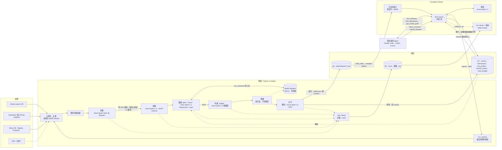

# 架構提案：以 demo 與評分為主軸

2026-10-28（台北）· 技術調研 G 節的候選方案之一 · 角度：讓 3 分鐘影片和評審讀程式碼時最有說服力，同時一個人在 11/4 前做得完。

依據：[brief.md](../../brief.md) 第 4–7、10–13 節；[hackathon-rules.md](../../hackathon-rules.md) 第 2–6 節；[architecture.md](../architecture.md) A、C、D、F 節；[channels.md](../channels.md)；本目錄的筆記。查證日一律 2026-10-28。

標記：**未驗證**＝筆記裡標未驗證，或本提案新提出、還沒查證；**估算**＝自己算的。目前沒有任何 key，所有模型與雲端服務的呼叫都還沒實測（[architecture.md](../architecture.md) D 節）。

---

## 1. 一句話與設計原則

**一句話**：一條跑在 Modal 的 Meta 模型管線（Muse Spark Open 初篩 → Muse Spark 抽取 → Muse Spark 驗證 agent 在沙盒自己裝、自己修 → 程式重播），把軟體變成附證據的 JSON；Cloudflare Worker 上的 MCP server 用 Muse Spark 配對，每一筆推薦都連得回那次驗證的 trace。

| # | 原則 | 落在哪 |
|---|---|---|
| 1 | **Meta 模型每一步都看得見。** 每次呼叫留一行 trace（model ID、推理摘要、工具呼叫、token、花費）。畫面、README、影片結尾的數字一律從 trace 產生，不手寫 | `call_meta()`、run viewer、`meta_usage_report.py`（[meta-usage-design.md](meta-usage-design.md) §7） |
| 2 | **先打通一條垂直路徑，再擴量。** 11/1 前讓「一個 repo 被讀懂、驗證、被 agent 推薦並裝好」整條能跑，之後才加筆數與加分功能 | 第 6 節每天的完成標準 |
| 3 | **agent 有自主，結論有守門。** 驗證 agent 自己選裝法、修錯、決定何時結束；但「verified」要規則檢查、judge、重播三者一致 | [sandbox-verify-design.md](sandbox-verify-design.md) §2、§3.3 |
| 4 | **預跑可以，造假不行。** 大量資料預先跑。影片裡預跑的畫面標「trace 回放」，即時的標「即時，加速 ×N」。不改任何 trace、時間或 commit | 第 3.3 節；[hackathon-rules.md](../../hackathon-rules.md) 第 9 節 |
| 5 | **一個人做得完。** 重用已有的 spike；每個元件先做最低版本；任何一天落後超過 3 小時，照 5.2 節的順序砍 | 第 2.6、5.2、6 節 |

---

## 2. 元件

工時是一個人、含測試的人時（估算）。「最低」是 demo 一定要有的；「加分」只在進度超前時做。

### 2.1 管線（Python 3.12＋uv，跑在 Modal）

| 元件 | 技術 | 做什麼 | 為什麼選它 | 工時（最低＋加分） | 最低版本／加分版本 |
|---|---|---|---|---|---|
| 發現：GitHub search | `httpx`；GitHub REST `/search/repositories`；念誠的 fine-grained PAT | topic＋關鍵字、`created:`、`pushed:`、`stars:5..300` 的 query 組，每 2.1 秒一次；補 README 與最新 release | 兩類新作品主要在這；一次回傳就有 topics、license、stars；只走 API 才合條款（[channels-hosting.md](channels-hosting.md) §2.1）。spike `ch_hosting_github.py` 可改寫 | 3.5＋2 | 最低：近 30 天，每條 query 前 1,000 筆／加分：日期分片完整列舉；Muse Spark 把配對時的「覆蓋缺口」轉成新 query（讓發現也是 agent） |
| 發現：Homebrew 第三方 tap | `formulae.brew.sh` analytics JSON；GitHub contents API 讀 tap 的 `.rb` | 挑 30 天安裝 10–1000、且 365 天 ≤ 1.15 × 30 天的 formula，對回原始 repo | 唯一同時有「真實安裝數」和「默默無聞」的訊號（抽樣星數中位數 1）；對上 Mac demo（[channels-packages.md](channels-packages.md) §2.1） | 1.5 | 最低＝全部（每天一次） |
| 發現：Show HN | HN Algolia `search_by_date`（`tags=show_hn`）；Firebase `newstories` | 只留連到 GitHub 的貼文，存連結與 metadata | 作者本人發表、86% 只有 ≤3 分（[channels.md](../channels.md) §0） | 1.5 | 最低：Algolia 每日回補／加分：Firebase 輪詢 |
| 發現：PyPI | RSS＋XML-RPC `changelog_since_serial`＋wheel `entry_points.txt`（HTTP Range） | 篩有 `console_scripts`、連到 GitHub 的新專案 | 本地 AI 工具多在這（[channels-packages.md](channels-packages.md) §2） | 0＋3.5 | 最低：不做，GitHub topic 與 tap 已涵蓋兩類／加分：接上 |
| 正規化、去重、排程 | 改寫 spike `ch_integration_normalize.py`、`ch_integration_merge.py`；狀態放 Modal Volume | canonical key＝小寫 `github.com/owner/repo`（跟隨改名轉址）；合併 `sources[]`；記 cursor／ETag；已收錄的跳過 | spike 已做增量抓取與合併 | 1.5＋1 | 最低：手動 `modal run`／加分：Modal 排程每 6 小時（Modal 排程用法未實測） |
| 規則前置過濾＋初篩 | 規則（[quality-scoring.md](quality-scoring.md) §1.2）；**Muse Spark Open** `meta-models/muse-spark-open-1026`（未驗證，備案 `meta-models/muse-spark-open`）@ Baseten，`reasoning_effort: low`；pydantic 驗證 | 丟掉 fork、archived、沒 README；模型判斷是不是可用軟體、哪一類，附原文證據；不給星數；低信心送 `muse-spark-1.3` 複查 | 量最大、答案短；拿 Best Open Weight 資格；Baseten 不強制 schema，所以程式端驗（[meta-open-weights.md](meta-open-weights.md) §4.2、§9） | 2.5＋1.5 | 最低：初篩＋低信心升級＋5% 抽樣和 1.3 比對一致率／加分：人工標 30 筆算準確率 |
| 抽取 | `muse-spark-1.3`，Responses API，`text.format` strict schema `software_profile_v1`，`reasoning.effort: low` | README、release notes、manifest → 結構化檔案；每欄附逐字引用；程式檢查引用真的在來源裡；事實欄位用 API 值 | constrained decoding 保證合 schema（[meta-usage-design.md](meta-usage-design.md) §4.2） | 4.5＋1.5 | 最低：文字來源／加分：README 裡最多 3 張截圖一起讀 |
| 驗證 agent（actor） | `muse-spark-1.3`，Responses＋`previous_response_id`，`reasoning: {effort: medium, summary: auto}`，`parallel_tool_calls: false`；function tools：`run_command`、`run_background`、`read_file`、`write_file`、`take_screenshot`、`finish` | 照 README 安裝 → 讀錯誤 → 修正 → smoke test → `finish`（含 `install_steps`、`deviations_from_readme`）。15 類常見錯誤先用規則處理 | 最能證明「Meta 模型是核心」與 agentic；官方 cookbook 有同型範例（[meta-usage-design.md](meta-usage-design.md) §4.3.1） | 6＋1 | 最低：CLI＋本地 AI 的服務／極小模型推論檢查；上限 25 回合、15 指令、20 分鐘、每款 $0.50、同錯 3 次／加分：內建 `web_search` 查錯誤；失敗時換 `muse-wonder-1.0` 重試 |
| 判讀（judge）＋截圖 | `muse-spark-1.3` 另開一次呼叫（圖片＋`text.format`，`effort: low`）；Pillow 把終端輸出畫成 PNG | 只看截圖、指令、exit code、預期訊號；回 `verdict` 與 0–1000 座標的證據框 | actor 不給自己打分；證據框直接畫在 demo 畫面上（[sandbox-verify-design.md](sandbox-verify-design.md) §3） | 2.5＋1 | 最低：終端截圖＋judge／加分：pty 顏色、TUI 第一個畫面、本地 AI 網頁 UI（Playwright） |
| 重播（replay） | 程式；全新的 Modal Sandbox | 照 `finish.install_steps` 與 smoke test 重跑，不呼叫模型；通過才標 `reproducible: true` | 把「模型說可以」變成「照做可以」 | 1 | 最低＝全部 |
| 沙盒 | Modal Sandbox：`runtime="gvisor"`、`cpu=(0.5, 2)`、`memory=(1024, 4096)`、`timeout=1200`；named image（python 3.12-slim＋libgomp1、git、curl、uv、pipx、node）；安裝時網域 allowlist、執行時斷網；沙盒內零金鑰 | 每款一個全新沙盒，跑完就刪 | 比賽 credits、gVisor、可在執行中改網路政策（[sandbox-compare.md](sandbox-compare.md) §0、§4.1） | 3＋3 | 最低：spike `sb_modal_verify.py` 改成 `ModalBox`（和 spike 的 `DockerBox` 同介面）＋`--limits-test`／加分：E2B 備案（只在 Modal 出問題時做） |
| Mac 驗證（只限 demo 的 3–5 款） | 念誠的 Apple silicon Mac＋Tart；或 GitHub Actions `macos-15`（spike `sb_gha_macos_brew.yml`） | 照 `get_install_guide` 的 Mac 步驟跑一次，寫進 `install.macos` 並註明方式 | demo 使用者在 Mac，Linux 沙盒不能代表 Mac；Actions 條款只容許少量（[architecture.md](../architecture.md) C.1） | 1.5 | 最低＝全部 |
| 計分 | 規則（Python）＋`muse-spark-1.3` 文件 rubric（附引用）；加分：`muse-spark-1.3`＋`web_search` 搜尋可見度 | 品質 Q、知名度 N 分開算；寶藏＝驗證通過、Q ≥ 70、N ≤ 45；理由寫進推薦 | 規則算的品質會飽和，要靠驗證與模型 rubric 拉開（[quality-scoring.md](quality-scoring.md) 一句話結論） | 3.5＋1.5 | 最低：規則＋文件 rubric／加分：搜尋可見度（「用一般需求搜尋找不找得到它」變成數字，也是對照組的縮影） |

**計分公式 v1**：兩份草案權重不同（[quality-scoring.md](quality-scoring.md) §3.1、[meta-usage-design.md](meta-usage-design.md) §4.4）。建議採前者的分項（沙盒驗證 35、安裝與文件 20、維護 15、工程衛生 10、回應 10、使用結果 10），其中「安裝與文件」改由 Muse Spark 依 rubric 評、附引用；後者的「安裝說明準確度」併進驗證分（要改 README 步驟才成功 × 0.8）。知名度照 [quality-scoring.md](quality-scoring.md) §3.2。存 `formula_version: v1`，門檻收完候選後再依分布調。

### 2.2 資料與服務

| 元件 | 技術 | 做什麼 | 為什麼選它 | 工時（最低＋加分） | 最低版本／加分版本 |
|---|---|---|---|---|---|
| 儲存 | 正本：git `data/software/<slug>.json`（JSON Schema 驗證）。建置產物：候選卡＋BM25 倒排，打包進 Worker。D1：`events`、`reverify_queue`、`meta_budget`、`submissions`、`live_profiles`。R2：trace、截圖、log | 正本可審計；即時路徑寫 D1 的 `live_profiles`（overlay），Worker 查詢時把它疊在打包的索引上，不必等重新部署 | 每次改動一個 commit，也是賽中成果的證據；不用向量搜尋（[storage-matching.md](storage-matching.md) §0、§3）。overlay 是本提案新增，為了「幾分鐘內可被推薦」 | 4＋1 | 最低：本機 `pickfit sync`：從 Modal Volume 拉 JSON → 驗證 → commit → `build_index` → `wrangler deploy`／加分：Workers Builds；`sync_outcomes` 把回報彙總寫回 JSON |
| MCP server | TypeScript；`@modelcontextprotocol/server` 2.4.0 的 `createMcpHandler`（同時服務新舊兩代、無狀態）；Cloudflare Workers；配對用 `muse-spark-1.3`（`store: false`） | 5 個工具（下表）；Host／Origin 檢查；Rate Limiting binding；Meta 預算超過就改規則排序並標 `degraded: true` | spike 在 Node 與 workerd 都通過兩代檢查（[mcp-server.md](mcp-server.md) §0、§6） | 8＋1.5 | 最低：5 個工具、公開 URL、Claude Code 與 Codex 的連線說明／加分：MCP Registry 登錄、Cursor 一鍵安裝連結 |
| 提交入口 | MCP `submit_software`＋Modal web endpoint `run_one(url)`（Worker 用 HMAC 共用密鑰呼叫）；狀態寫 D1 `submissions` | 收 GitHub 連結（可附 Threads 貼文連結，只用 oEmbed 嵌入）；跑和批次**同一套** stage；寫 overlay；同一個 URL 重送就是查進度 | Threads 貼文內容沒有合規方式交給模型（[channels-meta-platforms.md](channels-meta-platforms.md) §2.2） | 2.5＋2 | 最低：MCP 工具＋狀態輪詢／加分：網頁表單、GitHub Issue Form、Threads oEmbed 嵌入、「分享到 Threads」按鈕 |

MCP 工具（4＋1，schema 照 [mcp-server.md](mcp-server.md) §5.4）：

| 工具 | 呼叫 Meta 模型？ | 要點 | 為 demo 加的欄位（本提案新增） |
|---|---|---|---|
| `find_software` | 是：解析需求、比較取捨（`muse-spark-1.3`） | 硬條件篩 → BM25 取 25 張候選卡 → 模型選 1–3 個，每個理由附 `field_ref` → 程式守門（[storage-matching.md](storage-matching.md) §2.1） | `matched_by`（model ID、token、花費）、每個推薦的 `how_we_know` 與 `evidence_url` |
| `find_alternatives` | 同上 | 共用後端；多帶 `current_software`、`pain_points`；可回 `keep_current` | 同上 |
| `get_install_guide` | 否 | 只回重播過的步驟；`applies_to_user_system`；`run_by: agent／user` | `evidence_url`（連到 run viewer） |
| `report_outcome` | 否（失敗會觸發驗證 agent） | 必須帶 `rec_id`（HMAC）；同 `rec_id`＋`stage` 只記一次；失敗＋錯誤訊息 → `reverify_queue` | `next.reverify_run_url` |
| `submit_software` | 觸發整條管線 | 冪等；回 `status`、`check_again_after_s` | `run_url`（看板上這次提交的進度） |

`find_software` 是兩次串行的 Muse Spark 呼叫，延遲未實測（目標 20 秒內）；Codex 預設工具逾時 60 秒（[mcp-server.md](mcp-server.md) §4、§7）。

### 2.3 評測、展示與營運

| 元件 | 技術 | 做什麼 | 為什麼選它 | 工時（最低＋加分） | 最低版本／加分版本 |
|---|---|---|---|---|---|
| 評測（brief 第 10 節） | `eval/questions.yaml`（10/28 寫好就 commit 凍結，賽中新寫）；harness 用 Claude Code 無頭模式跑兩組（不接／接 MCP；旗標以當時的 `claude --help` 為準，未驗證）；推薦的步驟在沙盒重播 | 20 題 × 2 組；逐題記：推薦的軟體存在且合條件、步驟正確、照做能跑；另記候選數、驗證通過率、提交到可推薦的分鐘數 | brief 要求；同一批錄影也是影片的對照組素材 | 6＋1 | 最低：兩組＋人工判定表，輸的題也寫進 README／加分：第三組「關掉模型、只用規則排序」，量出 Muse Spark 在配對的貢獻（[storage-matching.md](storage-matching.md) §2.3） |
| run viewer＋管線看板 | 純 HTML＋原生 JS，放 Workers Static Assets（和 MCP 同一個 Worker）；讀 R2 的 trace JSON | `/runs/<id>`：每一步的模型徽章、推理摘要、工具呼叫、exit code、token、花費；截圖疊上 judge 的證據框；重播結果；「和 README 不同的地方」。`/`：漏斗與各模型呼叫數、花費 | 影片中段的主畫面；MCP 回應的 `evidence_url` 直接連過來，評審點得到 | 4＋4 | 最低：run viewer＋看板（批次結果）＋提交狀態輪詢／加分：提交時逐步串流 trace、公開寶藏列表、分享按鈕 |
| trace／觀測 | `pipeline/meta.py` 的 `call_meta(stage, request)`；JSONL（欄位見 [meta-usage-design.md](meta-usage-design.md) §7.1）；`scripts/meta_usage_report.py` | 每次模型呼叫一行；工具輸出截尾、README 只存 URL 與雜湊；配對只記 stage、模型、token、花費，不記需求原文 | 25% 評分項要「一眼看出」，而且數字要能追溯 | 2.5 | 最低＝全部 |
| 金鑰與花費控管 | `.env`（不 commit）；Modal Secrets；Worker secrets；發現、驗證、配對各一把 Meta key | 每次呼叫讀 `usage` 記帳；每日 $25、總額 $120 硬停；每款驗證 $0.50；Baseten 開 enforce 月預算；Worker 用 D1 `meta_budget` | Meta 的 Spend Limit 只寄信、不會停止扣款（[meta-model-api.md](meta-model-api.md) §5） | 1 | 最低＝全部 |
| 第一天：帳號與 spike 實測 | spike `meta_api_hello.py`、`meta_responses_agent_probe.py`、`meta_baseten_hello.py` | 註冊、領 credits；把 [architecture.md](../architecture.md) D.4 的 5 個未驗證項目變成實測數字 | 成本、agent 設計、備案都取決於這些答案 | 2.5 | — |
| demo 製作 | — | 選故事、彩排、錄影、剪輯；README（Meta 用法、評測、賽前／賽中說明）；檢查表、交件、X 貼文 | Demo 佔 25%，影片是主要評審依據（[hackathon-rules.md](../../hackathon-rules.md) 第 2、4 節） | 13 | — |
| 整合與除錯緩衝 | — | — | — | 6 | — |

### 2.4 Meta 模型在哪裡被看見

| 環節 | 模型 | 影片畫面 | 評審讀程式碼時看哪 |
|---|---|---|---|
| 初篩 | Muse Spark Open @ Baseten | 看板徽章與漏斗數字；提交那一幕的第一步 | `pipeline/stages/triage.py`、`pipeline/prompts/triage.md` |
| 抽取 | `muse-spark-1.3` | run viewer：每個欄位旁的原文引用 | `pipeline/stages/extract.py`、`schema/software_profile_v1.json` |
| 驗證 actor | `muse-spark-1.3` | run viewer：每一步的推理摘要與工具呼叫，「自己修錯」那一步高亮 | `pipeline/stages/verify_actor.py`（迴圈與停止條件） |
| 判讀 | `muse-spark-1.3`（圖片） | 截圖上的證據框 | `pipeline/stages/verify_judge.py` |
| 計分 | `muse-spark-1.3` rubric | 軟體頁的分項與引用 | `pipeline/stages/score.py` |
| 配對 | `muse-spark-1.3` | agent 收到的工具結果：`matched_by`、理由對到欄位 | `worker/src/match.ts` |
| 重驗 | `muse-spark-1.3` | 回報失敗後，git diff 多了一個修正步驟 | `pipeline/stages/reverify.py` |
| 總計 | 全部 | 結尾：各模型呼叫數、token、花費（從 trace 算） | `scripts/meta_usage_report.py` |

`reasoning.summary` 官方不保證每次都有（[meta-usage-design.md](meta-usage-design.md) §8 #11）；沒有時 viewer 只顯示工具呼叫。

### 2.5 repo 目錄（建議）

```text
pipeline/          Python：stages/、prompts/、meta.py（call_meta、ledger、trace）、sandbox.py（ModalBox）、modal_app.py
schema/            software.v1.json、software_profile_v1.json（抽取用）
data/software/     每款一份 JSON（正本）
worker/            TypeScript：MCP server、match.ts、overlay、static assets
site/              run viewer、看板（純 HTML＋JS）
eval/              questions.yaml（10/28 凍結）、harness、results/
scripts/           pickfit_sync、build_index、meta_usage_report
spikes/            調研 spike（已有，不是產品程式碼）
```

### 2.6 工時合計

| 項目 | 人時 |
|---|---:|
| 管線（發現 8、初篩 2.5、抽取 4.5、驗證 actor 6、judge 2.5、重播 1、沙盒 3、Mac 1.5、計分 3.5） | 32.5 |
| 資料與服務（儲存 4、MCP 8、提交入口 2.5） | 14.5 |
| 評測、展示、營運（評測 6、viewer 4、trace 2.5、金鑰 1、第一天 2.5） | 16 |
| demo 製作 | 13 |
| 緩衝 | 6 |
| **最低版本合計** | **82** |
| 加分項合計（進度超前才做） | 25.5 |

可用時間（估算）：10/28 約 9 h、10/29–11/3 每天 10.5–11 h、11/4 約 8.5 h，合計約 82 h。**沒有多餘空間**：加分項只能用每天省下的時間做，落後就照 5.2 節砍。

---

## 3. 資料流

### 3.1 圖



### 3.2 兩條路徑

| | 批次路徑 | 即時路徑（提交） |
|---|---|---|
| 觸發 | `modal run`（加分：每 6 小時排程） | `submit_software` → Worker 用 HMAC 呼叫 Modal `run_one(url)` |
| stage | 發現 → 初篩 → 抽取 → 驗證 → 判讀 → 重播 → 計分 | 同一套 stage 程式碼，只處理一筆 |
| 結果寫到 | Modal Volume → 本機 `pickfit sync` → commit → 重新部署索引 | D1 `live_profiles`（立刻可被推薦）＋Volume；之後 `pickfit sync` 補 commit |
| trace | R2 | R2；進度寫 D1 `submissions.status`，看板輪詢 |
| 預估時間 | 150 款約 1.5 小時（10 個沙盒並行，估算） | 約 6–11 分鐘：初篩 10 秒、抽取 30 秒、驗證 4–8 分鐘、判讀與重播 1–2 分鐘、計分 20 秒（估算，未實測） |

overlay 的理由：push → 建置 → 部署的時間未量過（[storage-matching.md](storage-matching.md) §1.3 估 1–3 分鐘，未驗證），而且批次 commit 很多時會排隊。寫 D1 讓「提交到可推薦」只取決於管線本身。

### 3.3 demo：什麼要即時、什麼可以預跑

| 內容 | 方式 | 理由 | 影片怎麼標 |
|---|---|---|---|
| 發現、初篩、抽取 150–300 款 | 預跑（10/29–11/1 批次） | 量大，跑數小時 | 看板數字由 trace 產生，標「本週批次」 |
| 50–100 款驗證與重播 | 預跑 | 每款 4–8 分鐘（估算） | run viewer 標「trace 回放」 |
| 計分、搜尋可見度 | 預跑 | — | — |
| 評測 20 題 × 2 組 | 預跑 | 跑很久；結果放 README | 只秀結果表 |
| demo 款的 Mac 驗證 | 預跑 | 只有 3–5 款 | 註明在哪台機器、什麼方式 |
| 對照組：agent 自己上網查 | 即時錄影（可取自評測那次） | 要真實 | 不剪掉它推薦了什麼 |
| `find_software` → `get_install_guide` | **必須即時** | 主張本身；Muse Spark 即時配對 | 秀工具結果裡的 `matched_by` |
| agent 在 Mac 上安裝並第一次執行 | **必須即時** | 「第一次執行就成功」不能預錄 | 可加速，標 ×N |
| 提交 → 被讀懂、驗證 → 被推薦 | **必須即時** | 「幾分鐘內」是主張本身；也是 Best Agentic 的主畫面 | 計時器＋「加速 ×8」 |
| 回報失敗 → 重驗 → git diff | 預跑可，能即時更好 | 一次要幾分鐘 | 預跑就標「回放」 |

**即時提交那一幕的規則**：
- 提交的 repo 從發現結果挑一個**還沒處理過**、第三方、可在 Linux 沙盒驗證的。不能是念誠自己的作品（brief 第 9 節）。影片裡是「使用者」提交別人的作品，不扮演作者。
- 可以先 dry run 同一款確認會過，但正式錄影前把它從 `data/`、overlay、R2 刪乾淨，錄影那次是全新的一輪。dry run 的 trace 保留，不覆蓋。
- 錄 2–3 次，用其中一次。失敗的那幾次 trace 照樣保留。

### 3.4 3 分鐘分鏡

| 時間 | 畫面 | 即時／預跑 | Meta 模型露出 |
|---|---|---|---|
| 0:00–0:10 | 一句話：賽前有什麼、這週做了什麼（官方要求） | — | — |
| 0:10–0:25 | 問題：好軟體找不到、agent 也不認識 | — | — |
| 0:25–0:45 | 對照組：同一個 agent 不接 pickfit，推薦知名但不合條件的，或根本不知道今年的專案 | 即時錄影 | — |
| 0:45–1:25 | 接上 pickfit：`find_software` → 推薦今年的寶藏，附理由、最好的免費選項、`how_we_know` → `get_install_guide` → 在 Mac 上裝好、第一次執行成功 → `report_outcome` | 即時 | `matched_by: muse-spark-1.3` |
| 1:25–1:55 | 「怎麼知道裝得起來」：點 `evidence_url` → run viewer 回放：actor 照 README 失敗 → 讀錯誤 → 自己修 → judge 框出證據 → 重播通過 | 預跑（標回放） | actor、judge 的模型徽章與推理摘要 |
| 1:55–2:35 | 供給端：`submit_software` → 看板逐步亮起：Spark Open 初篩 → 抽取 → 驗證 → 列入 → 再問一次 `find_software`，它出現了 | 即時（加速 ×8、計時器） | 每一步的模型徽章 |
| 2:35–2:50 | 自我修正：回報失敗 → 驗證 agent 重跑 → git diff 多一個步驟 | 預跑或即時 | `muse-spark-1.3` |
| 2:50–3:00 | 數字：漏斗、驗證通過率、評測結果、各模型呼叫數與花費 | trace 產生 | 全部 |

### 3.5 加碼獎對上什麼

| 獎 | 條件（[hackathon-rules.md](../../hackathon-rules.md) 第 5 節） | 本提案的證據 |
|---|---|---|
| Best Agentic Use-Case | 自主程度、效果、實用性 | 驗證 agent 自己選裝法、修錯、決定何時停；回報 → 重驗 → 步驟被修正的閉環；提交後自動跑完整條管線。README 放平均步數、自修比例（`deviations_from_readme` 筆數）、重播成功率 |
| Best Build on Meta Open Weight Models | Spark Open 或 Glimmer，跑在合作夥伴的推論服務 | Spark Open @ Baseten 做全部初篩；看板與提交那一幕可見；README 放呼叫數、token、和 1.3 的一致率；標「Built with Muse Spark Open」（授權第 2 條，[meta-open-weights.md](meta-open-weights.md) §2）。提交時怎麼標要到 Discord 問（未驗證，§7） |
| Most Viral | X 貼文互動數 | 交件後發 demo 貼文；影片前 10 秒要能單獨看懂 |

---

## 4. 成本估算

### 4.1 規模假設（估算）

| 階段 | 筆數 |
|---|---:|
| 原始候選（GitHub、Homebrew tap、Show HN，一週） | 約 1,500 |
| 規則前置過濾後，送初篩 | 約 700 |
| 初篩通過，送抽取（通過率 30–35%，假設） | 約 210–250 |
| 送驗證 agent（需要 GPU、macOS、帳號的先早停） | 約 150 |
| 驗證通過（含 partial） | 50–100 |
| 重驗（回報觸發、修 bug 後重跑） | 約 30 |
| 配對查詢（開發、評測、demo） | 約 300 次 |

### 4.2 各服務

單價來自 [meta-usage-design.md](meta-usage-design.md) §3.3、§5 與 [sandbox-verify-design.md](sandbox-verify-design.md) §5。推理 token 未實測，是最大誤差來源。

| 服務 | 項目 | 算式 | 估計 |
|---|---|---|---:|
| Meta API | 初篩複查＋一致率抽樣 | 105 × $0.0042 | $0.4 |
| Meta API | 抽取（含 10% 重試） | 250 × $0.022–0.025 × 1.1 | $6.1–6.9 |
| Meta API | 驗證 actor | 150 × $0.10–0.27 | $15–41 |
| Meta API | 判讀 judge | 150 × $0.013 | $2.0 |
| Meta API | 驗證中 `web_search`（加分） | 約 75 次搜尋＋token | $0.5 |
| Meta API | 重驗 | 30 × $0.10–0.28 | $3–8.4 |
| Meta API | 文件評分 | 100 × $0.017 | $1.7 |
| Meta API | 搜尋可見度（加分） | 200 次 × $0.0096 | $1.9 |
| Meta API | 配對 | 300 × $0.024 | $7.2 |
| Meta API | 開發、spike、重跑（＋30%） | — | $11–21 |
| **Meta API 小計** | | | **$49–91** |
| Baseten | Spark Open 初篩 | 700 × $0.0042；推理加倍時 × $0.0063；＋30% 開發 | **$4–6** |
| Modal | CLI 驗證沙盒 | 110 款 × 6 分鐘 × 1 core＋2 GiB（約 $0.019／款） | $2.1 |
| Modal | 本地 AI 驗證沙盒 | 40 款 × 10 分鐘 × 2 core＋4 GiB（約 $0.063／款） | $2.5 |
| Modal | 重播＋重驗 | 130 次 × 約 $0.01–0.03 | $2 |
| Modal | 管線函式（一般容器，不是沙盒的 3 倍價） | — | $1–2 |
| Modal | 開發除錯 × 1.5 | — | **小計約 $11–13** |
| Modal | 最壞情況：180 次都跑滿 20 分鐘、2 core＋4 GiB | 180 × $0.127 | $23 |
| Cloudflare | Workers Paid（建議 demo 週開，避開 10 ms CPU 風險）；D1、R2、Static Assets、Builds 都在免費額度內 | — | $0–5 |
| GitHub | Actions macOS（repo 還是 private 時 $0.062／分）；5 款 × 約 10 分鐘 | 用 Tart 或 repo 轉 public 後為 $0 | $0–3 |
| 其他 | E2B（只當備案，Hobby 送 $100）；網域（可選，價格未查）；Claude Code（評測與 demo 的 agent，念誠既有方案，不計） | — | $0 |

### 4.3 合計

| 付款方 | 一般 | 偏高 | 額度與注意 |
|---|---:|---:|---|
| Meta API | $49 | $91 | $150 credits。claim 表要 Team ID，核准後 2 個工作天入帳；入帳前的用量會先刷卡（[meta-model-api.md](meta-model-api.md) §5） |
| Baseten | $4 | $6 | $100 credits 要審核；沒核准就自費，仍符合開放權重獎的條件 |
| Modal | $11 | $23 | $100 credits（前 1,000 人，不保證）；Starter 每月另含 $30，沒 credits 也夠 |
| Cloudflare | $0 | $5 | — |
| GitHub | $0 | $3 | — |
| **自費現金（credits 都到位時）** | **$0–5** | **$8** | |

**最壞情況**：每款驗證都跑滿 $0.50 上限時，Meta 約 $146，會碰到 $150。所以 ledger 總額 $120 硬停，11/2–11/3 錄影另留 $15；若 10/28 的 spike 顯示推理 token 比估算多一倍，驗證批次從 150 款降到 100 款。

---

## 5. 風險

### 5.1 風險表

| # | 風險 | 機率 | 影響 | 退路 |
|---|---|---|---|---|
| 1 | 台灣帳號開不了 Meta Model API（未驗證） | 中 | 極高：第一輪 pass/fail | 10/28 中午前確認；不行就抽取、驗證、配對全改 Spark Open @ Baseten（有 tool calling 與圖片，schema 由程式驗證）（[meta-usage-design.md](meta-usage-design.md) §8 #1） |
| 2 | 驗證 agent 通過率太低或常卡住 | 中 | 高：可推薦的寶藏太少、demo 故事撐不起來 | 規則表先處理常見錯誤；只送有套件管理器或 release 二進位的；`unsupported_env` 早停不算失敗；先保證 demo 那 3–5 款 |
| 3 | 錄影時即時提交那一幕失敗（安裝慢、504、網路） | 中 | 高：Demo 25% | dry run 後清乾淨再錄；錄 2–3 次；最後退路是播上一輪真實 trace 並標「回放」 |
| 4 | 找不到「寶藏確實勝過知名產品」的 demo 故事 | 中 | 高 | 10/29 起在看板標候選；11/1 定主案＋2 備案；先找本地 AI 類（「模型不認識今年的專案」最有力）。起點例如 tap 抽樣中的本地 LLM 工具（[channels-packages.md](channels-packages.md) §4.1），品質未驗證 |
| 5 | 一個人時程落後 | 高 | 高 | 每天有完成標準；落後超過 3 小時就照 5.2 砍；11/1 前只做垂直路徑 |
| 6 | demo 款在 Mac 上裝不起來（沙盒是 Linux） | 中 | 高：demo 第 4 幕 | 11/3 前在 Mac 驗過；`get_install_guide` 回 `applies_to_user_system`；換備案款 |
| 7 | 推理 token 比估算多，花費加倍 | 中 | 中 | 10/28 用 spike 的 `usage` 換掉估算；`effort` 降到 `low`；驗證批次降到 100 款；ledger 硬停 |
| 8 | `find_software` 太慢（兩次串行呼叫，未實測） | 中 | 中 | 兩步合成一次呼叫；`effort: low`；Codex 調高 `tool_timeout_sec`；逾時就規則排序並標 `degraded: true` |
| 9 | Baseten credits 沒核准，或 `-1026` 的 model ID 不存在 | 中 | 低 | `/v1/models` 查；自費約 $6；最後改 `muse-spark-1.3-contributor`（失去開放權重獎） |
| 10 | Meta credits 晚到、Spend Limit 不擋扣款 | 中 | 中 | 10/28 就 claim；ledger 每日 $25、總額 $120 |
| 11 | 文件矛盾：截圖放 tool 輸出看不看得到；`text.format` 能否和 tools 併用 | 中 | 低 | 截圖改放 user 訊息或只給 judge；`finish` 工具＋程式驗證（[architecture.md](../architecture.md) D.4） |
| 12 | Modal credits 沒發、gVisor 與某些工具不相容、網域 allowlist（Beta）出問題 | 低–中 | 中 | Starter 每月 $30；改 VM runtime；E2B 備案；錄影保底是本機 Docker（只跑 demo 款） |
| 13 | Workers Free 冷啟動超過 10 ms CPU（未驗證） | 低–中 | 中 | 開 Paid（每月 $5） |
| 14 | 被看成基本 RAG | 中 | 高：反面範例 | 影片前半就秀驗證 agent 與即時提交；README 放「Why this is not RAG」表與 ablation 數字；不用 knowledge base、retrieval 這些字 |
| 15 | 條款：Actions macOS 用途、GitHub 大量抓取、Threads 內容 | 低 | 高：repo 或帳號被停 | Actions 只跑 demo ≤ 5 款、`permissions: {}`；只走 API、守 rate limit；Threads 只嵌入 |
| 16 | 惡意 repo 或 README 裡的 prompt injection | 低 | 中 | 沙盒零金鑰、gVisor、allowlist；來源包在 `<source>`；judge 不能推翻規則檢查 |
| 17 | 評測結果不好看 | 中 | 中 | 照實寫進 README（brief 要求含輸的題）；分析輸在哪 |

### 5.2 砍除順序

落後時從上往下砍：

1. 所有加分項（PyPI、即時 trace 串流、公開寶藏列表、表單、Threads 嵌入與分享、MCP Registry、E2B）。
2. 搜尋可見度探針。
3. `find_alternatives` 的獨立邏輯：工具保留，直接共用 `find_software` 並帶 `current_software`。
4. 本地 AI 的推論驗證降成服務驗證。
5. 驗證批次從 150 款降到 50 款，demo 款優先。
6. 開放權重初篩改 `muse-spark-1.3-contributor`：只在 Baseten 完全不能用時（會失去 Best Open Weight 資格）。

**不砍**：驗證 agent＋judge＋重播、`find_software`＋`get_install_guide`、提交即時路徑、trace 與 run viewer、評測、影片。

---

## 6. 每天的工作（10/28–11/4，台北時間）

| 日期 | brief 第 12 節 | 本提案的工作（人時） | 背景批次 | 完成標準：可以 demo 什麼 |
|---|---|---|---|---|
| 10/28（三） | 凍結評測題組；骨架；申請 credits | 帳號與 credits：Meta（綁卡、記 Team ID、填 claim 表）、Baseten、Modal、Cloudflare、E2B（備案）、GitHub PAT；跑 3 支 spike（2.5）· 寫 20 題評測並 commit（2.5）· 骨架＋`call_meta()`＋ledger＋trace（2.5）· 金鑰管理（1）· 把 spike 的 MCP worker 部署到 `workers.dev`，用 Claude Code 連一次（0.5）＝ **9** | — | 一次 `muse-spark-1.3`、一次 Spark Open 呼叫各留一行 trace（模型、token、$）；`eval/questions.yaml` 已 commit；Claude Code 看得到遠端 MCP 的 hello 工具。**中午前確認 Meta 帳號能用，不行就切 Baseten 全路徑** |
| 10/29（四） | 發現 agent：GitHub 收候選、抽取 | GitHub search（3.5）· Homebrew tap（1.5）· Show HN（1.5）· 正規化去重（1.5）· 規則＋Spark Open 初篩（2.5）＝ **10.5** | 晚上：發現全量 → 初篩 | 終端機印出漏斗：原始 → 過濾 → 初篩通過，每格標模型與花費；Spark Open 和 1.3 的抽樣一致率有第一個數字；開始標記 demo 故事候選 |
| 10/30（五） | 配對 MCP 的 4 個工具 | 抽取＋引用檢查（4.5）· 驗證 agent actor，先在本機 Docker 跑已知工具（6）＝ **10.5** | 晚上：抽取約 250 款 | 一款「照 README 會失敗」的真實工具，由 Muse Spark 自己讀錯誤、修好、呼叫 `finish`；trace 看得到每一步的推理摘要；≥ 30 份 profile JSON 已 commit |
| 10/31（六） | 驗證 agent | Modal 沙盒（3）· judge＋截圖（2.5）· 重播（1）· 儲存：schema、`build_index`、D1、R2、overlay（4）＝ **10.5** | 晚上：Modal 批次驗證第一輪 50 款 | 同一款在 Modal gVisor 跑完 actor → judge（證據框）→ 重播通過；驗證通過率有第一個數字；`pickfit sync` 把結果 commit 並部署索引 |
| 11/1（日） | 提交入口；寶藏分數；開放權重初篩 | MCP 5 個工具、限流、預算、降級（7.5）· 計分（3.5）＝ **11** | 晚上：批次驗證第二輪約 100 款＋計分 | **垂直路徑打通**：Claude Code 說需求 → `find_software`（Muse Spark 配對）→ `get_install_guide`，回應附 `how_we_know` 與 `evidence_url`；寶藏分數出現；demo 主案＋2 個備案定案 |
| 11/2（一） | 跑評測、修正 | 提交即時路徑（2.5）· run viewer＋看板（4）· 評測 harness、兩組執行、判定（3.5）· 緩衝（1）＝ **11** | 修 bug 後重驗失敗款；評測 20 × 2 | `submit_software` 一個沒處理過的 repo → 看板逐步亮起 → 幾分鐘後 `find_software` 找得到，量出實際分鐘數；評測結果表（含輸的題） |
| 11/3（二） | 打磨 demo；README；錄影 | demo 款 Mac 驗證（1.5）· 彩排＋錄影（5）· README（2）· 緩衝（2.5）＝ **11** | 錄影前最後一次 sync、deploy，資料凍結 | 影片素材齊全：對照組、即時推薦與安裝、即時提交、自我修正（回報 → 重驗 → git diff）；README 草稿含 Meta 用法、評測、賽前／賽中說明。**這天是主辦方回答問題的最後一天**：先問開放權重怎麼標、Community Vote 看哪個頁面 |
| 11/4（三） | 檢查表；轉 public；提交；X 貼文 | 剪輯（3）· README 定稿（1）· 檢查表、轉 public、未登入測試、提交（1.5）· X 貼文（0.5）· 緩衝（2.5）＝ **8.5** | — | 已提交（目標台北 11/4 晚上，留 11/5 上午當緊急時間）；X 貼文連結附在提交平台 |

合計 82 h，和 2.6 節一致。

**和 brief 第 12 節的差別**：
- 驗證 agent 提前到 10/30–10/31，MCP 延到 11/1。驗證是最大風險，也是 demo 的核心；MCP 有通過兩代檢查的 spike，而且 10/28 先部署 hello 版、確認 Claude Code 連得上。
- 寶藏分數、開放權重初篩分散到 10/29、11/1；提交入口放 11/2，因為它重用整條管線，管線穩了才做。
- demo 故事 11/1 定案，比錄影早兩天，讓 Mac 驗證與彩排有時間。

---

## 7. 對 brief 的修改建議

本提案沒有修改 brief。

### 7.1 建議修改的地方

| 節 | 現在寫的 | 建議 | 理由 |
|---|---|---|---|
| 4.1、5 第 5 幕 | 貼 GitHub 或 Threads 連結就收錄；作者在 Threads 分享後貼連結 | 提交 GitHub 連結（可附 Threads 貼文連結，只用 oEmbed 嵌入）；影片裡由「使用者」提交別人的作品，不扮演作者 | Threads 內容沒有合規方式交給模型（[channels-meta-platforms.md](channels-meta-platforms.md) §2.2）；第 9 節不自己做被推薦的軟體 |
| 4.4 | 4 個工具 | 加 `submit_software`；推薦一律帶 `how_we_know`、`evidence_url`、`rec_id`、`matched_by` | 第 5 幕可以全在 agent 裡做；評審點得到證據（[mcp-server.md](mcp-server.md) §5） |
| 4.5 | 展示頁可選，時間不夠先砍 | 拆兩塊：run viewer＋看板（必做，Meta 模型在影片裡被看見的主畫面）；公開寶藏列表（可選） | Use of Meta AI Tooling 佔 25%，要一眼看出 |
| 4.5、7 | 展示頁用於社群投票 | 先在 Discord 確認 Community Vote 的「公開展示頁」是不是主辦方的提交平台（未驗證） | 若是，自己的展示頁不影響投票，就不該為投票花時間 |
| 6 | 初篩：Spark Open 或 Glimmer；驗證判讀一列 | 初篩只寫 Spark Open @ Baseten；拆成「驗證 agent」「畫面判讀」；加「計分」一列；影音最後做 | Glimmer 沒有合作夥伴按 token 計費（[meta-usage-design.md](meta-usage-design.md) §11） |
| 10 | 對照組、實驗組 | 加第三組「關掉模型、只用規則排序」；系統數字的「提交到可推薦」用即時路徑實測 | 量出 Muse Spark 的貢獻；影片主張要有數字 |
| 11 | YAML；事件一張表 | JSON；D1 加 `submissions`、`live_profiles`（即時 overlay）；trace 與截圖放 R2 | [storage-matching.md](storage-matching.md) §0；即時路徑不等重新部署 |
| 12 | 10/30 MCP、10/31 驗證 | 見第 6 節：驗證提前、MCP 延後；11/1 定 demo 故事 | 先做最大風險 |
| 13 | 砍除順序：展示頁 → Threads 入口 → 開放權重初篩 | 改成 5.2 節：先砍加分項；run viewer 不砍；開放權重最後才砍 | 開放權重初篩只要 2.5 h，對 25% 評分項與 $10K 加碼獎都有幫助；Threads 入口本來就改成只嵌入 |
| 8 | GitHub API：可以；注意 rate limit | 補：只走 API、不爬 HTML、只存自己抽出的事實＋連結、不整份轉貼 README | [channels-hosting.md](channels-hosting.md) §2.1 |

### 7.2 需要念誠決定或提供

| 項目 | 為什麼 | 建議 |
|---|---|---|
| 有沒有 Apple silicon Mac | 決定 Mac 驗證用 Tart 還是 GitHub Actions；demo 第 4 幕在哪台機器錄 | 有就用 Tart，沒有條款疑慮 |
| Cloudflare Workers Paid（每月 $5） | 冷啟動 CPU 未驗證 | 10/31 部署前開 |
| demo 用哪個 agent | 對照組與實驗組要同一個 | Claude Code（遠端 MCP 已有文件）；Codex 當第二個畫面。Muse Code 能不能接遠端 MCP 未驗證，能的話加拍一段，Meta 露出更完整 |
| 第 5 幕提交哪個 repo | 不能是自己的作品 | 11/1 從發現結果挑 |
| 評測題目 | 要賽中新寫、寫資料前凍結（[CLAUDE.md](../../../CLAUDE.md)） | 10/28 念誠自己寫，不用賽前草稿 |
| 要不要買 `pickfit.dev` | `workers.dev` 就能 demo | 可選 |

---

## 8. 來源（查證日 2026-10-28）

| 主題 | 來源 |
|---|---|
| 需求、時程、評分、獎項、credits | [brief.md](../../brief.md)、[hackathon-rules.md](../../hackathon-rules.md) |
| 管道與條款 | [channels.md](../channels.md)、[channels-hosting.md](channels-hosting.md)、[channels-packages.md](channels-packages.md)、[channels-communities.md](channels-communities.md)、[channels-meta-platforms.md](channels-meta-platforms.md) |
| Meta 模型能力、價格、key、credits | [meta-model-api.md](meta-model-api.md)（官方 https://dev.meta.ai/docs、https://dev.meta.ai/docs/pricing-rate-limits.md） |
| 開放權重、Baseten、授權 | [meta-open-weights.md](meta-open-weights.md)（https://docs.baseten.co/inference/structured-outputs.md） |
| 各環節的模型用法、trace、成本 | [meta-usage-design.md](meta-usage-design.md) |
| 沙盒比較、macOS、條款 | [sandbox-compare.md](sandbox-compare.md)（https://modal.com/docs/guide/sandboxes、https://modal.com/pricing） |
| 驗證流程、檢查表、實測 | [sandbox-verify-design.md](sandbox-verify-design.md) |
| 儲存、D1、配對、不用向量 | [storage-matching.md](storage-matching.md)（https://developers.cloudflare.com/workers/platform/limits/、https://developers.cloudflare.com/d1/platform/limits/） |
| MCP 規格、SDK、部署、客戶端 | [mcp-server.md](mcp-server.md)（https://modelcontextprotocol.io/specification/2026-07-28/changelog.md、https://code.claude.com/docs/en/mcp.md） |
| 品質與知名度計分 | [quality-scoring.md](quality-scoring.md) |
| 已整合的結論 | [architecture.md](../architecture.md) A、C、D、F 節 |

本提案新提出、沒有在筆記查證的：D1 overlay、`matched_by`／`evidence_url` 等欄位、Modal 排程與 web endpoint 的實際用法、Claude Code 無頭模式跑評測的旗標、即時路徑 6–11 分鐘的估計、82 h 的工時與每天可用時數。
