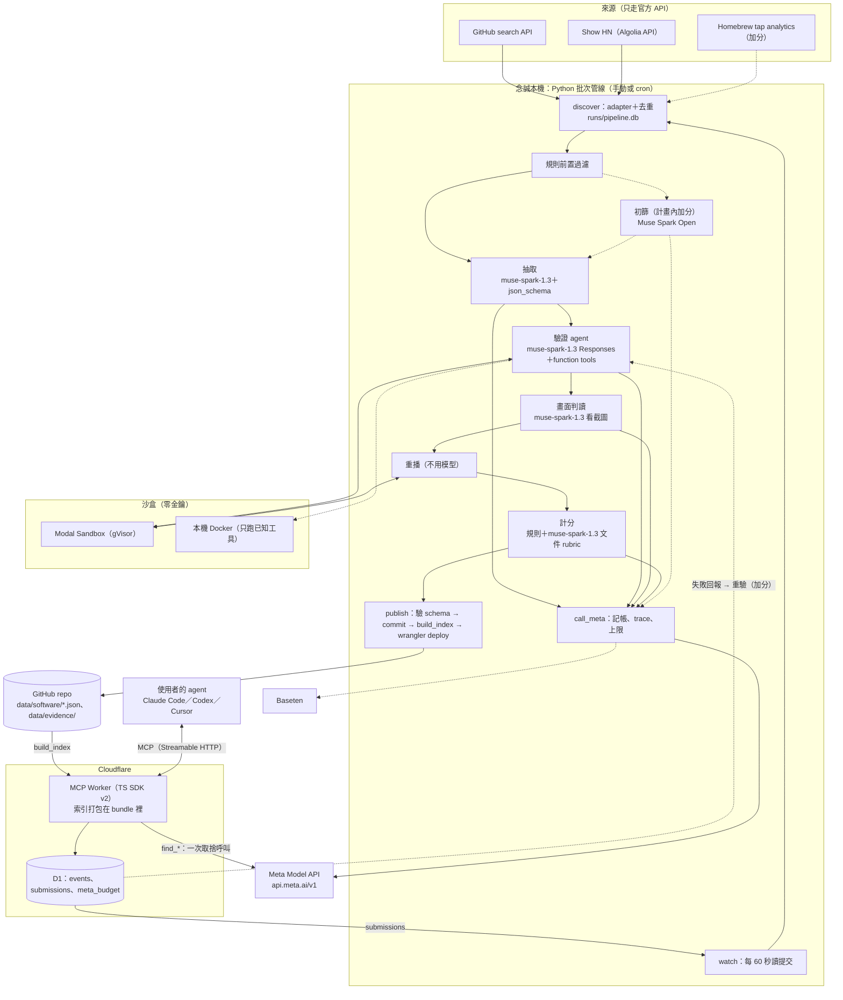

# 架構提案：最小可行、風險最低

2026-10-28（台北）· 技術調研 G 節的候選方案之一，待主控者整合。角度：**一個人在 11/4 前一定做得完，任何環節壞掉都有退路**。

依據：[brief](../../brief.md) 第 4、5、6、7、10、11、12、13 節；[規則](../../hackathon-rules.md) 第 2–6 節；[architecture.md](../architecture.md) A、C、D、F 節；[channels.md](../channels.md)；本目錄的調研筆記（查證日一律 2026-10-28）。

**狀態**：沒有任何 key。Meta、Baseten、Modal、Cloudflare 的線上行為都**未實測**。工時與成本都是估算。標「未驗證」的沿用各筆記的判定。

---

## 0. 結論

| 問題 | 答案 |
|---|---|
| 整體形狀 | 本機 Python 批次管線 → git 裡每款一份 JSON（正本）→ 建置成索引、打包進一個 Cloudflare Worker → Worker 用官方 MCP SDK 提供 5 個工具 |
| 用到的雲端服務 | 最低版本 4 個：Meta Model API、Modal Sandbox、Cloudflare（Workers＋D1）、GitHub。Baseten 是計畫內加分 |
| Meta 模型的位置 | `muse-spark-1.3`：抽取、驗證 agent、畫面判讀、文件評分、配對。Muse Spark Open（Baseten）：初篩（11/1 加） |
| 工時 | 最低版本約 **68 人時**；加上計畫內的開放權重初篩約 70.5 人時。可用時間約 79 人時，緩衝約 8.5 人時（偏薄，靠每日檢查點與砍除順序） |
| Meta 花費（估算） | demo 規模（150–300 候選、50–100 通過）約 **$22–76**，在 $150 credits 內。管線總額硬停 $100，Worker 每日 $3 |
| 最大風險 | 台灣帳號能否開 Meta Model API（今天確認）；驗證 agent 的成功率；一個人的工時 |

---

## 1. 一句話與設計原則

**一句話**：念誠電腦上的 Python 批次管線，把「發現 → Muse Spark 讀懂 → 沙盒實際安裝、截圖判讀、乾淨環境重播 → 計分」的結果寫成 git 裡每款一份 JSON；建置時轉成索引打包進 Cloudflare Worker；Worker 用官方 MCP SDK 提供 `find_software` 等 5 個工具，推薦時由 Muse Spark 取捨，安裝步驟只回傳重播過的。

### 1.1 設計原則

| # | 原則 | 具體做法 |
|---|---|---|
| 1 | **骨架只用已經跑過的 spike** | MCP 從 `spikes/mcp_stateless/` 長出來（Node 與 workerd 都通過，[mcp-server.md](mcp-server.md) §6）。沙盒從 `spikes/sandbox_docker_install.py` 長出來（4 款實測通過，[sandbox-verify-design.md](sandbox-verify-design.md) §6）。計分移植 `spikes/quality_signals.py`。schema 與 D1 DDL 用 `spikes/sm_schema_events.py` 測過的版本 |
| 2 | **先打通一條細路徑，再加寬** | 10/30 結束前：GitHub → 抽取 → 索引 → MCP → Claude Code 查得到（還沒驗證）。10/31 補上驗證。管道、筆數、加分功能都等路徑通了才加 |
| 3 | **每個外部依賴都有退路，切換只改設定** | Meta 與 Baseten 都走 OpenAI 相容介面，換 `base_url`／`model` 即可。沙盒是同一個 `Box` 介面（Modal／Docker／E2B）。同一份 Worker 程式能用 Node 在本機跑。見 2.8 |
| 4 | **一份正本、批次管線、無狀態服務** | git JSON 是唯一正本。管線是可重跑、冪等的命令列，手動或 cron 觸發。沒有佇列系統、沒有常駐 worker。線上只有無狀態的 Worker |
| 5 | **模型做判斷、程式守門；錢和步數有硬上限；降級要標示** | 每個 Meta 呼叫都經過同一個包裝：記帳、trace、schema 驗證、超額就停。模型失敗就退回規則，並在輸出標 `degraded` 或 `generated_by: rules`（[meta-usage-design.md](meta-usage-design.md) §1） |

### 1.2 和現有筆記不同的取捨

| 項目 | 筆記的建議 | 這份提案 | 理由 |
|---|---|---|---|
| 初篩 | Spark Open @ Baseten 放在主流程（[meta-usage-design.md](meta-usage-design.md) §4.1） | 最低版本：規則前置＋抽取時的 `kind`／`category` 當閘門。Baseten 初篩 11/1 再加 | Baseten credits 要審核；`meta-models/muse-spark-open-1026` 未驗證；brief 第 13 節本來就把開放權重初篩排在第 3 個砍 |
| `find_*` 的配對 | 兩次 Muse Spark 呼叫＋BM25 取 25 張卡（[storage-matching.md](storage-matching.md) §2.1） | 一次呼叫：硬條件篩選後，該類別依寶藏分數取前 40 張卡送進模型。BM25 等某類別超過 60 筆再加 | demo 規模每類別 ≤60 筆；少一次串行呼叫，延遲與程式都少；Codex 工具逾時預設 60 秒（[mcp-server.md](mcp-server.md) §4） |
| `rec_id` | HMAC 簽章，不查表（[mcp-server.md](mcp-server.md) §5.2） | `find_*` 時寫一列 D1，回報時查這列 | 少一把密鑰與簽章程式；D1 Free 每天可讀 500 萬列（[storage-matching.md](storage-matching.md) §1.5） |
| 部署 | push 後 Workers Builds 自動部署 | 本機 `pickfit publish` 跑 `wrangler deploy` | 少設定一個服務；自動部署留作加分 |
| 寶藏公式 | 筆記之間不一致：`Q − N`（[quality-scoring.md](quality-scoring.md) §3.3）；`Q × (1 − N/100)`（[meta-usage-design.md](meta-usage-design.md) §4.4、[storage-matching.md](storage-matching.md) §4.2） | `T = Q × (1 − N/100)`；Q ≥ 70 且 N ≤ 45 另標「寶藏」 | 和 schema 的程式端規則一致；門檻沿用 quality-scoring |
| 管道數 | 5 條：GitHub、Homebrew tap、Show HN、PyPI、提交（[channels.md](../channels.md) §0） | 最低版本 3 條：GitHub、Show HN、提交。Homebrew tap 是第一個加的；PyPI 再後面 | 省約 5 人時；GitHub topic 已涵蓋兩個類別 |

---

## 2. 元件

工時是一個人的人時（估算）。「最低版本」一定要交；「加分版本」只在進度超前時做，括號是額外工時。

### 2.1 發現

| 元件 | 技術 | 做什麼 | 為什麼選它 | 工時 | 最低版本 | 加分版本 |
|---|---|---|---|---:|---|---|
| GitHub search adapter | Python 3.12、`httpx`；GitHub REST `search/repositories`；fine-grained PAT（不勾權限就能讀公開 repo） | 跑「寶藏候選」與「近 7 天新建」query；每次 ≤20 次 search，間隔 2.1 秒 | 兩個類別新作品的主力；可直接篩 `created`、`pushed`、`stars:5..300`；只走 API，條款清楚（[channels-hosting.md](channels-hosting.md) §2.1） | 2 | 每類別 3 條 q（[channels-hosting.md](channels-hosting.md) §3.1 的寶藏候選 1 條＋召回 2 條），不做日期分片 | 16 條 q 全上＋日期分片繞過每 query 1,000 筆上限（+2） |
| Repo 補資料 | 同上：`repos/{o}/{r}`、`readme`、`releases/latest`、根目錄 `contents` | 補 README、manifest、最新 release、檔案清單、release 下載數 | 抽取、計分、驗證都要；core 5,000 次／時夠用（[channels-hosting.md](channels-hosting.md) §2.2） | 2 | 只用 GitHub API | ecosyste.ms 補下載量與套件庫收錄，只在計分時即時查、不存，避開 CC BY-SA（+1）；deps.dev 簽章對應（+1） |
| Show HN adapter | HN Algolia `search_by_date?tags=show_hn`，按天切片；cursor＝看過的最大 `created_at_i` | 抓連到 GitHub 的 Show HN；只存標題、連結、時間、points | 作者本人發表；86% ≤3 分。不要只用 `/v0/showstories`（只涵蓋 14%）（[channels-communities.md](channels-communities.md) §2.1） | 1 | 每天回補一次 | Firebase `/v0/newstories` 每 1–3 小時輪詢（+1） |
| Homebrew tap adapter | formulae.brew.sh analytics JSON＋GitHub contents API 讀 `.rb` | 找「安裝幾乎都在近 30 天、30 天 10–1000 次」的第三方 tap formula | 唯一同時有真實安裝數與低知名度的訊號（437 個；抽樣星數中位數 1）；對上 Mac demo（[channels-packages.md](channels-packages.md) §2.1） | 0 | 不做 | 移植 `spikes/ch_packages_brew_taps.py`（+2，**第一個要加的管道**） |
| PyPI adapter | RSS＋XML-RPC `changelog_since_serial`＋wheel `console_scripts` | 本地 AI 類的新套件 | 本地 AI 工具多在 PyPI（[channels-packages.md](channels-packages.md) §2.5） | 0 | 不做 | +3 |
| 去重與候選庫 | Python `sqlite3`，檔案 `runs/pipeline.db`（不進 git）；URL 正規化沿用 `spikes/ch_integration_normalize.py` 的 `canon()`（整合工程筆記調研中，未查核） | canonical key＝`github.com/<owner>/<repo>` 小寫；合併 `sources[]`；記每筆的階段與淘汰原因 | 冪等重跑；README 的漏斗數字直接從這裡算 | 1 | URL 正規化＋同 key 合併 | 偵測改名（GitHub 301）；同作者一週建很多 repo 就降權（+1） |
| 排程 | `uv run pickfit run --daily`；`pickfit watch` 處理提交 | 每天 1–2 次發現與處理 | 雲端 session 打不到 GitHub search，管線一定在本機跑（[channels.md](../channels.md) §3）；不需要常駐服務 | 0 | 手動執行 | cron／launchd（+0.5）；Modal 排程（+1.5） |

### 2.2 理解（Meta 模型）

| 元件 | 技術 | 做什麼 | 為什麼選它 | 工時 | 最低版本 | 加分版本 |
|---|---|---|---|---:|---|---|
| Meta 呼叫層 `call_meta` | Python `openai` SDK，`base_url` 設 `https://api.meta.ai/v1`（或 `https://inference.baseten.co/v1`）；`pydantic` | 記帳（讀 `usage` 乘單價）、trace JSONL、429 退避、504 改 streaming、schema 驗證、每日與總額硬上限 | API 與 OpenAI 相容，不需專用 SDK；Spend Limit 只寄信、不會停扣款（[meta-model-api.md](meta-model-api.md) §0 #2、#10） | 2.5 | 單價表＋trace＋上限 | 每個環節設 `prompt_cache_key`（+0.5） |
| 規則前置（初篩第一層） | Python，移植 `spikes/quality_signals.py` 的 P／N／L 規則 | 丟掉 fork、archived、沒有 README、README 少於 300 字元、清單、作業、模板；函式庫與不確定的交給模型 | 先擋能省模型呼叫；227 個 Show HN repo 實測：工具 142、交給模型 34（[quality-scoring.md](quality-scoring.md) §1.3） | 1.5 | 規則＋淘汰原因 | — |
| 初篩（開放權重） | Muse Spark Open @ Baseten，`meta-models/muse-spark-open-1026`（未驗證；備案 `meta-models/muse-spark-open`），`reasoning_effort: low`；pydantic 驗證 | 判斷「是不是可用的軟體、哪一類」；不給星數；低信心送 `muse-spark-1.3` 複查 | 爭取 Best Build on Meta Open Weight Models；同價不省錢；Baseten 不強制 JSON schema，預設推理 `xhigh` 一定要改（[meta-open-weights.md](meta-open-weights.md) §0、§4.2） | 0 | 不做獨立初篩；抽取輸出的 `kind`／`category` 兼當閘門 | Baseten 初篩＋5% 抽樣和 `muse-spark-1.3` 比一致率（+2.5，**計畫內，11/1**）；README 加「Built with Muse Spark Open」 |
| 抽取 | `muse-spark-1.3`，Responses API，`text.format` json_schema strict（`software_profile_v1`，[meta-usage-design.md](meta-usage-design.md) §4.2），`reasoning.effort: low` | README（≤8K tokens）＋manifest＋最近 3 則 release notes → 結構化檔案；每個非空欄位附逐字引用 | constrained decoding 保證輸出合 schema（[meta-model-api.md](meta-model-api.md) §4.4）；引用可以用程式檢查 | 4 | 只讀文字；引用比對；`license`、`last_release`、`repo` 用 API 值；有錯附錯誤清單重試一次 | README 截圖（≤3 張）一起讀（+1）；公開 README 改用 `muse-spark-1.3-contributor`（只改 model ID，便宜約 12–20 倍，但 150 RPM、內容可能被拿去訓練） |

### 2.3 驗證

| 元件 | 技術 | 做什麼 | 為什麼選它 | 工時 | 最低版本 | 加分版本 |
|---|---|---|---|---:|---|---|
| 沙盒 | `modal` Python SDK：`Sandbox.create(runtime="gvisor", cpu=(0.5, 2), memory=(1024, 4096), timeout=1200)`；事先發布 named image（`python:3.12-slim`＋`libgomp1 git curl ca-certificates`＋uv、pipx、node）。本機 `DockerBox` 沿用 spike | 每筆一個全新沙盒；`Box` 介面：`put`、`run`、`close` | 官方定位就是跑不受信任的程式；有上限、網域 allowlist、GPU；比賽 $100＋Starter 每月含 $30（[sandbox-compare.md](sandbox-compare.md) §0）。`runtime` 不設時由 Modal 選，要明確設 gVisor（[sandbox-verify-design.md](sandbox-verify-design.md) §0 #6） | 3.5 | Modal 跑陌生程式；本機 Docker 只跑已知工具與開發；沙盒零金鑰；CPU、記憶體、時間上限；安裝階段網域 allowlist（Beta，不穩就開放並記錄外連、照實標示） | 執行階段斷網（Alpha API）（+1）；`E2BBox`（+2，只在 Modal 不能用時做）；GPU 沙盒（+2）；模型放 Volume（+1） |
| 驗證 agent（actor） | `muse-spark-1.3`，Responses＋`previous_response_id`，`reasoning: {effort: medium, summary: auto}`，`parallel_tool_calls: false`；function tools：`list_dir`、`read_file`、`run_command`、`run_background`、`finish` | 照 README 安裝、讀錯誤、修正、跑 smoke test；`finish` 回報實際步驟、偏離 README 處、手動步驟 | 多步工具迴圈官方建議 Responses（[meta-model-api.md](meta-model-api.md) §0 #9）；這是「Meta 模型是核心」最直接的證明（[meta-usage-design.md](meta-usage-design.md) §0 #2） | 5 | 安裝方式候選由程式從 manifest 排序；先套 6–8 條常見錯誤規則再問模型（[sandbox-verify-design.md](sandbox-verify-design.md) §1.3）；上限 25 回合、15 指令、20 分鐘、$0.50、同錯 3 次；終端機逐步印出模型、指令、exit code、token、花費 | 內建 `web_search` 查錯誤（+0.5）；失敗改用 `muse-wonder-1.0` 重試（+0.5） |
| 畫面判讀（judge） | Pillow 把終端輸出畫成 PNG（spike 現成，約 0.06 秒）；`muse-spark-1.3`＋圖片＋`screen_judge` schema | 另開一次呼叫，只看截圖、指令、exit code、預期訊號；回 `verdict` 與 0–1000 座標的證據框 | actor 不給自己打分；brief 4.2 要求視覺判讀。截圖是由輸出重繪，不是真螢幕，要照實寫（[sandbox-verify-design.md](sandbox-verify-design.md) §3） | 1.5 | 1 張終端截圖；exit code、judge、重播三者都過才算 verified | 把證據框畫在截圖上給 demo 用（+1） |
| 重播 | 程式，同一個 `Box` | 全新沙盒照 `finish.install_steps` 與 smoke test 重跑，不呼叫模型 | 把「模型說可以」變成「照做可以」；`get_install_guide` 只回傳重播過的步驟 | 1 | 每筆一次 | — |
| 批次與抽查 | `pickfit verify --batch N --concurrency 5` | 背景批次跑；人工看 demo 會用到的那幾筆 | 每筆 4–8 分鐘（估算，[meta-usage-design.md](meta-usage-design.md) §4.3.4）；批次在背景跑，人可以做別的 | 2.5 | 並行 5 | 並行 10 |
| Mac 驗證（demo 那 3 筆） | 念誠的 Mac（是否 Apple silicon 未確認）；開一個新的 macOS 使用者帳號照 `get_install_guide` 跑 | 讓 demo 第 4 幕「第一次執行就成功」有依據 | 雲端沙盒都是 Linux；GitHub Actions 驗第三方軟體是條款灰色地帶（[sandbox-compare.md](sandbox-compare.md) §5） | 1 | 人工執行、log 存證；profile 照實標 `provider: other`、`method: human` | `spikes/sb_gha_macos_brew.yml` 跑這 3 筆，README 說明用途（+1）；Tart VM |

### 2.4 計分與儲存

| 元件 | 技術 | 做什麼 | 為什麼選它 | 工時 | 最低版本 | 加分版本 |
|---|---|---|---|---:|---|---|
| 計分 | Python 規則（移植 `spikes/quality_signals.py`）＋`muse-spark-1.3` 文件 rubric（一次呼叫：6 項各 0–3 分附引用，另寫 `why_worth_it`） | quality、popularity、treasure 分開算，寫進 `scores`，記 `formula_version` | 規則算的品質會飽和；Scorecard 只涵蓋 3% 的長尾；能拉開差距的是沙盒驗證與模型 rubric（[quality-scoring.md](quality-scoring.md) 一句話結論） | 3 | 驗證、文件 rubric、維護、工程衛生；缺資料的分項從分母拿掉；知名度用星數、forks、HN points、release 下載數的對數正規化 | 搜尋可見度探針（`web_search`，每筆 2 次）（+2）；沙盒裡順跑 `scorecard --local`（+1）；類別內百分位校準（+1） |
| 正本與索引 | `schema/software.v1.json`（[storage-matching.md](storage-matching.md) §4.2）；Python `jsonschema` 寫入前驗證；`scripts/build_index.mjs` 產生候選卡 JSON，打包進 Worker | 每款一份 `data/software/<slug>.json`；截圖放 `data/evidence/`；完整 trace 不進 git | diff 就是審計紀錄；3,000 筆 bundle 約 1 MB、查詢 <1 ms（[storage-matching.md](storage-matching.md) §1.2） | 2.5 | `pickfit publish`：驗 schema → commit → build → `wrangler deploy` | Workers Builds push 自動部署（+0.5）；BM25 倒排（某類別 >60 筆時）（+1.5）；完整檔案放 Static Assets |
| 事件 | Cloudflare D1：`events`、`submissions`、`meta_budget`（DDL 取自 [storage-matching.md](storage-matching.md) §1.4，另加 `submissions`） | 記查詢、安裝指南、回報、提交；不記 IP，不存需求原文 | 要 SQL 去重與彙總；KV 寫入額度太小。DDL 只在 SQLite 3.45 測過，**D1 上未實測** | 1 | 用 `ON CONFLICT … DO NOTHING`，不用 `INSERT OR IGNORE`（spike 實測它會吞掉 CHECK 錯誤） | `reverify_queue`＋`sync_outcomes`：失敗回報 → 重驗 → 新步驟 commit 回 git（+2） |

### 2.5 服務：MCP server 與提交入口

| 元件 | 技術 | 做什麼 | 為什麼選它 | 工時 | 最低版本 | 加分版本 |
|---|---|---|---|---:|---|---|
| MCP server | TypeScript；`@modelcontextprotocol/server` 2.4.0 的 `createMcpHandler`（dual-era、無狀態）、`zod` 4；Cloudflare Workers；`fetch` 呼叫 Meta `/v1/responses`（`store: false`） | 4＋1 個工具（下表） | spike 已在 Node 與 workerd 通過 legacy 與 modern 兩套檢查，官方 TS、Python client 都能呼叫（[mcp-server.md](mcp-server.md) §6）。直接用 SDK，不用已 deprecated 的 `McpAgent`，也不用 Cloudflare 包裝（釘 2.3.1） | 7 | 部署 `workers.dev`；Claude Code `claude mcp add --transport http`；自己加 Host／Origin 檢查；輸出根節點是 object，並附 JSON 文字版；不用 elicitation；3 個查詢工具標 `readOnlyHint` | Claude.ai custom connector、Codex、Cursor 實連（+0.5）；Rate Limiting binding（+0.5）；MCP Registry 登錄（+0.5） |
| 提交處理 | `pickfit watch`：每 60 秒 `wrangler d1 execute --remote --json` 讀 `submissions` | 單筆跑完整管線 → publish → 回寫狀態 | 不用另開服務；demo 時本機開著即可 | 2 | 只收 `github.com/<owner>/<repo>`；預估 10 分鐘內上線（驗證 4–8 分鐘＋部署，估算） | GitHub Issue Form 入口（+1）；Threads 連結只用 oEmbed 嵌入展示頁（+1） |

5 個工具（schema 沿用 [mcp-server.md](mcp-server.md) §5.4）：

| 工具 | 最低版本做法 | 用 Meta 模型？ | 加分 |
|---|---|---|---|
| `find_software` | 硬條件篩選（驗證狀態、OS、本機執行、免費、類別）→ 依寶藏分數取前 40 張候選卡 → **一次** `muse-spark-1.3` 呼叫（解析需求、比較取捨、最好的免費選項、最多 1 個澄清問題，schema 約束）→ 程式檢查 slug 在候選裡、`field_ref` 對得上 → 失敗或超預算時退回規則排序＋模板理由，標 `degraded: true` | 是 | 先產生 `search_terms` 再 BM25；程式算「分歧屬性」決定准不准問（+2） |
| `find_alternatives` | 共用 `find_software` 的後端；`current_software` 與 `pain_points` 必填；沒有更好的就回 `keep_current` | 是 | — |
| `get_install_guide` | 只讀 profile：重播過的步驟、`run_by`（agent／user）、手動步驟、驗證指令、`applies_to_user_system`；使用者的 OS 沒驗證過就明說 | 否 | Mac 指南的推論（標未驗證） |
| `report_outcome` | 必須帶 `find_*` 回傳的 `rec_id`（D1 裡的 ULID）；同一個 `rec_id`＋`slug`＋`stage` 只記一次 | 否 | HMAC `rec_id`；失敗回報排入重驗（見事件列） |
| `submit_software` | 寫 `submissions`；同一 URL 冪等，重送就是查進度 | 否（觸發管線） | — |

### 2.6 評測、展示、觀測、控管

| 元件 | 技術 | 做什麼 | 為什麼選它 | 工時 | 最低版本 | 加分版本 |
|---|---|---|---|---:|---|---|
| 評測（brief 第 10 節） | `eval/questions.yaml`（20 題，10/28 凍結並 commit）；`eval/run.py` 用 `claude -p --output-format json` 跑對照組（不接 pickfit）與實驗組（接 pickfit），兩組同版本、同提示；人工評分 CSV；安裝是否成功用重播執行器實跑 | 逐題檢查：存在、符合條件、步驟正確、照做能跑；系統數字：候選數、通過率、提交到可推薦的時間 | brief 要求先凍結題目再收資料；結果（含輸的題）進 README | 7 | 題組 2 h＋執行與評分 5 h；只有 Linux 能跑的步驟才實跑，其餘標「未實跑」 | 加一組「關掉模型（規則排序）」量 Muse Spark 的貢獻（+1） |
| 展示頁 | Workers Static Assets，一頁 HTML 由索引產生 | 列出驗證過的寶藏與 `why_worth_it` | brief 4.5 標可選，砍除順序第一 | 0 | 不做 | 寶藏清單、驗證截圖、Threads 分享按鈕、「Built with Muse Spark Open」（+2.5） |
| trace／觀測 | `call_meta` 寫 `runs/traces/*.jsonl`（欄位見 [meta-usage-design.md](meta-usage-design.md) §7.1）；`scripts/meta_usage_report.py`；Worker 用 `wrangler tail`＋D1 `events` | 每次模型呼叫的 model ID、token、花費、推理摘要 | README 與 demo 的數字自動產生，不手寫。`reasoning.summary` 不保證每次都有（[meta-usage-design.md](meta-usage-design.md) §8 #11） | 1.5 | 報表腳本；公開 3 份 trace 範例（verified、failed、unsupported_env）到 `data/traces/` | HTML 驗證過程檢視器，給影片用（+3） |
| 金鑰與花費 | `.env`（`.gitignore` 已有 `.env*`）；Worker 用 `wrangler secret`；發現、驗證、配對各一把 Meta key；Baseten 月預算開 enforce | 硬上限與降級 | Meta 只寄信不停扣（[meta-model-api.md](meta-model-api.md) §5）；Baseten 的 enforce 會真的拒絕請求（[meta-open-weights.md](meta-open-weights.md) §4.3） | 1.5 | 管線每日 $25、總額 $100 硬停；Worker 每日 $3，超過就降級；單筆驗證 $0.50；commit 前 grep 常見金鑰格式；`runs/` 加進 `.gitignore` | 每日報表對帳 Meta Usage 頁（+0.5） |
| 專案骨架與帳號 | `uv`、`pyproject.toml`；目錄見 2.9 | 帳號申請、跑既有 spike、建目錄 | — | 3 | — | — |
| README、demo、影片、交件 | — | brief 第 5 節的 5 幕、README、3 分鐘影片、檢查表 | 評分 Demo 25% | 11 | 見第 6 節 | — |

### 2.7 工時合計

| 群組 | 最低版本（人時） |
|---|---:|
| 發現 | 6 |
| 理解 | 8 |
| 驗證 | 14.5 |
| 計分與儲存 | 6.5 |
| 服務（MCP＋提交處理） | 9 |
| 評測、觀測、控管 | 10 |
| 骨架與帳號 | 3 |
| README、demo、影片、交件 | 11 |
| **合計** | **68** |
| 計畫內加分：開放權重初篩（11/1） | 2.5 |
| 可用時間（10/28 剩 8 h＋10/29–11/3 每天 10.5 h＋11/4 8 h） | 約 79 |
| 緩衝 | 約 8.5 |

其他加分項合計約 30 人時，不會全做。進度超前時的順序：Homebrew tap → 執行階段斷網 → 重驗迴圈（回報 → 重驗 → git diff）→ 展示頁 → 搜尋可見度 → BM25 → 其他。

### 2.8 退路對照

| 依賴 | 主選 | 退路 1 | 退路 2 | 切換成本 |
|---|---|---|---|---|
| Meta Model API 帳號 | `muse-spark-1.3` | Spark Open @ Baseten（有 tool calling、圖片；schema 不強制，改用 pydantic＋重試） | Spark Open @ Fireworks serverless（$25 只給入選者，[meta-open-weights.md](meta-open-weights.md) §6） | 改 `base_url`／`model`；加驗證重試約 2 h |
| Meta $150 credits 晚到 | credits | 綁卡先付（10/28–10/30 估 <$10） | 公開 README 抽取改 `-contributor` | 改 model ID |
| Baseten | `-1026`（未驗證） | 公開 ID `meta-models/muse-spark-open`，自付 <$2 | 不做初篩（brief 砍除順序） | 改設定 |
| Modal Sandbox | gVisor | E2B Hobby（免卡、$100 一次性、無 GPU） | 本機 Docker，只跑人工看過的候選 | E2B 約 2 h；Docker 0 h |
| Modal 網域 allowlist（Beta） | allowlist | 開放網路＋記錄外連，README 標明 | — | 0 |
| gVisor 不相容的工具 | gVisor | VM runtime（不能配 GPU） | 標「未驗證」並寫原因 | 改一個參數 |
| Cloudflare Workers Free | Free | Paid（$5／月，CPU 上限變 30 秒） | 同一份程式用 Node 在本機跑（spike 的 `serve.mjs`），Claude Code 連 localhost | 0–0.5 h |
| D1 寫入失敗 | D1 | Worker catch，推薦照常回（只少一筆事件） | — | 已內建 |
| `find_*` 的模型呼叫 | 一次 Muse Spark | 規則排序＋模板理由，標 `degraded: true` | — | 已內建 |
| Mac 驗證 | 念誠的 Mac | GitHub Actions `macos-15`（條款灰色，只跑 3 筆） | 不宣稱 Mac 驗證，demo 改在 Linux | 0–1 h |
| 驗證 agent 自主修錯 | 模型 | 規則表＋程式排序安裝方式 | 只到「安裝驗證」等級 | 已內建 |

### 2.9 repo 目錄（建議）

```
pickfit/                     Python 套件（管線）
  cli.py                     discover / extract / verify / score / publish / watch / run
  meta.py                    call_meta：單價表、ledger、trace、上限
  store.py                   runs/pipeline.db（候選與各階段狀態）
  sources/                   github.py、hn.py（加分：brew.py、pypi.py）
  prefilter.py  extract.py  score.py  publish.py（加分：triage.py）
  verify/                    box.py（Box、ModalBox、DockerBox）、actor.py、rules.py、judge.py、replay.py、render.py
schema/software.v1.json
data/software/*.json         正本
data/evidence/<slug>/<run>/  截圖
data/traces/                 只放 3 份公開範例
worker/                      src/index.ts、src/match.ts、src/tools/*.ts、migrations/0001_init.sql、wrangler.toml
scripts/                     build_index.mjs、meta_usage_report.py
eval/                        questions.yaml、run.py、results/
runs/                        不進 git：pipeline.db、ledger.json、traces/
```

### 2.10 第三方套件授權

加入前要確認並記在 README 或 `NOTICE`（[規則](../../hackathon-rules.md) 第 9 節）。

| 套件 | 用途 | 授權 | 狀態 |
|---|---|---|---|
| `@modelcontextprotocol/server` 2.4.0 | MCP | Apache-2.0 | 已確認（[mcp-server.md](mcp-server.md) §2.1） |
| `zod` 4.x | 工具 schema | MIT | 已確認（同上） |
| `ajv` 8.20.0 | 建置時驗證 | MIT | 已確認（[storage-matching.md](storage-matching.md) §7） |
| `jsonschema` 4.26.0 | Python 驗證 | MIT | 已確認（同上） |
| `minisearch` 7.2.0（加分） | BM25 | MIT | 已確認（同上） |
| Pillow | 截圖重繪 | MIT-CMU | 已確認（[sandbox-verify-design.md](sandbox-verify-design.md) §3.2） |
| `openai`（Python）、`httpx`、`pydantic`、`modal` | 呼叫 API、沙盒 | — | **未驗證**，加入前查 |
| asciinema、agg | — | GPL-3.0 | 不用 |
| 系統字型（DejaVu Sans Mono、文泉驛正黑） | 截圖重繪 | — | 只在執行環境用，不進 repo |

---

## 3. 資料流

實線是最低版本，虛線是加分。



demo 五幕（brief 第 5 節）對到的元件：

| 幕 | 畫面 | 元件 | 出問題時 |
|---|---|---|---|
| 1 | 使用者在 Claude Code 說需求 | `find_software` | — |
| 2 | 同一個 agent 不接 pickfit，推薦知名但不合條件的 | 評測對照組的錄製結果 | 用評測裡已存的輸出 |
| 3 | 接上 pickfit：推薦今年的專案，附理由、驗證證據、最好的免費選項 | `find_software`（Muse Spark 取捨）、`verification` 欄位、截圖 | `degraded` 模式仍有推薦，理由改模板 |
| 4 | agent 照重播過的步驟在 Mac 上裝好，第一次就跑起來；回報 | `get_install_guide`、`report_outcome` | 影片前一晚彩排；Mac 不行就改 Linux |
| 5 | 作者在 Threads 發文 → 在自己的 agent 用 `submit_software` 貼 GitHub 連結 → 幾分鐘後被推薦 | `submit_software`、`watch`、整條管線 | 影片加速；Threads 只出現在畫面上，不讀內容 |

---

## 4. 成本估算

全部是估算。推理 token 沒實測，是最大誤差來源（[meta-usage-design.md](meta-usage-design.md) §5）。

### 4.1 假設

| 項目 | 值 | 來源 |
|---|---|---|
| 規則前置通過率 | 約 65% | 估算；規則把 80% 有資料的 Show HN repo 判為工具（[quality-scoring.md](quality-scoring.md) §1.3） |
| 驗證嘗試數 | 通過數 × 1.5 | 估算（通過率約 65%，未實測） |
| 抽取 | 每筆 $0.028（含 10% 重試） | [meta-usage-design.md](meta-usage-design.md) §4.2 |
| 驗證（actor＋judge） | 每次嘗試 $0.12–0.28；單筆上限 $0.50 | 同上 §4.3.4 |
| 文件評分 | 每筆 $0.017 | 同上 §4.4 |
| 配對 | 每次查詢 $0.013–0.03：40 張卡約 16K tokens 輸入、2K 輸出（含推理）；下限是卡片前綴命中快取 | 本文估算，用 [meta-model-api.md](meta-model-api.md) §2.2 單價 |
| 配對次數 | 約 400 次（開發測試 300、評測 20–40、demo 彩排 50） | 估算 |
| 開發與重跑損耗 | 管線花費的 30% | 估算 |
| 初篩（加分） | 每筆 $0.0042（Baseten） | [meta-usage-design.md](meta-usage-design.md) §4.1 |
| 沙盒 | CLI 1 core＋2 GiB 5 分鐘 $0.016；LLM 工具 2 core＋4 GiB 10 分鐘 $0.063；最壞 20 分鐘 $0.127；平均取 $0.03 | [sandbox-verify-design.md](sandbox-verify-design.md) §5 |

### 4.2 兩種規模

| 項目 | 小：150 候選 → 50 通過 | 大：300 候選 → 100 通過 | 付款方 |
|---|---:|---:|---|
| 抽取（前置後 100／200 筆） | $2.8 | $5.6 | Meta |
| 驗證（75／150 次嘗試） | $9–21 | $18–42 | Meta |
| 文件評分（50／100 筆） | $0.9 | $1.7 | Meta |
| 配對（約 400 次） | $5–12 | $5–12 | Meta |
| 開發與重跑損耗 | $4–7 | $8–15 | Meta |
| **Meta 小計** | **$22–44** | **$38–76** | $150 credits |
| 初篩（100／200 筆，加分） | $0.4 | $0.8 | Baseten $100 credits |
| 沙盒（嘗試＋重播：125／250 個） | 約 $4 | 約 $8（最壞 $32） | Modal Starter 每月含 $30；比賽 $100 |
| Workers＋D1 | $0 | $0 | Free（建議 10/30 開 Paid $5，見風險 #9） |
| GitHub API、Actions（public repo） | $0 | $0 | — |
| E2B（只在 Modal 不能用時） | $0 | $0 | Hobby $100 一次性 |
| **自付現金（credits 都到時）** | **$0–5** | **$0–5** | — |

- Meta credits 若一直沒到，Meta 的部分改刷卡：$22–76。
- 最壞情況（每次驗證都打到 $0.50 上限）大規模約 $115，會被管線的 $100 硬上限擋下。
- 評測用的 agent（Claude Code）是受測對象，不算產品成本，這裡沒估。
- 網域非必要：`workers.dev` 就能 demo。

### 4.3 上限設定

| 位置 | 上限 | 超過時 |
|---|---|---|
| 管線 `call_meta` | 每日 $25；總額 $100 | 拒絕新呼叫，命令列印出原因 |
| 單筆驗證 | $0.50、25 回合、15 指令、20 分鐘 | `stopped: budget／step_limit／…`，標未驗證 |
| Worker | 每日 $3（D1 `meta_budget`） | `find_*` 改規則排序，標 `degraded: true` |
| Meta Billing | Spend Limit 通知設 $50、$100 | 只寄信（不會停） |
| Baseten | 月預算 $20，開 enforce | 拒絕請求 |
| Modal | 每個沙盒 `timeout=1200`、並行 ≤5 | 沙盒結束 |

---

## 5. 風險

| # | 風險 | 機率 | 影響 | 退路 | 最晚何時決定 |
|---|---|---|---|---|---|
| 1 | 台灣帳號開不了 Meta Model API 或綁卡失敗（未驗證，[meta-model-api.md](meta-model-api.md) §0 #12） | 中 | 高：產品核心 | 抽取、驗證、判讀、配對全改 Spark Open @ Baseten；Baseten 也不行就 Fireworks serverless | 10/28 晚上 |
| 2 | 驗證 agent 成功率低（亂試、步數不夠、gVisor 不相容） | 中高 | 高：通過的太少，demo 沒料 | 程式先排安裝方式、規則表先處理常見錯誤；發現時優先有 release 二進位或 pipx／uv 可裝的；接受「安裝驗證」等級；10/29 先挑 10 筆 demo 候選優先驗；不相容換 VM runtime | 10/31 晚上 |
| 3 | 一個人工時不夠 | 高 | 高 | 每日檢查點；砍除順序（第 6 節末）；加分項等路徑通了才做 | 每天晚上 |
| 4 | 被看成「基本 RAG」（官方反面範例） | 中 | 高 | 沒有向量庫；demo 秀驗證過程、重播、截圖判讀與 `how_we_know`；README 放「Why this is not RAG」表（[storage-matching.md](storage-matching.md) §2.2） | 11/3 |
| 5 | 推理 token 比估算多 2–3 倍 | 中 | 中：成本與延遲 | 降 `reasoning.effort`；總額硬停；公開 README 抽取改 `-contributor` | 10/29（看第一批 `usage`） |
| 6 | Modal credits 沒發，或網域 allowlist（Beta）不穩 | 中 | 中 | 先用 Starter 每月 $30；E2B 同介面約 2 h；allowlist 不穩就開放網路、記錄外連、README 標明 | 10/31 中午 |
| 7 | Baseten credits 沒核准，或 `-1026` 不存在 | 中 | 低：只失去開放權重獎 | 公開 ID 自付（<$2）；再不行就不做初篩 | 11/1 |
| 8 | `find_*` 太慢（未實測），agent 逾時 | 中 | 中 | 一次呼叫、`effort: low`、卡片上限 40；超時退回規則排序 | 10/30 |
| 9 | Workers Free 冷啟動超過 10 ms CPU，回 Error 1102（未驗證，[mcp-server.md](mcp-server.md) §7） | 低中 | 低 | 開 Paid（$5）；或同一份程式用 Node 在本機跑 | 10/30 |
| 10 | 沙盒是 Linux，demo 在 Mac | 高 | 中 | 結果標平台；demo 那 3 筆在 Mac 上跑過並照實標「人工、Mac」；沒有 Mac 就 demo 改 Linux | 11/2 |
| 11 | 陌生程式在沙盒裡作怪（挖礦、外連、prompt injection） | 低中 | 高：帳號被停、金鑰外洩 | 沙盒零金鑰、gVisor、上限、每筆全新沙盒；judge 不能推翻規則；陌生程式不在自己電腦上跑（[sandbox-verify-design.md](sandbox-verify-design.md) §4.3） | 一直 |
| 12 | Meta 花費失控（Spend Limit 只寄信） | 低 | 中 | 管線與 Worker 各自硬停；每環節一把 key，可單獨撤銷 | 一直 |
| 13 | DDL 在 D1 上不相容（只在 SQLite 測過） | 低 | 低 | 先跑 `wrangler d1 execute --local`；寫入失敗 Worker catch | 10/30 |
| 14 | 評測輸掉，或題目被說偏 | 中 | 中 | 10/28 先凍結題目再收資料；輸的題目照實寫進 README | 11/2 |
| 15 | 錄影或現場連不上 | 低 | 高 | 前一晚完整彩排；本機 Node 版備援；關鍵片段先錄 | 11/3 |

---

## 6. 每天的工作（10/28–11/4）

對照 brief 第 12 節。每天 10.5 小時是假設，念誠可以調。「完成標準」是當天晚上可以 demo 的東西。

### 10/28（三）· 約 8 h · brief：凍結評測題組；專案骨架；申請 credits

| 工作 | 工時 |
|---|---:|
| 帳號：Meta Model API（Individual → 綁卡 → 建 key → 抄 Team ID → 填 $150 credits 表單 → 設 Spend Limit 通知）；Baseten、Modal credits；Cloudflare；GitHub fine-grained PAT；E2B（備案，免卡） | 等待時做別的 |
| 本機跑 `meta_api_hello.py`、`meta_responses_agent_probe.py`、`meta_baseten_hello.py`、`sb_modal_verify.py`、`ch_hosting_github.py counts`，結果貼回各筆記 | 1.5 |
| 骨架：`uv`、`pyproject.toml`、2.9 的目錄、`schema/software.v1.json`、`.env.example`、`runs/` 加進 `.gitignore` | 1.5 |
| `call_meta`：單價表、ledger、trace、429／504、上限 | 2.5 |
| 評測題組 20 題：需求原話、硬條件、評分標準；commit 後不再改。比賽期間重寫，不搬賽前草稿 | 2 |
| 金鑰與上限設定 | 0.5 |

- **完成標準**：`uv run pickfit meta-hello` 回傳一份符合 schema 的 JSON，ledger 記下花費；`eval/questions.yaml` 已 commit；帳號狀態表貼在筆記。
- **檢查點**：Meta API 今晚能不能用？不能 → 風險 #1，10/29 的抽取直接走 Baseten。

### 10/29（四）· 約 10.5 h · brief：發現 agent 從 GitHub 收候選，用 Muse Spark 抽出結構化檔案

| 工作 | 工時 |
|---|---:|
| GitHub search adapter（每類別 3 條 q） | 2 |
| repo 補資料（README、manifest、release、檔案清單） | 2 |
| 去重與候選庫；從候選裡挑 10 筆 demo 候選（可在 Mac 裝、免費、能離線） | 1 |
| 規則前置 | 1.5 |
| 抽取（schema、prompt、引用比對、事實欄位用 API 值） | 4 |

- **完成標準**：`pickfit discover` 產生 ≥150 筆候選；`pickfit extract` 產生 ≥30 份過 schema 與引用檢查的 JSON 並 commit；能打開一份 JSON，指出每個欄位的引用來源；有漏斗數字（候選 → 前置 → 抽取）。
- **檢查點**：用第一批 50 筆的實際 `usage` 換掉第 4 節的假設；推理 token 超過估算 2 倍就降 effort。

### 10/30（五）· 約 10.5 h · brief：配對 MCP 的 4 個工具上線，接上 Claude Code 可以查詢

| 工作 | 工時 |
|---|---:|
| `build_index.mjs`（候選卡）＋`pickfit publish` | 2.5 |
| D1 建表（先 `--local` 再 `--remote`） | 1 |
| MCP Worker：4 個工具、Host／Origin 檢查、Meta 呼叫與降級；部署 `workers.dev` | 6 |
| Worker 端每日上限（`meta_budget`）；`wrangler secret` | 1 |

- **完成標準**：`claude mcp add --transport http pickfit https://<name>.workers.dev/mcp` 之後，在 Claude Code 問「我想要 Mac 上、免費、能離線的 X」，回 2–3 筆，附理由與最好的免費選項。此時資料還沒驗證：用開發旗標放行，並在結果標「未驗證」。`get_install_guide` 回 README 宣稱的步驟並標未驗證；`report_outcome` 寫進 D1；預算用完時回 `degraded: true`。
- **檢查點**：線上出現 1102 → 開 Paid。

### 10/31（六）· 約 11 h · brief：驗證 agent：沙盒安裝、截圖、視覺判讀

| 工作 | 工時 |
|---|---:|
| `Box` 介面：`ModalBox`（gVisor、上限、allowlist）＋named image；`DockerBox` 沿用 spike | 3.5 |
| actor：安裝方式排序、規則表、Responses 迴圈、停止條件、`finish` 驗證 | 5 |
| judge：Pillow 截圖＋`screen_judge` | 1.5 |
| 重播；結果寫回 `install.linux` 與 `verification` | 1 |

- **完成標準**：`pickfit verify <slug>` 在 Modal 跑完 actor → judge → 重播，終端機逐步印出模型、指令、exit code、token、花費；10 筆 demo 候選 ≥5 筆通過；`get_install_guide` 改回傳重播過的步驟，開發旗標關掉。
- **檢查點**：沒有 5 筆通過 → 11/1 上午繼續修驗證，開放權重初篩移出當天；Modal 不能用 → E2B（約 2 h）。

### 11/1（日）· 約 11 h · brief：連結提交入口；寶藏分數；開放權重模型初篩

| 工作 | 工時 |
|---|---:|
| 批次驗證（背景跑）＋人工抽查 demo 那幾筆 | 2.5 |
| 計分：規則分項＋文件 rubric（Muse Spark）＋寶藏分數 | 3 |
| `submit_software` 工具 | 1 |
| `pickfit watch`：輪詢 D1、單筆跑完整管線、publish、回寫狀態 | 2 |
| 開放權重初篩（Baseten）＋5% 抽樣比一致率（計畫內加分） | 2.5 |

- **完成標準**：≥30 筆驗證通過（目標 50），每筆有分開的 quality、popularity、treasure；在 Claude Code 用 `submit_software` 貼一個 GitHub 連結，約 10 分鐘內（估算）出現在 `find_software` 的結果；有初篩的筆數與一致率。
- **檢查點**：通過不到 30 筆 → 停止加管道與加分，只補 demo 類別的候選。

### 11/2（一）· 約 10.5 h · brief：跑評測：對照組 vs 實驗組；修正

| 工作 | 工時 |
|---|---:|
| Show HN adapter；新候選丟進背景管線 | 1 |
| demo 那 3 筆在 Mac 上照 `get_install_guide` 跑一次並存證 | 1 |
| `meta_usage_report.py`：從 trace 產生 README 的 Meta 用量表；挑 3 份公開 trace | 1.5 |
| 評測：20 題 × 2 組（背景跑）→ 評分 → 結果表（含輸的題） | 5 |
| 依評測修正 | 2 |

- **完成標準**：評測結果表與系統數字（候選數、通過率、提交到可推薦的時間）；Meta 用量表自動產生；demo 3 筆在 Mac 上裝好。**當晚功能凍結**。
- **檢查點**：有 ≥2 題「好答案在資料裡卻沒被推薦」→ 只調卡片排序或加 BM25，不加新功能。

### 11/3（二）· 約 11 h · brief：打磨 demo；README；錄 3 分鐘影片

| 工作 | 工時 |
|---|---:|
| 修正（評測與彩排發現的） | 1.5 |
| demo 彩排兩次（brief 第 5 節的 5 幕） | 2 |
| README：Meta 模型分工與用量（含「Built with Muse Spark Open」）、Why not RAG、評測結果、賽前與賽中的區分、授權 | 3 |
| 錄影與剪輯；開頭第一句說明賽前有什麼、這週做了什麼 | 4 |
| 緩衝 | 0.5 |

- **完成標準**：3 分鐘影片上傳（先不公開）；README 完成；用一個乾淨的 Claude Code 照 README 能接上 MCP。

### 11/4（三）· 約 2 h＋緩衝 · brief：檢查表；repo 轉 public；提交；X 貼文

| 工作 | 工時 |
|---|---:|
| 跑 [規則](../../hackathon-rules.md) 第 11 節檢查表；金鑰掃描 | 1 |
| repo 轉 public，登出確認打得開 | 0.5 |
| 提交（Indie Developer）；X 貼文，連結附在提交頁 | 0.5 |

- **完成標準**：台北 11/4 晚上 10 點前送出（美東 11/4 上午 9 點，離截止還有 12 小時）。其餘時間是緩衝。加分：MCP Registry 登錄、Claude.ai custom connector 實連。

### 落後時的砍除順序

1. 展示頁（本來就不在最低版本）
2. Homebrew tap、PyPI 管道（不在最低版本）
3. 開放權重初篩（11/1 的計畫內加分）
4. Show HN 管道 → 只剩 GitHub 與提交
5. `find_alternatives` 的 `keep_current` 細節（直接共用 `find_software` 的輸出）
6. 判讀的截圖 → 只看文字 log（README 照實寫）

不砍：驗證＋重播、MCP 的 4 個工具、評測、影片。

---

## 7. 對 brief 的修改建議

本文沒有修改 brief。以下給主控者決定。

| # | 位置 | 現在寫的 | 建議 | 理由 |
|---|---|---|---|---|
| 1 | §4.1、§5 第 5 幕 | 任何人貼 GitHub 或 Threads 連結就收錄 | 提交 GitHub 連結（可附 Threads 連結，只用 oEmbed 嵌入）；第 5 幕改成「作者在 Threads 發文 → 在自己的 agent 用 `submit_software` 貼 GitHub 連結 → 幾分鐘後被推薦」 | oEmbed 回傳沒有貼文文字，條款禁止抽取；`threads_basic` 的允許用途不符（[channels-meta-platforms.md](channels-meta-platforms.md) §2.1、§2.2） |
| 2 | §4.4 | 4 個工具 | 加第 5 個 `submit_software`（同一 URL 冪等，重送就是查進度） | 供給端與第 5 幕都能在 agent 裡完成（[mcp-server.md](mcp-server.md) §5.4） |
| 3 | §6 表 | 大量初篩：Muse Spark Open 或 Muse Glimmer（透過 Baseten 或 Modal） | 只寫 Muse Spark Open @ Baseten；README 標「Built with Muse Spark Open」 | Glimmer 沒有合作夥伴按 token 計費的服務；授權第 2 條要求標示（[meta-open-weights.md](meta-open-weights.md) §0） |
| 4 | §6 表 | 驗證判讀一列 | 拆成「驗證 agent（Responses＋function tools）」與「畫面判讀（另一次呼叫）」；加一列「計分：文件 rubric」 | 讓評審看出 agent 與判讀是分開的（[meta-usage-design.md](meta-usage-design.md) §11） |
| 5 | §6 表 | （選用）影音：Muse Voice Transcribe | 黑客松期間不做 | 價值最低（[meta-usage-design.md](meta-usage-design.md) §4.6） |
| 6 | §11 | 每款一份 YAML（或 JSON） | 定為 JSON、schema `software.v1`；`verification` 分級：安裝、功能、服務、推論、未驗證（附原因） | diff 乾淨、可用 JSON Schema 驗證（[storage-matching.md](storage-matching.md) §0）；分級避免「假裝驗證過」（[sandbox-verify-design.md](sandbox-verify-design.md) §2） |
| 7 | §12 | 每天的目標 | 加每天的檢查點與未達標時的動作（本文第 6 節）；建議台北 11/4 晚上就提交 | 一個人的時程沒有餘裕 |
| 8 | §13 | 砍除順序：展示頁 → Threads 提交入口 → 開放權重初篩 | 展示頁 → 額外管道（Homebrew tap、PyPI）→ 開放權重初篩 → Show HN → 截圖判讀改純文字 | Threads 提交已改成 GitHub 連結＋嵌入，幾乎沒有工時可砍；管道才是工時大項 |
| 9 | §8 | Homebrew、winget「有安裝數等資料」；Hacker News 用官方 API | winget 沒有公開安裝數；Homebrew analytics 的資料授權沒寫明（只取數字當訊號）；HN 用 Algolia 或 `newstories`，不要只用 `showstories` | [channels-packages.md](channels-packages.md) §6；[channels-communities.md](channels-communities.md) §4 |
| 10 | §5 第 4 幕 | agent 照驗證過的步驟幫使用者裝好 | 註明沙盒驗證在 Linux；demo 那幾筆另外在 Mac 上跑過並照實標示 | 雲端沙盒都是 Linux（[sandbox-compare.md](sandbox-compare.md) §5） |
| 11 | §10 | 對照組 vs 實驗組 | 寫明受測 agent（例如 Claude Code headless，兩組同版本、同提示）；安裝正確性用重播執行器實跑；可選加「關掉模型」一組 | 讓結果可重現，並量出 Muse Spark 在配對的貢獻（[storage-matching.md](storage-matching.md) §2.3） |

---

## 8. 需要念誠確認

| 項目 | 為什麼要知道 | 沒回覆時的預設 |
|---|---|---|
| 有沒有 Apple silicon Mac | demo 第 4 幕、Mac 驗證 | 有就用自己的 Mac；沒有就 demo 改 Linux |
| Meta Model API 帳號能不能開 | 全部 | 10/28 晚上決定走 Meta 或 Baseten |
| 每天可投入幾小時 | 本文假設 10.5 h | 照本文；少於 9 h 就先砍 Show HN 與開放權重初篩 |
| 是否同意 Cloudflare 開 Paid（$5／月） | 消掉 10 ms CPU 的未驗證項 | 看到 1102 才開 |
| 要不要買 `pickfit.dev` | 不影響功能 | 不買，用 `workers.dev` |

---

## 來源

- 需求與規則：[brief.md](../../brief.md)、[hackathon-rules.md](../../hackathon-rules.md)
- 已整合：[architecture.md](../architecture.md)（A、C、D、F 節）、[channels.md](../channels.md)
- 筆記：[meta-model-api.md](meta-model-api.md)、[meta-open-weights.md](meta-open-weights.md)、[meta-usage-design.md](meta-usage-design.md)、[sandbox-compare.md](sandbox-compare.md)、[sandbox-verify-design.md](sandbox-verify-design.md)、[storage-matching.md](storage-matching.md)、[mcp-server.md](mcp-server.md)、[quality-scoring.md](quality-scoring.md)、[channels-hosting.md](channels-hosting.md)、[channels-packages.md](channels-packages.md)、[channels-communities.md](channels-communities.md)、[channels-meta-platforms.md](channels-meta-platforms.md)
- 官方文件（經上列筆記查證）：Meta [models](https://dev.meta.ai/docs/models.md)、[pricing](https://dev.meta.ai/docs/pricing-rate-limits.md)、[Responses](https://dev.meta.ai/docs/protocols/responses.md)；[Baseten Model APIs](https://docs.baseten.co/inference/model-apis/overview.md)；[Modal Sandboxes](https://modal.com/docs/guide/sandboxes)、[Modal pricing](https://modal.com/pricing)；[Workers limits](https://developers.cloudflare.com/workers/platform/limits/)、[D1 limits](https://developers.cloudflare.com/d1/platform/limits/)；[MCP 2026-07-28 changelog](https://modelcontextprotocol.io/specification/2026-07-28/changelog.md)、[TS SDK v2](https://ts.sdk.modelcontextprotocol.io/v2/serving/http.md)；[GitHub REST search](https://docs.github.com/en/rest/search/search)；[HN Algolia API](https://hn.algolia.com/api)；[Threads embed](https://developers.facebook.com/documentation/threads/tools-and-resources/embed-a-threads-post)
