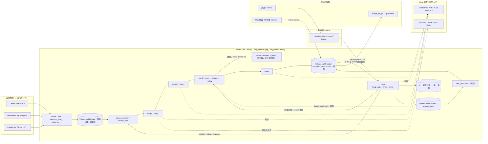

# 架構提案：單一平台、最少膠水程式碼

2026-10-28（台北）· 技術調研 G 節的候選方案之一 · 角度：把管線、沙盒、MCP server 放在同一個平台，少寫「把 A 的輸出搬到 B」的程式。

依據：[brief.md](../../brief.md) 第 4–7、10–13 節；[hackathon-rules.md](../../hackathon-rules.md) 第 2–6 節；[architecture.md](../architecture.md) A、C、D、F 節；[channels.md](../channels.md)；本目錄的筆記。平台能力另外讀了 Modal、Cloudflare、MCP Python SDK 的官方文件（第 10 節），查證日一律 2026-10-28。

標記：**未驗證**＝筆記標未驗證，或本提案新提出、沒有實測；**估算**＝自己算的。目前沒有任何 key，模型與雲端服務都還沒實際呼叫過（[architecture.md](../architecture.md) D 節）。

---

## 0. 結論

| # | 結論 |
|---|---|
| 1 | **建議全部放在 Modal**：一個 Python 套件、一個 Modal App、一次 `modal deploy`。發現用 `modal.Cron`，各階段用 Modal Function，驗證用 Modal Sandbox，MCP server 用 `@modal.asgi_app` 掛官方 Python SDK v2 的 `MCPServer`。 |
| 2 | 和「Python 管線＋Modal 沙盒＋Cloudflare Worker MCP」的混合做法比，省掉 8 個跨平台接點（索引建置與部署鏈、D1、overlay、Worker→Modal webhook、雙份 schema 等），淨省約 4–5 小時，而且 demo 當天只有一個地方要看 log。（估算，見 2.3） |
| 3 | 不建議全部放 Cloudflare：Containers 要付費方案、沙盒只能從 Worker 的 TypeScript 操作、容器內的程式不算「活動」，要自己用 alarm 維持；Python spike 要全部改寫成 TS。比全 Modal 多約 12–18 小時。（估算，見 2.1） |
| 4 | 單一平台的代價：MCP 會有冷啟動（demo 與評審期間開 1 個常駐容器，約 $0.38／天）、網址是 `*.modal.run`（Starter 方案不能綁自訂網域）、沒有 D1，事件要改存 Volume＋Dict、Modal 掛了就全部掛。每一項都有退路（第 6 節）。 |
| 5 | 唯一放不進平台的是 Mac 驗證（demo 那 3–5 款）、評測 harness、把資料匯出到 git，這三件在念誠的電腦上做。 |
| 6 | **今天（10/28）要過的關卡**：Python MCP 部署到 Modal 後，Claude Code 與 Codex 都連得上。10/30 中午前還連不上，MCP 改回 Cloudflare Worker（`spikes/mcp_stateless/` 已在 workerd 驗證），其他照舊，多花約 5–7 小時。 |
| 7 | 最低版本總工時約 **79.5 人時**（含 demo 製作 13、緩衝 5.5），可用時間約 79.5 小時，**沒有多餘空間**；加分項另有 23 小時，只在超前時做。 |

---

## 1. 一句話與設計原則

**一句話**：pickfit 是一個 Modal App。Muse Spark Open 初篩、Muse Spark 1.3 抽取與在 Modal Sandbox 裡自己安裝驗證，結果寫成附證據的 JSON 放在 Modal Volume；同一個 App 的 web 端點用這些 JSON 回答 agent 的 MCP 請求，並用 Muse Spark 1.3 配對；每天把 JSON 匯出到 git 當審計紀錄。

| # | 原則 | 落在哪 |
|---|---|---|
| 1 | **一個語言、一個部署、一個 secret 庫。** Python 3.12；`modal deploy` 一次部署管線、排程、MCP、run viewer；金鑰只放 Modal Secrets（本機腳本用 `.env`） | 第 3 節 Modal App 結構 |
| 2 | **一份 schema 用三次。** pydantic 模型是唯一來源：產生 Meta `text.format` 的 strict JSON Schema、MCP 的 input／output schema、git 匯出時的驗證 | `pickfit/schema.py` |
| 3 | **服務讀檔，不讀 git。** 管線寫 Volume，MCP 每 30 秒 reload 一次、全部放記憶體。git 是每天的匯出快照（審計、評審看），不在服務路徑上 | 第 3.3 節儲存 |
| 4 | **非同步的事用 `spawn()`，不用佇列服務。** 提交、重驗都是 web 端點直接 `process_one.spawn()`／`verify.spawn()`；狀態放 Modal Dict | [webhook-timeouts](https://modal.com/docs/guide/webhook-timeouts.md) 的官方範例就是這個做法 |
| 5 | **模型做判斷，程式做守門；每次呼叫留 trace。** 沿用 [meta-usage-design.md](meta-usage-design.md) 第 1 節；Starter 方案 log 只留 1 天，所以 trace 一律自己寫進 Volume | `pickfit/meta.py` 的 `call_meta()` |

---

## 2. 三種部署方式比較

### 2.1 比較表

| | **A. 全部 Modal（建議）** | B. 全部 Cloudflare | C. 混合（目前基準） |
|---|---|---|---|
| 管線 | Python Function＋`modal.Cron` | Workers＋Workflows（TS；Python Workers 是 Pyodide，`openai` 等套件能否用**未驗證**） | Python on Modal |
| 沙盒 | Modal Sandbox（gVisor、網域 allowlist Beta、執行中改政策 Alpha） | Containers（Firecracker；`allowedHosts`、outbound handler，政策可對執行中的容器生效） | Modal Sandbox |
| MCP | Python `MCPServer`（`mcp` 2.3.0）掛在 `@modal.asgi_app` | TS `createMcpHandler` on Workers（spike 已驗證） | TS on Workers（spike 已驗證） |
| 資料（服務讀的） | Volume 上的 JSON，載入記憶體 | 打包進 Worker＋Static Assets | 打包進 Worker，提交走 D1 overlay |
| 事件 | Volume 上每容器一個 JSONL＋Dict 去重 | D1 | D1 |
| 語言數 | 1（Python） | 1（TS），Python spike 要改寫 | 2（Python＋TS） |
| 部署指令 | 1：`modal deploy` | 1：`wrangler deploy`＋容器 image | 3：`modal deploy`、git push→Workers Builds、`wrangler` |
| 付費前提 | 無（Starter 每月含 $30 compute） | **Workers Paid $5／月**（Containers 在 Free 方案不可用） | 建議 Workers Paid $5（Free 冷啟動 10 ms CPU 未驗證） |
| GPU | 有（T4、L4…） | 文件未列 | 有（Modal） |
| 冷啟動 | 容器約 1 秒＋Python import（未實測）；`min_containers=1` 可消除 | Worker 幾乎沒有；容器 1–3 秒 | Worker 幾乎沒有 |
| 公開網址 | `https://<workspace>--<label>.modal.run`；自訂網域要 Team 方案 | `*.workers.dev` 或自訂網域 | 同 B |
| 工時（相對 A） | 基準 | **+12–18 h**（估算：沙盒整合 10–16 h vs Modal 4–6 h，見 [sandbox-compare.md](sandbox-compare.md) §2；再加 Python spike 改寫） | **+4–5 h**（膠水，見 2.3） |
| 出事的影響範圍 | Modal 掛 → 全部掛 | Cloudflare 掛 → 全部掛 | 任一個掛 → 半邊掛 |

B 的其他事實（官方文件，2026-10-28 讀）：
- Containers 的價格表 Free 欄是「N/A」，要 Workers Paid（[pricing](https://developers.cloudflare.com/containers/platform/pricing/index.md)）；沙盒總覽寫「Available on Workers Paid plan」（[sandbox](https://developers.cloudflare.com/sandbox/index.md)）。
- 「Code that runs inside the instance does not count as activity」，要用 Durable Object alarm 讓長任務不被停（[lifetime](https://developers.cloudflare.com/sandbox/concepts/lifetime/index.md)）。驗證 agent 一跑 4–8 分鐘，這是額外的程式。
- Workflows 在 Free 方案每步只有 10 ms CPU、每個 instance 50 個子請求；Paid 每步 30 秒（[Workflows limits](https://developers.cloudflare.com/workflows/reference/limits/index.md)）。
- B 唯一明顯比 A 好的是出網控制：`enableInternet = false`＋`allowedHosts`，outbound 政策可在容器執行中生效（[outbound traffic](https://developers.cloudflare.com/containers/configuration/outbound-traffic/index.md)）。Modal 的網域 allowlist 是 Beta、執行中改政策是 Alpha（[sandbox-networking](https://modal.com/docs/guide/sandbox-networking.md)）。

**結論**：選 A。B 的工時太高；C 能用，但跨平台接點多，一個人除錯時最花時間的就是這些接點。

### 2.2 A 方案用到的 Modal 能力（官方文件查證）

| 能力 | 文件寫的 | 對 pickfit | 狀態 |
|---|---|---|---|
| 在 Modal 跑無狀態 Streamable HTTP MCP | 官方範例 `mcp_server_stateless`：`@modal.asgi_app()` 包 FastAPI，掛 `http_app(transport="streamable-http", stateless_http=True)`；用 `modal deploy` 上線（[範例](https://modal.com/docs/examples/mcp_server_stateless.md)） | 範例用的是第三方 `fastmcp==2.10.6`（2025 年版本，是否支援 2026-07-28 新協定**未驗證**）。本提案改用官方 `mcp` 2.3.0 的 `MCPServer`：它依 `MCP-Protocol-Version` 分流，新協定本來就無狀態，`stateless_http=True` 只影響舊協定那一路（[Deploy & scale](https://py.sdk.modelcontextprotocol.io/run/deploy/index.md)）。暫存目錄快速實測過 legacy 與 modern 都可用（[mcp-server.md](mcp-server.md) §2.3） | 範例存在；**在 Modal 上未實測** |
| 掛進既有 ASGI app | `streamable_http_app()` 回傳 Starlette app；掛在 `Mount("/")` 時，**host app 的 lifespan 要自己進入 `mcp.session_manager.run()`**，自己的路由要排在 Mount 前面（[ASGI](https://py.sdk.modelcontextprotocol.io/run/asgi/index.md)） | `/runs`、`/` 等 viewer 路由放前面，MCP 在 `/mcp` | 已確認（文件） |
| Host 檢查 | 預設只收 localhost，其他 Host 一律 421；要設 `TransportSecuritySettings(allowed_hosts=[...])`，或在反向代理後關掉檢查（同上 Deploy 頁） | 設成實際的 `*.modal.run` 主機名（含 `:*`） | 已確認（文件） |
| `/mcp` → `/mcp/` 轉址 | TLS 在代理終止時，轉址可能指向 `http://`，Python client 會拒絕（同上） | README 給確切網址；部署後實測 | **未驗證** |
| Web 請求時間上限 | 150 秒，超過回 303（[timeouts](https://modal.com/docs/guide/webhook-timeouts.md)） | `find_software` 目標 20 秒內；Codex 預設工具逾時 60 秒 | 已確認 |
| 非同步工作 | web 端點 `slow_operation.spawn()`，回 call id 讓別的端點輪詢（同上） | `submit_software`、重驗直接 `spawn()` | 已確認 |
| 冷啟動 | `scaledown_window` 預設 60 秒、可到 20 分鐘；`min_containers` 常駐（[cold-start](https://modal.com/docs/guide/cold-start.md)）；`f.autoscaler.update(min_containers=…)` 可不重新部署就調整（[scale](https://modal.com/docs/guide/scale.md)） | demo 與評審期間開 1 個常駐 | 已確認；實際冷啟動秒數**未實測** |
| 並行 | `@modal.concurrent(max_inputs=…)` 讓一個容器同時處理多個請求（[webhooks](https://modal.com/docs/guide/webhooks.md)） | MCP 用 async（`AsyncOpenAI`），單一容器處理 demo 流量 | 已確認 |
| 平台限流 | 新帳號每 workspace 每秒 200 個 Function 呼叫或 HTTP 請求，超過回 429（同上） | 遠高於需求 | 已確認 |
| 驗證 | Web Function 預設公開；可設 `requires_proxy_auth=True`（[proxy auth](https://modal.com/docs/guide/webhook-proxy-auth.md)） | MCP 要公開（Claude custom connector 從 Anthropic 雲端連）；只有內部管理端點加 proxy auth | 已確認 |
| 取得客戶端 IP | `request.client.host`（[webhooks](https://modal.com/docs/guide/webhooks.md)「Client IP address」） | 行程內限流，key 用 IP 雜湊，不落地 | 已確認 |
| 排程 | `modal.Period`、`modal.Cron`（可設時區），要 deploy 才生效（[cron](https://modal.com/docs/guide/cron.md)）；Starter 方案 **5 個 deployed crons**（[pricing](https://modal.com/pricing)） | 用 3 個 | 已確認 |
| Volume | v2 支援多容器同時寫；同一檔案同時改是 last write wins；reload 時該容器看到的 Volume 是空的、有開啟的檔案不能 reload；背景每幾秒自動 commit，關機時也會 commit（[volumes](https://modal.com/docs/guide/volumes.md)） | 每個寫入者寫自己的檔；MCP 只在背景工作裡 reload、請求只讀記憶體 | 已確認 |
| SQLite 放 Volume | 官方範例先在暫存目錄建 SQLite，再搬到 Volume（[cron_datasette](https://modal.com/docs/examples/cron_datasette.md)） | 候選庫照這個做法，只由一個編排 Function 寫 | 已確認（範例） |
| Dict | 跨容器 KV；`put(key, value, skip_if_exists=True)`；**每筆 7 天沒讀寫就過期**；單筆上限 100 MiB（[dicts](https://modal.com/docs/guide/dicts.md)、[Dict](https://modal.com/docs/sdk/py/latest/Dict.md)） | 提交狀態、`report_outcome` 去重（`rec_id` 本來就 7 天有效）、每日預算計數。不當長期儲存 | 已確認 |
| Queue | 最後一次 put 後 24 小時清空，「persistence is likely, but not guaranteed」（[queues](https://modal.com/docs/guide/queues.md)） | **不用** | 已確認 |
| 花費上限 | Workspace budget 是硬上限；spend limit 到了會「stop workloads」（[budgets](https://modal.com/docs/guide/budgets.md)） | 比 Meta 的 Spend Limit（只寄信）好；但到上限時 MCP 也會停 | 已確認 |
| Starter 方案 | 每月含 $30 compute、100 containers、10 GPU 並行、log 保留 1 天、無自訂網域（[pricing](https://modal.com/pricing)） | trace 要自己存；網址用 `modal.run` | 已確認 |
| Shared Endpoint（Spark Open） | 按 token 計費；「Credits included with your plan cannot be used」（[shared-endpoints](https://modal.com/docs/guide/shared-endpoints.md)） | 開放權重初篩仍走 Baseten（比賽 credits）；Modal Shared Endpoint 當備案 | 已確認；比賽 $100 能否付**未驗證** |

### 2.3 膠水清單對照

「膠水」指只為了讓兩個平台或兩種語言接起來而寫的程式。工時是一個人的估算。

| 接點 | C 混合 | A 全 Modal |
|---|---|---|
| JSON → 索引 → Worker 部署（`build_index`、Workers Builds） | 2 h（[storage-matching.md](storage-matching.md) §0：1.5＋0.5） | 0：MCP 直接讀 Volume、啟動時建 BM25 |
| 事件表（D1 DDL、binding、寫入、錯誤處理） | 1.5 h | 0.5 h：JSONL＋Dict `skip_if_exists` |
| 提交即時上線（D1 `live_profiles` overlay） | 1 h | 0：管線寫 Volume，MCP 30 秒內 reload |
| Worker → Modal 提交 webhook（HMAC 共用密鑰） | 1 h | 0：`process_one.spawn()` |
| Modal → D1 回寫狀態與重驗佇列（Cloudflare REST） | 1 h | 0：Dict＋`verify.spawn()` |
| `sync_outcomes`（D1 → JSON） | 1 h | 0.5 h（讀 Volume 上的 JSONL） |
| 第二份 schema（zod 對 pydantic） | 1 h | 0：pydantic 產生 |
| Cloudflare 帳號、wrangler、Worker secrets | 0.5 h | 0 |
| Volume 載入與 reload | — | 1 h |
| 匯出到 git（Volume → 驗證 → commit） | — | 1 h |
| MCP 改用 Python（TS spike 不能直接用） | — | +1 h |
| Modal 上的 MCP 細節（Host allowlist、lifespan、轉址） | — | 1 h（併入 Day-1 spike） |
| **合計** | **9 h** | **5 h** |

除了工時，還少了：兩套 log（Modal dashboard＋Workers 日誌）、兩套 secret、部署順序（資料要先 push 才能建 Worker）。

### 2.4 單一平台的代價（不迴避）

| 代價 | 影響 | 處理 |
|---|---|---|
| MCP 冷啟動 | 閒置 60 秒後第一個請求要等容器啟動與 Python import（未實測） | 11/2 起 `min_containers=1`，一直開到 11/16 社群投票結束；`cpu=0.25`、`memory=512` 約 $0.38／天（估算，第 5 節） |
| 網址不好看 | `https://<workspace>--pickfit-mcp.modal.run/mcp`；Team 方案（$250／月）才有自訂網域 | 用 `label=` 讓網址短一點；README 放一鍵設定指令 |
| 沒有關聯式事件表 | 不能直接下 SQL 彙總 | 事件量小（demo 規模幾百筆）；`sync_outcomes` 讀 JSONL 用 Python 彙總 |
| 一家掛就全掛 | Modal 故障或帳號被停權（例如受測程式偷挖礦）會連 MCP 一起停 | 沙盒 CPU／時間上限、安裝後斷網；git 每天有匯出快照；退路是 TS Worker spike＋git 裡的 JSON（第 6 節） |
| 花費硬上限連帶停服務 | Modal spend limit 一到，MCP 也停 | 上限留足空間；每天看一次用量 |
| TS spike 用不上 | `spikes/mcp_stateless/` 已驗證的是 TS | 當退路保留；Python 版的 dual-era 行為在 Day-1 實測 |

---

## 3. 元件

工時是一個人、含測試的人時（估算）。「最低」是 demo 一定要有的；「加分」只在超前時做。model ID 與用法照 [meta-usage-design.md](meta-usage-design.md) 第 3、6 節。

### 3.1 管線（Python 3.12＋uv，全部是同一個 Modal App 的 Function）

| 元件 | 技術 | 做什麼 | 為什麼選它 | 工時（最低＋加分） | 最低版本／加分版本 |
|---|---|---|---|---|---|
| 發現：GitHub search | `httpx`；GitHub REST `/search/repositories`；念誠的 fine-grained PAT（Modal Secret） | 兩類別的 topic＋關鍵字、`created:`、`pushed:`、星數 5–300；補 README 與最新 release | 兩類新作品主要在這；只走 API 才合條款（[channels-hosting.md](channels-hosting.md) §2.1）。本 session 打不到 GitHub API，所以要在 Modal 或本機跑（[channels.md](../channels.md) §3） | 3＋2 | 最低：近 30 天、每條 query 前 1,000 筆／加分：日期切片完整列舉 |
| 發現：Homebrew 第三方 tap | `formulae.brew.sh` analytics JSON；GitHub contents API 讀 `.rb` | 30 天安裝 10–1000 的新 formula，對回 repo | 唯一同時有真實安裝數與默默無聞的訊號（[channels.md](../channels.md) §0） | 1.5 | 最低＝全部 |
| 發現：Show HN | HN Algolia `search_by_date`（`tags=show_hn`） | 只留連到 GitHub 的貼文 | 作者本人發表；86% ≤3 分（[channels.md](../channels.md) §0） | 1.5＋0.5 | 最低：每天回補／加分：Firebase 輪詢 |
| 發現：PyPI | RSS＋`console_scripts` | 篩 CLI 的新專案 | 本地 AI 工具多在這 | 0＋3 | 最低：不做／加分：接上（RSS 只涵蓋約 1 小時，要每 30 分鐘一次，見 [channels-integration.md](channels-integration.md) §3.1） |
| 正規化、去重、候選庫 | 改寫 `spikes/ch_integration_normalize.py`、`ch_integration_merge.py`；SQLite（標準函式庫）在 `/tmp` 操作，結束時寫回 Volume `pickfit-state` | 主鍵用 GitHub 數字 repo ID（新作品 14% 改過名）；合併 `sources[]`；記 cursor／ETag | spike 已驗證規則 25／25（[channels-integration.md](channels-integration.md) §4） | 1.5＋1 | 最低：GitHub ID＋canonical key／加分：ecosyste.ms 反查套件 |
| 排程與批次執行 | `modal.Cron`（Starter 5 個，用 3 個）；`process_batch`（`max_containers=1`，唯一寫候選庫的人）用 `.map()` 平行跑各階段 | 每天 2 次 GitHub＋Homebrew、每 2 小時 Show HN；批次驗證每天上限 30–50 款 | 和管線同一個 App，不用本機 cron 或 GitHub Actions（Actions 定期爬取在條款灰色地帶，[channels-integration.md](channels-integration.md) §3.2） | 2 | 最低：排程＋一次全量批次＋人工抽查 |
| 規則過濾＋初篩 | 規則（[quality-scoring.md](quality-scoring.md) §1.2）；**Muse Spark Open** `meta-models/muse-spark-open-1026`（未驗證，備案 `meta-models/muse-spark-open`）@ Baseten，`reasoning_effort: low`；pydantic 驗證 | 丟 fork、archived、沒 README；模型判斷是不是可用軟體、哪一類、附原文；不給星數；低信心送 `muse-spark-1.3` 複查 | 量最大；Best Open Weight 資格；Baseten 不強制 schema 所以程式端驗（[meta-open-weights.md](meta-open-weights.md) §4.2、§9） | 2.5＋1 | 最低：初篩＋升級＋5% 抽樣和 1.3 比一致率／加分：人工標 30 筆算準確率 |
| 抽取 | `muse-spark-1.3`，Responses API，`text.format` strict（schema 由 pydantic 產生），`reasoning.effort: low` | README、release notes、manifest → 檔案；每欄附逐字引用；程式檢查引用；事實欄位用 API 值 | constrained decoding 保證合 schema（[meta-model-api.md](meta-model-api.md) §4.4） | 4＋1.5 | 最低：文字來源／加分：README 截圖一起讀 |
| 驗證 agent（actor） | `muse-spark-1.3`，Responses＋`previous_response_id`，`reasoning: {effort: medium, summary: auto}`，`parallel_tool_calls: false`；function tools：`run_command`、`run_background`、`read_file`、`write_file`、`take_screenshot`、`finish` | 照 README 安裝 → 讀錯誤 → 修正 → smoke test → `finish`；15 類常見錯誤先套規則 | 最能證明 Meta 模型是核心，也是 Best Agentic 的主體（[meta-usage-design.md](meta-usage-design.md) §4.3.1） | 6＋1 | 最低：CLI＋本地 AI 的服務／極小模型推論；上限 25 回合、15 指令、20 分鐘、$0.50、同錯 3 次／加分：`web_search` 查錯誤、失敗時 `muse-wonder-1.0` 重試 |
| 沙盒 | Modal Sandbox：`runtime="gvisor"`、`cpu=(0.5, 2)`、`memory=(1024, 4096)`、`timeout=1200`；named image（python 3.12-slim＋libgomp1、git、curl、uv、pipx、node）；建立時 `outbound_domain_allowlist=["*"]`，安裝完改空清單；**不帶任何 secret** | 每款一個全新沙盒，跑完就刪；actor 的 Function 直接 `Sandbox.create(app=…)` | 和 actor 在同一個 App、同一個帳號，不用跨服務傳指令（[sandboxes](https://modal.com/docs/guide/sandboxes.md)）；gVisor、比賽 credits（[sandbox-compare.md](sandbox-compare.md) §0） | 3＋1 | 最低：把 spike 的 `DockerBox` 換成 `ModalBox`（同介面）＋`--limits-test`／加分：CUDA 才能跑的工具開 T4 沙盒 |
| 判讀（judge）＋截圖 | `muse-spark-1.3` 另開一次（圖片＋`text.format`，`effort: low`）；Pillow 把終端輸出畫成 PNG | 只看截圖、指令、exit code、預期訊號；回 `verdict` 與 0–1000 座標的證據框 | actor 不給自己打分（[sandbox-verify-design.md](sandbox-verify-design.md) §3） | 2＋1 | 最低：終端截圖＋judge／加分：本地 AI 網頁 UI（Playwright） |
| 重播（replay） | 程式；全新 Modal Sandbox | 照 `finish.install_steps` 重跑，不呼叫模型；通過才 `reproducible: true` | 把「模型說可以」變成「照做可以」 | 1 | 最低＝全部 |
| Mac 驗證（demo 的 3–5 款） | 念誠的 Apple silicon Mac＋Tart；或 GitHub Actions `macos-15`（`spikes/sb_gha_macos_brew.yml`） | 照 `get_install_guide` 的 Mac 步驟跑一次，寫進 `install.macos` 並註明方式 | **唯一放不進 Modal 的驗證**：雲端沙盒都是 Linux；Actions 條款只容許少量（[architecture.md](../architecture.md) C.1） | 1.5 | 最低＝全部 |
| 計分 | 規則（Python）＋`muse-spark-1.3` 文件 rubric（附引用）；加分：`muse-spark-1.3`＋`web_search` 搜尋可見度 | 品質、知名度分開算；寶藏＝驗證通過、Q ≥ 70、N ≤ 45 | 規則算的品質會飽和，要靠驗證與 rubric 拉開（[quality-scoring.md](quality-scoring.md)） | 3＋1.5 | 最低：規則＋rubric／加分：搜尋可見度 |

### 3.2 服務（同一個 App 的 `web` Function）

| 元件 | 技術 | 做什麼 | 為什麼選它 | 工時（最低＋加分） | 最低版本／加分版本 |
|---|---|---|---|---|---|
| MCP server | `mcp` 2.3.0（MIT）的 `MCPServer`；Starlette host app（自己的路由在前、`Mount("/")` 在後、lifespan 進入 `session_manager.run()`）；`@modal.asgi_app(label="pickfit-mcp")`＋`@modal.concurrent(max_inputs=50)`＋`max_containers=1`；`TransportSecuritySettings(allowed_hosts=[…modal.run 主機名, 主機名:*])`；配對用 `muse-spark-1.3`（`store: false`），`AsyncOpenAI` | 5 個工具（3.4）；行程內限流（IP 雜湊，不落地）；Meta 每日預算超過就改規則排序並標 `degraded: true` | 和管線共用 pydantic 模型與配對程式；一次部署 | 7.5＋1.5 | 最低：5 個工具、公開 URL、Claude Code 與 Codex 的連線說明／加分：MCP Registry 登錄、Cursor 一鍵安裝 |
| 儲存 | Volume `pickfit-data`（v2）：`software/<slug>.json`、`index_version`、`traces/`、`evidence/`；Volume `pickfit-events`：`events/<UTC 日期>/<容器 id>.jsonl`；Volume `pickfit-state`：候選庫、cursor；Dict `pickfit-hot`：提交狀態、去重、預算 | 管線寫 JSON 後更新 `index_version`；MCP 背景工作每 30 秒比對、reload、在記憶體重建候選卡與 BM25（300 筆，啟動成本可忽略，見 [storage-matching.md](storage-matching.md) §1.2 的量級）；請求路徑完全不碰 Volume | 少掉建置與部署鏈；提交後幾分鐘內可被推薦，不需要 overlay | 2＋1.5 | 最低：`save_profile()`、載入與 reload、本機 `export_to_git.py`（`modal volume get` → JSON Schema 驗證 → git commit）／加分：Modal Function 用 GitHub Git Data API 批次 commit |
| 提交入口 | MCP `submit_software` → 正規化 → Dict `sub:<key>`（`skip_if_exists`）→ `process_one.spawn(url)` | 只收 GitHub 連結（可附 Threads 貼文連結，只存 permalink 給 oEmbed 嵌入）；同一 URL 重送就是查進度 | Threads 貼文內容沒有合規方式交給模型（[channels.md](../channels.md) §0） | 1.5＋2.5 | 最低：MCP 工具＋狀態查詢／加分：GitHub Issue Form、run viewer 嵌入 Threads 貼文、「分享到 Threads」按鈕 |
| 回報 → 重驗 | `report_outcome` 寫事件；`install_failed`／`first_run_failed` 且有錯誤摘要 → Dict 計數（每天上限）→ `verify.spawn(slug, os, hint=error_excerpt)` | 重驗後新步驟寫回檔案；下次匯出時 git diff 看得到 | 「回報 → 重驗 → 步驟被修正」是不是基本 RAG 最直接的證據（[storage-matching.md](storage-matching.md) §2.2） | 1 | 最低＝全部 |

### 3.3 評測、展示與營運

| 元件 | 技術 | 做什麼 | 為什麼選它 | 工時（最低＋加分） | 最低版本／加分版本 |
|---|---|---|---|---|---|
| 評測（brief 第 10 節） | `eval/questions.yaml`（10/28 賽中新寫並 commit 凍結）；harness 在念誠電腦上用 Claude Code 無頭模式跑兩組（不接／接 MCP，旗標以當時的 `claude --help` 為準，未驗證）；推薦的步驟丟進 Modal Sandbox 重播 | 20 題 × 2 組；逐題記存在與否、合條件、步驟正確、照做能跑；另記候選數、驗證通過率、提交到可推薦的分鐘數 | brief 要求；錄下的對照組也是影片素材 | 6＋1 | 最低：兩組＋人工判定表，輸的題也寫進 README／加分：第三組「關掉模型、只用規則排序」 |
| 展示頁／run viewer | 同一個 Starlette app 的路由＋純 HTML／原生 JS（模板打包進 image） | `/runs/<id>`：每一步的模型徽章、推理摘要、工具呼叫、exit code、token、花費、截圖疊證據框；`/`：漏斗與各模型呼叫數、花費 | 不必另外部署靜態網站；MCP 回應的 `evidence_url` 直接連過來 | 2.5＋3 | 最低：run viewer＋看板／加分：公開寶藏列表與分享按鈕（brief 4.5） |
| trace／觀測 | `pipeline/meta.py` 的 `call_meta(stage, request)` 每次寫一行 JSONL 到 Volume（欄位見 [meta-usage-design.md](meta-usage-design.md) §7.1）；`scripts/meta_usage_report.py` | README 與影片結尾的數字從 trace 產生；配對只記 stage、模型、token、花費，不記需求原文 | Starter 方案 log 只留 1 天，自己存才留得住 | 0.5（另 2.5 在骨架裡） | 最低＝全部 |
| 金鑰與花費控管 | Modal Secrets：`pickfit-meta`（`MODEL_API_KEY`，發現／驗證／配對可各一把）、`pickfit-baseten`、`pickfit-github`（公開 repo 唯讀）、`pickfit-app`（`rec_id` 的 HMAC key）；沙盒不掛任何 secret；本機腳本用 `.env`（已 gitignore） | `call_meta` 讀 `usage` 記帳：每日 $25、總額 $120 硬停、每款驗證 $0.50；MCP 每日 $3 → 降級；Baseten 開 enforce 月預算；Modal workspace spend limit 設 $40 | Meta 的 Spend Limit 只寄信不停扣款（[meta-model-api.md](meta-model-api.md) §5）；Modal 的是硬上限（[budgets](https://modal.com/docs/guide/budgets.md)） | 1 | 最低＝全部 |
| 專案骨架 | `uv`；`pickfit/` 套件；`modal.App("pickfit")`；`call_meta`（記帳、trace、429 退避、504 處理） | 所有 Function 共用 image 與套件 | — | 2.5 | — |
| schema | pydantic v2 模型 → `model_json_schema()` → 自寫約 20 行把 `$ref` 展開 | 同時給 Meta strict schema、MCP schema、匯出驗證 | Meta 不支援遞迴 schema；舊 MCP 客戶端對 `$ref` 的支援未驗證（[mcp-server.md](mcp-server.md) §2.4） | 1 | — |
| 第一天：帳號與 spike | `spikes/meta_api_hello.py`、`meta_responses_agent_probe.py`、`meta_baseten_hello.py`、`sb_modal_verify.py`；新增 Modal 上的 MCP hello | 註冊、領 credits；把 [architecture.md](../architecture.md) D.4 的未驗證項變成數字；**確認 Claude Code、Codex 連得上 Modal 上的 Python MCP** | 成本、agent 設計、MCP 放哪都取決於這些答案 | 3 | — |
| demo 製作 | — | 選故事、彩排、錄影、剪輯；README（Meta 用法、評測、賽前／賽中說明、Built with Muse Spark Open）；檢查表、交件、X 貼文 | Demo 佔 25%，影片是主要依據（[hackathon-rules.md](../../hackathon-rules.md) 第 2、4 節） | 13 | — |
| 緩衝 | — | — | — | 5.5 | — |

### 3.4 MCP 工具（4＋1）

schema 照 [mcp-server.md](mcp-server.md) §5.4；輸出一律 object 根節點，同時回 JSON 文字版 `content`。

| 工具 | 呼叫 Meta 模型？ | 要點 | annotations |
|---|---|---|---|
| `find_software` | 是：A 解析需求、E 比較取捨（`muse-spark-1.3`，兩次串行） | 硬條件篩 → BM25 取 25 張候選卡 → 模型選 1–3 個、每個理由附 `field_ref` → 程式守門（[storage-matching.md](storage-matching.md) §2.1）；回 `rec_id`（HMAC，7 天）、`best_free`、`clarifying_question`、`degraded`、每個推薦的 `how_we_know` 與 `evidence_url` | `readOnlyHint: true` |
| `find_alternatives` | 是（同上） | 多帶 `current_software`、`pain_points`；可回 `keep_current` | `readOnlyHint: true` |
| `get_install_guide` | 否 | 只回重播過的步驟；`applies_to_user_system`；`run_by: agent／user`；`manual_steps` | `readOnlyHint: true` |
| `report_outcome` | 否（失敗會 spawn 驗證 agent） | 必帶 `rec_id`；Dict `put("o:<rec_id>:<slug>:<stage>", …, skip_if_exists=True)` 去重 | `idempotentHint: true` |
| `submit_software` | 觸發整條管線 | 冪等；回 `status`、`check_again_after_s`、`run_url` | `idempotentHint: true`、`openWorldHint: true` |

### 3.5 Modal App 結構

| Function | 觸發 | 主要設定 | 讀寫 |
|---|---|---|---|
| `discover_daily` | `modal.Cron`，每天 2 次（UTC，避開整點） | `timeout=1800`；secret `pickfit-github` | 只寫自己的原始紀錄檔 `pickfit-state/raw/<來源>/<日期>.jsonl`，不碰候選庫 |
| `discover_hn` | `modal.Period(hours=2)` | — | 同上 |
| `process_batch` | 手動 `modal run`，或 `discover_*` 結束時 `spawn()` | `max_containers=1`（候選庫唯一寫入者）：把原始紀錄併進候選庫；`.map()` 呼叫 `triage`、`extract`；`verify.spawn()` | 讀寫 `pickfit-state`；寫 `pickfit-data` |
| `triage`、`extract`、`score` | `.map()` | 純函式：輸入候選、回傳結果，不直接寫候選庫 | 寫 trace |
| `verify` | `spawn()` | `timeout=1800`；在裡面 `Sandbox.create()`、跑 actor、judge、replay | 寫 `pickfit-data` 的 `software/<slug>.json`、`evidence/`、`traces/`；更新 `index_version` |
| `process_one` | `submit_software` 的 `spawn()` | 單筆跑完 triage → verify | 同上；更新 Dict 狀態 |
| `sync_outcomes` | `modal.Cron`，每天 1 次 | — | 讀 `pickfit-events`，寫回各檔 `outcomes` |
| `web` | `@modal.asgi_app` | `@modal.concurrent(max_inputs=50)`、`max_containers=1`、`scaledown_window=1200`；demo 期 `autoscaler.update(min_containers=1)` | 讀 `pickfit-data`（只在背景 reload）；寫 `pickfit-events`（自己的檔）、Dict |

deployed crons：3 個（上限 5）。

### 3.6 repo 目錄（建議）

```text
pickfit/            Python 套件（管線與服務共用）
  app.py            modal.App：image、volumes、secrets、cron、web
  schema.py         pydantic 模型（唯一 schema 來源）＋展開 $ref
  meta.py           call_meta、ledger、trace
  discover/         github.py、brew.py、hn.py、normalize.py、candidates.py
  stages/           triage.py、extract.py、verify_actor.py、judge.py、replay.py、score.py
  sandbox.py        ModalBox
  serve/            mcp.py、match.py、index.py、viewer.py、templates/
prompts/            各階段 prompt（評審讀程式碼時看得到 Meta 模型做什麼）
data/software/      每天從 Volume 匯出的 JSON（審計快照）
eval/               questions.yaml（10/28 凍結）、harness、results/
scripts/            export_to_git.py、meta_usage_report.py
spikes/             調研 spike（已有，不是產品程式碼；mcp_stateless/ 是 MCP 退路）
```

### 3.7 工時合計

| 項目 | 最低 | 加分 |
|---|---:|---:|
| 管線（發現 7.5〔GitHub 3、Homebrew 1.5、Show HN 1.5、正規化 1.5〕、排程與批次 2、初篩 2.5、抽取 4、actor 6、沙盒 3、judge 2、重播 1、Mac 1.5、計分 3） | 32.5 | 13.5 |
| 服務（MCP 7.5、儲存 2、提交 1.5、重驗 1） | 12 | 5.5 |
| 評測、展示、營運（評測 6、viewer 2.5、trace 報表 0.5、金鑰 1、骨架 2.5、schema 1、第一天 3） | 16.5 | 4 |
| demo 製作 | 13 | — |
| 緩衝 | 5.5 | — |
| **合計** | **79.5** | **23** |

可用時間（估算）：10/28 約 8 h（早上已過一部分）、10/29–11/3 每天 10.5 h、11/4 約 8.5 h，合計約 79.5 h。11/5 00:00–10:00（台北）是截止前的最後時段，只留給意外，不排工作。

---

## 4. 資料流

### 4.1 圖



### 4.2 三條路徑

| 路徑 | 步驟 | 時間（估算） |
|---|---|---|
| 批次（主要資料來源） | Cron 發現 → 候選庫 → 規則 → Spark Open 初篩 → 抽取 → 驗證（每天上限 30–50 款）→ 計分 → 寫 Volume → 30 秒內 MCP 看得到 → 每天匯出到 git | 一批 30 款約 15–25 分鐘（10 個沙盒並行，[channels-integration.md](channels-integration.md) §6.2） |
| 提交（demo 第 5 幕） | agent 呼叫 `submit_software` → `process_one.spawn()` → 同一套階段 → 寫 Volume → reload → `find_software` 找得到；agent 用同一個 URL 查進度 | 單筆 5–10 分鐘（驗證 4–8 分鐘＋reload ≤30 秒） |
| 回饋 | `report_outcome` 失敗＋錯誤摘要 → `verify.spawn()`（帶提示）→ 步驟修正 → 寫 Volume → 下次匯出出現 git diff | 單筆 5–10 分鐘 |

---

## 5. 成本估算

### 5.1 規模假設（demo 規模，估算）

| 層 | 數量 |
|---|---|
| 發現原始項目 | 2,000–3,000 |
| 規則過濾後送模型初篩 | 300（上限） |
| 抽取 | 140（初篩通過約 120＋提交 20） |
| 驗證嘗試 | 160（140＋重驗 20）；開發重跑再加 50% → 240 |
| 驗證通過 | 50–100 |
| 配對查詢 | 560（評測 60、開發 200、demo 與評審期 300） |

單價全部取自筆記的估算（推理 token 未實測，是最大誤差來源）。

### 5.2 各服務

| 服務 | 項目 | 算式 | 小計 |
|---|---|---|---:|
| Meta Model API | 抽取（`muse-spark-1.3`） | 140 × 2（開發重跑）× $0.022–0.025 | $6.2–7.0 |
| | 初篩複查 | 30 × $0.0042 | $0.1 |
| | 驗證 actor＋judge | 240 × $0.113–0.283 | $27–68 |
| | `web_search`（驗證時查錯誤） | 約 120 次 × $0.0025＋token | $0.3–0.5 |
| | 文件 rubric | 100 × $0.017 | $1.7 |
| | 搜尋可見度（加分） | 每 100 筆 $1.9 | $0–1.9 |
| | 配對 | 560 × $0.024 | $13.4 |
| | **Meta 合計** | | **$49–93**（比賽 $150 credits；程式硬停 $120） |
| Baseten | Spark Open 初篩 | 300 × 3（開發重跑）× $0.0042，加提交 | **約 $4**（比賽 $100 credits；未核准就改 Modal Shared Endpoint 或 `muse-spark-1.3-contributor`） |
| Modal | 沙盒：驗證 240＋重播約 100 | 340 × 平均 $0.03（CLI 70% × $0.016、LLM 30% × $0.063）；最壞 340 × $0.127 | $10（最壞 $43） |
| | GPU 沙盒（加分） | 10 × T4 10 分鐘 | $1 |
| | Function 容器（發現、編排、actor 等模型回應） | 0.125 core＋128 MiB 約 $0.0069／小時；actor 240 × 6 分鐘，其他合計數十小時 | $1 以內 |
| | MCP 常駐容器 | 0.25 core × $0.0000131＋0.5 GiB × $0.00000222 = $0.0000044／秒 → $0.38／天 × 15 天（11/2–11/16） | $5.7 |
| | Volume、Dict | 1 TiB 內免費 | $0 |
| | **Modal 合計** | | **約 $18（最壞 $51）**（Starter 每月含 $30；比賽 $100 不保證） |
| Cloudflare | 不使用 | — | $0（退路啟用時 $0–5） |
| 其他 | GitHub Actions macOS（若不用 Tart） | public repo $0；private $0.062／分 × 約 30 分鐘 | $0–2 |
| | 網域 | 不需要（Modal Starter 不能綁自訂網域） | $0 |

### 5.3 合計與敏感度

- 正常情況：Meta 約 $49–93、Baseten 約 $4、Modal 約 $18，**幾乎全由 credits 與 Starter 內含額度支付**；自付 $0–20。
- 最壞情況（Modal 比賽 credits 沒發、驗證都跑到上限）：Modal 約 $51，扣掉 Starter $30 自付約 $21；Meta 仍在 $150 內。
- 驗證 agent 的推理 token 每多 500，240 次多約 $3（[meta-usage-design.md](meta-usage-design.md) §5）。
- 和混合做法比：混合建議開 Workers Paid（$5／月）；本提案改付 MCP 常駐容器約 $5.7。費用差不多。

---

## 6. 風險

| # | 風險 | 機率 | 影響 | 退路 |
|---|---|---|---|---|
| 1 | 台灣帳號開不了 Meta Model API（未驗證） | 中 | 高 | 抽取、驗證、配對改用 Spark Open @ Baseten（有 tool calling 與圖片，schema 不強制 → pydantic 驗證＋重試）；Modal Shared Endpoint 當第二備案（[meta-usage-design.md](meta-usage-design.md) §8） |
| 2 | Python MCP 在 Modal 上連不上或不穩（Host 421、lifespan、`/mcp` 轉址成 http、legacy SSE 經 Modal 代理，都未實測） | 中 | 高 | 10/28 Day-1 spike 先過；10/30 中午前不行就改用 `spikes/mcp_stateless/`（TS，已在 workerd 驗證）部署到 Cloudflare Worker，索引從匯出的 git JSON 建，多 5–7 h（其中配對邏輯改寫成 TS 約 3 h）；管線與沙盒照舊留在 Modal |
| 3 | Modal 故障或帳號被停（例如受測程式挖礦違反條款，[sandbox-verify-design.md](sandbox-verify-design.md) §0 #7） | 低 | 高（全部停） | 沙盒 CPU、時間上限，安裝後斷網；每天匯出 git；同 #2 的 Worker 退路；驗證改本機 Docker 只跑 demo 那幾款 |
| 4 | MCP 冷啟動讓 agent 等太久 | 中 | 中 | 11/2 起 `min_containers=1`；`scaledown_window=1200`；錄影前先暖機 |
| 5 | Volume reload 時讀到空目錄或因開啟中的檔案失敗 | 中 | 中 | 請求路徑只讀記憶體；reload 只在背景工作、加鎖；資料 Volume 對 `web` 唯讀，事件寫另一個 Volume；reload 失敗就保留舊索引 |
| 6 | 事件遺失（Dict 7 天不讀寫就過期；同一檔案並行寫 last write wins） | 低 | 低 | 每個容器寫自己的 JSONL；Dict 只放 7 天內有用的東西；`sync_outcomes` 每天彙總進檔案 |
| 7 | Modal 比賽 credits 沒發或很晚到 | 中 | 低 | Starter 每月 $30（11 月是新的月份，帳單週期對齊方式未驗證）；Modal spend limit 硬上限 $40 |
| 8 | 花費硬上限一到，MCP 也停 | 低 | 高 | 上限留 2 倍空間；每天看用量；評審期（11/5–11/8）前再確認一次 |
| 9 | 驗證誤判、gVisor 不相容 | 中 | 中 | 規則、judge、replay 三者一致才算過；不相容的改 `runtime` VM（不能配 GPU）或標「未驗證」 |
| 10 | pydantic 產生的 schema 帶 `$ref`／`$defs`，Meta strict 或舊 MCP 客戶端不吃 | 中 | 低 | 自寫展開函式；Day-1 用 spike 打一次 strict schema |
| 11 | 範圍太大、一個人做不完 | 高 | 高 | 每天的完成標準（第 7 節）；落後超過 3 小時就照順序砍：公開寶藏列表 → Threads 嵌入 → 開放權重初篩（改 `muse-spark-1.3-contributor`）→ Show HN → 計分的模型 rubric（只留規則） |
| 12 | Baseten `muse-spark-open-1026` 不存在或 RPM 太低 | 中 | 低 | `/v1/models` 確認；15 RPM 時 300 筆約 40 分鐘，可接受（[meta-open-weights.md](meta-open-weights.md) §8.2） |

---

## 7. 每天的工作（10/28–11/4，台北時間）

對照 brief 第 12 節。和 brief 不同的地方：開放權重初篩提前到 10/29（它是漏斗第一層，晚做反而要重跑）；Show HN 放到 11/2。

| 日期 | 工作（人時） | 完成標準（可以 demo 什麼） |
|---|---|---|
| 10/28（三）8 h | 帳號與 Day-1 spike 3（Meta、Baseten、Modal 註冊與領 credits；跑 `meta_api_hello.py`、`meta_responses_agent_probe.py`、`meta_baseten_hello.py`、`sb_modal_verify.py`；**Python MCP hello 部署到 Modal**）；骨架＋`call_meta` 2.5；評測 20 題寫好並 commit 凍結 1.5；金鑰與花費控管 1 | `modal deploy` 後有公開 URL；Claude Code `claude mcp add --transport http` 與 Codex 都連得上，`find_software` 回固定資料；一次真實 `muse-spark-1.3` 呼叫的 trace 在 Volume；`eval/questions.yaml` 已 commit；Modal、Baseten、Meta 的花費上限都設好 |
| 10/29（四）10.5 h | schema 1；GitHub search 3；Homebrew tap 1.5；正規化與候選庫 1.5；規則＋初篩 2.5；抽取（開頭）1 | `modal run` 一次收到 ≥1,000 筆原始候選、去重後進候選庫；300 筆跑完初篩（Baseten 未核准就先用備案），看得到漏斗數字；抽取對 5 筆產出通過 schema 與引用檢查的檔案 |
| 10/30（五）10.5 h | 抽取 3；儲存（Volume、reload、匯出）2；MCP 5 個工具與配對 5.5 | ≥50 份檔案（標 unverified）在 Volume；Claude Code 與 Codex 對公開 URL 呼叫 `find_software`／`find_alternatives`／`get_install_guide`／`report_outcome` 拿到真資料；第一次 `export_to_git` commit |
| 10/31（六）10.5 h | 沙盒 `ModalBox` 3；驗證 actor 6；run viewer 1.5 | 10 款 CLI 工具跑完驗證 agent，至少 5 款 verified；`/runs/<id>` 看得到每一步的推理摘要、指令、exit code、花費；verified 的檔案 30 秒內出現在 `find_software` |
| 11/1（日）10.5 h | judge＋截圖 2；replay 1；計分 3；`submit_software` 1.5；回報 → 重驗 1；MCP 收尾（`rec_id`、預算降級、限流）2 | demo 第 5 幕可跑：在 agent 裡提交 GitHub 連結 → 10 分鐘內 listed；回報失敗 → 重驗 → 新步驟寫回；推薦理由帶寶藏分數與驗證證據 |
| 11/2（一）10.5 h | Show HN 1.5；排程上線＋批次驗證＋抽查 2；評測 4.5；Mac 驗證 1.5；viewer 收尾 1 | ≥50 款 verified，兩個類別都有；評測兩組結果表（含輸的題）；demo 的 3–5 款在 Mac 驗證過；`min_containers=1` 開啟 |
| 11/3（二）10.5 h | demo 製作 8（故事、彩排、錄影 v1、README）；`meta_usage_report` 0.5；緩衝 2。最後一天可在 Discord 問：開放權重獎要怎麼標 | 3 分鐘影片 v1；README 有 Meta 用法表（數字從 trace 產生）、評測、賽前／賽中說明、Built with Muse Spark Open |
| 11/4（三）8.5 h | demo 製作 5（剪輯定稿、交件前檢查表、repo 轉 public、提交、X 貼文）；緩衝 3.5 | 台北 11/4 23:59 前送出（官方截止是台北 11/5 10:00，留 10 小時）；未登入可開 repo；影片連結公開 |

---

## 8. 對 brief 的修改建議

| 段落 | 現在寫的 | 建議 | 理由 |
|---|---|---|---|
| 11 MCP server | 部署在 Cloudflare Worker | **部署在 Modal web Function（官方 Python SDK v2），和管線同一個 App**；Cloudflare Worker 改成退路 | 少 8 個跨平台接點，約省 4–5 h（2.3）；Modal 官方有無狀態 MCP 範例（2.2） |
| 11 資料 | 每款一份 JSON 放 git 當正本；事件用一張表 | 線上服務讀 Modal Volume 上的同一份 JSON；**git 是每天匯出的審計快照**；事件寫 Volume 上的 JSONL，去重與狀態放 Modal Dict；仍不記 IP | 服務路徑不再經過 git 與建置，提交後幾分鐘內可被推薦；事件量小，不需要資料庫 |
| 11 管線 | Python 腳本或 worker；沙盒可考慮 Modal | 管線、排程、沙盒都在 Modal；本機只做 git 匯出、評測、Mac 驗證 | 本 session 打不到 GitHub API；GitHub Actions 定期爬取在條款灰色地帶（[channels-integration.md](channels-integration.md) §3.2） |
| 12 時程 | 11/1 做開放權重初篩 | 10/29 就用（漏斗第一層）；Baseten 沒核准前用同一段程式換 base_url | 晚做要重跑前面的資料 |
| 13 砍除順序 | 展示頁 → Threads → 開放權重 | 公開寶藏列表 → Threads 嵌入 → 開放權重初篩 → Show HN → 模型 rubric；**run viewer 不砍**（demo 與 `evidence_url` 都要用） | run viewer 和 MCP 在同一個 app，成本低、demo 價值高 |
| 4.1、5 | 貼 Threads 連結就收錄 | 貼 GitHub 連結，可附 Threads 貼文連結只用來嵌入 | Threads 貼文內容沒有合規方式交給模型（[channels.md](../channels.md) §0） |
| 6 | 初篩用 Spark Open 或 Glimmer（Baseten 或 Modal） | 只寫 Spark Open @ Baseten；Modal Shared Endpoint 當備案 | Glimmer 沒有合作夥伴按 token 託管；Modal 方案內含額度不能付 Shared Endpoint（[shared-endpoints](https://modal.com/docs/guide/shared-endpoints.md)） |

需要念誠決定的：
1. 接受 `*.modal.run` 網址（不買網域、不升 Team 方案）。
2. Mac 驗證用 Tart（要有 Apple silicon Mac）還是 GitHub Actions `macos-15`（條款灰色地帶，只跑 3–5 款）。
3. Modal workspace spend limit 的金額（建議 $40）。

---

## 9. 本提案新增的未驗證項目

| # | 項目 | 怎麼確認 | 什麼時候 |
|---|---|---|---|
| 1 | `mcp` 2.3.0 `MCPServer` 掛在 `@modal.asgi_app` 後，legacy 與 modern 兩代都通（含 legacy 的 SSE 回應經 Modal 代理） | Day-1 部署 hello，跑 `spikes/mcp_stateless/` 的 curl 與 client 檢查（換網址） | 10/28 |
| 2 | Host allowlist 的實際主機名、`/mcp` 轉址是否變 `http://` | 同上 | 10/28 |
| 3 | Claude Code、Codex 對 `*.modal.run` 的實際連線 | `claude mcp add`、`codex mcp add` | 10/28 |
| 4 | Python MCP 容器冷啟動秒數 | 部署後量第一個請求 | 10/28 |
| 5 | Volume v2 背景 reload 的耗時與行為 | 管線寫檔後量 MCP 多久看得到 | 10/30 |
| 6 | 每個容器的唯一 id（例如 `MODAL_TASK_ID` 環境變數）是否存在 | 印環境變數；沒有就啟動時產生 uuid4 | 10/30 |
| 7 | pydantic schema 展開後，Meta strict schema 與舊 MCP 客戶端都接受 | spike 打一次 strict；MCP Inspector legacy 模式看 `tools/list` | 10/29–10/30 |
| 8 | Modal 比賽 $100 credits 的領取、能付哪些項目、帳單週期 | 領取後看 Billing | 10/28 |
| 9 | Modal spend limit 到上限時 web Function 是否立刻停 | 文件寫「stops workloads」，細節未寫；不實測，留足空間 | — |

---

## 10. 來源（查證日 2026-10-28）

**Modal**
- 無狀態 MCP 範例：https://modal.com/docs/examples/mcp_server_stateless.md
- Web Functions（並行、平台限流、客戶端 IP、驗證）：https://modal.com/docs/guide/webhooks.md
- Web Function URL、自訂網域（Team 以上）：https://modal.com/docs/guide/webhook-urls.md
- 請求時間上限與輪詢：https://modal.com/docs/guide/webhook-timeouts.md
- Proxy tokens：https://modal.com/docs/guide/webhook-proxy-auth.md
- 冷啟動：https://modal.com/docs/guide/cold-start.md
- Scale、autoscaler：https://modal.com/docs/guide/scale.md
- 排程：https://modal.com/docs/guide/cron.md
- Volumes：https://modal.com/docs/guide/volumes.md
- Dicts、Dict 參考：https://modal.com/docs/guide/dicts.md 、https://modal.com/docs/sdk/py/latest/Dict.md
- Queues：https://modal.com/docs/guide/queues.md
- Sandboxes、網路：https://modal.com/docs/guide/sandboxes.md 、https://modal.com/docs/guide/sandbox-networking.md
- 資源預設值：https://modal.com/docs/guide/resources.md
- Budgets：https://modal.com/docs/guide/budgets.md
- Shared Endpoints：https://modal.com/docs/guide/shared-endpoints.md
- SQLite 範例：https://modal.com/docs/examples/cron_datasette.md
- 價格與方案：https://modal.com/pricing

**MCP Python SDK**
- Deploy & scale（Host allowlist、`stateless_http` 只影響 legacy）：https://py.sdk.modelcontextprotocol.io/run/deploy/index.md
- 掛進既有 ASGI app（lifespan）：https://py.sdk.modelcontextprotocol.io/run/asgi/index.md

**Cloudflare**
- Containers 限制與價格：https://developers.cloudflare.com/containers/platform/limits/index.md 、https://developers.cloudflare.com/containers/platform/pricing/index.md
- Sandbox 總覽、生命週期、網路：https://developers.cloudflare.com/sandbox/index.md 、https://developers.cloudflare.com/sandbox/concepts/lifetime/index.md 、https://developers.cloudflare.com/sandbox/network/index.md
- Containers 出網控制：https://developers.cloudflare.com/containers/configuration/outbound-traffic/index.md
- Workflows 限制：https://developers.cloudflare.com/workflows/reference/limits/index.md
- Queues 價格：https://developers.cloudflare.com/queues/platform/pricing/index.md
- Python Workers 與套件：https://developers.cloudflare.com/workers/languages/python/index.md 、https://developers.cloudflare.com/workers/languages/python/packages/index.md

**本目錄筆記**：[meta-model-api.md](meta-model-api.md)、[meta-open-weights.md](meta-open-weights.md)、[meta-usage-design.md](meta-usage-design.md)、[sandbox-compare.md](sandbox-compare.md)、[sandbox-verify-design.md](sandbox-verify-design.md)、[storage-matching.md](storage-matching.md)、[mcp-server.md](mcp-server.md)、[quality-scoring.md](quality-scoring.md)、[channels-integration.md](channels-integration.md)、[channels-hosting.md](channels-hosting.md)。
