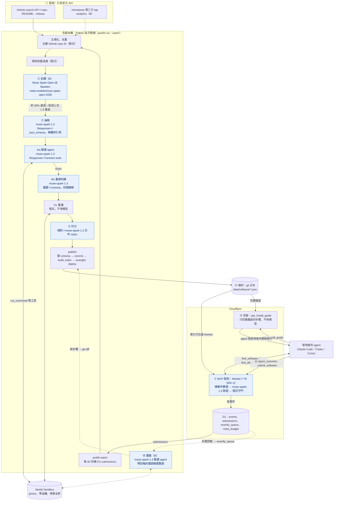

# 整體架構：綜合建議（G–K）

2026-10-28（台北）· 技術調研 G–K 節的最終建議，每一節都可以直接貼進 [architecture.md](../architecture.md)。

依據：三份提案（[mvp](arch-proposal-mvp.md)、[demo](arch-proposal-demo.md)、[single](arch-proposal-single.md)）與三位評審（務實派、黑客松評審、懷疑派）的評分；[brief](../../brief.md) 第 4–7、10–13 節；[規則](../../hackathon-rules.md) 第 2–6 節；[architecture.md](../architecture.md) A、C、D、F 節；[channels.md](../channels.md)；本目錄筆記。查證日一律 2026-10-28。

標記：**未驗證**＝筆記標未驗證，或本文新提出、沒有查證；**估算**＝自己算的。目前沒有任何 key，Meta、Baseten、Modal、Cloudflare 的線上行為都沒有實測。本文沒有修改 brief、規則、architecture.md、channels.md。

---

## 0. 結論

| 問題 | 答案 |
|---|---|
| 推薦 | 以 **mvp** 為骨架（三位評審都選它，平均 7.28 分最高），移植 demo 的證據露出，以及 single 的資料正確性做法 |
| 形狀 | 念誠本機的 Python 批次管線 → Modal gVisor 沙盒驗證 → git 裡每款一份 JSON（正本）→ 建置成索引、打包進 Cloudflare Worker → TS MCP 提供 5 個工具 |
| Meta 模型 | `muse-spark-1.3`：抽取、驗證 agent、畫面判讀、文件評分、配對、重驗。Muse Spark Open @ Baseten：初篩（10/29 進主流程） |
| 工時 | 核心（A）64.5 h＋計畫內（B）8 h＝72.5 h。容量 78 h，緩衝 5.5 h。照評審「估計偏樂觀 1.5 倍」的折扣，連 A 都放不下，所以每天設檢查點，砍除順序也事先定好 |
| 花費（估算） | Meta $25–88（$150 credits 內，管線硬停 $100）；Baseten $2–5；Modal $4–9（最壞 $38）；Cloudflare $0–5 |
| 兩個關卡 | 10/28 晚上：Meta API 能不能用。10/31 晚上：≥5 筆在 Modal 通過驗證並重播成功 |
| 交件 | 目標台北 11/4 22:00（美東 11/4 09:00），離截止還有 12 小時 |

---

## G1 架構比較

三份提案的產品核心幾乎一樣：都用 `muse-spark-1.3` 做抽取、驗證 agent（Responses＋function tools）、截圖判讀、文件評分與配對，也都會在乾淨沙盒重播。差別在部署方式、工時，以及 Meta 模型在影片裡看不看得到。

| | mvp（最小可行） | demo（以 demo 為主） | single（全放 Modal） |
|---|---|---|---|
| 一句話 | 本機 Python 管線 → git JSON 正本 → 索引打包進 Cloudflare Worker（TS MCP） | 管線跑在 Modal；用 D1 overlay 讓提交不必重新部署；有 run viewer 與看板；trace 放 R2 | 管線、沙盒、MCP（Python SDK）全在一個 Modal App；git 改成每天匯出的快照 |
| 雲端服務 | Meta、Modal、Cloudflare（Workers＋D1）、GitHub；Baseten 是加分 | Meta、Baseten、Modal、Workers、D1、R2、Static Assets、GitHub | Meta、Baseten、Modal、GitHub |
| 開發時間（自估） | 最低版本 68 h（含初篩 70.5 h），自稱緩衝 8.5 h | 82 h，等於全部可用時數；6 h 緩衝已算在內 | 79.5 h，等於可用時數；緩衝 5.5 h |
| 開發時間（評審重算） | 每日排程加總 74.5 h，實際緩衝約 4.5 h；發現與驗證的工時偏低 | 重驗、HMAC webhook 沒有列工時；發現工時約只有筆記估計的一半 | 啟用 TS 退路要多 5–7 h，會吃光緩衝；發現工時偏低 |
| 成本（估算） | Meta $22–76；Modal $4–8（最壞 $32）；自付 $0–5 | Meta $49–91；Baseten $4–6；Modal $11–23；自付 $0–8 | Meta $49–93；Baseten 約 $4；Modal 約 $18（最壞 $51） |
| 主要風險 | Meta 模型露出不足；提交靠筆電輪詢；驗證全擠在 10/31 一天 | 跨平台接點最多（overlay、webhook、R2）；完整 MCP 到 11/1 才上線；即時提交 6–11 分鐘沒有實測 | Python MCP 在 Modal 上沒有實測（Host 421、不結束的 SSE、150 秒上限）；陌生程式和 MCP 共用一個帳號；git 不再是正本 |
| demo 效果 | 終端機逐步輸出＋3 份公開 trace；run viewer 是加分 | 最好：run viewer、看板、judge 證據框、`matched_by`／`how_we_know`／`evidence_url` | 好：run viewer 和 MCP 在同一個 app；沒有分鏡 |
| 和評分標準的契合度 | Use of Meta AI Tooling 偏弱：開放權重初篩與重驗閉環都是加分項 | 最好：每一步都有模型徽章；開放權重在主流程；三個加碼獎都有對應的證據 | 中上：初篩排 10/29，重驗在最低版本 |
| 規則與條款安全度 | 最保守：Mac 由人工跑並標 `method: human`；ecosyste.ms 只查不存。但第 5 幕「作者在 Threads 發文」有扮演作者的疑慮 | 第 5 幕的規則最清楚（使用者提交第三方作品，不扮作者）。但把 Actions 寫成「容許少量」、Tart 寫成「沒有條款疑慮」，兩處都錯 | Actions 同樣寫錯；陌生程式和對外服務在同一個帳號，被停權就全部停 |
| 評審平均（6 項） | **7.28** | 7.08 | 6.69 |
| 評審選誰當基礎 | 3／3 | 0 | 0 |

評審平均分數（3 位評審，0–10 分，未加權）：

| 項目 | mvp | demo | single |
|---|---:|---:|---:|
| 可行性 | **7.17** | 4.50 | 5.33 |
| 成本 | **8.67** | 7.17 | 7.00 |
| 風險（高分＝風險低） | **7.33** | 4.83 | 4.83 |
| demo 效果 | 6.00 | **9.00** | 7.33 |
| 和評分標準的契合度 | 6.17 | **9.00** | 7.67 |
| 規則與條款安全度 | **8.33** | 8.00 | 8.00 |
| 6 項平均 | **7.28** | 7.08 | 6.69 |

---

## G2 推薦架構

**一句話**：念誠電腦上的 Python 批次管線先用 Muse Spark Open 初篩，再由 `muse-spark-1.3` 讀懂軟體，並在 Modal gVisor 沙盒裡自己安裝、修錯、判讀截圖；接著程式在乾淨沙盒重播。結果寫成 git 裡每款一份 JSON，建置時打包進 Cloudflare Worker。Worker 用官方 TS MCP SDK 提供 5 個工具：推薦由 `muse-spark-1.3` 做取捨，每筆都附驗證證據；回報失敗會觸發重驗，並留下一個 git diff。

### G2.1 為什麼選它

1. **最可能如期交出能動的作品。** 三位評審都選它；可行性 7.17、成本 8.67、風險 7.33，三項都是三份裡最高。
2. **關鍵路徑只用跑過的 spike。** MCP 的 `spikes/mcp_stateless/` 在 Node 和 workerd 都通過了新舊兩代協定的檢查（[mcp-server.md](mcp-server.md) §6）。沙盒沿用 `spikes/sandbox_docker_install.py` 的 Box 介面，已實測 4 款真實工具（[sandbox-verify-design.md](sandbox-verify-design.md) §6）。
3. **跑陌生程式的平台和對外服務分開。** 陌生程式在 Modal 跑，MCP 在 Cloudflare。Modal 帳號被停權或碰到花費上限時，只有驗證會停，MCP 照常服務（single 做不到這點）。
4. **接點最少，退路多半只改設定。** Meta 和 Baseten 都是 OpenAI 相容介面，換 `base_url`／`model` 即可；沙盒換 Box 的實作即可。它沒有 demo 提案的 overlay、R2、webhook 這些沒驗證過的接點。
5. **弱點補得起來。** 它的弱點（Meta 模型露出不足、開放權重排太後面、沒有回報閉環）約 8 h 就能從另兩份移植補上。另兩份的弱點是結構性的（demo 的接點與時程、single 沒實測的 MCP 與單點故障），移植修不了。

### G2.2 從其他提案移植了什麼

層級：**A**＝核心，一定要交；**B**＝計畫內，落後時照 H.5 的順序砍；**C**＝只有進度超前才做。

| # | 移植的做法 | 來源 | 工時 | 層級 | 哪天 |
|---|---|---|---:|---|---|
| 1 | 把 `spikes/mcp_stateless/` 部署到 `workers.dev`，用 Claude Code 實際連一次，把連線風險提前到第一天 | demo、single | 0.5 | A | 10/28 |
| 2 | 開放權重初篩進主流程，當漏斗第一層；抽 5% 和 `muse-spark-1.3` 比一致率；README 標「Built with Muse Spark Open」 | demo、single | 2 | B | 10/29 |
| 3 | 驗證 agent 提前：10/30 先在本機 Docker 對已知工具跑 actor，目標是「照 README 失敗 → 讀錯誤 → 自己修好 → `finish`」 | demo | 改排程 | A | 10/30 |
| 4 | 主鍵改用 GitHub 數字 repo ID，遇到 301 就取現名；新作品有 14% 改過名（[channels-integration.md](channels-integration.md) §0） | single | 含在 2.5 | A | 10/29 |
| 5 | 用 pydantic 當唯一的 schema 來源，產生 Meta strict schema 和 JSON Schema，並展開 `$ref` | single | 1 | A | 10/28 |
| 6 | Homebrew 第三方 tap 進計畫：唯一同時有真實安裝數與低知名度的訊號，也對上 Mac demo（[channels-packages.md](channels-packages.md) §2.1） | demo、single | 2 | B | 10/30 |
| 7 | MCP 回應加 `how_we_know`、`evidence_url`、`matched_by` | demo | 含在 MCP | A | 11/1 |
| 8 | 回報 → 重驗 → 新步驟 commit（留下 git diff）。這是「不是基本 RAG」最直接的證據（[storage-matching.md](storage-matching.md) §2.2） | single、demo | 1.5 | B | 11/2 |
| 9 | run page（demo 的 run viewer 縮小版）：從 trace 產生靜態 HTML，顯示模型徽章、推理摘要、工具呼叫、exit code、花費、judge 證據框 | demo | 2 | B | 11/2 |
| 10 | 評測加第三組「關掉模型、只用規則排序」，量出 Muse Spark 在配對上的貢獻 | demo | 0.5 | B | 11/2 |
| 11 | 影片的即時／回放標示規則；第 5 幕改成使用者提交第三方 repo；dry run 的 trace 保留；3 分鐘分鏡（H.4） | demo | 含在影片 | A | 11/3 |
| 12 | 到 Discord 問兩件事：開放權重獎提交時怎麼標、Community Vote 看的是哪個頁面 | demo | 0.25 | A | 11/2 前 |
| 13 | Modal workspace 設上限、Baseten 開 enforce。上限要高於自估的最壞情況（修正 single 的錯，見 G2.3 #15） | single | 含在金鑰設定 | A | 10/28 |
| 14 | 評審期防護：Worker 每日 Meta 上限＋評審期總額上限＋IP 限流，避免預算被刷完後評審只看到 degraded 結果 | 懷疑派評審 | 含在 MCP | A | 11/1 |
| 15 | 提交改在 Modal 用 `spawn()` 處理，評審期不必開著筆電（Modal web endpoint＋HMAC＋GitHub Contents API commit＋Workers Builds） | single、demo | 3–4 | C1 | 11/3 前 |

### G2.3 修正的事實錯誤

| # | 原寫法（出處） | 問題 | 改成 | 依據 |
|---|---|---|---|---|
| 1 | 可用 79 h、緩衝 8.5 h（mvp） | 每日排程加總是 74.5 h，實際緩衝約 4.5 h | 重排：A 64.5 h＋B 8 h＝72.5 h，容量 78 h，緩衝 5.5 h（H.1） | 評審重算 |
| 2 | 發現工時：GitHub 3–4 h、Homebrew 1–1.5 h、去重 1–1.5 h（三份都有） | 筆記估的完整版是 GitHub 6–9 h、Homebrew 3–4 h、Show HN 2–4 h、正規化＋ID 3–4 h | 最低版本縮小範圍並重用 spike：GitHub 4 h（每類別 3 條 q、不切日期）、Homebrew 2 h、正規化 2.5 h；完整版放加分 | [channels.md](../channels.md) §0；[channels-integration.md](channels-integration.md) §9.1 |
| 3 | 去重 key 用小寫網址，改名偵測放加分（mvp、demo） | 新作品有 14% 改過名，舊名、新名會被收成兩筆 | 主鍵用 `gh:<repo id>`，舊名放進 `aliases` | [channels-integration.md](channels-integration.md) §0、§4.3 |
| 4 | `find_*` 依寶藏分數取前 40 張卡（mvp） | 寶藏分數只算 verified／partial 的軟體，10/30 還沒有驗證資料；先依分數截斷，也違反「推薦是配對，不是排名」 | 硬條件篩選後，該類別合格 ≤60 筆就全部送進模型，不截斷；超過 60 筆才加 BM25（加分）。排序不用寶藏分數 | [meta-usage-design.md](meta-usage-design.md) §4.4；[storage-matching.md](storage-matching.md) §2.1 C |
| 5 | 安裝階段只設網域 allowlist（三份都有） | 網域 allowlist 只放行 TLS 443，被擋的連線寫進 system output；http 下載會失敗。要在執行中收緊政策，建立時就得同時設 `["*"]` 與 `["0.0.0.0/0"]` | 建立沙盒時兩個都設；安裝完、跑範例前用 `_experimental_set_outbound_network_policy` 收成空清單（Alpha）。系統函式庫預裝在 image 裡，不在沙盒內 apt（非 root，缺函式庫就換 image） | [sandbox-compare.md](sandbox-compare.md) §4.1、§7；[sandbox-verify-design.md](sandbox-verify-design.md) §1.3、§4.1 |
| 6 | 退路「開放網路＋記錄外連」（mvp） | Modal 只記錄被擋的連線，全開時沒有內建的外連紀錄 | 外連改用 `/proc` 抽樣（spike 的做法，在 Modal 上**未驗證**），README 照實寫 | [sandbox-verify-design.md](sandbox-verify-design.md) §4.1、§6.4 #7 |
| 7 | Meta 開不了就改走 Baseten，「只改 `base_url`／`model`，約 2 h」（mvp、demo） | Baseten 的 `/responses` 是無狀態的，不能用 `previous_response_id`；預設只有 15–120 RPM（Meta 是 3,000） | actor 改用 Chat Completions，每輪重送完整歷史；並行數降到 2–6；退路工時改估 3–4 h | [meta-open-weights.md](meta-open-weights.md) §0 #3、§4.1、§4.3 |
| 8 | PyPI 用 XML-RPC `changelog_since_serial`（mvp、demo） | PyPI 官方：「No new integrations should use the XML-RPC APIs」 | 改用 RSS（每 20–30 分鐘一次），漏掉的用 ecosyste.ms 回補（只查不存）。PyPI 仍是加分項 | [channels-integration.md](channels-integration.md) §3.1 |
| 9 | 文件 rubric「6 項，各 0–3 分」（mvp） | 和 architecture B.3、quality-scoring 的「8 項，0／1／2 分」不一致 | 採用 B.3 的 8 項 0／1／2 分 | [quality-scoring.md](quality-scoring.md) §3.1 |
| 10 | 寶藏公式（筆記之間不一致） | quality-scoring 用 `gap = Q − N` 排序；schema 用 `T = Q × (1 − N/100)` | 「寶藏」標記照 B.3：Q ≥ 70 且 N ≤ 45。排序值用 schema 已經測過的 `T`，並記 `formula_version`。主報告 B.3 寫的是 gap，整合時要統一 | [storage-matching.md](storage-matching.md) §4.2；[quality-scoring.md](quality-scoring.md) §3.3 |
| 11 | 「Actions 條款只容許少量」（demo、single） | 條款沒有任何數量上的容許；用 Actions 驗證第三方軟體本身就是灰色地帶 | 只寫「灰色地帶」；預設不用 Actions | [sandbox-compare.md](sandbox-compare.md) §5 |
| 12 | 「有 Apple silicon Mac 就用 Tart，沒有條款疑慮」（demo） | Apple 授權只允許 VM 用於開發、開發中的測試、個人非商業用途；驗證第三方軟體算不算，同樣是解讀問題 | 改成「風險較低，但仍是解讀問題」；預設在自己的 Mac 開一個新的使用者帳號，人工照指南跑 | [sandbox-compare.md](sandbox-compare.md) §5；[architecture.md](../architecture.md) C.1 |
| 13 | 評測用 `claude -p --output-format json`，沒有標未驗證（mvp） | 旗標沒有查證 | 標**未驗證**，以當時 `claude --help` 的輸出為準 | demo、single 的寫法 |
| 14 | Rate Limiting binding 放在最低版本（demo） | Free 方案能不能用，文件沒寫 | 開了 Workers Paid 才用；Free 方案先靠每日預算上限 | [mcp-server.md](mcp-server.md) §0 #7、§7 |
| 15 | Modal 上限設 $40，但自估最壞 $51；budget 與 spend limit 混用（single） | 碰到上限時 MCP 會一起停 | 本建議的 MCP 不在 Modal；Modal 上限設自估最壞情況的 2 倍。budget 與 spend limit 的差別，評審引用 Modal budgets 文件說明，本文沒有再查證 | 評審（懷疑派） |
| 16 | 「15 RPM 時，300 筆初篩約 40 分鐘」（single） | 300 次 ÷ 15 RPM＝20 分鐘 | 20 分鐘 | [meta-open-weights.md](meta-open-weights.md) §8.2 |
| 17 | 把混合方案（含 D1 overlay、Worker→Modal webhook）當成基準，算出「少 8 個接點、省 4–5 h」（single） | architecture E、F 的基準沒有這兩項，這筆帳是對 demo 提案算的 | 本建議不採用 overlay，也不採用 webhook | [architecture.md](../architecture.md) E、F；[storage-matching.md](storage-matching.md) §0 #5 |
| 18 | 第 5 幕「作者在 Threads 發文，再自己提交」（mvp） | 念誠扮演作者有冒充疑慮；提交自己的作品又違反 brief 第 9 節 | 改成使用者提交第三方 repo，不扮演作者 | [brief](../../brief.md) 第 9 節 |

### G2.4 不採用的做法

| 做法 | 來源 | 不採用的理由 |
|---|---|---|
| D1 `live_profiles` overlay＋R2＋Worker→Modal HMAC webhook | demo | 多 3 個沒驗證過的接點。Modal 寫 D1 要走 REST，全域上限是 1,200 次／5 分鐘；overlay 裡的新筆不在建置時算好的 BM25 倒排裡（[storage-matching.md](storage-matching.md) §1.1、§1.2） |
| Python MCP 掛在 Modal `@modal.asgi_app` | single | 沒有實測。Python SDK 的 `GET /mcp` 會開一條不結束的 SSE（[mcp-server.md](mcp-server.md) §2.3），撞上 150 秒上限後的行為未知；而且是單一容器、單一帳號 |
| git 降成每天匯出的快照 | single | 偏離 brief 第 11 節與 architecture F；「回報 → 重驗 → git diff」要等匯出後才看得到 |
| `rec_id` 用 HMAC 簽章 | mcp-server 筆記 | 沿用 mvp：`find_*` 時寫一列 D1，回報時查這列。少一把密鑰；D1 Free 每天可讀 500 萬列（[storage-matching.md](storage-matching.md) §1.5） |
| 配對分兩次串行呼叫（解析、比較） | storage-matching 筆記 | 改成一次呼叫，延遲較低，比較不會碰到 Codex 預設的 60 秒工具逾時（[mcp-server.md](mcp-server.md) §4）。類別超過 60 筆時才加 `search_terms`＋BM25 |
| 向量搜尋 | — | Meta 沒有 embedding 模型（**未驗證**）；「向量庫＋LLM」正是基本 RAG 的樣子（[storage-matching.md](storage-matching.md) §3） |

### G2.5 花費與上限（估算）

規模：300–600 筆候選 → 規則後 200–400 筆送初篩 → 抽取 100–150 筆 → 驗證嘗試 75–150 次 → 通過 50–100 筆。推理 token 沒有實測，是最大的誤差來源（[meta-usage-design.md](meta-usage-design.md) §5）。

| 項目 | 算式 | 估計 | 付款方 | 上限 |
|---|---|---:|---|---|
| 抽取 | 100–150 筆 × $0.028（含 10% 重試） | $3–4 | Meta | — |
| 驗證 actor＋judge | 75–150 次 × $0.12–0.28 | $9–42 | Meta | 單筆 $0.50 |
| 重驗 | 10–20 次 × $0.12–0.28 | $1–6 | Meta | 每天最多 5 筆 |
| 文件 rubric | 50–100 筆 × $0.017 | $1–2 | Meta | — |
| 配對 | 約 400 次 × $0.013–0.035（≤60 張卡） | $5–14 | Meta | Worker 每日 $3 |
| 開發與重跑 | 以上 × 30% | $6–20 | Meta | — |
| **Meta 小計** | | **$25–88** | $150 credits | 管線每日 $25、總額 $100 硬停；評審期 Worker 總額 $40 |
| 初篩 | 200–400 筆 × $0.0042 × 1.5（重跑） | $2–5 | Baseten credits | 月預算 $20，開 enforce |
| 沙盒 | 嘗試＋重播 125–300 個 × 平均 $0.03；最壞 × $0.127 | $4–9（最壞 $38） | Modal | `timeout=1200`、並行 ≤5；workspace 上限約 $80 |
| Workers Paid＋D1 | — | $0–5 | Cloudflare | — |
| **自付現金（credits 都到位時）** | | **$0–5** | | |

- Meta 的 Spend Limit 只寄信，不會停止扣款（[meta-model-api.md](meta-model-api.md) §0 #10），所以上限全部由程式執行；Baseten 的 enforce 會真的拒絕請求（[meta-open-weights.md](meta-open-weights.md) §4.3）。
- Meta credits 一直沒入帳的話，上面的 Meta 小計改刷卡。Credit Terms 寫「入帳後不過期」，活動頁寫「10 天開發期」，兩者矛盾（[meta-model-api.md](meta-model-api.md) §5），評審期的配對呼叫可能會刷卡。

---

## G3 資料流

實線是核心（A），虛線是計畫內（B）。藍色節點會呼叫 Meta 模型。

（已用 mermaid 11.4.1 的 parser 確認可以解析。）

每一步用的模型：

| 步 | model ID／端點 | 模型做的決定 | 程式做的事 | 依據 |
|---|---|---|---|---|
| ① 發現 | 不用模型 | — | GitHub search（每次 ≤20 次 search、間隔 2.1 秒）、Homebrew analytics、正規化、repo ID、規則前置 | [channels-hosting.md](channels-hosting.md) §3.1；[channels-integration.md](channels-integration.md) §4 |
| ② 初篩 | Muse Spark Open，`meta-models/muse-spark-open-1026`（**未驗證**，備案 `meta-models/muse-spark-open`）@ Baseten，`reasoning_effort: low` | 是不是可用的軟體、屬於哪一類（不給星數） | pydantic 驗證（Baseten 不強制 schema）；低信心或 JSON 壞掉就送 1.3 複查；抽 5% 比一致率 | [meta-open-weights.md](meta-open-weights.md) §0、§4.2；[meta-usage-design.md](meta-usage-design.md) §4.1 |
| ③ 抽取 | `muse-spark-1.3`，`/v1/responses`，`text.format` strict，`reasoning.effort: low` | 讀 README、manifest、release notes，填欄位，每欄附逐字引用 | 檢查引用確實出現在來源；授權、release 等事實欄位改用 API 值 | [meta-usage-design.md](meta-usage-design.md) §4.2 |
| ④a 驗證 agent | `muse-spark-1.3`，Responses＋`previous_response_id`，`reasoning.effort: medium` | 每一步跑什麼、錯了怎麼修、何時結束 | 安裝方式由程式先排序；規則表先處理常見錯誤；25 回合、15 指令、20 分鐘、$0.50 的上限 | [sandbox-verify-design.md](sandbox-verify-design.md) §1；[meta-model-api.md](meta-model-api.md) §0 #9 |
| ④b 畫面判讀 | `muse-spark-1.3`，圖片＋schema，另開一次呼叫 | 截圖裡的軟體是不是真的在運作，框出證據（0–1000 座標） | Pillow 把終端輸出重繪成 PNG；exit code、judge、重播三者都過才算 verified | [sandbox-verify-design.md](sandbox-verify-design.md) §3 |
| ④c 重播 | 不用模型 | — | 在全新沙盒照 `finish.install_steps` 重跑 | [meta-usage-design.md](meta-usage-design.md) §4.3.3 |
| ⑤ 計分 | `muse-spark-1.3`（文件 rubric，8 項 0／1／2 分，附引用） | 文件完整度；寫 `why_worth_it` | 驗證、維護、知名度、寶藏分數都由規則計算 | [quality-scoring.md](quality-scoring.md) §3 |
| ⑥ 儲存 | 不用模型 | — | 寫入前用 JSON Schema 驗證；commit；建置索引 | [storage-matching.md](storage-matching.md) §0 |
| ⑦ MCP 配對 | `muse-spark-1.3`，`store: false` | 解析需求、比較取捨、找最好的免費選項、最多問 1 題 | 硬條件篩選；slug 必須在候選裡、`field_ref` 要對得上；超出預算或失敗時退回規則排序，標 `degraded: true` | [meta-usage-design.md](meta-usage-design.md) §4.5 |
| ⑧ 安裝 | 不用模型 | — | 只回重播過的步驟；使用者的 OS 沒驗證過就明說 | [storage-matching.md](storage-matching.md) §2.1 G |
| ⑨ 回報 | 不用模型 | — | 一定要帶 `rec_id`；同一個 `rec_id`＋`slug`＋`stage` 只記一次 | [storage-matching.md](storage-matching.md) §1.4 |
| ⑩ 重驗 | `muse-spark-1.3`（同 ④a，多帶錯誤摘要） | 依使用者的錯誤修正步驟 | 失敗＋錯誤摘要 → `reverify_queue`；新步驟 commit 回 git | [storage-matching.md](storage-matching.md) §0 #6 |

三條路徑：

| 路徑 | 觸發 | 步驟 | 時間（估算，未實測） |
|---|---|---|---|
| 批次 | 手動 `uv run pickfit run --daily`（本機） | ① → ⑥，驗證每天上限 30–50 筆 | 30 筆約 15–25 分鐘（10 個沙盒並行，[channels-integration.md](channels-integration.md) §6.2） |
| 提交 | `submit_software` 寫 D1 → `pickfit watch` 每 60 秒讀一次 | 單筆跑 ① → ⑥ → `wrangler deploy` | 約 10 分鐘（驗證 4–8 分鐘＋部署） |
| 回饋 | `report_outcome` 失敗＋錯誤摘要 → `reverify_queue` | ⑩ → ⑥ | 單筆 5–10 分鐘 |

---

## G4 元件與技術表

工時是一個人的人時（估算）。工時欄的 A＝核心、B＝計畫內，見 G2.2。

| 元件 | 技術（語言、套件、服務、model ID） | 做什麼 | 最低版本 | 加分版本 | 工時 |
|---|---|---|---|---|---:|
| 帳號與 spike 實測 | Meta、Baseten、Modal、Cloudflare、GitHub、E2B；`spikes/meta_api_hello.py`、`meta_responses_agent_probe.py`、`meta_baseten_hello.py`、`sb_modal_verify.py`、`ch_hosting_github.py` | 申請 key 與 credits；把 [architecture.md](../architecture.md) D.4 的未驗證項變成數字 | 5 支 spike 的結果貼回筆記 | — | 1.5 A |
| 專案骨架＋schema | Python 3.12、`uv`、`pydantic` v2（`model_json_schema()` 再自寫約 20 行展開 `$ref`）；`schema/software.v1.json` | 一份 schema 同時給 Meta strict schema、JSON Schema 驗證、MCP 用 | 目錄照 [mvp](arch-proposal-mvp.md) §2.9；`.env`（`.gitignore` 已有 `.env*`）；`runs/` 不進 git | — | 2 A |
| hello MCP 上線 | `spikes/mcp_stateless/` → `wrangler deploy` 到 `workers.dev`；`claude mcp add --transport http` | 第一天就確認公開 URL 連得上 | Claude Code 看得到 hello 工具 | Codex 實連（要 OpenAI 登入） | 0.5 A |
| `call_meta` | `openai` Python SDK（授權**未驗證**）；`base_url` 設 `https://api.meta.ai/v1` 或 `https://inference.baseten.co/v1` | 記帳（`usage` × 單價）、trace JSONL、429 退避、504 改 streaming、schema 驗證 | 每日 $25、總額 $100 硬停；發現、驗證、配對各用一把 key | 每個環節設 `prompt_cache_key` | 2.5 A |
| 發現：GitHub | `httpx`；REST `search/repositories`、`repos`、`readme`、`releases/latest`、`contents`；fine-grained PAT（不勾任何權限） | 找今年新建、最近有 push、5–300 星的兩類工具 | 每類別 3 條 q（寶藏候選 1 條＋召回 2 條）；每次 ≤20 次 search | 16 條 q 全上＋切日期繞過每條 1,000 筆的上限 | 4 A |
| 發現：Homebrew tap | `formulae.brew.sh` analytics JSON（30／90／365 天）；GitHub contents API 讀 `.rb`；移植 `spikes/ch_packages_brew_taps.py` | 找「30 天安裝 10–1000 次，365 天 ≤ 30 天的 1.15 倍」的第三方 formula，對回原始 repo | 安裝數只當「有人在用」的弱訊號（含 CI 安裝） | 加 homebrew-core 當知名度基準 | 2 B |
| 正規化、去重、候選庫 | Python `sqlite3`（`runs/pipeline.db`）；移植 `ch_integration_normalize.py` 的 `canon()`；`GET /repos/{o}/{r}` 不自動跟隨 301 | 主鍵 `gh:<repo id>`；舊名進 `aliases`；合併 `sources[]`；記錄各階段狀態與淘汰原因 | URL 正規化＋repo ID＋同 key 合併 | 用 provenance 對應套件與 repo；同一作者一週建很多 repo 就降權 | 2.5 A |
| 規則前置 | 移植 `spikes/quality_signals.py` | 丟掉 fork、archived、template、沒有 README、README 少於 300 字元的 | 規則＋淘汰原因 | — | 1 A |
| 初篩（開放權重） | Muse Spark Open @ Baseten，`meta-models/muse-spark-open-1026`（**未驗證**），`reasoning_effort: low`；pydantic | 是不是可用的軟體、屬於哪一類 | 規則通過的全部跑；低信心送 1.3；抽 5%（≥30 筆）比一致率 | 人工標 30 筆算準確率 | 2 B |
| 抽取 | `muse-spark-1.3`，Responses，`text.format` strict（`software_profile_v1`），`reasoning.effort: low` | README（≤8K tokens）＋manifest＋最近 3 則 release notes → 結構化檔案 | 比對引用；事實欄位用 API 值；出錯時附錯誤清單重試一次 | 一起讀 README 截圖；公開 README 改用 `-contributor`（便宜 12–20 倍，150 RPM） | 4 A |
| 沙盒 | `modal` SDK：`Sandbox.create(runtime="gvisor", cpu=(0.5, 2), memory=(1024, 4096), timeout=1200)`；事先發布 named image（`python:3.12-slim`＋`libgomp1 git curl ca-certificates`＋uv、pipx、node）；本機 `DockerBox` 沿用 spike | 每筆一個全新沙盒、零金鑰 | 建立時設 `outbound_domain_allowlist=["*"]`＋`outbound_cidr_allowlist=["0.0.0.0/0"]`，跑範例前收成空清單；`--limits-test` | 安裝時只開精選網域；`E2BBox`（Modal 不能用時）；GPU 沙盒 | 3.5 A |
| 驗證 agent（actor） | `muse-spark-1.3`，Responses＋`previous_response_id`，`reasoning: {effort: medium, summary: auto}`，`parallel_tool_calls: false`；tools：`list_dir`、`read_file`、`run_command`、`run_background`、`finish` | 照 README 安裝、讀錯誤、修正、跑 smoke test；`finish` 回報實際步驟與偏離 README 的地方 | 程式先排安裝方式，再套 6–8 條常見錯誤規則，最後才問模型；終端機逐步印出模型、指令、exit code、花費 | 內建 `web_search` 查錯誤；失敗時改用 `muse-wonder-1.0` 重試 | 6 A |
| 畫面判讀（judge） | Pillow 重繪終端 PNG（約 0.06 秒）；`muse-spark-1.3`＋圖片＋`screen_judge` schema | 只看截圖、指令、exit code，回 `verdict` 與證據框 | 1 張終端截圖；規則、judge、重播三者都過才算 verified | 證據框畫在截圖上（併入 run page） | 1.5 A |
| 重播 | 程式，同一個 `Box` 介面 | 在全新沙盒照 `install_steps` 重跑，不呼叫模型 | 每筆一次；`get_install_guide` 只回重播過的步驟 | — | 1 A |
| 批次驗證與抽查 | `pickfit verify --batch N --concurrency 5` | 背景跑；人工看 demo 會用到的那幾筆 | 每天上限 30–50 筆，demo 類別優先 | 並行 10 | 1 A |
| Mac 驗證（demo 那 3 筆） | 念誠的 Mac，開一個新的 macOS 使用者帳號，人工照 `get_install_guide` 跑 | 讓第 4 幕「第一次執行就成功」有依據 | log 存證；profile 照實標 `method: human` | Actions `macos-15`（條款灰色，見 K） | 1 A |
| 計分 | 規則（`quality_signals.py`）＋`muse-spark-1.3` 文件 rubric | quality、popularity、treasure 分開算，記 `formula_version` | B.3 的權重；缺資料的分項從分母拿掉 | 搜尋可見度（`web_search`）；類別內百分位校準 | 2.5 A |
| 正本、索引、發布 | `data/software/<slug>.json`；`jsonschema` 4.26.0；`scripts/build_index.mjs`（`ajv` 8.20.0）；`wrangler deploy` | `pickfit publish`：驗 schema → commit → build → deploy | 手動部署 | Workers Builds 自動部署；BM25（`minisearch` 7.2.0） | 2.5 A |
| 事件 | Cloudflare D1：`events`、`submissions`、`reverify_queue`、`meta_budget`（DDL 取自 [storage-matching.md](storage-matching.md) §1.4） | 記錄查詢、安裝指南、回報、提交；不記 IP、不存需求原文 | 用 `ON CONFLICT … DO NOTHING`，不用 `INSERT OR IGNORE`；先 `--local` 再 `--remote` | `sync_outcomes` 寫回 JSON | 1 A |
| MCP server | TypeScript；`@modelcontextprotocol/server` 2.4.0 的 `createMcpHandler`；`zod` 4（≥4.5）；Workers；`fetch` 呼叫 Meta `/v1/responses` | 5 個工具（`find_software`、`find_alternatives`、`get_install_guide`、`report_outcome`、`submit_software`） | Host／Origin 檢查；硬條件篩選後該類別 ≤60 張卡全送，一次 `muse-spark-1.3` 呼叫，程式守門；回 `how_we_know`、`evidence_url`、`matched_by`；`rec_id` 存 D1；Worker 每日 $3，超過就標 `degraded` | BM25＋`search_terms`；「分歧屬性」程式檢查；Rate Limiting binding（Paid）；MCP Registry；Claude.ai connector | 7 A |
| 提交處理 | `pickfit watch`：每 60 秒 `wrangler d1 execute --remote --json` 讀 `submissions` | 單筆跑完整管線 → publish → 回寫狀態 | 只收 `github.com/<owner>/<repo>`；同一 URL 冪等 | 改在 Modal 用 `spawn()`（C1） | 2 A |
| 回報 → 重驗 | `reverify_queue`＋`pickfit watch`＋actor | 失敗回報帶錯誤摘要重跑，新步驟 commit | 每天最多 5 筆 | — | 1.5 B |
| run page | `scripts/render_runs.py`：trace JSONL → 靜態 HTML（Workers Static Assets，`/runs/<id>`） | 每一步的模型徽章、推理摘要、工具呼叫、exit code、花費、截圖與證據框 | demo 會用到的 3–5 筆 | 漏斗看板；公開寶藏列表 | 2 B |
| trace 與用量報表 | `runs/traces/*.jsonl`（欄位見 [meta-usage-design.md](meta-usage-design.md) §7.1）；`scripts/meta_usage_report.py` | README 與影片的數字由 trace 產生，不手寫 | 公開 3 份 trace（verified、failed、unsupported_env） | — | 1 A |
| 評測 | `eval/questions.yaml`（10/28 凍結）；`eval/run.py` 用 Claude Code 無頭模式（旗標**未驗證**）；人工評分 CSV；用重播執行器實跑安裝 | 對照組（不接）vs 實驗組（接 pickfit），同版本、同提示 | 題組 2 h（A）＋執行與評分 3.5 h（A） | 第三組「關掉模型、只用規則排序」0.5 h（B） | 5.5 A＋0.5 B |
| README、demo、影片、交件 | — | README 3、彩排 1.5、錄影 2.5、剪輯 2.5、檢查表與交件 1.5 | H.4 的分鏡 | — | 11 A |

合計：A 64.5 h，B 8 h，A＋B 72.5 h。

| C（只在超前時做，依序） | 工時 |
|---|---:|
| C1 提交改在 Modal 用 `spawn()`（評審期不必開筆電） | 3–4 |
| C2 Show HN（Algolia 按天切；spike `ch_comm_hn_showhn.py`） | 1.5–2 |
| C3 Codex、Cursor、Claude.ai custom connector 實連；MCP Registry 登錄 | 1 |
| C4 Workers Builds 自動部署 | 0.5 |
| C5 BM25＋`search_terms`＋分歧屬性 | 2.5 |
| C6 公開寶藏列表、Threads oEmbed 嵌入與分享按鈕 | 2.5 |
| C7 搜尋可見度（`web_search`） | 2 |
| C8 PyPI RSS（不用 XML-RPC） | 3 |
| C9 Muse Code 當 demo agent 加拍一段（能否接遠端 MCP **未驗證**） | 1 |

---

## H 每天的實作計畫

### H.1 工時假設

- 10/28 白天已經用掉一部分，只排 8 h。10/29–11/3 每天排 10.5 h（10–12 h 區間的中間偏低）；10/30 排 11.5 h，當天最後一項是最先砍的 Homebrew。11/4 排 6 h。
- 台北 11/4 22:00 到 11/5 10:00（截止）這 12 小時不排工作，只留給交件時的意外。

| 日期 | 容量 | 排入 A | 排入 B | 緩衝 |
|---|---:|---:|---:|---:|
| 10/28（三） | 8 | 8 | 0 | 0 |
| 10/29（四） | 10.5 | 8.5 | 2 | 0 |
| 10/30（五） | 11.5 | 9.5 | 2 | 0 |
| 10/31（六） | 10.5 | 10.5 | 0 | 0 |
| 11/1（日） | 10.5 | 10.5 | 0 | 0 |
| 11/2（一） | 10.5 | 6.5 | 4 | 0 |
| 11/3（二） | 10.5 | 9.5 | 0 | 1 |
| 11/4（三） | 6 | 1.5 | 0 | 4.5 |
| **合計** | **78** | **64.5** | **8** | **5.5** |

誠實的判斷：

- A 層 64.5 h 佔容量的 83%，能吸收約 20% 的超支。
- A＋B 72.5 h 只剩 5.5 h 緩衝。
- 評審認為一個人的估計常偏樂觀 1.5 倍；照這個折扣，連 A 層都要約 97 h。所以每天的檢查點與 H.5 的砍除順序是計畫本身的一部分，不是備案。

### H.2 每天的工作與完成標準

「完成標準」是當天晚上可以 demo 的東西。沒達到就照「檢查點」那一欄處理。

| 日期 | brief 第 12 節 | 工作（人時） | 晚上背景執行 | 完成標準（可以 demo 什麼） | 檢查點：沒達到就… |
|---|---|---|---|---|---|
| **10/28（三）** 8 h | 凍結評測題組；骨架；申請 credits | 帳號與 credits：Meta 優先（Individual → 綁卡 → 建 key → 抄 Team ID → 填 Claim Form → 設 Spend Limit 通知），再申請 Baseten、Modal、Cloudflare、GitHub PAT、E2B；跑 5 支 spike 1.5 · 骨架＋pydantic schema 2 · hello MCP 部署＋Claude Code 實連 0.5 · **評測 20 題寫好並 commit** 2 · `call_meta` v0（單價、ledger、trace、硬上限）2 | — | 一次真的 `muse-spark-1.3` 呼叫留下 trace 與花費；`eval/questions.yaml` 已 commit；Claude Code 看得到遠端的 hello 工具；帳號狀態表（含 Baseten model ID 與 RPM）貼回筆記 | Meta API 今晚不能用 → 10/29 起走 Baseten 全路徑（風險 I #1） |
| **10/29（四）** 10.5 h | 發現 agent：從 GitHub 收候選、用 Muse Spark 抽取 | `call_meta` 收尾（429／504、每日上限）0.5 · GitHub search＋補資料 4 · 正規化、repo ID、候選庫 2.5 · 規則前置 1 · **開放權重初篩（B）** 2 · 抽取 prompt 對 5 筆跑通 0.5 | 全量發現 → 規則 → 初篩 | `pickfit discover` 產生 ≥150 筆候選（含 repo ID）；漏斗（原始 → 規則 → 初篩）每一格標模型與花費；Spark Open 與 1.3 的一致率有第一個數字；5 份抽取檔過 schema | 用第一批 `usage` 換掉成本假設；推理 token 超過估算 2 倍就降 effort。Baseten 沒核准 → 公開 ID 自付；再不行就先只用規則 |
| **10/30（五）** 11.5 h | 配對 MCP（本計畫改到 10/31–11/1，先做驗證） | 抽取完成（引用比對、事實欄位、重試、批次）3.5 · **驗證 actor**（安裝方式排序、規則表、Responses 迴圈、停止條件、`finish` 驗證），先在本機 Docker 跑已知工具 6 · Homebrew tap（B，當天最後做）2 | 批次抽取初篩通過的候選 | evnx 這類「照 README 會失敗」的工具，由 Muse Spark 自己讀錯誤、補步驟、呼叫 `finish`，trace 看得到每一步的推理摘要；≥30 份 profile 已 commit；挑好 10 筆 demo 候選（能在 Mac 裝、免費、能離線） | actor 一筆都修不好 → 10/31 上午繼續修 actor，細路徑 MCP 延到 11/1；用規則表兜底，只做到「安裝驗證」等級。落後 → 不做 Homebrew |
| **10/31（六）** 10.5 h | 驗證 agent：沙盒安裝、截圖、視覺判讀 | ModalBox（gVisor、上限、網路政策、named image、`--limits-test`）3.5 · judge＋截圖 1.5 · 重播；寫回 `install.linux` 與 `verification` 1 · `build_index`＋`pickfit publish` 2.5 · D1 建表 1 · 細路徑 MCP：hello 改成讀真索引的 `find_software`、`get_install_guide` 1 | Modal 批次驗證：先跑 10 筆 demo 候選，再跑 30 筆 | 同一筆工具在 Modal gVisor 跑完 actor → judge（證據框）→ 重播；Claude Code 問「Mac 上、免費、能離線的 X」，回 2–3 筆真資料（還沒驗證的用開發旗標放行並標示） | **硬關卡**：10 筆 demo 候選 ≥5 筆在 Modal 通過驗證並重播成功。沒過 → 停掉所有 B、C，11/1 上午只修驗證；Modal 不能用 → 換 E2B（約 2 h） |
| **11/1（日）** 10.5 h | 提交入口；寶藏分數；開放權重初篩（已在 10/29 做） | MCP 補完：`find_alternatives`、`report_outcome`（`rec_id` 存 D1）、`submit_software`、Host／Origin、Worker 每日上限與 `degraded`、`how_we_know`／`evidence_url`／`matched_by` 6 · 計分：規則分項＋文件 rubric＋寶藏 2.5 · `pickfit watch` 2 | 批次驗證第二輪＋計分 | ≥30 筆 verified（目標 50），每筆有分開的 Q、N、T；在 Claude Code 用 `submit_software` 貼一個第三方 repo，約 10 分鐘內（估算）出現在 `find_software` 的結果；demo 主案＋2 個備案定案 | 不到 30 筆 → 停止加管道，只補 demo 類別的候選；Homebrew 若 10/30 沒做，就不再做 |
| **11/2（一）** 10.5 h | 跑評測（對照組 vs 實驗組）；修正 | 回報 → 重驗 → git diff（B）1.5 · run page（B）2 · 評測 20 題 × 2 組（背景跑）＋評分 3.5 · 第三組 rules-only（B）0.5 · demo 3 筆的 Mac 驗證 1 · `meta_usage_report` 1 · 抽查批次結果 1。到 Discord 問開放權重獎怎麼標、Community Vote 看哪個頁面 | 修 bug 後重驗失敗的筆 | 評測結果表（含輸的題）與系統數字；回報一次失敗 → 重驗 → 新 commit 的 git diff；3 份 run page；Mac 驗證有存證；Meta 用量表由 trace 產生。**當晚功能凍結** | 有 ≥2 題「好答案在資料裡卻沒被推薦」→ 只調卡片或加 BM25，不加新功能 |
| **11/3（二）** 10.5 h | 打磨 demo；README；錄影 | README（Meta 模型分工與用量、Built with Muse Spark Open、Why this is not RAG、評測、賽前／賽中、授權）3 · 彩排 2 次 1.5 · **錄影**（錄影前最後一次 publish，資料凍結）2.5 · 剪輯 v1 2.5 · 緩衝 1 | — | 3 分鐘影片 v1 已上傳（先不公開）；README 完成；用乾淨的 Claude Code 照 README 接得上 | 影片沒完成 → 11/4 上午補完；這天是主辦方回答問題的最後一天（規則第 1 節） |
| **11/4（三）** 6 h | 檢查表；轉 public；提交；X 貼文 | 規則第 11 節檢查表、金鑰掃描、授權 NOTICE · repo 轉 public 並登出確認 · 提交（Indie Developer）· X 貼文並附在提交頁：共 1.5 · 緩衝 4.5（剪輯修正、意外） | — | **台北 11/4 22:00 前送出**（美東 11/4 09:00，離截止 12 小時） | 有問題就用 11/5 00:00–10:00 補救，不再加功能 |

和 brief 第 12 節的差別：

- 驗證 agent 提前到 10/30（本機）與 10/31（Modal），因為它是最大的風險，也是 demo 的核心。
- MCP 拆成三段：10/28 hello、10/31 細路徑、11/1 補完。MCP 有跑過的 spike，連線風險在第一天就排除。
- 開放權重初篩從 11/1 提前到 10/29，因為它是漏斗第一層，晚做就要重跑前面的資料。
- demo 故事在 11/1 定案，比錄影早兩天。

### H.3 凍結與錄影的時間點

| 時間 | 事件 | 為什麼 |
|---|---|---|
| 10/28 晚上 | **凍結評測題組**（commit 後不再改） | brief 第 10 節：題目要在寫資料之前凍結。比賽期間重寫，不搬賽前草稿（[CLAUDE.md](../../../CLAUDE.md)） |
| 10/31 晚上 | 驗證硬關卡 | 不過就停掉所有 B、C |
| 11/1 晚上 | demo 故事定案 | 給 Mac 驗證和彩排留時間 |
| 11/2 晚上 | **功能凍結** | 之後只修 bug、寫 README、錄影 |
| 11/3 錄影前 | **資料凍結**（最後一次 publish） | 錄影和 README 的數字要一致 |
| 11/3 | **錄影** | 留 11/4 當剪輯與交件的緩衝 |
| 11/4 22:00（台北） | 交件 | 離截止 12 小時 |

### H.4 影片：即時／回放規則與 3 分鐘分鏡

規則（移植自 [demo](arch-proposal-demo.md) §3.3）：

- 預跑的畫面標「trace 回放」，即時的畫面標「即時，加速 ×N」。不改任何 trace、時間或 commit（[規則](../../hackathon-rules.md) 第 9 節）。
- 即時提交那一幕：從發現結果挑一個**還沒處理過**、第三方、能在 Linux 沙盒驗證的 repo。不能是念誠自己的作品；影片裡是「使用者」提交別人的作品，不扮演作者（[brief](../../brief.md) 第 9 節）。
- 可以先 dry run 同一筆確認會過。正式錄影前，用一個新的 commit 把它從 `data/` 移除（不改寫歷史）。dry run 和錄壞的那幾次，trace 都保留。
- 錄 2–3 次，用其中一次。

| 時間 | 畫面 | 即時／預跑 | Meta 模型露出 |
|---|---|---|---|
| 0:00–0:10 | 一句話說明賽前有什麼、這週做了什麼（官方要求，[規則](../../hackathon-rules.md) 第 7 節） | — | — |
| 0:10–0:25 | 問題：好軟體找不到，agent 也不認識今年的專案 | — | — |
| 0:25–0:45 | 對照組：同一個 agent 不接 pickfit | 即時錄影（取自評測那次）；不剪掉它推薦了什麼 | — |
| 0:45–1:25 | 接上 pickfit：`find_software` → 今年的寶藏＋理由＋最好的免費選項＋`how_we_know` → `get_install_guide` → 在 Mac 上裝好，第一次執行就成功 → `report_outcome` | **即時**（安裝可以加速，標 ×N） | `matched_by: muse-spark-1.3` |
| 1:25–1:55 | 「怎麼知道裝得起來」：點 `evidence_url` → run page：照 README 失敗 → 讀錯誤 → 自己修 → judge 證據框 → 重播通過 | 預跑，標「trace 回放」。run page 被砍時改用終端機錄影 | actor、judge 的模型徽章與推理摘要 |
| 1:55–2:30 | 供給端：使用者用 `submit_software` 提交第三方 repo → 終端機逐步印出 Spark Open 初篩 → 抽取 → 驗證 → 收錄 → 再問一次 `find_software`，找得到了 | **即時**（加速 ×N＋計時器）。失敗就播上一輪的真實 trace，標「回放」 | 每一步的模型 |
| 2:30–2:45 | 自我修正：回報失敗 → 驗證 agent 重跑 → git diff 多了一個步驟 | 預跑或即時 | `muse-spark-1.3` |
| 2:45–3:00 | 數字：漏斗、驗證通過率、評測結果、各模型的呼叫數與花費（由 trace 產生） | — | 全部 |

### H.5 時間不夠時依序砍什麼

先砍 C，再砍 B，最後才砍 A 裡不影響主張的部分。任何一天結束時落後超過 2 小時，就往下砍一項。

| 順序 | 砍什麼 | 砍掉後的替代 | 省下 |
|---:|---|---|---:|
| 1 | 所有 C 項 | — | — |
| 2 | Homebrew tap（B） | GitHub topic 已經涵蓋兩個類別 | 2 h |
| 3 | run page（B） | `evidence_url` 改指向 repo 裡公開的 trace JSON；影片改用終端機錄影 | 2 h |
| 4 | 評測第三組 rules-only（B） | README 不寫 Muse Spark 在配對上的貢獻數字 | 0.5 h |
| 5 | 回報 → 重驗 → git diff（B） | README 說明設計，影片不演 | 1.5 h |
| 6 | 開放權重初篩（B） | 規則＋抽取輸出的 `kind` 當閘門；不宣稱開放權重（失去 Best Open Weight 資格） | 2 h |
| 7 | 驗證批次規模：50 筆降到 20 筆 | demo 類別優先 | 背景時間 |
| 8 | judge 的截圖 | 只看文字 log，README 照實寫 | 1 h |
| 9 | 文件 rubric | 改用規則近似（[quality-scoring.md](quality-scoring.md) §3.1 的 spike 版） | 1 h |
| 10 | `find_alternatives` 的獨立邏輯 | 直接共用 `find_software` 的輸出 | 1 h |
| 11 | 評測的安裝實跑 | 只實跑 ≤10 題，其餘標「未實跑」 | 1.5 h |

**不砍**：驗證 agent＋judge＋重播、`find_software`＋`get_install_guide`＋`report_outcome`＋`submit_software`、凍結的評測題組與結果（含輸的題）、影片、README 的賽前／賽中說明、金鑰與花費硬上限。

---

## I 風險

| # | 風險 | 機率 | 影響 | 早期訊號 | 退路 |
|---|---|---|---|---|---|
| 1 | 台灣帳號開不了 Meta Model API，或綁卡失敗（**未驗證**，[meta-model-api.md](meta-model-api.md) §0 #12） | 中 | 極高：第一輪是 pass/fail | 10/28 註冊或綁卡被拒；拿不到 Team ID | 全部改走 Spark Open @ Baseten：抽取用 Chat＋pydantic 重試；actor 改用 Chat Completions，每輪重送完整歷史（Baseten 的 `/responses` 是無狀態的）；並行降到 2–6；多 3–4 h。再不行就用 Fireworks serverless（$25 只給入選者，[meta-open-weights.md](meta-open-weights.md) §6） |
| 2 | Meta $150 credits 晚到，或效期矛盾（不過期 vs 10 天） | 中 | 中 | claim 後 2 個工作天還沒入帳 | 先刷卡（10/28–10/30 估 <$10）；管線總額硬停；評審期 Worker 設總額上限 |
| 3 | Baseten credits 沒核准、`-1026` 不存在，或只有 15 RPM | 中 | 低–中：只影響開放權重獎 | 10/29 `/v1/models` 查不到；`x-ratelimit-limit-requests` 是 15 | 公開 ID 自付（<$5）；15 RPM 時 300 筆約 20 分鐘；Modal Shared Endpoint（方案內含的 credits 不能付；比賽的 $100 能不能付**未驗證**；tool calling 與 schema 支援**未驗證**）；最後退回 H.5 #6 |
| 4 | Modal credits 沒發，或網路政策（網域 allowlist 是 Beta、執行中改政策是 Alpha）不穩 | 中 | 中 | 10/28 領不到；10/31 `--limits-test` 或改政策的呼叫失敗 | Starter 方案每月含 $30；改政策不能用時，就把安裝與執行拆成兩個沙盒（用 snapshot，**未實測**），或開放網路並照實標示；換 E2B（約 2 h）；本機 Docker 只跑已知工具 |
| 5 | 驗證 agent 成功率太低 | 中高 | 高：通過的太少，demo 沒料 | 10/30 本機 actor 修不好 evnx 這類問題；10/31 的 10 筆 <5 筆通過 | 程式先排安裝方式＋規則表；優先挑有 release 二進位或能用 pipx／uv 裝的；接受「安裝驗證」等級；gVisor 不相容的改用 VM runtime；10/31 硬關卡 |
| 6 | Mac 驗證：沙盒都是 Linux，demo 在 Mac | 高 | 中 | 念誠沒有 Apple silicon Mac；照指南在 Mac 上失敗 | 在自己的 Mac 開新使用者帳號人工跑（`method: human`）；沒有 Mac → demo 改在 Linux 終端機；Actions `macos-15` 只跑 3 筆並在 README 說明用途（條款灰色，[sandbox-compare.md](sandbox-compare.md) §5）；Tart 同樣有 Apple 授權的解讀問題 |
| 7 | 雲端 session 的 GitHub API 被擋 | 已發生 | 中 | `/search/repositories` 回 403（[channels.md](../channels.md) §3） | 發現管線在念誠本機用自己的 PAT 跑；雲端 session 只寫程式與文件 |
| 8 | 被看成「基本 RAG」（官方反面範例） | 中 | 高 | 彩排時觀眾只記得「查資料庫再回答」 | 影片在 1:25 前就秀驗證 trace；run page；回報 → 重驗 → git diff；README 放「Why this is not RAG」表（[storage-matching.md](storage-matching.md) §2.2）；沒有向量庫；不用 knowledge base、retrieval 這類詞 |
| 9 | 工時超支 | 高 | 高 | 任何一天結束時落後 >2 h；10/31 關卡沒過 | H.5 的砍除順序；11/2 功能凍結；目標 11/4 22:00 交件，留 12 h |
| 10 | prompt injection（README、工具輸出、使用者需求） | 中 | 高 | 引用比對的失敗率異常；actor 想讀沙盒外的檔案或要金鑰 | 讀進來的內容包在 `<source>` 裡；沙盒零金鑰；actor 的工具只作用在沙盒；judge 不能推翻規則檢查；MCP 回應只放抽取欄位＋引用並限長；安裝步驟只回重播過的，安裝腳本先下載、記 sha256 才執行；`get_install_guide` 不自動執行，由使用者的 agent 經使用者同意才執行（[sandbox-verify-design.md](sandbox-verify-design.md) §1.2、§4.3） |
| 11 | 陌生程式在沙盒裡挖礦或作怪，Modal 帳號被停 | 低中 | 中：驗證停，MCP 照常 | Modal 用量異常 | CPU、時間上限；每筆全新沙盒；gVisor；MCP 在 Cloudflare，不受影響 |
| 12 | `find_*` 太慢，碰到 Codex 預設 60 秒工具逾時 | 中 | 中 | 10/31 細路徑量到 >20 秒 | 一次呼叫、`effort: low`、卡片 ≤60 張；逾時就退回規則排序，標 `degraded` |
| 13 | Workers Free 冷啟動超過 10 ms CPU（Error 1102）；Rate Limiting binding 不能用（**未驗證**） | 低中 | 低 | 部署後看 Invocation Statuses | 開 Paid（每月 $5），CPU 上限變 30 秒 |
| 14 | 評審期間預算被刷完，或筆電關機讓提交卡住 | 中 | 中 | `meta_budget` 每天都接近上限；`submissions` 一直堆積 | Worker 每日上限＋評審期總額＋IP 限流；README 寫明評審期的提交是每日批次處理；做 C1 |
| 15 | 推理 token 比估算多 2–3 倍 | 中 | 中 | 10/29 第一批的 `usage` | 降 effort；總額硬停；公開 README 的抽取改用 `-contributor` |
| 16 | 評測輸了，或題目被說偏 | 中 | 中 | 11/2 的結果 | 10/28 先凍結題目；輸的題照實寫進 README |
| 17 | 錄影時即時提交那一幕失敗 | 中 | 高 | 彩排失敗 | 錄 2–3 次；最後播真實 trace，標「回放」 |
| 18 | D1 DDL 不相容（只在 SQLite 3.45 測過） | 低 | 低 | `--local` 就失敗 | Worker 寫入失敗時 catch，推薦照常回 |
| 19 | 第三方套件授權沒查（`openai`、`httpx`、`pydantic`、`modal`） | 低 | 中 | — | 加入前查，記在 README 或 `NOTICE`（[規則](../../hackathon-rules.md) 第 9 節） |

---

## J 建議修改 brief

本文沒有修改 brief。以下給主控者決定。

| brief 章節 | 現在寫的 | 建議 | 理由 |
|---|---|---|---|
| 4.1 提交入口 | 任何人貼一個 GitHub 或 Threads 連結 | 只收 GitHub 連結；可以附 Threads 貼文連結，但只用 oEmbed 嵌入，不讀內容 | oEmbed 回傳沒有貼文文字，條款也禁止抽取；`threads_basic` 的允許用途不符（[channels-meta-platforms.md](channels-meta-platforms.md) 一句話結論、§2.1、§2.2） |
| 4.1 來源 | GitHub、Show HN、Homebrew 與 winget、Threads／Facebook 上的分享 | 黑客松接 GitHub search、Homebrew 第三方 tap、提交；Show HN 有時間再接；winget 不接；Threads／Facebook 不能主動發現 | [channels.md](../channels.md) §0；winget 只對 Windows 有意義（[channels-packages.md](channels-packages.md) §2.3） |
| 4.4 工具 | 4 個工具 | 5 個：加 `submit_software`（同一個 URL 冪等，重送就是查進度）；推薦一律帶 `how_we_know`、`evidence_url`、`matched_by`、`rec_id` | 第 5 幕可以全程在 agent 裡做；評審點得到證據（[mcp-server.md](mcp-server.md) §0 #13） |
| 4.5 展示頁 | 可選；用於 demo、社群投票 | 拆成兩塊：run page（驗證過程，計畫內）與公開寶藏列表（可選）；Community Vote 的「公開展示頁」先到 Discord 確認是不是主辦方的提交頁 | Use of Meta AI Tooling 佔 25%；[規則](../../hackathon-rules.md) 第 5 節沒寫清楚是哪個頁面 |
| 5 第 4 幕 | agent 照驗證過的步驟幫使用者裝好 | 註明沙盒驗證在 Linux；demo 那 3 筆另外在 Mac 上人工驗證，標 `method: human` | 雲端沙盒都是 Linux（[sandbox-compare.md](sandbox-compare.md) §5） |
| 5 第 5 幕 | 作者在 Threads 分享，貼上連結後幾分鐘被推薦 | 使用者在自己的 agent 用 `submit_software` 提交一個第三方 GitHub repo（不扮作者、不用念誠自己的作品）；畫面標「即時，加速 ×N」；有展示頁時才用 oEmbed 嵌入作者的 Threads 貼文 | brief 第 9 節；Threads 內容讀不到（[channels-meta-platforms.md](channels-meta-platforms.md) §6） |
| 6 Meta 模型表 | 讀懂與抽取、驗證判讀、大量初篩、配對、（選用）影音 | 改成 6 列：初篩（Spark Open @ Baseten）、抽取、驗證 agent（Responses＋function tools）、畫面判讀（另一次呼叫）、計分（文件 rubric）、配對；影音改成「不做」 | 讓評審看出 agent 與判讀是分開的；影音價值最低（[meta-usage-design.md](meta-usage-design.md) §11、§4.6） |
| 6 大量初篩 | Muse Spark Open 或 Muse Glimmer（透過 Baseten 或 Modal） | 只寫 Muse Spark Open @ Baseten（model ID 拿到 key 後用 `/v1/models` 確認）；Glimmer 不用；README 標「Built with Muse Spark Open」 | 合作夥伴都沒有按 token 計費的 Glimmer；授權第 2 條要求標示（[meta-open-weights.md](meta-open-weights.md) §0 #4、#6） |
| 8 資料來源 | Homebrew、winget-pkgs、Flathub：可以，有安裝數等資料 | winget 沒有公開安裝數；Homebrew analytics 的資料授權沒有明示，而且包含 CI 安裝，只當弱訊號、不轉發原始資料；Flathub 未查 | [channels-packages.md](channels-packages.md) §2.1、§6 |
| 8 Hacker News | 用官方 API | 用 Algolia `search_by_date` 或 Firebase `newstories`，不要只用 `showstories`（只涵蓋約 14%） | [channels-communities.md](channels-communities.md) §4 |
| 8 Reddit | 條款禁止爬取、建立競爭資料庫或商用 | 理由改成：商用要另簽約、禁止拿去訓練、任何 API 存取都要先申請核准 | 「競爭資料庫」不是條款原文（[channels-communities.md](channels-communities.md) §4） |
| 8 awesome 清單 | CC0 的 awesome 清單可以 | 補一句：沒有授權的清單只取連結、不轉載描述；ecosyste.ms（CC BY-SA）只查不存 | [channels-curation.md](channels-curation.md) §4.4；[channels-integration.md](channels-integration.md) §10 #2 |
| 10 評測 | 對照組 vs 實驗組 | 寫明受測 agent（Claude Code 無頭模式，兩組同版本、同提示）；安裝正確性用重播執行器實跑；加第三組「關掉模型、只用規則排序」 | 結果可重現，並量出 Muse Spark 的貢獻（[storage-matching.md](storage-matching.md) §2.3） |
| 11 資料 | 每款一份 YAML（或 JSON）；欄位清單 | 定為 JSON、schema `software.v1`；欄位加 `repo_id`、`aliases`、`first_seen_at`；`verification` 分級（安裝、功能、服務、推論、未驗證＋原因）；候選放 SQLite，只有收錄的寫進 git | [storage-matching.md](storage-matching.md) §0；[channels-integration.md](channels-integration.md) §10 #3、#4；[sandbox-verify-design.md](sandbox-verify-design.md) §2 |
| 11 管線 | Python 腳本或 worker；沙盒可考慮 Modal | 本機 Python 批次管線；沙盒用 Modal（明確設 `runtime="gvisor"`）；註明雲端 session 打不到 GitHub API | [channels.md](../channels.md) §3；[sandbox-verify-design.md](sandbox-verify-design.md) §0 #6 |
| 12 時程 | 10/30 MCP、10/31 驗證、11/1 提交與初篩 | 照 H.2：10/28 加 hello MCP；10/29 加開放權重初篩；10/30 抽取＋驗證 agent（本機）；10/31 Modal 驗證＋細路徑 MCP；11/1 補完 MCP＋計分＋提交；11/2 評測與功能凍結；11/3 錄影；目標台北 11/4 22:00 交件 | 先做最大的風險；一個人的時程要有檢查點 |
| 13 砍除順序 | 公開展示頁 → Threads 提交入口 → 開放權重初篩 | 照 H.5：加分項 → Homebrew → run page → rules-only 評測 → 重驗閉環 → 開放權重初篩 → …；Threads 入口已經改成只嵌入，沒有工時可砍 | 管道與展示才是工時大項 |
| 14 名稱查核 | 網域要用就盡早買 | 不需要：`workers.dev` 就能 demo | — |

---

## K 需要念誠決定或提供的東西

| 項目 | 為什麼需要 | 建議選項 | 期限 |
|---|---|---|---|
| Meta Model API 帳號、key、$150 credits | 產品核心；第一輪 pass/fail | dev.meta.ai → Start building（Individual）→ Billing 綁卡 → 建 key（發現、驗證、配對各一把）→ 抄 Team ID → 用錄取 email 裡的 Claim Form 申領 → Spend Limit 通知設 $50、$100（[meta-model-api.md](meta-model-api.md) §5） | 10/28 中午前確認能不能註冊；claim 今天做（截止 11/4 9 PM ET） |
| Baseten 帳號、比賽 credits | 開放權重初篩 | app.baseten.co 註冊 → 用 Participant Guide 的連結申請（限 2,000 人，要審核）→ 建 key → 月預算 $20 開 enforce → `/v1/models` 查 `-1026` | 10/28 申請；10/29 上午要有 key（沒核准就自付公開 ID） |
| Modal 帳號、token、credits | 沙盒 | `modal token new`；領 $100（前 1,000 人）；workspace 上限設約 $80（自估最壞 $38 的 2 倍；budget 與 spend limit 的差別以 Modal 文件為準，**未驗證**） | 10/28 |
| GitHub fine-grained PAT | 本機發現管線（雲端 session 打不到） | 不勾任何權限（公開 repo 唯讀）；放 `.env` | 10/28 |
| Cloudflare 帳號、`wrangler login` | MCP Worker、D1 | 用 `workers.dev` 子網域 | 10/28（部署 hello） |
| E2B 帳號（備案） | Modal 不能用時 | 只註冊（免信用卡） | 10/28 |
| 有沒有 Apple silicon Mac | 第 4 幕、Mac 驗證 | 有：開一個新的 macOS 使用者帳號人工跑。沒有：demo 改在 Linux | 10/28 |
| 要不要用 GitHub Actions 跑 demo 那 3 筆的 Mac 驗證 | 條款是灰色地帶（[sandbox-compare.md](sandbox-compare.md) §5），交件又要用 GitHub repo | 有 Mac 就不用；沒有 Mac 才考慮，只跑 3 筆、`permissions: {}`、README 寫明用途 | 11/1 |
| 要不要開 Workers Paid（每月 $5） | 冷啟動 10 ms CPU 與 Rate Limiting binding 都**未驗證**；評審期要穩定 | 開。10/31 部署真資料時開，最晚 11/2 | 10/31 |
| 要不要買 `pickfit.dev` | 不影響功能 | 不買。要買就今天買（名稱隨時可能被搶，brief 第 14 節） | 10/28 |
| 每天可投入的時數 | 本計畫假設 10.5 h（10/30 是 11.5 h） | 少於 9 h → 先砍 Homebrew 與 run page | 10/28 |
| Meta 花費上限 | Spend Limit 只寄信 | 管線每日 $25、總額 $100；Worker 每日 $3、評審期總額 $40 | 10/28 |
| 評測題組 20 題 | 要在比賽期間新寫，寫資料前凍結 | 念誠自己寫，不搬賽前草稿（[CLAUDE.md](../../../CLAUDE.md)） | 10/28 晚上 |
| demo 用哪個 agent | 對照組與實驗組要同一個 | Claude Code。Codex 要 OpenAI 登入，實連沒測過；Muse Code 能不能接遠端 MCP **未驗證** | 10/31 |
| 第 5 幕提交哪個 repo | 不能是自己的作品 | 11/1 從發現結果挑一個還沒處理過的第三方 repo | 11/1 |
| 評審期（11/5–11/8）的提交怎麼處理 | `pickfit watch` 要開著筆電 | (a) 評審期開著筆電跑 watch；(b) 做 C1，搬到 Modal（+3–4 h）；(c) README 寫明每日批次處理。建議 (a)＋(c)，有空再做 (b) | 11/2 |
| Discord 要問的兩件事 | 開放權重獎提交時怎麼標；Community Vote 看的是哪個頁面 | 到 #questions 或 office hours 問 | 11/2（官方最後一天回答是美東 11/3） |

---

## 來源

- 三份提案：[arch-proposal-mvp.md](arch-proposal-mvp.md)、[arch-proposal-demo.md](arch-proposal-demo.md)、[arch-proposal-single.md](arch-proposal-single.md)；三位評審的評分由主控者提供（未存檔）。
- 需求與規則：[brief.md](../../brief.md)、[hackathon-rules.md](../../hackathon-rules.md)。
- 已整合：[architecture.md](../architecture.md)（A–F 節）、[channels.md](../channels.md)。
- 筆記：[meta-model-api.md](meta-model-api.md)、[meta-open-weights.md](meta-open-weights.md)、[meta-usage-design.md](meta-usage-design.md)、[sandbox-compare.md](sandbox-compare.md)、[sandbox-verify-design.md](sandbox-verify-design.md)、[storage-matching.md](storage-matching.md)、[mcp-server.md](mcp-server.md)、[quality-scoring.md](quality-scoring.md)、[channels-integration.md](channels-integration.md)、[channels-hosting.md](channels-hosting.md)、[channels-packages.md](channels-packages.md)、[channels-communities.md](channels-communities.md)、[channels-meta-platforms.md](channels-meta-platforms.md)、[channels-curation.md](channels-curation.md)。
- 官方文件（經上列筆記查證）：Meta [models](https://dev.meta.ai/docs/models.md)、[pricing](https://dev.meta.ai/docs/pricing-rate-limits.md)；[Baseten Model APIs](https://docs.baseten.co/inference/model-apis/overview.md)；[Modal Sandboxes](https://modal.com/docs/guide/sandboxes)、[sandbox networking](https://modal.com/docs/guide/sandbox-networking.md)、[Modal pricing](https://modal.com/pricing)；[Workers limits](https://developers.cloudflare.com/workers/platform/limits/)、[D1 limits](https://developers.cloudflare.com/d1/platform/limits/)；[MCP 2026-07-28 changelog](https://modelcontextprotocol.io/specification/2026-07-28/changelog.md)、[TS SDK v2](https://ts.sdk.modelcontextprotocol.io/v2/serving/http.md)；[GitHub Additional Products Terms](https://docs.github.com/en/site-policy/github-terms/github-terms-for-additional-products-and-features)；[PyPI API](https://docs.pypi.org/api/)；[Threads embed](https://developers.facebook.com/documentation/threads/tools-and-resources/embed-a-threads-post)。
